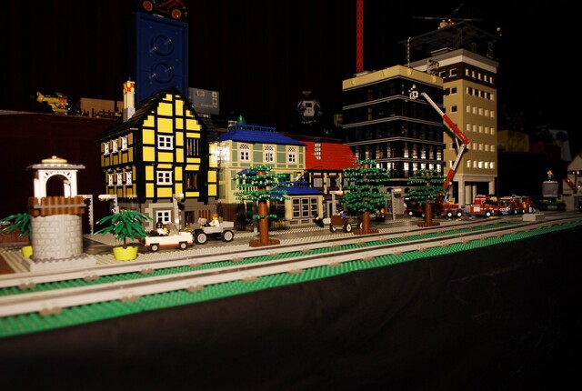
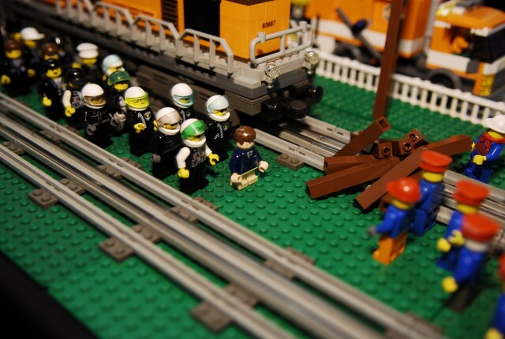
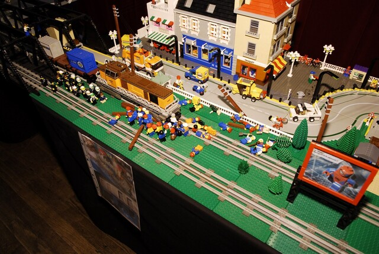

Lors de l’exposition de Sainte-Adresse quinze jours plus tôt, nous avons été contactés par l’organisateur de cette petite exposition locale.

Cette exposition se voulait sur le thème de la création, et un atelier de construction était le bienvenu.

Nous avons donc répondu présents Médérik et moi, avec un petit réseau de trains, comprenant une partie ville (quelques maisons et deux immeubles), le manoir hanté, un pont, une présentation d’un bateau de pêche, et entre tout cela, deux zones dégagées pour pouvoir construire.

Bien entendu, vu le peu de temps d’exposition, le temps de tout mettre en place, nous n’avons pas construit grand chose. Seules quelques boîtes officielles achetées récemment ont été assemblées. Malgré cela, certains visiteurs sont restés à nous regarder monter des boîtes...

Amusant.. comme quoi il n’est pas nécessaire de se compliquer pour partager notre passion.

En fin de journée, actualité oblige, nous avons improvisé une grève des cheminots, avec traverses sur les voies pour bloquer le train. L’intervention des CRS, avec notre président (si si, le petit minifig au premier plan) en première ligne, ne s’est pas faite attendre.

Une charge de la locomotive pour "déblayer" les voies à fait sensation auprès des spectateurs venu voir cela de près. Les modélistes ferroviaires n’ayant pas l’habitude de ce genre de scène.

Courte journée, mais grande rigolade.

Notre prestation leur ayant vraiment beaucoup plu, nous serons présents pour l’édition 2009, en janvier, qui cette fois-ci sera sur deux jours.

Toutes les photos :  
**–** [Galerie de photos](http://www.brickshelf.com/cgi-bin/gallery.cgi?f=352967)  
**–** [Lien vers le site FFMF](http://ffmfw.free.fr/FTM/FTM2007/Normandie/index.htm)
