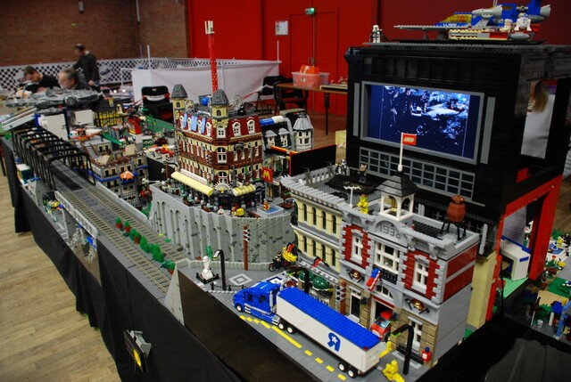
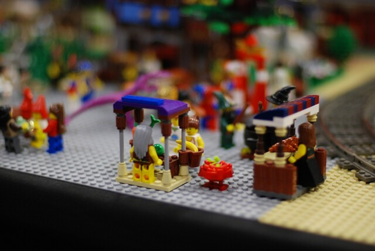
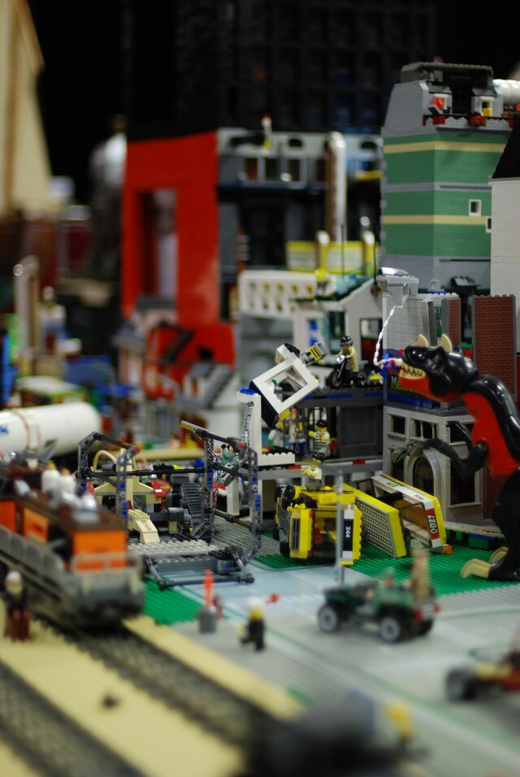

On prend les mêmes et on continue...  
L’équipe étant sympa, on a cette année été rejoints par Thomas et son père, Serge.

L’expo présentée ici était à peu de chose près la même que pour le Téléthon, mais Florence a rangé la caserne des pompiers en construction pour la remplacer par son marché médiéval.

Son lavoir et la cabane d’Hagrid font maintenant partie de la scène.  
Petite difficulté à intégrer les rails et les routes, son module ayant été créé sur place, avec ce que nous avions.

On retrouve donc toujours la vallée engloutie et les immeubles futuristes [exposés à Orléans cette année](/articles/resume-du-salon-du-modelisme-ferroviaire-d-orleans-2010/), et adossé à nous, Thomas qui a pris un malin plaisir à nous truffer sa ville de monstres, squelettes, et catastrophes en tous genres.  
Les LEGO, c’est bien connu, c’est pacifique...

Derrière notre réseau, un groupe de modélistes n’étant pas venu, par erreur de planning, une grande longueur de tables est restée vide le samedi.

Nous avons donc étalé plus de LEGO le dimanche, et cela m’a par exemple permis de présenter mon train de pompiers en statique, mais entièrement ouvert et déployé.  
Thomas a lui aussi présenté ses pompiers à côté.

Un week-end sympa, toujours dans une excellente ambiance.  
Repas convivial les midis, avec apéro, et beaucoup de rencontres.

Pour la première fois, nous n’avons pas installés de barrières autour de nos tables, et mis à part quelques enfants qui ont eu envie de jouer aux LEGO, rien à signaler.  
Une petite expo, c’est calme, et le public présent donnait confiance. Surveillance très relâchée, et bonne humeur.

Passez nous voir l’année prochaine.

Par contre, aucune idée du nombre de visiteurs, l’entrée étant gratuite, et totalement libre..., mais le Dimanche, il y avait beaucoup de monde dans les allées.

[Les photos](http://www.brickshelf.com/cgi-bin/gallery.cgi?f=463721)
