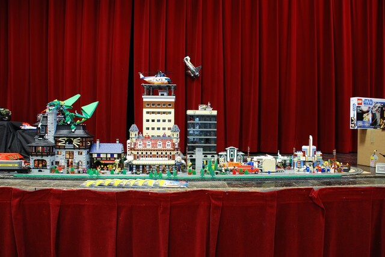
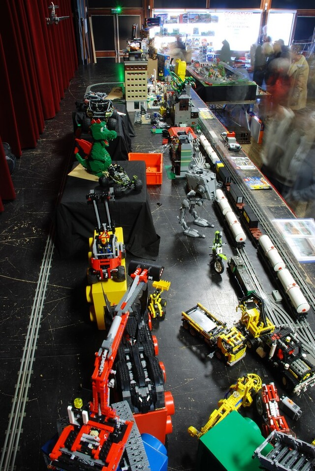
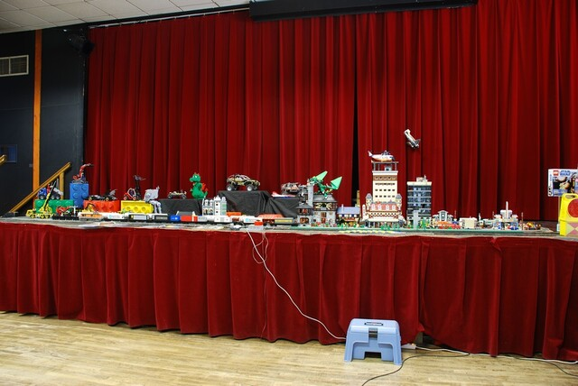
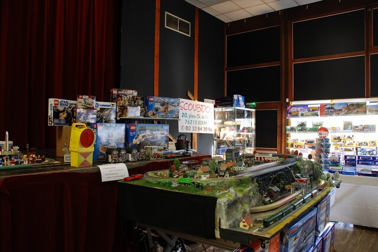
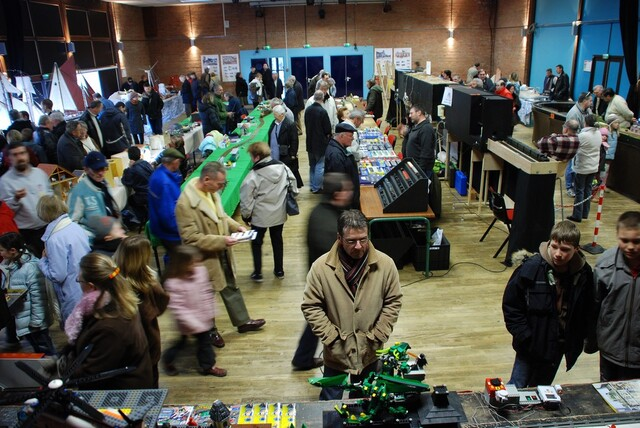
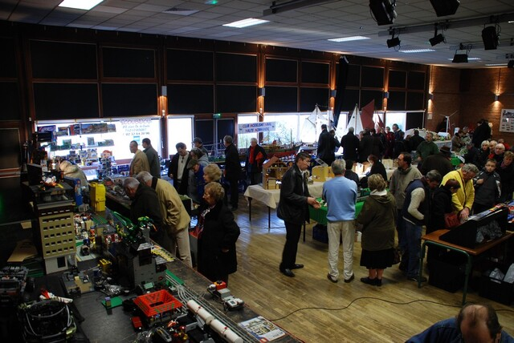

Cette année encore, les passionnés de modélisme de Bolbec, près du Havre, nous ont contactés lors de l’[exposition de Sainte Adresse](/articles/compte-rendu-de-l-exposition-modeliste-2008-de-sainte-adresse-76/), pour nous demander de participer à leur exposition.

Un imprévu (changement de boulot) me prive de mon Kangoo, très utile, et même indispensable pour véhiculer mes modules d’exposition (La mine d’Indiana Jones).

Je décide tout de même de ne pas annuler ma participation, et de trouver le moyen d’exposer quelque chose de sympa avec les modèles en réserve. Médérik a du déclarer forfait pour cette fois, et Florence était à l’autre bout de la France... Je suis donc arrivé seul pour cette exposition de deux jours, le vendredi soir pour déposer le matériel, et improviser le réseau.

Pas besoin de tables, je me suis basé sur le bord de la scène (salle polyvalente). Une grande boucle 12v, quelques voies de garage, le tour est joué. Les immeubles et les maisons placées, quelques routes pour aménager, et hop ! Une ville prend forme en moins d’une heure...

La deuxième partie est une présentation de divers modèles Technic, StarWars, et sculptures.

Je suis passé au nouveau PicWic de Barentin avant de venir, pour acheter le Green Grocer. Mon but est de le monter sur place le samedi, et qu’il soit exposé le dimanche. Il y avait tellement de monde (et j’étais seul), que je n’ai réussi à monter que le rez-de-chaussée le samedi au soir. J’ai donc emmené du travail à la maison, et le dimanche matin, il ne restait que le toit à faire.  
En passant, ce modèle est vraiment superbe.

Par contre, pour le construire, j’étais sur le bord de la scène, et j’ai fait une erreur, celle de laisser ma notice de montage sur le bord. Quelqu’un m’a pris le livret numéro 1 en pensant que c’était un catalogue LEGO...  
(Si la personne lit cet article, [merci de contacter l’association](/articles/nous-contacter/) pour me le restituer... )

Un magasin de jouets local était présent : Scoubidou.  
De nombreux sets LEGO étaient à vendre, dont les deux trains RC.

L’ambiance était décontractée, et les visiteurs nombreux (entrée libre).

Le dimanche soir, j’étais encore une fois le dernier à finir de ranger, et les exposants encore présents ne me croyaient pas lorsque je leur disais que tout rentrait dans une ZX... (même pas break). Et pourtant, pas une brique n’est restée sur place !

Comme quoi, on peut faire une exposition sans préparation particulière, et faire sensation...

