C’est la seconde participation de FreeLUG au salon du modélisme ferroviaire d’Orléans. Pour situer un peu mieux cette participation, citons quelques chiffres : 14 membres de notre association ont été accueillis par l’[AMFC](http://perso.orange.fr/amfc/) [^1]. Lors des deux journées de cette édition, plus de 8900 visiteurs ont admiré un réseau long de 28m x 2,5m et au déroulé de voies d’environ 90m.

Contrairement au « Mondial de Paris » qui s’étend sur 5 jours, cette exposition est spécialisée sur le modélisme ferroviaire et nous nous attendions donc à de nombreux commentaires d’amateurs très éclairés.

## Description du réseau

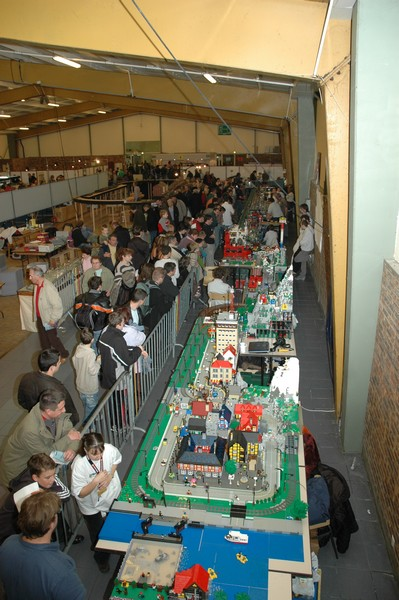

**vue aérienne**

les 28 mètres du réseau, dont il est difficile de voir le bout...

[Voir le plan schématique du stand](http://photos.freelug.org/main.php/v/Frogleap/ExpositionsLego/PreparationAMFC2006/plan-stand-Freelug-17.jpg.html?g2_imageViewsIndex=1).

Didier Malon débutait le réseau avec une large boucle dotée d’une voie de garage. Une très belle scène de campagne décorait celle-ci, ornementée d’une éolienne motorisée mais surtout d’une zone de chargement de charbon pour la 141R.

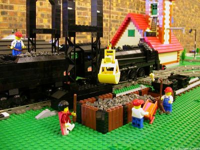

Cette boucle était le point de départ d’une très longue ligne droite d’environ 15m en double voie le long de laquelle Daniel Goberville avait placé sa gare de triage, elle-même équipée d’un pont transbordeur parfaitement fonctionnel.

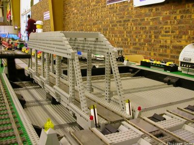

Notons la taille exceptionnelle de celle-ci, qui grâce à ses 8m a permis de stocker le matériel ferroviaire prêté notamment par Alban Nanty, Xavier Viallefont et Erik Amzallag.

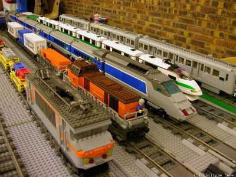

A la suite, la rotonde et l’atelier de réparation de Christophe (tof du 9-3) a permis d’exposer la superbe 231 vapeur de Pascal « LeGnome ».

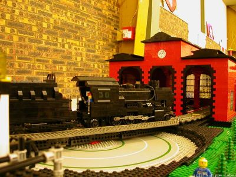

Comme de nombreux wagons fret étaient présents, il fallait bien prévoir une station de chargement - c’est Philippe qui s’en est chargé avec son pont roulant dédié au transbordement intermodal des conteneurs et sa grue.

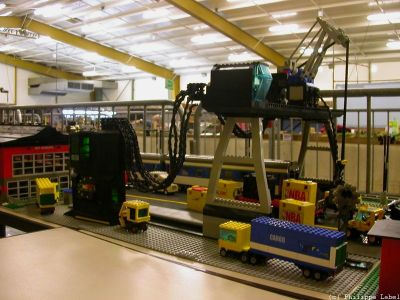

Le module de Loys présentait sa fameuse caserne de pompier qui a toujours attiré autant l’attention des personnels de la commission de sécurité qui passent avant l’ouverture au public. Sa gare (décidément Loys adore les gares) était, quant à elle, un inédit, qui a rencontré et c’est peu de le dire, un énorme succès.

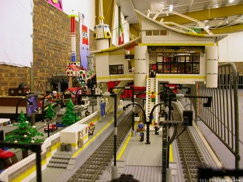

Sébastien, fan de Technic, a lui aussi rencontré un fort succès avec sa caméra type « louma », que le public pouvait piloter tout en observant le résultat sur le vidéo-projecteur.

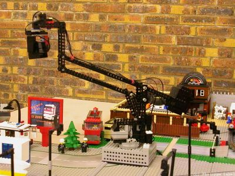

Gilles pour sa part avait « Mindstormisé » un métro (le métro automatique de la ligne 14 à Paris). Les minifigs empruntaient alors un escalator pour remonter en surface qui leur permettaient d’aller visiter un moulin à papier, là encore fonctionnel, eau comprise, réalisé par Denis Laurençon. Montant ensuite via le funiculaire, les minifigs poursuivaient leur visite par le sentier de crête contournant le donjon en ruines surplombant la vallée.

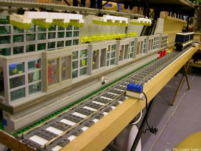

[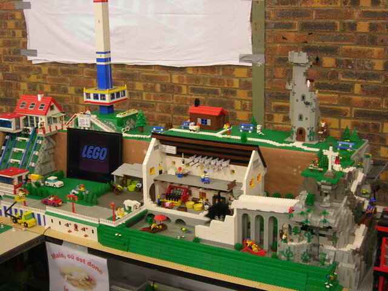](https://www.freelug.org/IMG/jpg/Mon_module_3.jpg)

Un peu plus loin, débutait l’impressionnant (par la taille mais pas uniquement) module de Nicolas. Montagnes enneigées, chalets et pont ferroviaire en bois superbement réalisés. D’ailleurs la magnifique rame VB2N apportée par Erik a pu apprécier le point de vue sur le pont depuis le haut, comme depuis le bas (voir plus loin SSSTOOOPPP !!!)

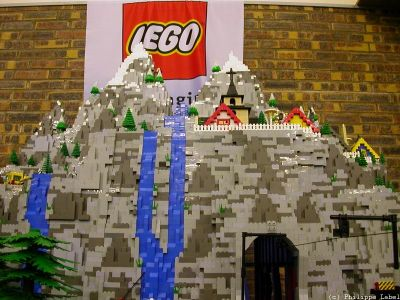

Cela faisait la transition parfaite avec la scène plus moderne des Havrais de passage (Médérick, Florence et Pascal), qui nous présentaient des bâtiments modernes (comprendre de grande taille) conservant toutefois un charme grâce à leur petites échoppes en rez-de-chaussée et aux fleurs témoignant de la touche féminine de l’équipe. Le réseau se terminait à nouveau par une boucle traversant une petite cité médiévale au bord de l’eau.

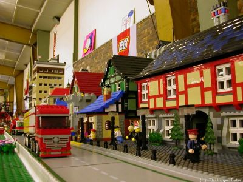

## Animation du stand

Didier (l’autre), notre ambassadeur est passé nous soutenir et pas que moralement, car il a entreprit de mettre à jour sa bibliothèque de modèles de trains Français et ses fichiers MLCAD - vous retrouverez d’ailleurs ici les notices de montages de petits éléments présents à Orléans :

**–** Le lapin : [Notice](http://photos.freelug.org/main.php/v/6studs/orleans2006/lapin.JPG.html)

**–** Le wagonnet à charbon pour la 141R de Didier : [Notice](http://gallery2.freelug.org/main.php/v/6studs/orleans2006/notices+de+montage_001/Wagonnet600.JPG.html)

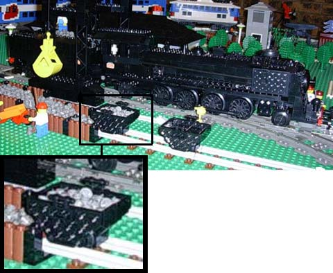

**–** La voiture du train touristique : [Notice](http://photos.freelug.org/main.php/v/6studs/orleans2006/touristique/)

[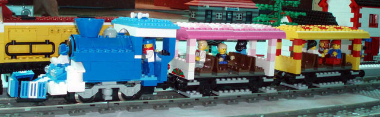](https://www.freelug.org/IMG/jpg/wt800.jpg)

De nombreux FreeLUGiens de passage sont venus nous dire un petit bonjour et nous avons été heureux de recevoir tout le monde, même si nous n’avons pas eu la chance de pouvoir serrer la main à chacun(e) (surtout à Simone ;-) [^2]).

Ce qui a surtout été marquant pour nous, c’est cette première journée très chargée, d’accord il pleuvait dehors, mais je crois que nous pouvons quand même rendre hommage au public Orléanais pour son accueil et nous ne saurons jamais le remercier assez (si, peut-être dans deux ans...) pour ses encouragements.

Remercions également nos FreeLUGiens locaux pour l’efficacité de leur organisation et leur mobilisation pour faire de cet évènement une grande fête très réussie.

Un grand merci aussi aux sponsors qui ont apporté leur soutien, notamment le magasin PIC-WIC de Sainte-Geneviève-des-Bois par le don de petits sachets hélicoptère LEGO et le groupe MARS par le don de friandises. Ces cadeaux ont été distribués aux enfants à l’occasion d’un jeu organisé sur le diorama dont le but était de retrouver la minifig FreeLUG. Nous sommes arrivés à bout du stock dès le samedi soir, c’est ce qu’on peut appeler la rançon du succès.

Le réseau en chiffres :  
**–** Un espace de 28m x 2,5m,  
**–** environ 90m de voies développées,  
**–** 14 rames en circulation ou en présentation,  
**–** 19 locomotives présentées au total, là-aussi en circulation ou en présentation statique.

Soulignons que l’ensemble du réseau était alimenté et commandé en [DCC](http://train.modele.free.fr/index1.htm?page=digital0.htm)". Philippe, qui est à l’origine de l’[adaptation pour ce réseau](/articles/integrer-un-module-dcc-dans-un-moteur-9v-lego/) [^3] et qui "pilotait" la commande digitale, en a prouvé la grande souplesse d’utilisation. Une partie de ce matériel nous a été généreusement prêtée par Nicolas, propriétaire du magasin de jouets "[Au P’tit Magasin Bleu](http://www.magbleu.com/)" situé rue du faubourg Bannier à Orléans, et dont voici la reproduction par Pascal. A noter pour ceux qui souhaiteraient encore le voir, qu’il est présenté dans la vitrine du vrai magasin, jusqu’aux fêtes de Noël, avec un petit diorama.

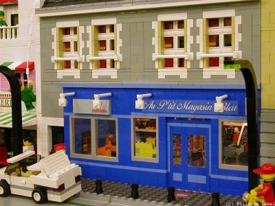

En résumé, le mot d’ordre de cette exposition aurait pu être :  
"STOOOOOOOP !!!!!" :)  
Car le réseau était tellement grand, que du pupitre de commande, il était impossible d’avoir la vue complète du parcours. Il était fréquent de perdre un train de vue, et lorsqu’un déraillement survenait à l’autre bout du réseau (ce qui est arrivé un bon nombre de fois...), un grand "Stooooop" retentissait dans le hall d’exposition... (encore pardon aux autres stands, à qui nous avions déjà volé une grande partie des spectateurs...)  
Bref... Un weekend sous le signe de la bonne humeur.

## Galleries de photos et vidéos

Photos :  
**–** [photos de Jac](http://www.brickshelf.com/cgi-bin/gallery.cgi?f=215312)  
**–** [photos de Brickerik](http://www.brickshelf.com/cgi-bin/gallery.cgi?f=215329)  
**–** [photos de Didier M.](http://gallery2.freelug.org/main.php/v/La-Gallerie-de-qdm/Expositions/2006-Orleans/)  
**–** [photos de frogleap](http://photos.freelug.org/main.php/v/Frogleap/ExpositionsLego/PreparationAMFC2006/PhotosAMFC2006/)  
**–** [photos de Didier E.](http://www.brickshelf.com/cgi-bin/gallery.cgi?f=215374)  
**–** [photos de Legnome](http://www.brickshelf.com/cgi-bin/gallery.cgi?f=215363)  
**–** [photos de Sébastien](http://www.brickshelf.com/cgi-bin/gallery.cgi?f=215203)  
**–** [photos de Nicolas](http://www.brickshelf.com/cgi-bin/gallery.cgi?f=180922)  
**–** [photos de f1tvf](http://photos.freelug.org/main.php/v/f1tvf/expositions/Orleans2006/)  
**–** [photos de DenisL](http://gallery.freelug.org/main.php/v/dlaurencon/Orleans+2006/)  
**–** [photos de Chimere](http://www.brickshelf.com/cgi-bin/gallery.cgi?f=215713)

Vidéos :  
**–** [vidéos de Didier M.](http://gallery2.freelug.org/main.php/v/La-Gallerie-de-qdm/Expositions/2006-Orleans/Video/)  
**–** [vidéos de Didier E.](http://photos.freelug.org/main.php/v/6studs/orleans2006/videos/)  
**–** [vidéos de Chimere](http://gallery2.freelug.org/main.php/v/Chimere/Orleans2006+Videos)

## Les participants

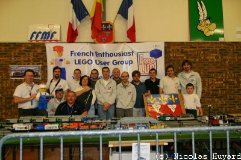

De gauche à droite : Didier Malon, Pascal Bréard, Denis Laurençon (accroupi), Daniel Goberville (accroupi), Frédéric Goberville, Simone Huyard, Christophe Connan, Nicolas Huyard, Philippe Label, Erik Amzallag, Médérick Guilbert, Sébastien Hamon, Gilles Micheletti, Loys Bailly, Jamy Bailly (devant). Participants absents de la photo, Alban Nanty et Xavier Viallefont.

[^1]: Association des Modélistes Ferroviaires du Centre

[^2]: Simone arrivée plâtrée suite à une double fracture au bras - Nous lui souhaitons tous un prompt et complet rétablissement

[^3]: Sur la base du travail de Mark Riley
