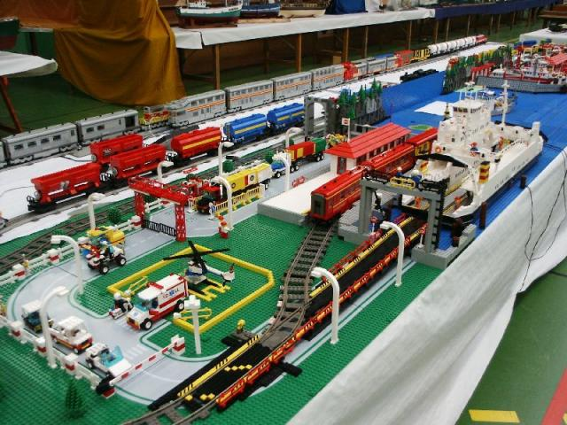
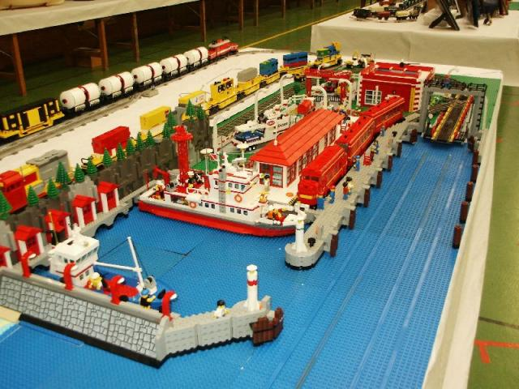

Le week-end du 20 et 21 Mai 2006 s’est tenu le 3ième salon de la maquette à Saint Martin des Champs près de Morlaix.

Les visiteurs sont venus très nombreux, le plateau des exposants était de belle qualité avec surtout, pour la première fois, la présence d’un stand d’un passionné de LEGO.

Ce stand fut très remarqué et apprécié (parfum de nostalgie chez les adultes).

Pour le public, votre correspondant de FreeLUG avait proposé deux réseaux :

1.  train + ferry que certains avaient vu à l’AG du club ;
2.  un panorama de mes locos, wagons, motrice de montagne.

**Le ferry à quai**

A quai, le ferry. En arrière plan, on distingue de nombreuses rames dont une Santa-Fe à double niveau.

Le jury du salon m’a récompensé (coup de coeur) et j’ai reçu une belle coupe de 34cm de haut.

Des contacts ont été noués avec Saint Brieuc, Lorient, Quimper, Brest.

**Vue du port**

Vue du port avec le bateau pompier.

Pour Toulouse, le train + ferry sera de retour dans sa forme définitive (j’espère).

Prochain rendez-vous du salon de Saint-Martin en 2008.

[La galerie photos complète](http://photos.freelug.org/main.php/v/barr__/)

Jean-Marc
