Lors du week end du 11 novembre, FreeLUG participait au 13e festival de la miniature, à St Rambert.

Cette année, l’ADImin, le club organisateur, s’y est prit largement en avance pour nous inviter, et ils ont mit les petits plats dans les grands pour notre venue.

Alors je commence par remercier grandement Vincent Ogier et son équipe de l’ADImin pour leur accueil superbe et très sympathique. Les petites choses à notre égard, tel que l’hôtel offert, notre emplacement déjà monté à notre arrivée, nous ont permis de passer un week-end d’exposition très agréable.

Cet évènement est la plus grande exposition régionale, sur 1500m² dans deux halls. 3000 visiteurs ont été comptés.

Toute l’équipe des Afols de Rhône-Alpes était assez frustrée par l’annulation de l’exposition lyonnaise. Mais ils ont joué le jeu, et ils ont reporté leur énergie sur l’exposition dromoise. Résultat, 9 participants pour monter un réseau de 18m de long sur 3 de large...

[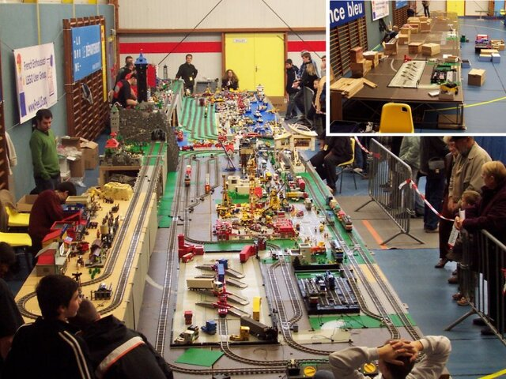](https://www.freelug.org/IMG/jpg/StRambert01.jpg)

**Table d’exposition**

Au début et à la fin !!

La première opération après la perception de notre emplacement fut le montage des tables BàB pour l’étage supérieur. Cette opération est maintenant très optimisée, et il ne faut pas longtemps pour monter les 17 tables. Notez que nous avons défini une hauteur de 40 briques pour l’étage supérieur, soit aussi la taille d’une plaque 48x48. Vous verrez sur les photos, l’usage de ces plaques 48x48 pour cacher l’espace entre les niveaux semble être un standard à conserver.

Ensuite, le montage des modules a commencé, et il a fallu 10 heures pour être prêts à l’ouverture au public le samedi matin à 10h.

La table se présentait en trois parties. Il y avait la grande zone portuaire de JeanG constituée d’un très grand nombre de sets LEGO. Une jolie touche humoristique avec la manifestation des dockers "Tradilug" face à une impressionnante compagnie de CRS.

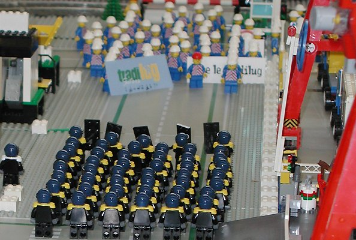

**La Manif**

Finalement, ils ne se sont pas mis dessus :))

De l’autre coté, une large partie urbaine Moc avec, dans le désordre, un pond transbordeur (Brice), une zone Modalohr (Denis), une quartier pompier/chantier (Pierre C) et un quartier gare avec son avenue (Loys).

En second plan, et en hauteur, nous avions monté une ligne droite de train sur la totalité de la longueur, soit 18m, pour faire des essais de vitesse. Essais assez concluants et surtout très amusants. Aller voir les vidéos ! Sur cette ligne droite, il y avait le village de Jérôme, le mini golf de Banban, la gare de Pierre L, le retour du module vache de Denis, ainsi qu’une montagne et un nouveau viaduc modulable très intéressant, et enfin le coin far-west de Xavier qui s’est défoulé sur les fenêtres des maisons en Snot !! :)

Au final, nous avons donc passé un excellent week-end. Je suis assez satisfait d’avoir trouvé de nouveaux Afols qui semblent très motivés pour faire d’autre expositions, à savoir Pierre et Pierre !! :))

Merci à vous tous pour votre participation et votre prestation qui fut de première qualité. Et sachez d’ores et déjà que nous sommes invités à revenir dans 2 ans !! :)

* * *

## Banban

A cause de mon éloignement géographique, j’ai tenté une nouvelle expérience avec l’aide de Loys et Denis : participer à une exposition par procuration. Sachant que Denis a un stock de LEGO inépuisable, je lui ai proposé de concevoir un petit MOC qu’il pourrait ensuite construire avec ses briques et exposer le jour de l’exposition.

Le petit MOC s’est rapidement transformé en module pour des raisons de facilité de placement. Mais je savais qu’une telle surface allait accroître leur charge de travail. Ils avaient déjà sans doute beaucoup à faire à construire leurs propres modules.

Puis très vite la contrainte de temps s’est manifestée. En effet, je devais concevoir, construire et modéliser sous [MLCAD](http://www.brickwiki.org/index.php?title=MLCAD) bien avant la date de l’exposition pour laisser le temps à Loys et Denis de construire le module chez eux. Bien sûr, j’ai délivré des versions intermédiaires de la notice de montage afin qu’ils puissent monter leur exemplaire en parallèle ; cela dit les délais étaient quand même assez courts, et j’espère que lors de la prochaine exposition de mon module, ils auront le temps de mettre les minifigs ! :-)

[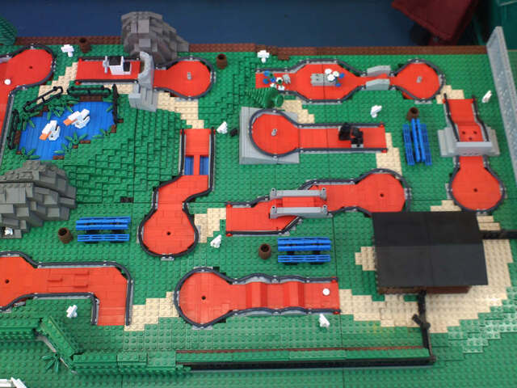](https://www.freelug.org/IMG/jpg/PICT0051.jpg)

Il m’arrive de concevoir des MOC uniquement en virtuel, mais pour un module entier, j’ai senti le besoin de le construire en réel chez moi, afin de mieux me rendre compte du résultat. J’essayais d’éviter d’utiliser des pièces trop spécifiques ou rares pour faciliter le travail de mes compères, ce qui m’a apporter de nouveaux challenges. Pourtant il semblerait que certains montages aient été encore trop alambiqués, montages qu’ils ont vite qualifié de "banbanteries"... :-)

Ce qui est amusant, c’est que j’ai démonté mon exemplaire **avant** la date de l’exposition, et à vrai dire c’est la première fois que j’expose un modèle déjà démonté. :-)

Bien sûr c’est un peu frustrant de ne pas pouvoir être présent parmi les autres exposants le jour J, mais l’expérience fut tout de même assez réjouissante, et je remercie encore mes partenaires Loys et Denis pour avoir rendu cela possible.

* * *

## Jac

C’est avec grand plaisir que j’ai chargé ma voiture, et fait le trajet qui me sépare de St Rambert pour me joindre à la construction de ce réseau démesuré. Après 2h30 de route, je débarque enfin dans cette double salle qui allait nous accueillir pour le week-end. Pourtant, le plus impressionnant n’était pas la taille de la dite salle, mais plutôt, celle de l’emplacement de notre réseau : 18x3m, tout cet espace vide à remplir !

Certains membres connus étaient déjà arrivés, et je découvre quelques nouvelles personnes que l’on rencontre toujours avec plaisir. De ce moment, la construction commence pour moi, c’est à dire, vers 18h30. Elle se terminera vers 10h30, le matin. Bien sûr, nous avons pris un repos bien mérité, dans une chambre d’hôtel réservée par l’ADImin. Ce qui donne en tout une bonne dizaine d’heures de construction...

Tout s’est fait dans la joie et la bonne humeur. Quelques aménagements nous ont permis de séparer en plusieurs réseaux, et d’éviter ainsi les accidents. Pourtant, cela n’a pas complètement empêché le risque et j’ai du ramasser les morceaux du train de Denis par terre... Je suis sûr qu’il y a des photos !

Ce fut un week-end très agréable de jeux, de conduite, alterné de discussion, de rencontre, et de visite de membres éloignés. Je ne cite aucun nom, pour ne pas en oublier, j’espère que vous m’excuserez, et que vous vous reconnaîtrez dans ces quelques phrases...

Le démontage a été très rapide, en comparaisons du temps de montage, bien sûr. Et les départs de chacun ont commencé. D’abord avec celui de Brice qui devait prendre le train. Ce n’est pas le meilleur moment, je vous assure. Mais, c’est compensé par les deux jours passés qui restent en mémoire.

Chaque construction est une pièce de plus à notre expérience en exposition. Sans chercher la perfection qui est ennuyeuse, nous avançons vers encore plus de jeux, et de convivialité. C’est un but qui me va...

* * *

## Denis

St Rambert d’Albon 2007 est un grand cru pour les AFOLs de Rhône Alpes. Je ne reviendrai pas sur l’immense qualité d’accueil de ADImin qui ne donne qu’une envie, celle de revenir dans deux ans, en 2009...

Pour le reste, des LEGO, et encore des LEGO, et surtout des Afols (et pour certains leur compagne) ont fait de ce très court WE un petit moment de rêve dans un monde de brutes.

Ville, immeubles, pompier, montagne, police, camions, gares, trains, port, transbordeur, viaducs, bateaux, voitures, MOC (même des canadiens - Pierre, merci de ta visite) et modèles officiels cohabitent pour la plus grande joie des visiteurs.

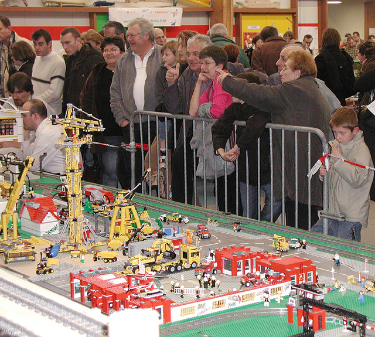

**Ho ! les vaches ! elles tournent la tête comme à la maison !**

Et puis aussi l’expérience de construction à distance avec Loys et Banban. A cette occasion est donc née une nouvelle technique de construction en LEGO : la banbanterie. Cette technique très particulière consiste, par exemple, à faire un banc avec 41 pièces alors qu’il existe un banc LEGO en une pièce. (cette technique a aussi permis à Loys de s’exprimer, par moment, dans un langage que je ne saurais traduire ici...)

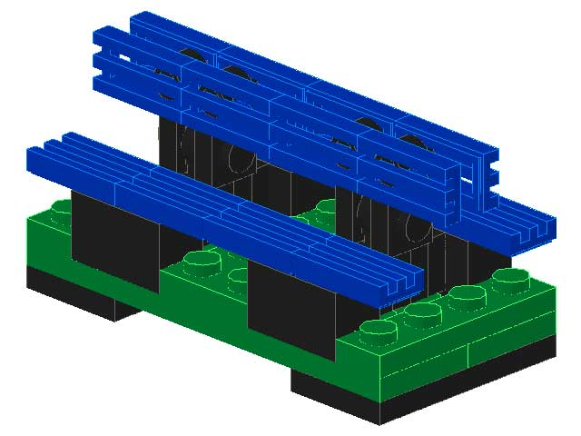

**Banbanterie : le banc à Banban.**

Enfin, cette exposition nous a aussi permis de rencontrer Mr Christian PLOUSSEY qui est le délégué RA de la FFMF, et avec qui nous avons richement échangé pour le futur, relayant ainsi dans notre région ce qui a déjà été initié au niveau national.

Alors, c’est dit, rendez-vous dans deux ans à St Rambert, le week-end du 11 novembre 2009 !

_PS : suite à interview réalisé avec DE, nous sommes fiers de pouvoir vous annoncer que GalaLUG N°1 sera bientôt dans tous les bons kiosques à journaux._

* * *

## JeanG

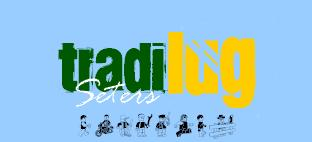

Depuis Ceyrat, en mars dernier, le Tradilugien que je suis avait porté toute son énergie sur le thème des sets aéroports : la dernière exposition était le 29 septembre à Dijon. La préparation de cette nouvelle exposition devait changer de thème : alors j’ai choisi le thème du port de marchandise. Tout comme dans la série "mission impossible" je devais sélectionner les sets officiels qui viendraient combler mon layout et me combler moi. La sélection fut plutôt assez simple tout comme le layout.

Après 5h de route avec Oriana et David depuis la Bourgogne nous arrivons enfin à la salle que nous espérions tant. Fatigué par le voyage je fus vite en pleine forme dès que j’ai commencé à monter. Le montage a duré 6h, mais c’est 6h de bonheur !

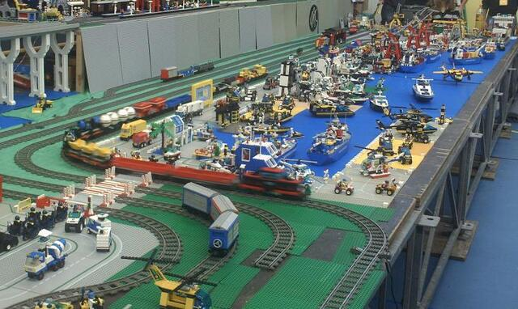

Une fois le travail terminé le résultat de notre exposition fut très impressionnant. Je dois dire que la première chose sur laquelle je me suis arrêté c’est le poids lourd de la poste de Denis qui fut pour moi une merveille. Et tout au long de l’exposition on découvre petit à petit les modules géniaux des autres.

Les organisateurs sont d’un accueil irréprochable et le public toujours aussi émerveillé !

Dans ma zone je me suis prêté au jeu avec Denis et j’ai donc fait faire une manifestation de 80 ouvriers du train contre les mocs et pour le Tradilug... 100 policiers maintenaient l’ordre.

Le Tradilug se réjouit de vous annoncer un nouveau record avec 150 sets officiels sur l’ensemble de l’exposition. Je remercie les deux Pierre qui sont de véritables Tradilugiens !

Mais il ne faut pas oublier que je suis un peu MOCER (sans jeu de mot, quoique :) la grosse surprise était de vous présenter un MOC cargo Maersk Sealand de 1.20m de long portant 144 containers à son bord (containers aux dimensions de ceux du set 4549).

Si je fais le bilan : j’ai été très content de revoir mes potes FreeLUG du Sud, content d’avoir sympathisé très rapidement avec les nouveaux... je remercie les FreeLUGiens non exposants qui nous ont fait l’amitié de venir nous voir. Je remercie Pierre Normandin pour l’échange amical que l’on a eu et j’espère pouvoir un jour venir exposer chez toi au Québec.

Bravo à Denis et Loys pour votre patience, vos efforts et votre travail pour cette exposition qui restera sans nul doute dans nos mémoires.

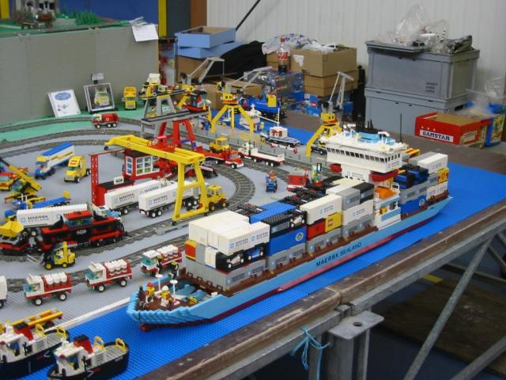

**Bateau Maersk**

* * *

## Pierre C

_Vendredi 9 novembre 2007, Lyon, 19h_

Ca y est je pars de chez moi. La voiture est pleine. Direction ? St Rambert d’Albon pour ma première exposition. En plus cela va être aussi ma première rencontre avec d’autres membres de FreeLUG... L’impatience me gagne. Une vraie petite pile électrique, ma copine peut en témoigner.

1h30 (et quelques bouchons plus tard) me voici arrivé à la salle de l’exposition. Accueilli par des membres de l’ADImin, ceux-ci m’indiquent la grande table où mes camarades FreeLUGiens se sustentent. Premier contact chaleureux. Tout le monde a l’air gentil.

L’installation du stand se passe bien. Les modules se raccordent à merveille. Cela grâce au travail de fond de Loys pour mettre en place ce layout.

Bon, il est déjà plus de minuit. Tout le monde va à l’hôtel pour laisser les organisateurs dormant sur place pouvoir se coucher.

_Samedi 10 novembre 2007, St Rambert, 10h_

L’exposition commence enfin ! Le public est au rendez-vous. Je passe deux jours à discuter LEGO avec tous le monde, que ce soit les autres Afols ou avec le public qui nous aborde, ébahi par la taille de notre décor/réseau.  
J’en profite pleinement car il faut dire que je rencontre enfin d’autres Afols...

[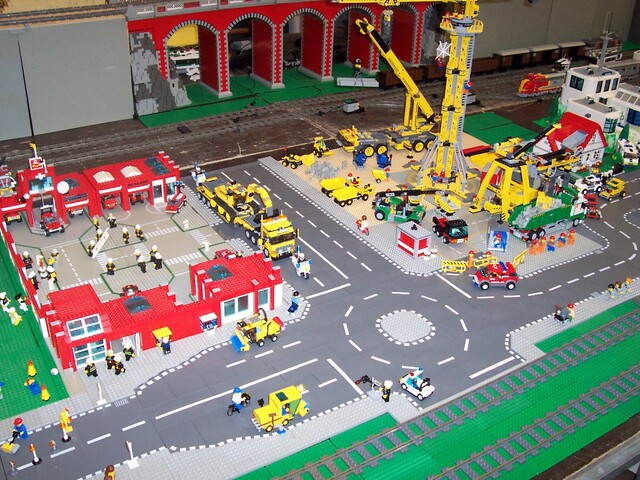](https://www.freelug.org/IMG/jpg/100_3631.jpg)

**Vue d’ensemble de mon module**

Pour ma première exposition j’ai réalisé une caserne de pompiers (sur la base du set 6389) et un chantier de construction plein de sets officiels (cela a fait plaisir à JeanG)

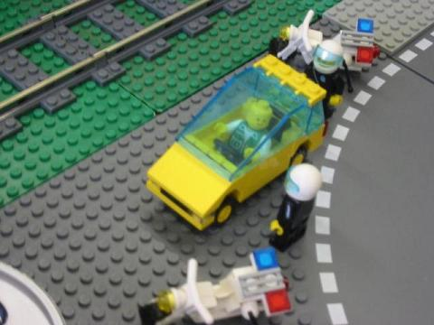

**Les contrôles de police étaient accrus en raison de la manifestation Tradilugienne**

_Dimanche 11 novembre 2007, Lyon, 23h_

Me voila rentré chez moi. Pleins de souvenir dans la tête. Je n’ai envie que d’une chose : recommencer...

Je tiens à remercier tous mes camarades de l’exposition ainsi que les autres FreeLUGiens qui sont venus nous voir à St Rambert pour leur accueil si chaleureux au sein de l’association.

Je tiens aussi à remercier ma copine qui a bien voulu faire le déplacement avec moi et qui s’est chargée de faire mes photos.

* * *

## Pierre L

Pour moi aussi ce fut ma première exposition, bien que j’en avais déjà rencontré certains lors de la REF07.  
J’étais bien content d’arriver enfin au résultat final de cette préparation de l’exposition qui a été menée de main de maître par Loys et Denis, et tout ceci par ordinateurs interposés... c’est ça qui fait que l’on profite encore plus de l’exposition.

Ce fut donc un super week-end, où l’on a construit LEGO, parlé LEGO, pensé LEGO, échangé LEGO, et enfin détruit LEGO... pour mieux reconstruire... etc.

Lors de mon inscription pour l’exposition, je ne savais pas encore quoi exposer, c’est ainsi que l’on m’a proposé de réaliser la gare TGV.

Et me voilà parti dans la grande aventure des expositions.  
Je me suis donc mis à travailler dur...(enfin bon tout est relatif car personne ne m’a obligé et je suis prêt à recommencer de plus belle...) pour remplir de LEGO les 3 modules que l’on m’a confié (2 plaques 48x48 sur 6 plaques 48x48).

J’ai donc réalisé une gare TGV à partir de 3 boites 7997, la dernière gare présentée par LEGO, avec un beau parvis à  
l’entrée de la gare.

Sur le côté gauche j’ai mis mon Corner Café avec le Market Street et entre les deux un bâtiment personnalisé de type médiéval, avec au bout un petit chantier de démolition.  
Sur la droite de mon module, et mitoyen avec le minigolf de Banban, un petit parc pour que les minifigs puissent se reposer après une rude partie de golf ; ou bien en attendant leur train.

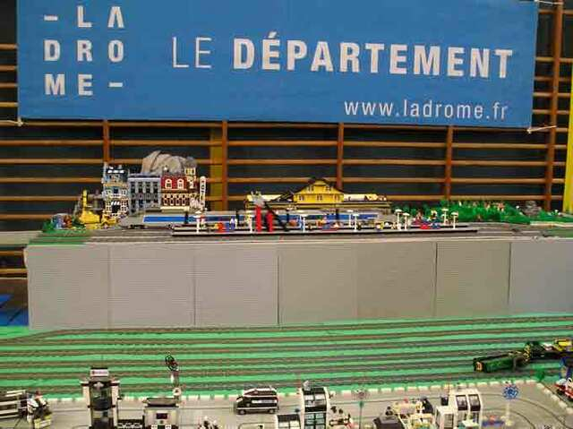

**vue d’ensemble**

Voilà pour ma réalisation et participation à l’exposition.

Sinon j’ai trouvé que tous les participants ont réalisé de superbes choses, j’ai bien aimé la montagne de Denis avec ses viaducs et le rond point de Pierre C qui ouvre de nouvelles perspectives de réalisation autoroutière en LEGO !  
C’est vrai que l’on se retrouve fier de ses réalisations puisqu’on les présente à d’autres Afols ainsi qu’au public qui est venu en masse.  
Ce fut donc une expérience unique et tout simplement géniale. Je viens donc d’attraper le virus des expositions !

Merci à toute l’équipe d’avoir passé un superbe week-end.  
Voilà je crois avoir tout dit.

Et pour finir, je conseille à tout Afol d’exposer ses réalisations, d’aller au contact des autres, surtout avec notre magnifique passion que sont les LEGO !

* * *

## Brikolego

C’est bien les afols vous écrivez mieux que moi alors rien d’autre à dire "_c’était bien quoi_" (NDLR à dire avec l’accent). Vive les lignes droites et longue vie au 4511 de Denis....

* * *

Les photos :  
**–** [Jac](http://gallery.freelug.org/main.php/v/JAC/Exposition/St-Rambert-2007/)  
**–** [Loys](http://gallery.freelug.org/main.php/v/Chimere/St+Rambert/)  
**–** [Xavier](http://gallery.freelug.org/main.php/v/vroum/)  
**–** [Pierre Laurenge](http://gallery.freelug.org/main.php/v/pierrel/exposition/)  
**–** [Pierre Charles](http://gallery.freelug.org/main.php/v/Pierre_13/Rambert/)  
**–** [Jean G](http://gallery.freelug.org/main.php/v/JeanG/Saint+Ramber+2007/)  
**–** [Denis - BaB](http://www.brickshelf.com/cgi-bin/gallery.cgi?f=285022)  
**–** [Plan et videos](http://gallery2.freelug.org/main.php/v/Chimere/St+Rambert/)
