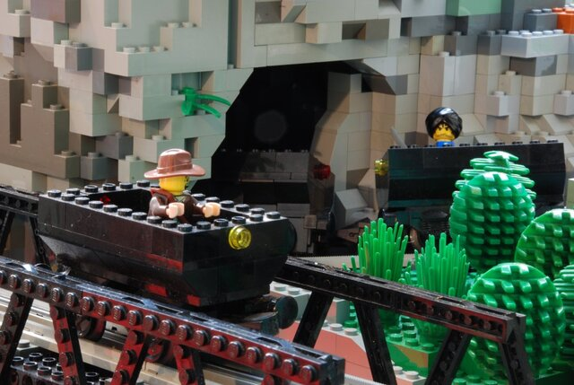
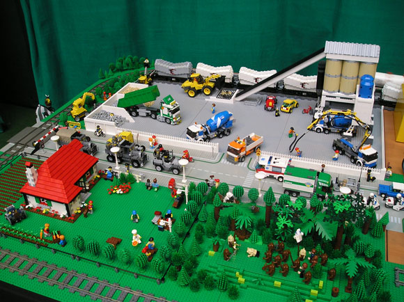
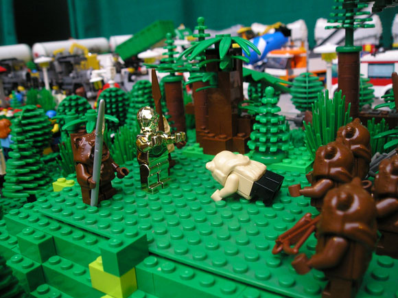
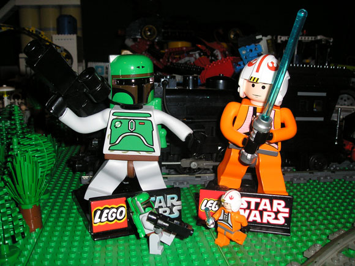
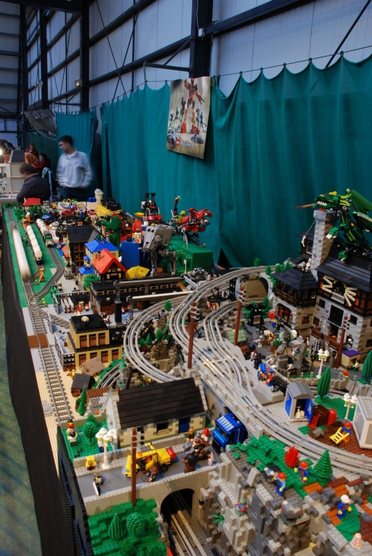
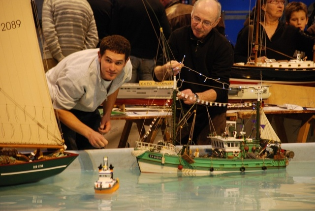
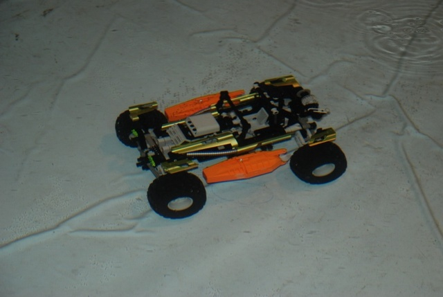
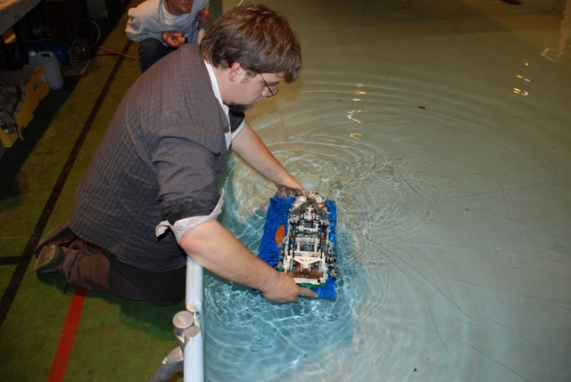
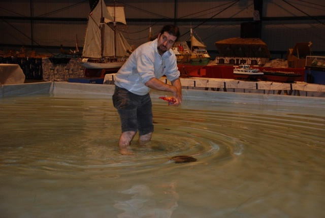
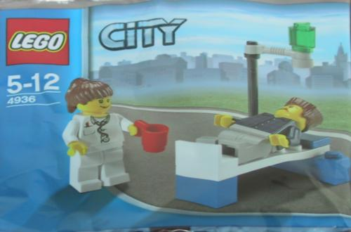

Comme l’année précédente, Médérik, Florence et moi-même avons exposé du LEGO, à la surprise générale des visiteurs. Nous avons été rejoints le vendredi soir par Pierre, venu avec sa centrale à béton.

## 700 km pour une exposition...

Lorsque Pascal a proposé cette exposition sur la liste, je me suis dit que c’était l’occasion d’aller me promener en Normandie et de rencontrer d’autres Freelugiens que je n’ai pas beaucoup l’occasion de voir. Et puis, le week-end suivant, c’était Orléans, et je voulais y passer en visiteur... J’ai donc pris une semaine de congés au milieu... (merci patron !)

Je suis donc parti le vendredi vers 15h... 700 km et 7 heures de route plus tard, je suis arrivé dans la salle d’exposition à Saint Adresse où il y avait encore Pascal et Médérik qui peaufinaient leurs créations.  
C’est donc à partir de 10h du soir que je me suis lancé dans la construction de ma partie.

J’avais juste prévu de mettre ma centrale à béton, déjà présenté à [Estivareilles](/articles/estivareilles-2008/), et j’avais pris en vrac une maison, et puis du Star Wars, et puis quelques idées en tête...

Donc voici ce que j’ai réussi à faire...

**ma p’tite partie**

Je me suis amusé à mettre pas mal de minifigs et des véhicules, c’est comme même plus vivant avec...

J’ai eu la grande chance d’avoir le C3PO en gold... et je n’avais jamais eut l’occasion de le mettre en scène lors d’expositions. Et bien c’est chose faite maintenant.  
C3PO sur Endor...

**C3PO et les Ewoks**

j’avais amené la statue d’Anakin que j’avais, je l’ai accompagné de Babo Fett (merci Xavier !), elles rendent bien ensembles !

**Anakin avec Boba Fett**

Voilà donc pour ma participation.  
Mais tout ceci n’était rien en comparaison des créations de Florence, Médérik et bien sur la montagne de Pascal !

Je tiens à remercier tout particulièrement les parents de Médérik de m’avoir accueilli durant ces quelques jours et merci encore pour la visite du Havre !

Et puis n’hésitez pas à faire des kilomètres pour participer à une exposition... ça vaut le coup !

* * *

Nous sommes arrivés avec le matériel le jeudi soir pour commencer l’installation. Surprise, l’emplacement était déjà occupé par une loco "vapeur vive", seule sur une table, et personne autour...

Il n’y a qu’à la déplacer... Oui, sauf que la bête pèse plus de 100Kgs...

Avec l’aide de quelques courageux, nous avons donc pu récupérer notre emplacement. Les tables modulaires sont vraiment pratiques. Pour leur première utilisation, elles sont arrivées déjà meublées. Cette solution est plus rapide que d’avoir plein de maisons ou éléments composant une montagne. Lors des dernières expositions, c’était mon point faible. En effet, retrouver les éléments, et leur ordre de montage, ça prend du temps, et il faut ajuster les tables. La montagne trouve donc naturellement sa place très rapidement. Jusque tard dans la nuit, et tôt le matin du vendredi, le réseau prend forme.

A l’ouverture au public, presque tout fonctionne, et sur la moitié gauche du stand, de gros sets Technic, un dragon vert, un vaisseau Bionicle, ou la voiture de Batman trouvent leur place. Pierre est attendu pour la fin de soirée, et une place lui étant réservée est meublée en attendant.

La première journée m’a permis de construire une dernière maison, manquante, ce qui a permis au public de voir un adulte jouer aux LEGO, et créer sur place. Expérience vraiment sympa ! Médérik, qui travaillait malheureusement, est passé voir le soir, pour fignoler l’installation de ses modules.

Pierre est arrivé plus tard dans la soirée avec tout plein de petits morceaux imbriqués dans des boites. Il est clair qu’il n’y a que le créateur d’un MOC qui est capable de le remonter :)

Le samedi soir, nous étions tellement absorbés par le montage de nos briques, que nous ne regardions pas l’heure. Cette exposition est organisée chaque année par le club de modélisme naval local. Un bassin géant nous tendait les bras. L’occasion était trop belle, nous avons commencé à faire naviguer tous les bateaux LEGO qui nous sont passés sous la main...

Une fois le tour des modèles fait, nous avons cherché quoi faire naviguer, ou couler.  
Les moteurs immergés s’adaptent à tout. Même aux modèles Technic. Un buggy fut le premier à tester les fonds marins, avec succès. ( Penser à monter les pneus sous l’eau pour les remplir d’eau... Sinon, ça flotte ).

Génial... Du coup, le tracteur suivit, puis, constatant que toutes les briques LEGO flottent, le logo FreeLUG y eu droit, puis le bateau de pêche de Médérik, pas vraiment prévu pour cela à la base.

Quelques modélistes restés là nous ont regardés, intrigués, mais amusés. Le lendemain matin, ils ont eu la surprise de retrouver un crabe Creator au milieu du bassin, près des récifs.

L’heure du démontage arrivée, il fallait replier tout cela. Décidément, une exposition, c’est toujours trop court !

Je suis resté parmi les derniers, et j’ai eu le droit d’être embauché pour le pliage de la toile du bassin... ( 15 personnes ). Côté logistique, le club naval Havrais nous bat largement ! Deux camions, des caisses de transport, sono avec micros HF, éclairage, pompe, groupe électrogène, bref, des pros :)

Une fois de plus, ils étaient ravis de notre prestation, et nous serons les bienvenus l’année prochaine. Pensez-y, en 2010, l’exposition d’Orléans n’a pas lieu... Vous pourriez peut-être trouver du temps pour passer au Havre ?

* * *

Un grand merci au responsable du magasin Toys’r’Us de Montivilliers, qui nous a fourni des sachets promotionnels LEGO ( l’infirmière, le patient, et un lit ). En effet, nous avons proposé aux enfants de rechercher des prisonniers, cachés un peu partout dans le réseau. Les sachets LEGO étaient remis aux gagnants ( tous les enfants en fait... ). Tout est parti très vite !

* * *

_Galeries de photos :_  
**–** [Photos de Pierre](http://photos.freelug.org/main.php/v/pierrel/exposition/saint+adresse/)  
**–** [Photos de Pascal](http://www.brickshelf.com/cgi-bin/gallery.cgi?f=350872)
