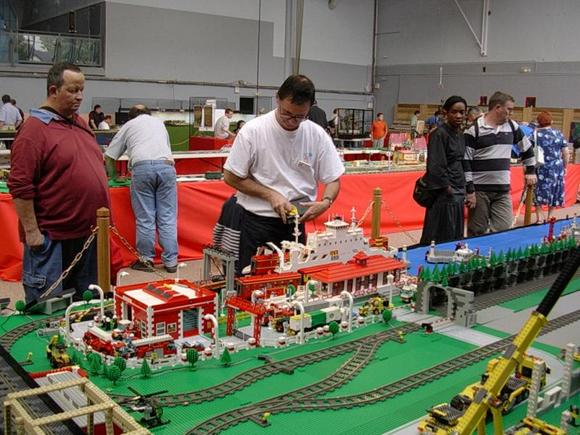
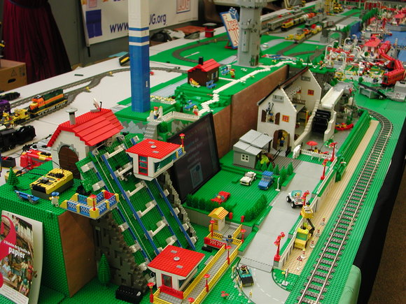
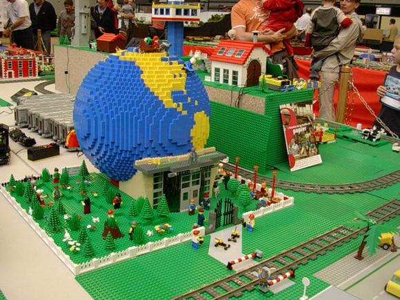
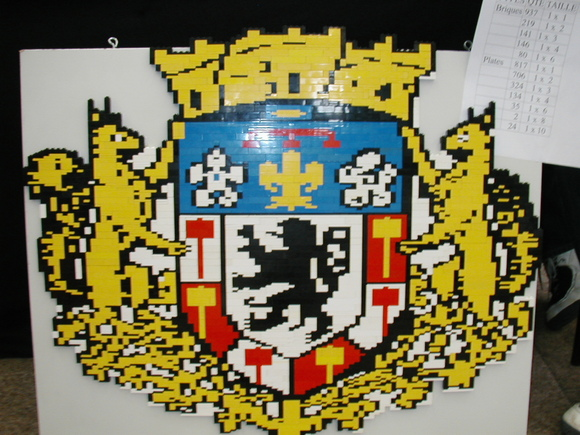
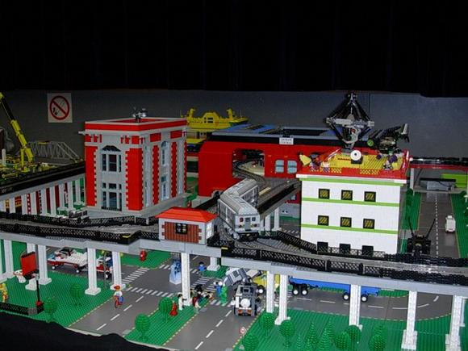

Evoquer l’histoire de la commune en faisant partager la passion des petits trains à toutes les générations des visiteurs était un peu le mot d’ordre de cette manifestation organisée par la municipalité de Quincy-Sous-Sénart (91), à l’occasion des journées du patrimoine, ce week-end des 16 et 17 Septembre 2006.

Nous nous sommes donc retrouvés ce week-end entre passionnés de "petits trains" rassemblés par l’intermédiaire de la FFMF (Fédération Française de Modélisme Ferroviaire), afin de présenter notre savoir faire au public, qui est venu en masse à notre rencontre lors de ce week-end des journées du patrimoine.

Lors du discours d’inauguration, la responsable des affaires culturelles de la municipalité, Mme Anne Juhel, a rappelé l’importance de l’activité ferroviaire dans le développement et la vie de la commune. Située sur la ligne impériale, "Ex-PLM", la gare de Quincy-Sous-Sénart a vibré aux hautes heures de densification du réseau, d’électrification, jusqu’à devenir aujourd’hui une plate-forme utilisée par de nombreux banlieusards qui souhaiteraient avoir "plus de trains".

Ce n’est évidemment pas avec nos petits trains "LEGO" que nous avons pu répondre à leur besoin, car notre réseau s’éloignait un peu de l’environnement du PLM pour offrir une vision plus internationale du trafic ferroviaire... et maritime également. Car le point d’orgue de notre diorama était sans contestation le ferry de notre ami Jean-Marc, venu spécialement de Morlaix (en voiture), présenter sa magnifique réalisation entièrement fonctionnelle de terminal de transbordement.

C’est toujours avec la plus grande approche pédagogique que Denis nous a apporté une fabrique de papier à l’ancienne (moulin à papier du XIVème siècle). Evidemment pour que tout "baigne", Denis ne conçoit pas une réalisation sans faire appel à une débauche de moyens technologiques (pompe, micro-ordinateur, RCX). Il a su éviter la pression et a lui aussi offert au public un grand échantillon d’interactivité.

Saluons également les débuts de Jérémy, alias "Thaaz", sur cette exposition. Il est certain que devant la qualité de réalisation de son "Earth Museum", nous aurons l’occasion de le retrouver de nouveau pour les prochaines expositions.

Erik nous a apporté de sa "quasi-Normandie" (c’est ça la banlieue Ouest) ses "Meuh !" de classe internationale, ainsi que ses déclinaisons sur base de BB17000/25500.

Gilles a quant à lui rafflé son stock de plates 1x1 jaunes pour réaliser le blason de la commune, qui a bien marqué les esprits et qui a suscité un intérêt particulier chez certains visiteurs VIP.

Il a également contribué à enrichir le quartier "Batman" d’une splendide caserne de "chasseurs de fantômes", que nous reverrons certainement sur de prochaines expositions. La quartier de Gotham City était offert par le dernier participant de cette exposition, Didier, qui a su savamment mélanger SpiderMan et Batman sur un même réseau.

Ce fut également l’occasion de tester pour la première fois en exposition le nouveau train à piles à commande infra-rouge, dans [sa version marchandises (présenté dans nos colones)](/articles/autopsie-du-train-de-marchandises-7898/). Même si il est beau, on découvre rapidement les limites d’un tel train en exposition : usure prématurée des piles, et surtout l’infra-rouge peu efficace dans un gymnase bien éclairé. Toutefois, on a pu s’initier aux joies de conduire indépendamment deux trains à vitesses différentes sur une même boucle.

Du coté des modélistes ferroviaires, beaucoup de belles choses, toutes échelles confondues, de la part du club de Provins, déjà présent au salon de la maquette, de nos voisins de Pontault-Combault, et des représentants des clubs d’Etrechy, de Ris-Orangis, de Savigny-le-temple, d’Ozoir la Ferrière ou de Vigneux (que ceux que j’ai oubliés veuillent bien m’en excuser, mais je n’étais pas au mieux de ma forme ce week-end et j’ai donc pu manquer quelques détails).

Tous les participants et représentants de club ont souligné la parfaite efficacité de M. Alain CARON, qui s’était chargé, pour le compte de la municipalité d’organiser cette manifestation. Et les quelques petits problèmes de dernière minute (il y en a toujours) ont rapidement su trouver une solution.

C’était une belle exposition, avec un public nombreux et chaleureux, nous avons donc tous passé un très bon moment.

Merci également aux quelques FreeLUGiens qui sont venus nous rendre visite et à bientôt pour la [prochaine exposition "Trains" à Orléans](/articles/salon-du-train-miniature-a-orleans-les-11-et-12-novembre-2006/).

**Galeries photos**  
**–** [Photos de Didier](http://photos.freelug.org/main.php/v/La-Gallerie-de-qdm/Expositions/2006-Quincy-sous-Senart/)  
**–** [Photos de Denis](http://photos.freelug.org/main.php/v/dlaurencon/Quincy+2006/)  
**–** [Photos de Erik](http://photos.freelug.org/main.php/v/brickerik/expositions/2006/2006_09_Quincy/)
