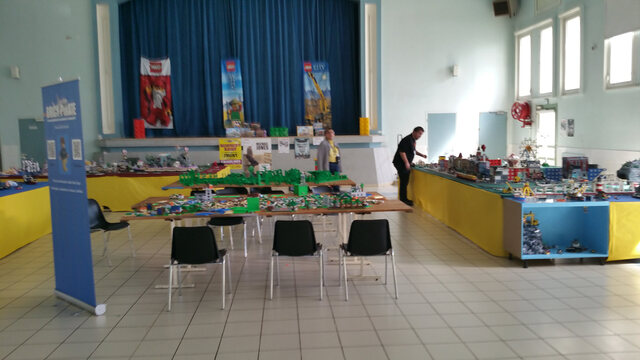

Les 8 et 9 avril s’est déroulée la première édition de l’exposition _Tous en Briques_ à Chaulnes dans la Somme.

Cette exposition a été initiée par les trois frères de la famille Van Dijk, William, Floyd et Kevin.

Tous les 3 passionnés de LEGO depuis leur tout jeune âge possèdent une impressionnante collection Lego des années 80/90 : des Fabuland aux pirates, en passant par les trains 12V, le western et certainement d’autre bijoux qu’ils n’ont pas encore présentés en Exposition.

L’exposition a été supportée par Brickpirate, et malgré la présence de membres de l’association, FreeLUG n’a pu s’investir dans cet événement à cause d’un calendrier chargé, les dates étant les mêmes que la Briqu’Convention de Villeurbanne.

L’organisation de l’exposition a été partagée par la famille Van Dijk et une association locale qui gère le centre socio-culturel de Chaulnes, l’OCLC. (Office de la Culture et des Loisirs de Chaulnes).  
Cette association n’en est pas à son premier événement festif, elle gère notamment des concerts et en l’occurrence le Metal FEST, très apprécié dans le secteur.

Cependant c’était sa première exposition LEGO, et on peut dire qu’ils ont su assurer, en se chargeant de la billetterie, de la gestion du bar, du point chaud et des repas des exposants et des bénévoles le samedi et le dimanche.  
Ils ont été au top, très accueillants et aux petits soins pour les exposants : petit déjeuner le samedi matin pour les exposants arrivés la veille, un petit verre de l’amitié entre les exposants et les représentants de la commune.  
A midi un petit buffet campagnard, puis au soir un petit apéritif et barbecue avec deux anniversaires surprise, le dimanche petit déjeuner, et à midi une tarte au maroilles et du poulet avec des pommes de terre sautées.

Bref, j’ai rarement été aussi bien reçu dans une exposition, presque comme dans la famille ^^

Coté exposants de sets LEGO, ce sont les frères Van Dijk et Djaur (LEGO Ambassador de Brickpirate) qui ont retroussé leurs manches.  
L’exposition était ouverte de 10H à 18H le samedi et de 10H à 17H le dimanche.  
Il y avait 9 exposants tous avec des thèmes différents et variés, montrant ainsi la diversité du monde legotique.  
Un concours du meilleur stand a été proposé aux visiteurs, qui pouvaient voter pour leur stand préféré grâce à leur ticket d’entrée, et tenter de remporter un set LEGO au tirage au sort.  
Les 3 meilleurs stands ont également été récompensés par une boîte.  
Une tombola a aussi été proposée, permettant de gagner un large panel de boites.  
Des briques vertes et des briques Minecraft ont été mise à la disposition des visiteurs, afin qu’ils expriment leur créativité.

Tout le support lots visiteurs/exposants et briques a été fourni par BrickPirate. Un draft sauvage a été organisé le samedi soir,  
et chaque exposant est reparti avec un Hélicoptère de Pompier City et bien sûr la brique de l’exposition.

Au total le nombre de visiteurs sur les deux jours s’élève à 733 entrées.

Belle récompense pour les organisateurs qui se sont investis, ils ont créé et fabriqué les tickets d’entrée à la main, installé la salle, organisé les concours et tombolas, fait le plan de table.  
Sur ce dernier plan, pas de soucis, les tables étaient présentes, stables et à niveau.

Bien sûr comme c’est une première édition, il y a encore quelques réglages à parfaire mais c’est très minime à côté de la qualité d’accueil et de convivialité.  
Comme quoi, il ne suffit pas de payer une grande salle et des jolies nappes pour faire une belle exposition.

Bonne exposition avec un esprit familial qui mérite d’être renouvelée, je ne peux conclure qu’en disant : Vivement la prochaine !

[Lien photos](https://flic.kr/s/aHskYxLNXz)
