La première Briqu’Expo à Lomme s’est déroulée le week-end dernier.  
Elle a rassemblé 25 exposants et accueilli 4056 visiteurs.

[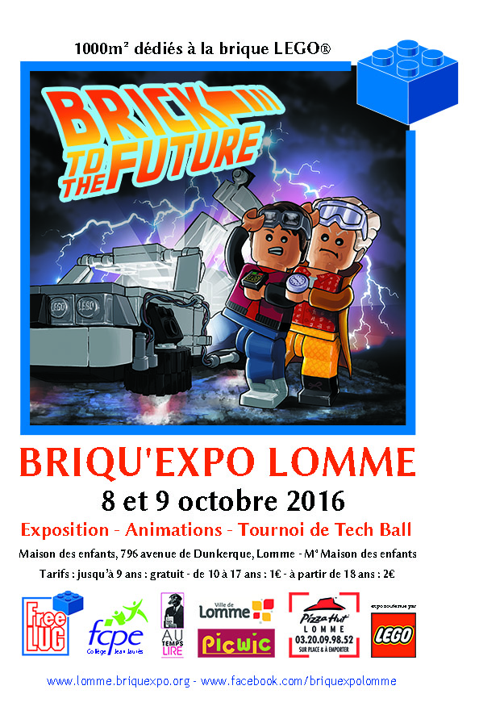](https://www.freelug.org/IMG/jpg/BE_Flyer_A6_PoC.jpg)

Le week-end dernier, 8 et 9 octobre 2016, la première Briqu’Expo organisée dans le nord s’est tenue à Lomme. Elle avait lieu à la maison des enfants, une ancienne villa du début du 20 ème siècle située dans un grand parc arboré, à laquelle une salle de 1000 m² a été ajoutée et qui sert aujourd’hui à accueillir différentes expositions ou événements de la ville.

[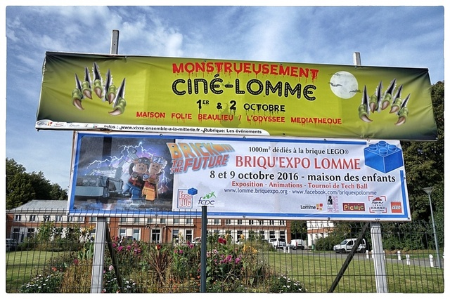](https://www.freelug.org/IMG/jpg/BE_2016_003_Snapseed.jpg)

La décision d’organiser cette Briqu’Expo nordiste est venue après la réussite d’une petite exposition, mise en place en janvier 2015, au collège Jean Jaurès, qui avait attiré 985 personnes en une journée, avec une communication principalement locale. L’association des parents d’élèves et FreeLUG, soutenus par la municipalité avaient donc décidé de mettre en place un évènement de plus grande envergure.  
Cette exposition a rassemblé près de 25 exposants, venus d’horizons différents. De Chti Lug, le Lug nordiste ; BeLUG, nos amis belges ; des exposants individuels et même un membre du LUG allemand Schwabenstein 2x4, Andreas, venu tout spécialement de Stuttgart avec une série de jeux qui ont conquis le public.

[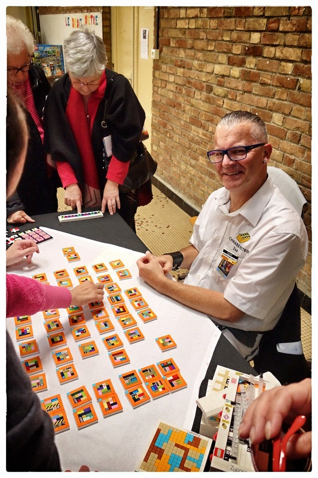](https://www.freelug.org/IMG/jpg/BE_LOMME_2016_014_Snapseed.jpg)

[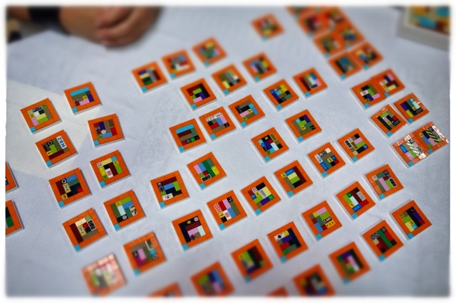](https://www.freelug.org/IMG/jpg/BE_LOMME_2016_015_Snapseed.jpg)

[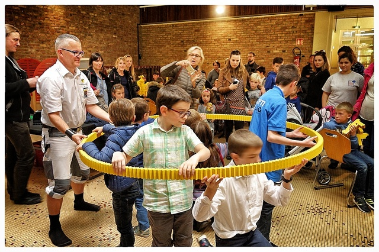](https://www.freelug.org/IMG/jpg/BE_LOMME_2016_001_Snapseed.jpg)

Andreas a proposé aux enfants présents de venir construire un anneau magique à partir des briques jaunes disponibles.

Le thème choisi pour cette exposition était "cinéma et TV des années 80", Indiana Jones et Star Wars étaient forcément à l’honneur parmi les créations exposées, mais des MOCs tirés de Robocop, où les créations autour d’Alien des Arvo Brothers, étaient également présentés.

[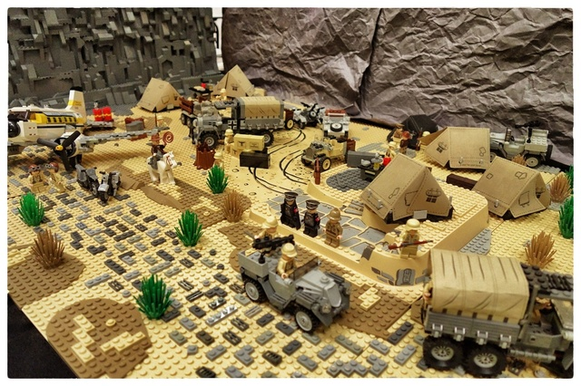](https://www.freelug.org/IMG/jpg/BE_LOMME_2016_005_Snapseed.jpg)

[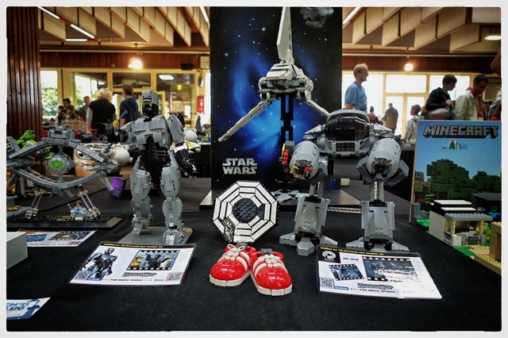](https://www.freelug.org/IMG/jpg/BE_LOMME_2016_002_Snapseed.jpg)

A côté, des MOCs fête foraine, agricole, ainsi que le fameux module Steampunk d’Erik et Manu qui avaient fait le déplacement, ont aussi ravis le public.

[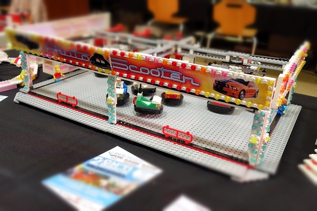](https://www.freelug.org/IMG/jpg/BE_LOMME_2016_012_Snapseed.jpg)

[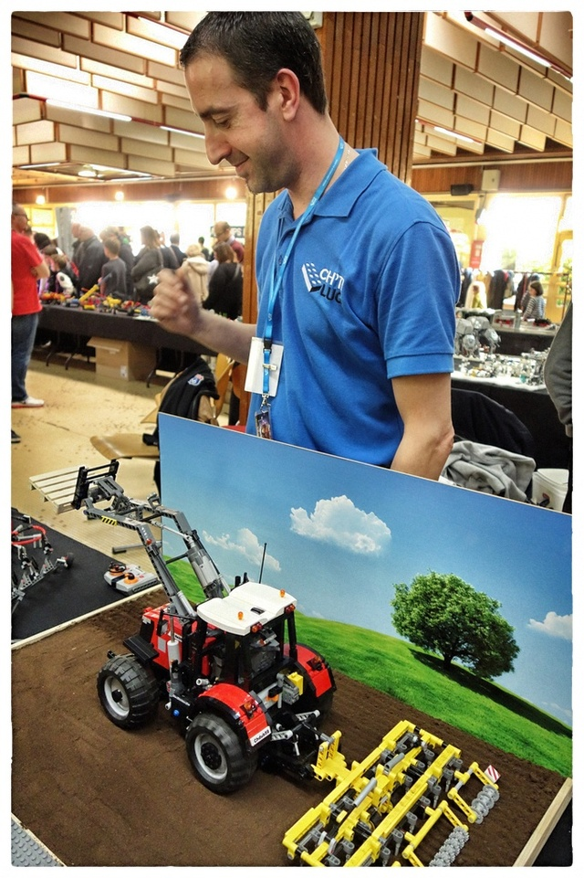](https://www.freelug.org/IMG/jpg/BE_LOMME_2016_017_Snapseed.jpg)

[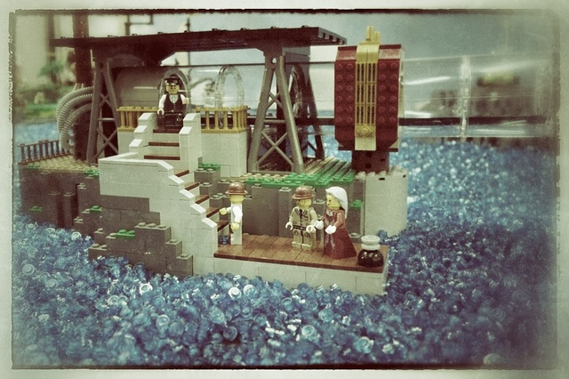](https://www.freelug.org/IMG/jpg/BE_LOMME_2016_010_Snapseed.jpg)

[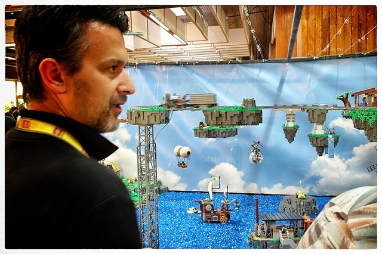](https://www.freelug.org/IMG/jpg/BE_LOMME_2016_023_Snapseed.jpg)

Les reproductions à grande échelle de l’ancienne poste de Courtrai et une église norvégienne, construites par Ludo (BeLUG), côtoyaient quelques pièces du projet "Histoire en Briques", créées à l’époque par les membres du Cor Nord.

[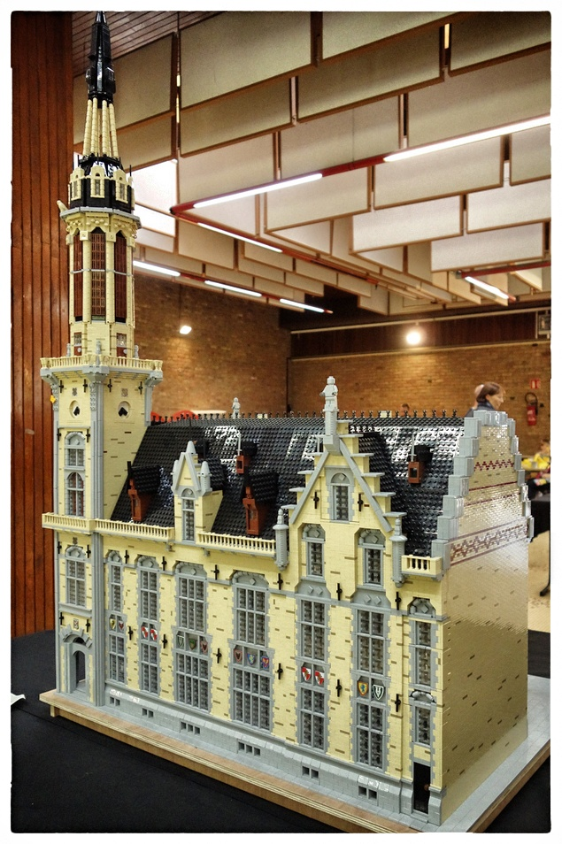](https://www.freelug.org/IMG/jpg/BE_LOMME_2016_008_Snapseed.jpg)

[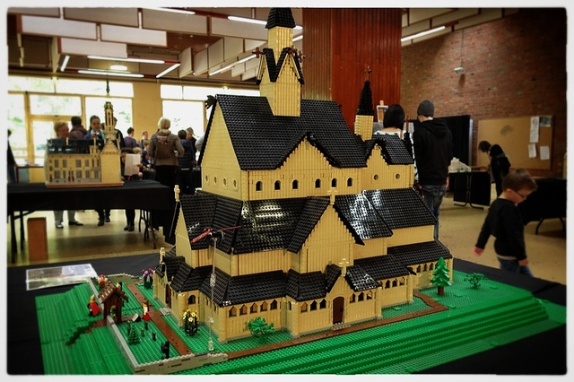](https://www.freelug.org/IMG/jpg/BE_LOMME_2016_009_Snapseed.jpg)

Le petit circuit GBB, installé par Philo et Annie, a lui aussi attiré les regards du public.

[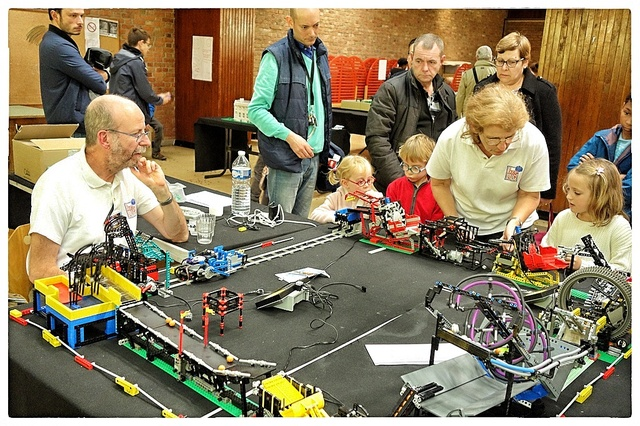](https://www.freelug.org/IMG/jpg/BE_LOMME_2016_019_Snapseed.jpg)

[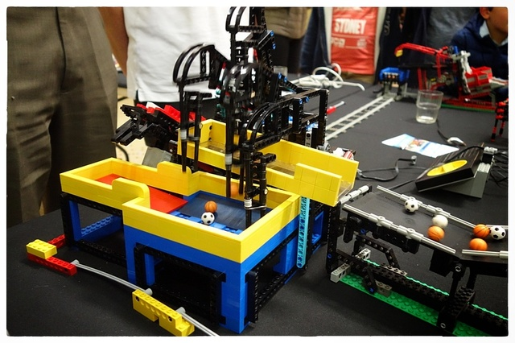](https://www.freelug.org/IMG/jpg/BE_LOMME_2016_006_Snapseed.jpg)

Plusieurs animations ont été proposées au public :  
Le tas de briques. Il n’a pas fallu longtemps au public pour s’approprier les 4 caisses de briques jaunes 2x4, en vrac au milieu d’une table, et de monter des créations imposantes.

[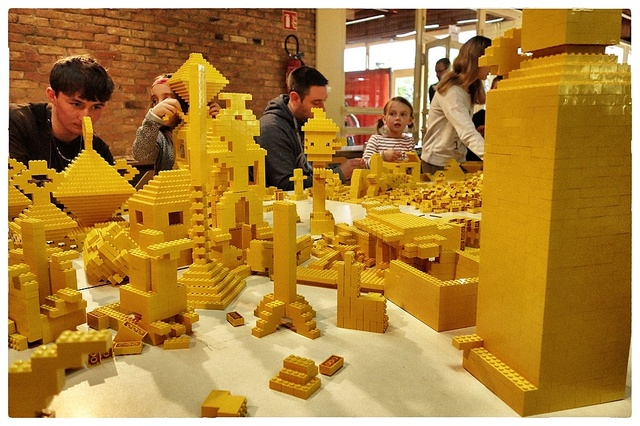](https://www.freelug.org/IMG/jpg/BE_LOMME_2016_007_Snapseed.jpg)

La mosaïque, préparée par Simon Pinta, représentait la géante de Lomme, Anne Delavaux. Petite frayeur samedi vers 16h, lorsque nous nous sommes rendus compte que nous allions manquer d’environ 1000 briques noires 2x4…

[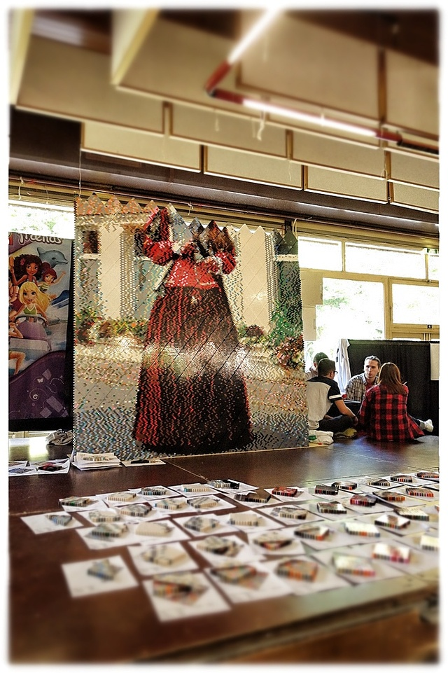](https://www.freelug.org/IMG/jpg/BE_LOMME_2016_003_Snapseed.jpg)

[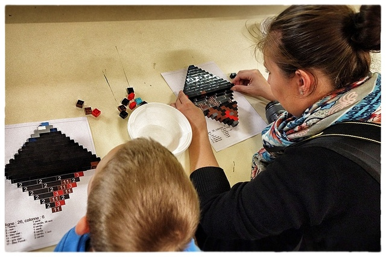](https://www.freelug.org/IMG/jpg/BE_LOMME_2016_004_Snapseed.jpg)

400 ont pu être récupérées sur les supports, mais il y avait toujours un trou de 600. Heureusement que Lille dispose d’un LEGO Store, accessible en métro depuis l’exposition, et que la brique 2x4 en noire est suffisamment commune pour être disponible sur le Pick a Brick wall. Un aller-retour rapide et 7 grands pots ont permis de continuer la construction de cette œuvre de 32000 briques, tellement grande que des supports supplémentaires ont dû être construits pour la soutenir.

[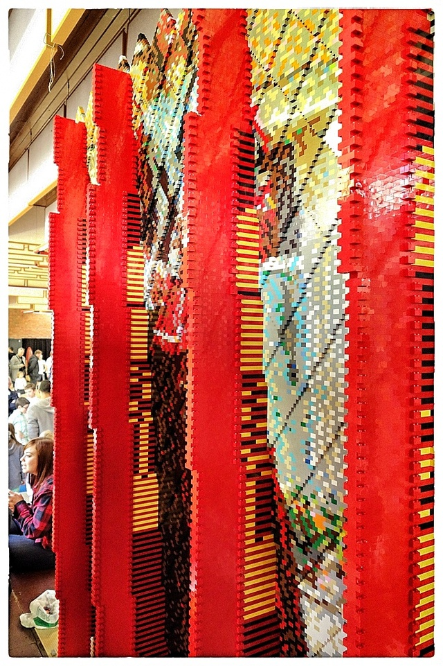](https://www.freelug.org/IMG/jpg/BE_LOMME_2016_013_Snapseed.jpg)

[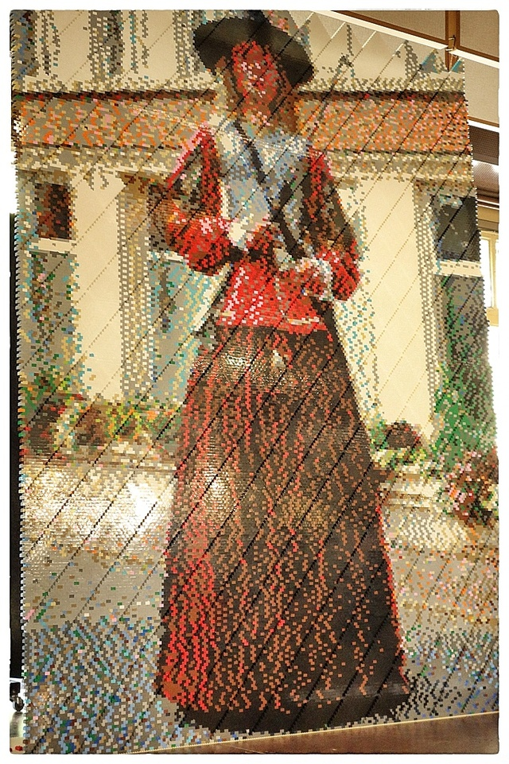](https://www.freelug.org/IMG/jpg/BE_LOMME_2016_016_Snapseed.jpg)

Le TechBall fait toujours le plein autour de l’arène. Les petits modules radiocommandés ont amusé petit et grands, et 14 compétiteurs se sont affrontés dimanche au cours d’un tournoi, dont les 4 premiers ont été récompensés par des sets Technic.

[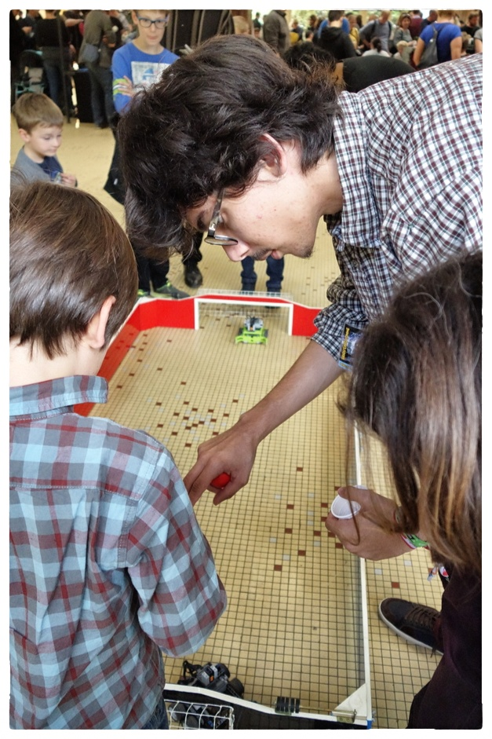](https://www.freelug.org/IMG/jpg/BE_LOMME_2016_020_Snapseed.jpg)

Une tombola le samedi et le dimanche, a aussi permis de remporter de très beaux sets.

[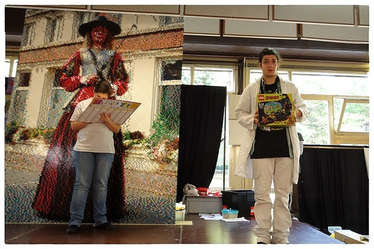](https://www.freelug.org/IMG/jpg/BE_LOMME_2016_025_Snapseed.jpg)

Mais la plus belle réussite de cette BE, à notre avis, reste le concours de création enfant. Nous pensions avoir au mieux 12 à 15 participants, âgés de 6 à 14 ans, et ce sont 50 créations qui ont été soumises au vote des exposants. Nous avions pensé remettre 3 prix, et au vu de la qualité des MOCs proposés, nous avons décidé de récompenser 7 enfants avec des sets. Tous les participants ont reçu un lot de consolation.

[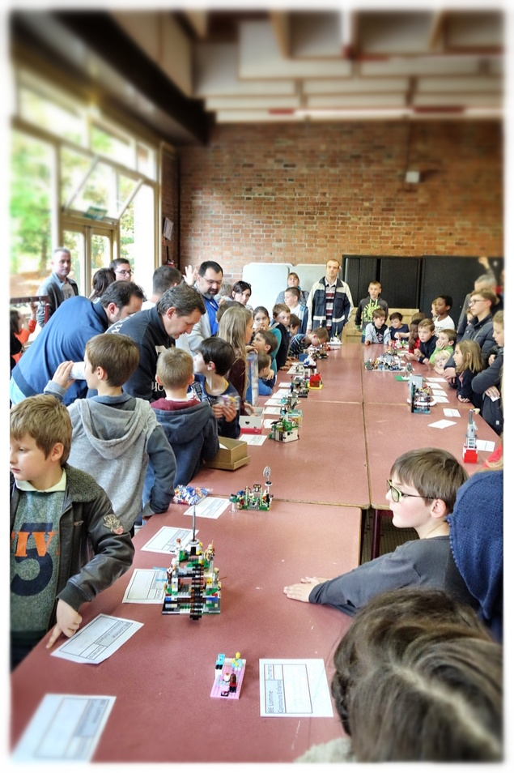](https://www.freelug.org/IMG/jpg/BE_LOMME_2016_024_Snapseed.jpg)

4056 visiteurs ont été comptabilisés sur le week-end. Un beau succès pour cette première Briqu’Expo Lomme, mise en place conjointement par FreeLUG, et l’association des parents d’élèves du collège Jean Jaurès de Lomme.

[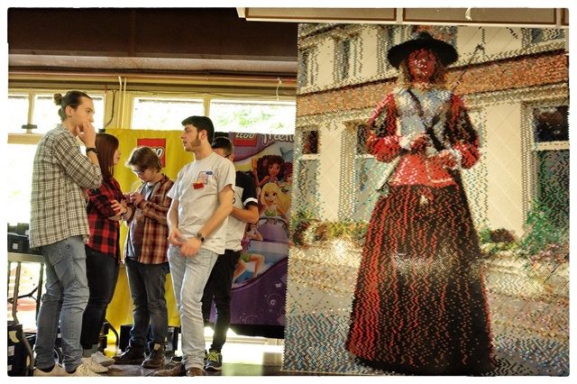](https://www.freelug.org/IMG/jpg/BE_LOMME_2016_018_Snapseed.jpg)

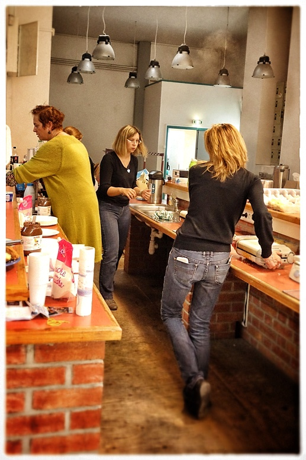

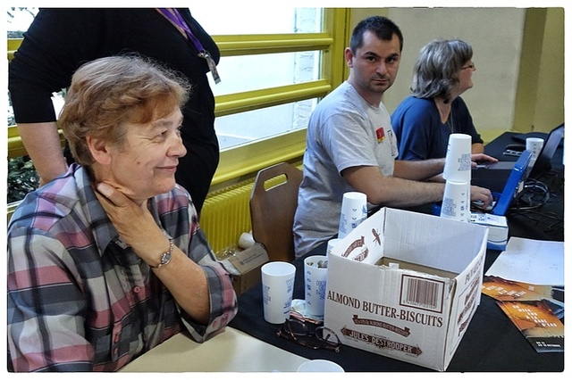

Plus de photos disponibles sur cet [album Flickr](https://www.flickr.com/photos/144155360@N07/sets/72157674939555406).
