FreeLUG était invité à participer à la première de Bures en Briques, à l’Espace culturel Marcel Pagnol de Bures sur Yvette. Évènement initié par la Ludothèque Bur’lututu se tenant sur deux semaines du 2 au 14 mars 2020.

Vos serviteurs, Laurent et Nicolas, se portent volontaires. Après discussion avec le personnel de la ludothèque, nous décidons d’investir le hall du centre culturel le week-end des 7 au 8 mars 2020. Au programme : MOC et sets officiels mis en scènes sur des tables ou exposés dans des vitrines.

[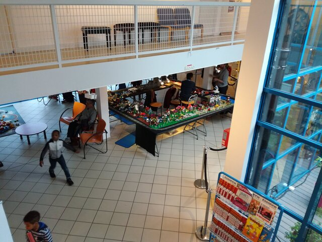](https://www.freelug.org/IMG/jpg/img_20200307_164115.jpg)

**Vue générale du hall d’exposition et des tables**

Grâce au prêt d’un lot de 16000 briques par FreeLUG, le personnel de la ludothèque en profite pour animer 4 ateliers de construction libre et de défis ludiques. Ainsi qu’un atelier avec Primo et Duplo pour les plus petits.

[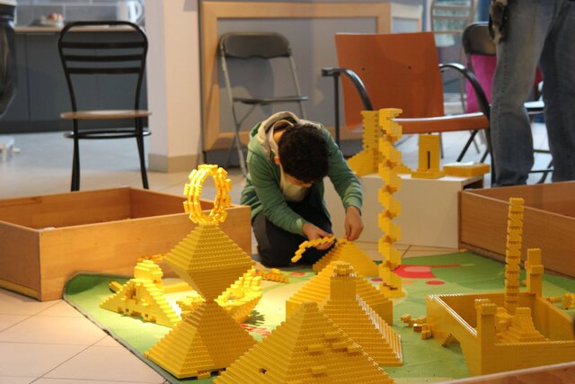](https://www.freelug.org/IMG/jpg/libre_img_1129.jpg)

**L’espace de construction libre**

En parallèle, Simon Pinta occupe l’espace avec ses créations artistiques (tableaux mosaïques) pour les 2 semaines de l’évènement.

À cela s’ajoute un espace qui projette en boucle l’histoire de la société LEGO, des brickfilms et des créations libres réalisés par les enfants pendant la semaine.

L’épidémie de Coronavirus a jeté un doute sur la tenue de l’événement, mais finalement il est maintenu.

Après des convoyages de briques préparatoires, rendez-vous est pris pour une installation le samedi matin. Le véhicule garé juste devant l’entrée est rapidement déchargé. Nous constatons que le personnel de la ludothèque nous a déjà installé les tables, gain de temps assuré ! Nous les recouvrons avec les nappes de l’association et déversons délicatement MOCs et sets dessus suivant une répartition préétablie (**Laurent :** comment Nicolas a-t-il pu rentrer tout ça dans si peu de caisses ?)

[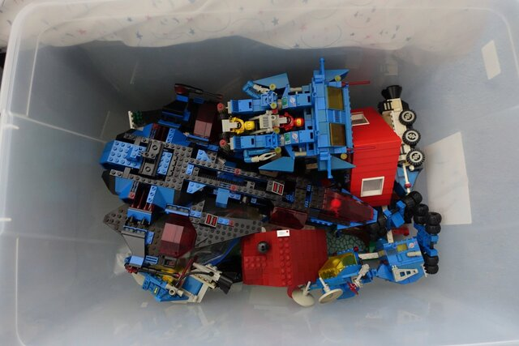](https://www.freelug.org/IMG/jpg/dsc02340.jpg)

**Une caisse Space en vrac !**

La gare, la ville bordée par la mer, le parc, la fête foraine et la campagne montagneuse occupent sans problème la moitié des 10 m linéaires.

[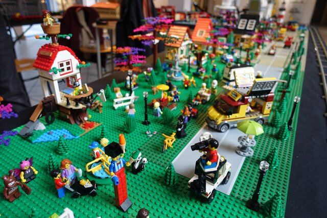](https://www.freelug.org/IMG/jpg/dsc02404.jpg)

**Aperçu de la ville**

[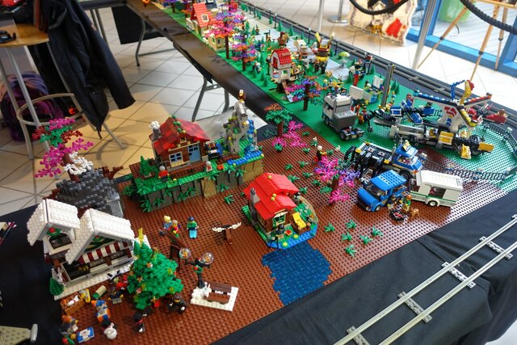](https://www.freelug.org/IMG/jpg/dsc02419.jpg)

**Aperçu de la campagne**

Sur un peu plus de 2 m, la collection de sets espace de Nicolas et deux MOC de son voisin ne passent pas inaperçus.

[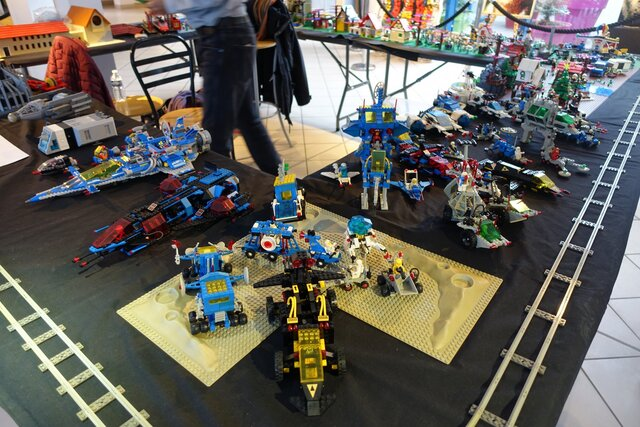](https://www.freelug.org/IMG/jpg/dsc02421.jpg)

**Le coin Space classique et moins classique !**

[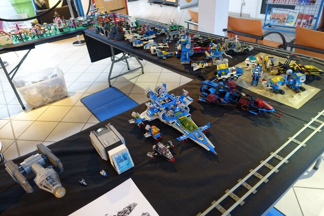](https://www.freelug.org/IMG/jpg/dsc02438.jpg)

**Autre aperçu du coin Space**

Sur les derniers mètres, la zone d’exposition des créations présente : Notre-Dame (avec sa toiture !), un bâtiment emblématique local (La Grande Maison), le logo de la ville d’accueil, tous de Laurent ainsi qu’[un monastère et sa chapelle (présenté par son créateur Nicolas)](https://forum.freelug.org/viewtopic.php?t=174).

[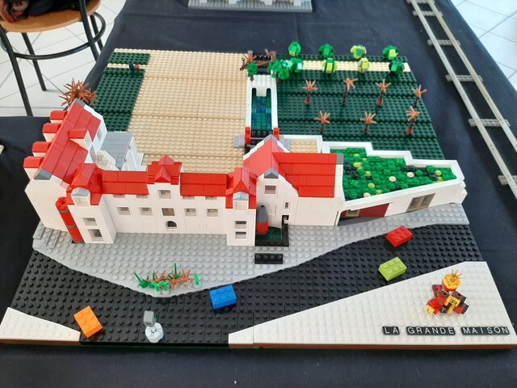](https://www.freelug.org/IMG/jpg/grdmaison_20200307_121240.jpg)

**La Grande Maison de Bures sur Yvette**

Et pour animer l’ensemble, le train de marchandises 7939 tourne tout autour, sur une voie construite au ras du précipice que constitue le bord des tables.

[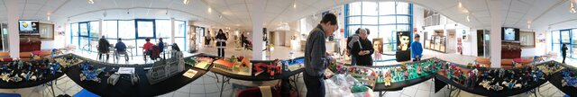](https://www.freelug.org/IMG/jpg/vuegal_dsc_0463.jpg)

**La vue panoramique**

Nous terminons par le garnissage des vitrines avec des sets Architecture, Technic, Bionicle et Ideas ainsi que quelques petits MOC de véhicules et de monuments (réalisés par Laurent).

[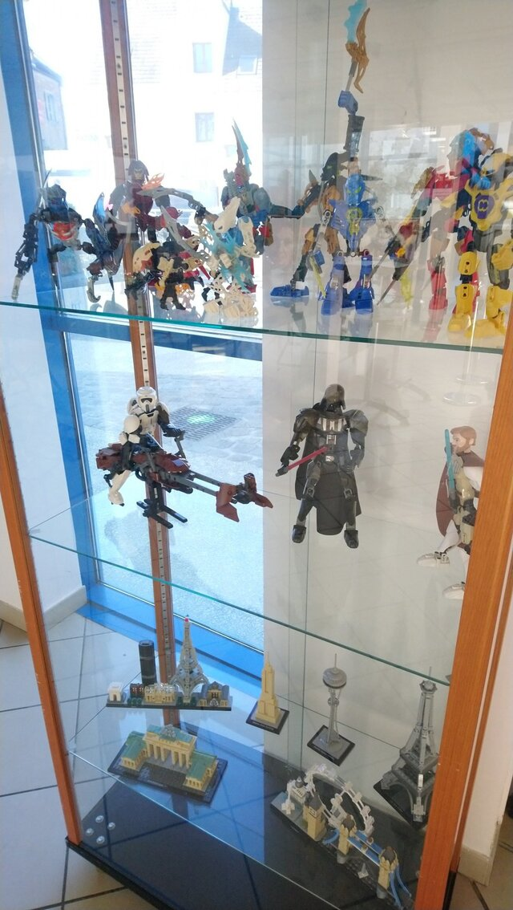](https://www.freelug.org/IMG/jpg/vitrine-1_dsc_0456-r90.jpg)

**La vitrine des figurines articulées et du thème Architecture**

[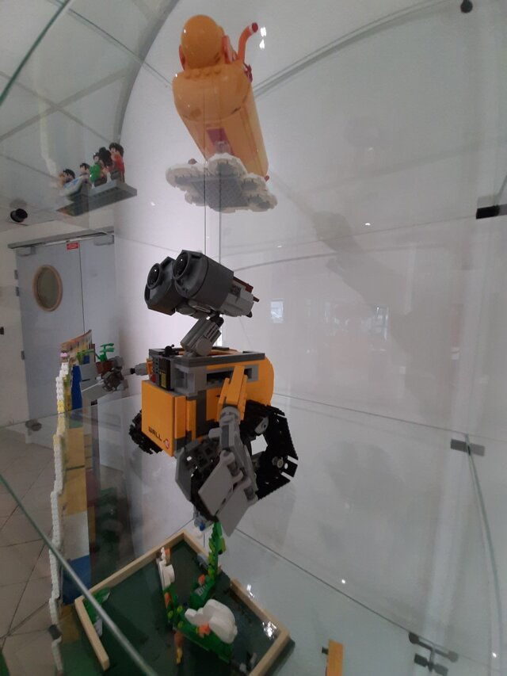](https://www.freelug.org/IMG/jpg/vitrine-2_20200307_121720-r90.jpg)

**La vitrine du thème Ideas**

La configuration des tables en rectangle et la voie de chemin de fer en boucle nous obligent à ramper sous les tables pour naviguer entre intérieur et extérieur. Mais des tapis d’évolution pour les tous petits permettent de ménager nos vieux os.

[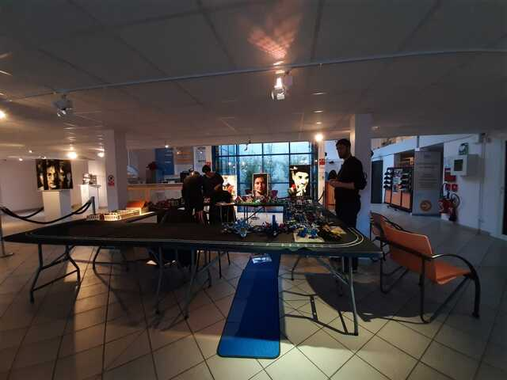](https://www.freelug.org/IMG/jpg/tapis_img-20200308-wa0015.jpg)

**Accès sous-marinier au centre des tables...**

* * *

**Nicolas**

Je me suis vraiment amusé, l’ambiance était très sympathique ! Peu importe le nombre de visiteurs, nous avons eu de très bons contacts avec le public, entre les enfants intéressés et les parents nostalgiques de sets de leur enfance.

Un grand merci à Laurent pour s’être occupé de l’organisation avec la ludothèque, et surtout pour avoir transporté tout mon matériel — 5 caisses de 40 litres quand même !

Même si tout était très présentable le samedi à 14h, pour l’ouverture officielle, nous avons continué à ajouter des détails jusqu’au dimanche matin, ce qui a permis à certains visiteurs venus plusieurs fois de nous faire part des nouveautés constatées — encore de l’interactivité amusante !

J’ai retenu comme leçon (merci Eric :)) de laisser plus de place entre le bord de table et la voie ferrée (dans notre configuration, ça aurait été vraiment compliqué), et surtout de surélever la voie dans les virages pour aider le train à tourner !

* * *

**Laurent**

C’était ma première participation à une exposition. Nicolas ayant déjà de l’expérience sur ce genre d’événement, et rassuré par la [boîte à outil du bon exposant](https://forum.freelug.org/viewtopic.php?f=10&t=705), je me suis lancé sans appréhension.  
N’ayant pas beaucoup de sets officiels à présenter, j’ai décidé de finir un projet en cours (Notre-Dame de Paris) et d’entamer quelques MOC symboliques de la ville de Bures sur Yvette. Malgré la somme importante de travail nécessaire à la préparation, l’envie de recommencer est bien là.

Car j’ai pris beaucoup de plaisir tout le week-end, que ce soit à trouver des solutions pour que le train tourne correctement, pour ajouter quelques petites touches au diorama ou lors des discussions avec les visiteurs. Que faire de mes LEGO Technic ? Où acheter des briques à l’unité ? Comment trier ? Bien d’autres échanges avec quelques AFOL, mais aussi des parents parfois perdus devant la passion de leurs enfants. Et des adultes bien tentés de jouer de nouveau avec les sets de leur enfance.

Les œuvres de Simon ont surpris et étonné la plupart des amateurs de LEGO qui étaient présents. Elles ont grandement contribué à faire de cette exposition un succès.

La cohabitation avec Nicolas s’est bien passée, de la préparation au rangement. Ce n’est pas forcément gagné d’avance quand on ne se connait pas. Je l’en remercie.  
Au moment d’écrire ces lignes, il me reste encore à lui livrer ses caisses pour clore définitivement le chapitre, mais avec le confinement de la population, c’est en attente. Il faudra patienter avant de retrouver tes jouets, Nicolas !

* * *

Et pour finir, un grand merci au personnel de la ludothèque : organisation, animation, repas, coups de main, échanges… tout était parfait.

Le week-end s’achève avec une fréquentation de 270 visiteurs, essentiellement venus de la commune de Bures sur Yvette (75%).

[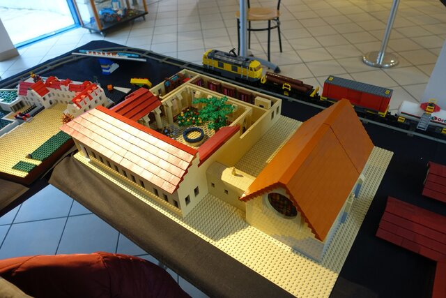](https://www.freelug.org/IMG/jpg/monastere_dsc02361.jpg)

**Le monastère**

[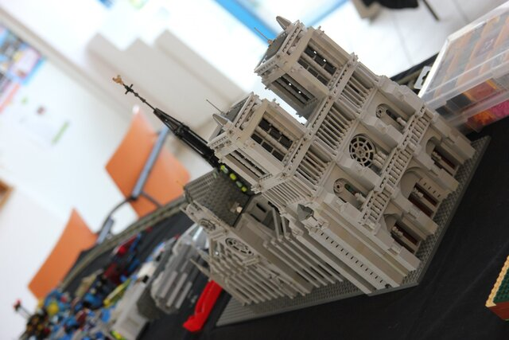](https://www.freelug.org/IMG/jpg/nddp_img_1111.jpg)

**Notre-Dame de Paris**

Voir en ligne : [Bures en Briques 2020](https://www.freelug.org/spip.php?article3008)
