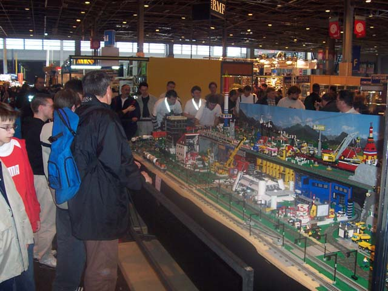
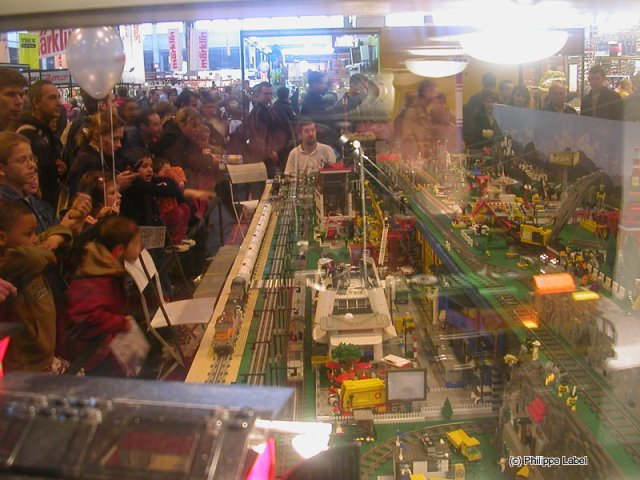
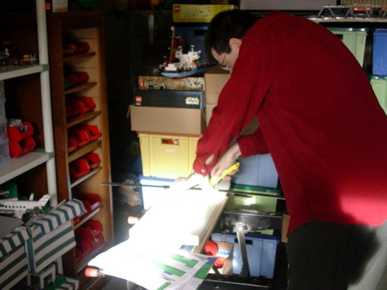

Le week-end du 23 au 24 Avril, nous avons exposé pour la première fois à Paris, nos réalisations, sur un grand réseau de train au Parc des Expositions de la Porte de Versailles.

Hébergés par nos amis de la Fédération Française de Modélisme Ferroviaire, nous avons offert une représentation originale de notre passion et nous pouvons dire que pour une première fois, ça a été une grande réussite, même s’il est toujours possible d’améliorer certains points.

Mais comment tout cela s’est il passé ? Parcourons ensemble les expériences des différents participants.

## Point de vue de Didier (qdm)

Il y a un an, lors de la précédente édition de ce salon, j’ai rendu visite timidement aux représentants de la FFMF, afin de les interroger sur leur intérêt pour le train LEGO et leur narrer nos premières expériences lors des précédentes expositions modélistes auxquelles nous avions participé.

Leur accueil a été chaleureux et nous avons alors envisagé d’affilier FreeLUG à la FFMF, avec le secret espoir de pouvoir nous aussi prendre part un jour à ce grand événement.

Evidement je ne me doutais pas alors, qu’un an plus tard, nous serions déjà en mesure d’y participer.

**Vue générale**

C’est en Novembre lors de la préparation du salon Expométrique, que j’ai commencé à me renseigner auprès des instances de la FFMF d’une éventuelle participation de FreeLUG à un prochain Mondial. J’étais conscient alors, de la tâche que celà nécessitait et du fait que notre jeunesse et le caractère particulier de nos réalisations ne nous autorisaient peut-être pas à faire preuve d’ambition démesurée.

Là encore notre démarche a été bien accueillie et un premier rendez-vous avec Bruno Saunier, responsable de la section jeune au sein de la FFMF, nous a permis de définir les grandes lignes de notre participation.

Dès lors, le projet Mondial a démarré et nous nous sommes vite retrouvés à une douzaine de volontaires, pour la plupart déjà rodés depuis [l’exposition d’Orléans](http://www.freelug.org/article.php3?id_article=323), pour donner vie à ce beau projet.

Pour se démarquer un peu de ce qui avait été fait à Orléans, j’ai souhaité que ce réseau soit pour nous l’opportunité de tester différentes techniques :  
**–** Une zone en coulisse pour préparer la composition des trains afin de jouer sur la diversité des rames.  
**–** La mise en oeuvre du DCC.  
**–** L’utilisation d’une base en Styrodur pour donner du relief.  
**–** Et l’introduction d’automatismes pour déclencher _via_ un RCX le départ des trains.

Toutes ces techniques ont connu des réussites plus ou moins marquantes sur lesquelles il convient de dresser le bilan.

D’une façon générale, nous avons retrouvé les problèmes déjà rencontrés sur les expositions précédentes, à savoir :  
**–** tables pas tout à fait aux dimensions escomptées ;  
**–** écarts lors de l’assemblage, car le design virtuel et les échanges d’informations ne remplacent pas une répétition préalable ;  
**–** échecs dans la mise en oeuvre de certaines réalisations, car le montage final réserve toujours son lot de surprises de dernière minute qu’il n’est pas évident de corriger.

Quoiqu’il en soit le montage de la structure et la mise en place du réseau ont pu démarrer le vendredi vers 13h pour se terminer le samedi matin, juste avant l’arrivée du public (avec quand même un petit dodo entre 23h et 8h du matin).

Il est clair que toute la partie préparation a été un travail éprouvant, mais dès l’entrée des  
premiers visiteurs tout était oublié.

16000 visiteurs le Samedi, 18000 le dimanche (chiffres des organisateurs) et en permanence des spectateurs sur 3 rangs, formant un attroupement qui se voyait de loin dans les allées !!!

**Vue sur la foule**

Des félicitations du public et des autres exposants, la visite de professionnels du jouet, aperçus furtivement et même quelques plans tournés par FR3 (pas diffusés, hélas), sans compter l’après salon avec d’ores et déjà de nombreux contacts pour d’autres animations et les futurs nouveaux adhérents.

Merci donc aux douze participants inscrits, mais également aux autres FreeLUGien(e)s qui se sont associés, notamment Erik, Xavier, Christophe, Simone, Florence, Eric et j’en oublie forcément...

## Point de vue de Philippe (frogleap)

Cette participation a été un grand plaisir. Imaginez : jouer au train et à la ville LEGO pendant deux jours avec un réseau dont on n’oserait même pas rêver pour chez soi.

Bon, je résume un peu le seul bon côté des choses, mais finalement c’est ce qu’il restera dans les mémoires. Les difficultés de montage sont finalement assez classiques et facilement surmontables.  
Le plus gros travail a été fourni par Didier pour l’organisation générale et la coordination. Participer en apportant un peu de briques est assez facile en comparaison.

En tous cas, le plaisir a aussi été de bavarder montages ou trucs et astuces avec un public admiratif. Sans parler des "t’as vu le train LEGO ?" qui ne cessaient de s’échanger aux alentours du stand. Il suffisait de s’éloigner un peu parmi la foule pour s’en rendre compte.  
Mon plus plus beau moment aura été l’échange entre un petit garçon et son père.  
Le père : "bon allez ça suffit, il faut y aller maintenant et il y a d’autres choses à voir..."  
Le fils : "non je reste regarder.",  
Le père : "Mais ça fait quatre fois que tu vois la grue vider et charger le camion !!!"  
Le fils : "Oui, mais je n’ai pas tout vu..."

Voilà pour moi une récompense au centuple des heures de montage pour réaliser quelques MOC.

Encore Merci à Didier pour le travail d’organisation et si il y a une petite place, je suis déjà partant pour l’an prochain.

Si vous voulez jeter un petit coup d’oeil, reportez-vous au tableau en fin d’article pour accéder aux galeries des différents participants et visiteurs.

## Point de vue de Denis (Denis L)

Pour ma part, les hostilités ont commencé comme assistant de Didier (qdm) pour la découpe du Styrodur du niveau supérieur un beau dimanche de printemps 2005.

**Préparation**

Puis ce fût, à la maison, la réorganisation du parc de loisirs (déjà présenté au Lego Festival de Bruxelles) pour l’adapter aux dimensions du diorama du Mondial.

Enfin arriva le grand jour de l’installation au Mondial. La table réalisée par les menuisiers du parc des expositions était en un seul morceau, pas exactement aux dimensions prévues. Qu’importe ! L’assemblage du Styrodur commence vers 13h30 le vendredi avec l’aide de Gilles. L’installation des MOCs se fait dans la bonne humeur et se termine vers 23h00 par une grillade/frites dans une brasserie du boulevard des Maréchaux. Retour maison avec Casper vers 0H30. Dodo.

Les deux jours de salon se sont fort bien déroulés, avec de nombreux :  
"Oh, regarde des LEGO !"  
"J’en avais plein quand j’étais petit !"  
"T’as vu c’qu’on peut faire avec des LEGO !" ...  
Bref, des contacts chaleureux et plein d’émerveillement.

En contrepartie, je déplore personnellement deux avaries principales :  
**–** une fontaine un peu trop énergique qui éclabousse et provoque à la fin de la première journée une légère inondation ;  
**–** le moteur de la tour panoramique rend l’âme après de nombreuses heures de bons et loyaux services.  
Autant dire rien par rapport à l’immense bonheur d’être parmi les pionniers du Mondial. La barre a été placée haute pour une première fois. Prêts pour les prochains challenges ?

## Point de vue de Loys (Chimere)

De mon coté, apres avoir déjà fait cinq expositions publiques en deux ans et demi, faire le Mondial à Paris.. Y’a pas de lézard.. Ca vaut vraiment le coup de se faire 1500 km pour participer à cet événement.

Notre table était.. comment dire.. une splendeur !! Ouaip, pas trop fort comme qualificatif.. hé hé !!

Et encore une fois, des idées absolument incroyables et d’une efficacité de premier ordre auprès du public, comme le marteau piqueur ou la fontaine. Ce qui me conforte dans l’idée que nous construisons de manière très différente des américains. Ils font plutôt dans le gros oeuvre qui en impose, alors que nous sommes plutôt du genre "le petit détail qui tue"...

Enfin, le charme de ces expositions, c’est voir tous ces grand yeux de gamins écarquillés ... "Wouah... Papa... Regarde des LEGO !! "

Alors, l’année prochaine !! On remet ça ?... Oh oui !! :)

## Les photos et video des exposants et visiteurs

| [Photos de Philippe](http://gallery.freelug.org/2005-Paris-23-24-Avril) |
| --- |
| [Photos de Legoman](http://www.brickshelf.com/cgi-bin/gallery.cgi?f=127041) |
| [Photos d’Eric](http://www.brickshelf.com/cgi-bin/gallery.cgi?f=127808) |
| [Photos de Loys](http://www.brickshelf.com/cgi-bin/gallery.cgi?f=127195) |
| [Photos de jlb](http://gallery.freelug.org/Mondial2005) |
| [Photos de qdm](http://gallery.freelug.org/Exposition-jour1) |
