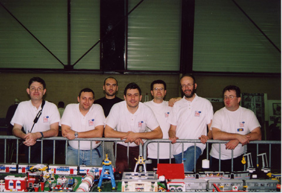
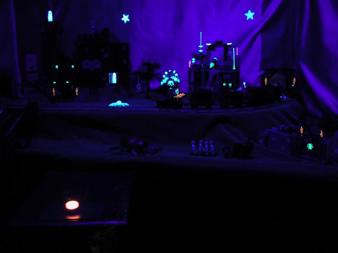
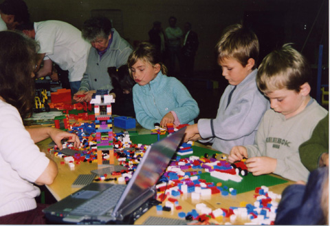
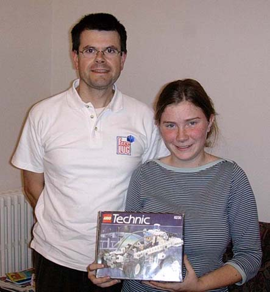

Notre ami Denis nous a donc entraînés Pascal, Gilles, Jean, Philo, JLB et moi dans cette sympathique aventure du salon des passionnés de La Ville du Bois.

S’agissant d’une petite manifestation locale, regroupant des passionnés de chiens, chats, oiseaux, poissons, appareils de radio, projecteurs de cinéma, des artistes peintres, des ferrovipathes, des maquettistes spécialisés dans les maquettes d’arsenal (maquettes en bois de vieux voiliers)et les figurines en plomb, des marionnettistes, des rallymen et même un fan de Johnny (ah que oui !), nous avions quelques scrupules à débarquer avec de gros moyens.

Nous étions néanmoins la plus forte représentation, avec 5 passionnés qui ont occupé une bonne partie du gymnase, le samedi matin pour installer nos 5 tables, 2 vitrines et notre petit cabanon aux mystères...

En plus en arrivant fièrement avec nos beaux T-shirts FreeLUG ([pour les conditions de vente](mailto:tresoriers@freelug.org)), nous l’avons, d’entrée, joué très professionnelle.

**L’équipe FreeLUG**

Quelques petites heures après, nous avions une préparation de Betton dans les vitrines, que Pascal et Jean ont remplies avec leurs trésors et une petite répétition de Claix et du LEGOWORLD avec une petite ville, provenant des mêmes caisses.

Denis s’est retiré sous sa grande bâche noire pour monter en secret son petit cabanon où à grand renfort d’effets sonores et lumineux, il nous a concocté un petit univers Halloween effrayant à souhait. Les courageux qui ont osé franchir la porte, ont quand même été récompensé par un petit bonbon.

**HalLEGOween**

FreeLUG ne recule devant aucun sacrifice quand il s’agit de faire plaisir à son public.

D’ailleurs, comme le mot d’ordre des organisateurs était de faire partager nos passions auprès des visiteurs, nous avions également mis à disposition des "enfants" quelques briques en vrac afin qu’ils puissent venir s’amuser avec nous.

**Le coin des constructeurs**

Le moins que l’on puisse dire, c’est que la passion est passée et que comme lors de nos expositions précédentes, les visiteurs comme les autres exposants et les organisateurs ont été ravis de la performance de FreeLUG.

Il faut vraiment préciser que le but de cet article n’est pas de faire de l’auto-satisfaction, car il nous reste beaucoup de choses encore à développer dans notre organisation. Mais même si l’on relativise les réactions du public en se disant que nous représentons une certaine forme de nouveauté qui est déjà un attrait par elle-même, il se confirme expo après expo que nous apportons une solution pour combler les espaces entre les générations.

J’en veux pour preuve :  
**–** les commentaires des modélistes, qui sont heureux de voir les jeunes qui se massent autour de nos tables et qui après découvrent les réalisations des autres exposants avec un autre regard,  
**–** les discussions entre les parents et les enfants où ils montrent devant nos modèles historiques, les jeux qui étaient les leurs quand ils avaient l’age de leurs enfants,  
**–** les mamies qui viennent nous confier que leurs enfants jouaient des heures entières avec leurs briques LEGO®, dont une partie se trouve encore dans un coin du grenier,  
**–** et tous ceux petits et grands qui nous demandent comment se procurer certains articles du catalogue, que l’on ne voit pas en grande surface.

Même le journaliste du journal régional qui est passé nous interviewer, nous a demandé de lui en dire plus, à l’occasion, sur l’univers des jeux LEGO®. Et il n’en revenait pas que nous ayons préparé une plaquette presse à son attention "Oui, oui, c’est pour vous !".

Denis avait également organisé un petit concours où il s’agissait de deviner le nombre de pièces d’un modèle exposé. C’est Solène, 12 ans, qui a donné le nombre le plus proche par défaut de 180 pièces (pour 186) et qui remporte donc le petit buggy technique.

**Denis lors de la remise du prix à Solène**
