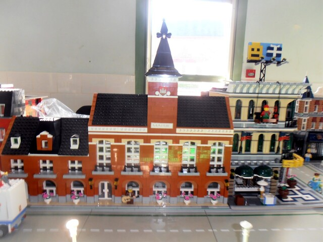
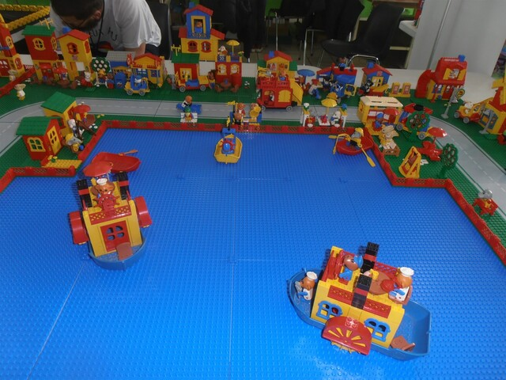
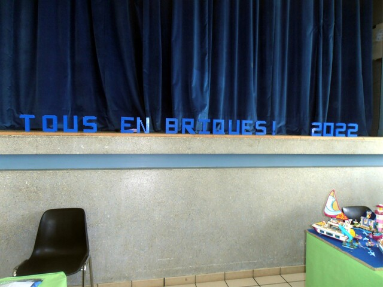
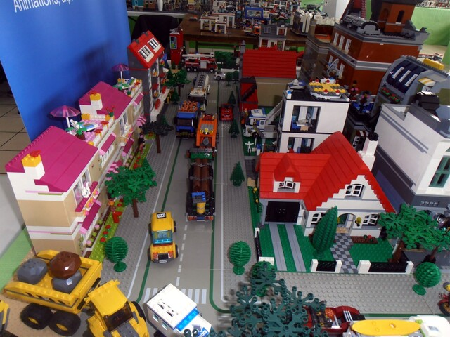
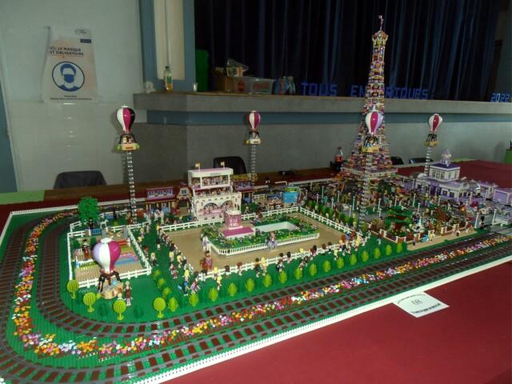
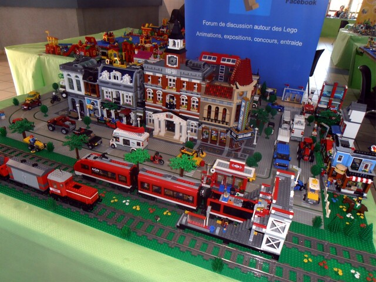

Le week-end du 16 et 17 avril s’est tenu à Chaulnes (80) la 4e édition de l’exposition "Tous en briques !"  
Cette manifestation a marqué la reprise des activités de l’Office de la Culture et des Loisirs de Chaulnes (OCLC), très connue dans le secteur notamment pour ses festivals de musiques, après une période d’arrêt suite au Covid19.

L’exposition en elle-même a regroupé 12 stands, pour 16 exposants (dont 2 Freelugiens : Arnaud Godet et William Van Dijk) allant du Fabuland au City, en passant par le Western, les Pirates, le Friends, et le technique.

Sur l’ensemble de ces deux jours, 489 visiteurs ont franchis les portes de l’exposition.

Même si quelques axes d’améliorations ont été évoqués, les organisateurs sont ravis de la qualité des créations et modèles exposés, et souhaitent renouveler cette manifestation pour une 5e édition.

Le rendez-vous est pris pour le printemps 2023 !
