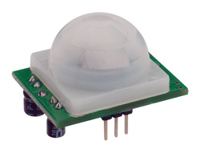
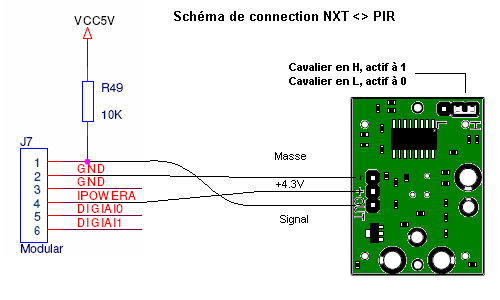
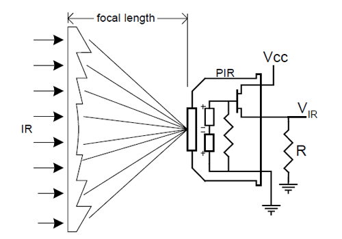
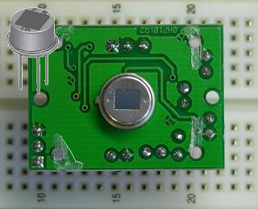
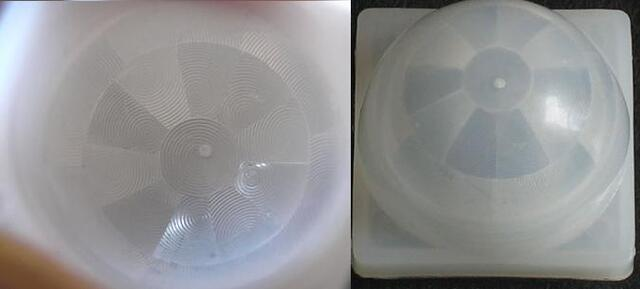
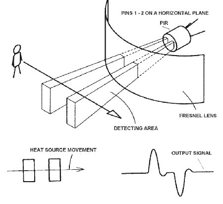

Principalement utilisés dans les systèmes d’alarme, les capteurs PIR peuvent être à la base d’expérimentations avec le NXT. Vous trouverez dans cet article la théorie sur les capteurs PIR, comment interfacer un capteur "tout ou rien" avec le NXT, et comment tester l’ensemble.

## Le kit parallax "PIR Sensor"

Le kit **"PIR Sensor (#555-28027)"** de [**Parallax**](http://www.parallax.com/) se présente sous la forme d’un module déjà intégré. Ce module détecte avec une portée de 6 mètres des mouvements d’humains (par extension, d’animaux à sang chaud). Il délivre une information binaire (0 ou 1).

-   Alimentation (entre + et -) de 3.3 à 5 VDC
-   Sortie binaire configurée par cavalier (H ou L) [^1]
-   Dimensions : 32.2 x 24.3 x 25.4 mm
-   Température : 0 à +50 °C

Voici le manuel :

**PIR Sensor (#555-28027)**

## Schéma de connexion au NXT

**Connexion NXT-PIR**

| Pin |  | Couleur |  | Nom |  | Fonction |
| --- | --- | --- | --- | --- | --- | --- |
| 1 |  | Blanc |  | ANA |  | Entrée analogique, avec résistance de tirage (10K) ou Source de tension (I2C) 9V |
| 2 |  | Noir |  | GND |  | Masse analogique |
| 3 |  | Rouge |  | GND |  | Masse numérique |
| 4 |  | Vert |  | IPOWERA/Vcc |  | Source de tension (I2C) 4,3V |
| 5 |  | Jaune |  | DIGI0/CLK |  | Ligne Horloge I2C |
| 6 |  | Bleu |  | DIGI1/DATA |  | Ligne Données I2C |

D’après les spécifications contenues dans le manuel, on peut alimenter directement le module, et il faudra donc connecter la pin 4 à + et la 2 à - , ainsi que la pin 1 à l’entrée analogique. Ce mode de connexion est valable pour la plupart des capteurs binaires et analogiques. Comme ici, la sortie du module est binaire, on pourra considérer ce module comme un capteur de contact (réponse en 0 ou 1), et donc utiliser les routines NXC associées, cf. [l’article sur les capteurs LEGO](/articles/capteurs-lego-test-et-programmation-nxc/).

SetSensorTouch(S1); // PIR en 1 x = SENSOR\_1; //lit le capteur

Pour le tester, il suffit de connecter ce capteur sur un port et d’allumer le NXT, menu "View", "Touch". Sélectionner le bon port, puis attendre 5s que le capteur apprenne le milieu. Agiter la main devant le capteur, et de 0, la mesure devrait passer à 1, et selon la position du cavalier, redescendre à 0 en 1s (L), ou à la fin du mouvement (H).

## Principe physique du capteur

Les capteurs PIR (Passive Infra-Red) sont aussi appelés pyroélectriques. Ils sont sensibles à la longueur d’onde de la lumière infrarouge émise par le corps humain, de l’ordre de 34 °C pour une peau en condition normale (soit une longueur d’onde comprise entre 9 et 10µm).

Ainsi, les capteurs sont généralement calibrés pour être sensibles de 8 à 12 µm. Les électrons du substrat capteur sont bombardés par les infrarouges, l’agitation résultante est détectée, amplifiée, puis mise en forme.

Afin d’être sensible au mouvement, et pas à la variation de température du sol entre le jour et la nuit, ou celle de murs réchauffés par le soleil, l’électronique associée cherche les variations rapides de température. Notez que les vitres sont d’excellents isolants aux infrarouges (effet "serre"), et donc on ne peut détecter un mouvement au delà d’une vitre.

Afin d’être sensible sur un angle de détection le plus vaste possible, on utilise une lentille de Fresnel qui permet de focaliser les infrarouges vers le substrat capteur.

En "rayant" différemment certaines zones de la lentille, on peut les discriminer, et donc détecter des variations d’illumination, et donc du mouvement. CQFD.

Pour aller plus loin, [des composants afin de régler les temps de réaction du capteur (en anglais).](http://www.neufeld.newton.ks.us/electronics/?p=208)

[^1]: Le fonctionnement du module pourra être configuré via un cavalier : en H(igh) la sortie sera active tant que du mouvement sera détecté ; en L(ow), la sortie sera active une seconde à chaque détection.
