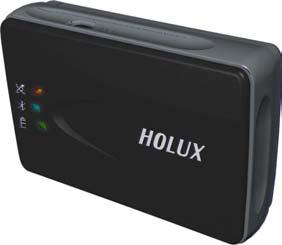
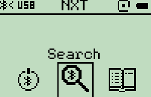
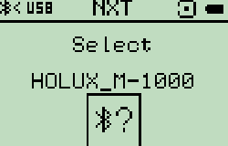
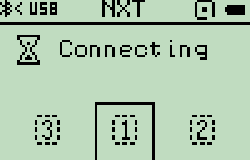
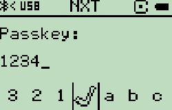
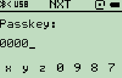
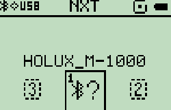
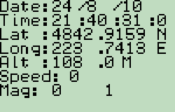

Un récepteur GPS envoie les données de localisation via Bluetooth, par un protocole dit NMEA, qui définit les trames support de la communication. Le NXT embarquant un composant bluetooth, avec lequel il est possible de faire dialoguer des NXT avec un PC et/ou ensemble, vous trouverez ici un tutoriel pour programmer la liaison bluetooth du NXT en NXC, et récupérer les données provenant du récepteur GPS.

## Le système GPS et les robots

[Le système GPS](http://fr.wikipedia.org/wiki/Global_Positioning_System) permet le positionnement sur l’ensemble de la surface du globe à +/- 2m près, au pire 10m, avec une fréquence de rafraichissement de 1 à 5 Hz (1 à 5 fois par seconde). C’est très pratique quant on est en voiture, à l’extérieur (on "voit" au moins 3 satellites), à 50 km/h (1 seconde, c’est 14 m), sur des routes qui font plus de 2 m de large (on peut discriminer les voies, et donc faire du suivi de trajectoire). Mais pour des robots qui évoluent le plus souvent à l’intérieur, qui font quelques dizaines de cm, qui évoluent à des vitesse de l’ordre du m/s et qui doivent le plus souvent se frayer un chemin dans des traces de moins de 50cm de large, c’est totalement inapproprié. Alors, pourquoi essayer de connecter un NXT avec un GPS ?

-   **Parce que !**
-   Parce que d’autres langages de programmation pour NXT, tels que [PbLua](http://www.hempeldesigngroup.com/lego/pblua/), [LeJos](http://lejos.sourceforge.net/) et [RobotC](http://www.robotc.net/index.php) disposent de leurs propres firmwares, et ont développé des librairies de code pour accéder aux trames d’un GPS bluetooth, pourquoi pas en développer une avec les bouts de code NXC qui trainent...
-   Parce que certains utilisateurs de NXT n’ont pas peur de salir leurs robots, et de les emmener "outdoor", pour des challenges de type darpa ["grand challenge", traversée du désert de point GPS en point GPS, de 2004](http://www.darpa.mil/grandchallenge04/index.htm), ou comme le [Green Monster de Steve Hassenplug](http://www.teamhassenplug.org/robots/GreenMonster/) ou même de les mouiller, cf le [bateau des boulettes](http://www.convict.lu/htm/rob/GPS.htm).
-   Parce que d’autres expérimentateurs ont tenté d’autres approches, en connectant un module GPS délivrant un signal série RS232 à un micro-contrôleur chargé de convertir le flux en I2C pour le NXT, comme Martijn ten Bhömer, qui a écrit un rapport lors du cours [**LEGO beyond toys**](http://www.bartneck.de/2008/03/09/lego-beyond-toys/).

**Projet GPS I2C**

-   Parce que Dexter Industries est en passe de mettre sur le marché [un capteur GPS](http://dexterindustries.com/blog/2010/08/12/gps-tracking-with-the-mindstorms-nxt/), et que ça donne envie d’expérimenter autour du GPS
-   Parce que je n’y connais rien en bluetooth, et que c’est fun d’apprendre et d’expérimenter !

## Connecter via le bluetooth GPS et NXT

Bien que donné pour impossible car le NXT utilise un protocole bluetooth propriétaire codé "en dur" dans le firmware (afin de garantir une connectivité facile entre la brique NXT et le PC), il est néanmoins possible de passer outre les limitations imposées. On peut ainsi récupérer une trame complète de données venant du GPS, car le composant utilisé est standard, et stocke toutes les données reçues.

Un tel exploit (au sens geek du terme, c’est à dire un moyen de contourner une difficulté) est le fait d’un certain _Antonio Scarfone_, [voici un post sur nxtasy.org qui décrit le principe du hack](http://nxtasy.org/2007/09/14/standard-firmware-and-gps-data/).

Pour pouvoir connecter un récepteur GPS Bluetooth avec le NXT, il faut :

-   Une installation fonctionnelle de [Bricxcc](http://sourceforge.net/project/showfiles.php?group_id=68600&package_id=67285), communicant avec la brique NXT via le [driver USB](http://mindstorms.lego.com/en-us/support/files/default.aspx#Driver), et une brique NXT avec le dernier [firmware optimisé](http://bricxcc.sourceforge.net/lms_arm_nbcnxc.zip).

-   Il vous faut aussi un récepteur Bluetooth compatible NMEA 1.2, Bluetooth 2.0 et capable de dialoguer à 4800 bauds [^1].

**Norme NMEA**

Celui que j’utilise est le Holux M-1000, dont voici les caractéristiques :

**Holux M-1000**

Pour "appairer" le récepteur au NXT, il vous faudra suivre les étapes suivantes

-   Allez dans le menu Bluetooth du NXT, et faite une recherche de récepteurs :
    
    
    

-   Sélectionnez le récepteur
    
    
    

-   Sélectionnez le canal bluetooth (ici 1, cf code _#define BT\_CONN 1_)
    
    
    

-   Entrez le mot de passe (celui par défaut est 1234, celui de mon récepteur 0000)
    
    
    
    **\->**
    
    
    

-   Vérifiez la connexion, le canal et le nom.
    
    
    

A chaque fois que le NXT ou le récepteur est éteint, il faut reprendre le processus de connexion, pour identifier le canal au récepteur (allez dans bluetooth, My contacts, vous retombez là :

Vous sélectionnez le canal, et voilà !)

## Programmation de la pile Bluetooth du NXT

La programmation de la communication bluetooth est de type maître-esclave, le maître donne des ordres, et les esclaves répondent, ce qui implique que les esclaves ne peuvent initier les réponses car le maître ne serait pas en mesure de les réceptionner, puisse qu’il n’a rien demander.

Les procédures de base du contrôle Bluetooth sont :  
Le programme maître vérifie que l’esclave est bien connecté sur le port ( **_constante BT\_CONN 1_** ) en utilisant la fonction **__BluetoothStatus(conn) ;__** et envoie des ordres avec **_SendRemoteString(conn,queue,string) ;_** . Il reçoit des messages de l’esclave avec **_ReceiveRemoteString(queue,clear,string) ;_** . D’autres fonctions permettent de partager un compteur de messages, afin d’éviter à l’un ou l’autre d’attendre indéfiniment un équipement déconnecté (Fouillez dans l’aide NXC fournie avec Bricxcc). Une autre fonctionnalité intéressante, c’est le contrôle à distance d’un NXT, directement grâce aux fonctionnalités du firmware, qui reçoit et traite les ordres émis par le NXT maître. On peut ainsi lui commander d’actionner les moteurs, de jouer de la musique, de lire un capteur...

## Exemple de code

Un peu comme le code "brut de fonderie" de [l’article sur le nunchuk](/articles/connecter-un-nunchuk-de-wii-a-un-nxt-via-i2c/), le [code publié par **_Antonio Scarfone_**](http://www.nxtasy.org/user_upload/2007/9/gps_master_1_04.nxc) mérite pas mal de boulot pour en faire une librairie exploitable. Entre autre, il manque le découpage des trames [NMEA](http://www.gpspassion.com/forumsen/topic.asp?TOPIC_ID=17661) en longitude/latitude/altitude, le décodage des messages de temps, la récupération du nombre de satellites vus, etc.). [_**Robokalle**_](http://www.robokalle.de/Gps.html) a quant a lui poussé l’idée de découper les trames, au travers du [bout de code suivant](http://www.robokalle.de/bilder/lego/strip_gps.nxc).  
Or toutes les informations pertinentes ne sont pas contenues dans la trame GGA (heure UTC, latitude, longitude, altitude, la correction de l’altitude), la trame PGRMC en plus la vitesse sol, le cap, la date et la déclinaison magnétique.

/\*\*\*\*\*\*\*\*\*\*\*\*\*\*\*\*\*\*\*\*\*\*\*\*\*\*\*\*\*\*\*\*\*\*\*\*\*\*\*\*\*\*\*\*\*\*\*\*\*\*\*\*\*\*\*\*\*\*\*\*\*\*\*\*\*\*\*\*\*\*\*\*\*\*\*\*\*\*\* \* Library for bluetooth GPS Receiver \* \*\*\*\*\*\*\*\*\*\*\*\*\*\*\*\*\*\*\*\*\*\*\*\*\*\*\*\*\*\*\*\*\*\*\*\*\*\*\*\*\*\*\*\*\*\*\*\*\*\*\*\*\*\*\*\*\*\*\*\*\*\*\*\*\*\*\*\*\*\*\*\*\*\*\*\*\*\*\* \* This is a library to handle Bluetooth communication with Gps receivers, \* \* Holux M-1000, M-1200 and Navilock BT-348 have been tested, but other \* \* models with NMEA GPS-Data output 4600 baud capable should also work. \* \* This library is able to parse GGA and RMC string, and retreive \* \* informations such as Longitude, Latitude and Date or UTC Time. \* \* \* \* Provided "as is" by Benco, french AFOL, contact via the nxtasy.org \* \* forum. You can find some articles around NXT and electronic, in french \* \* and english at http://freelug.org/auteur.php3?id\_auteur=135 \* \* \* \* -Original first working NXC source posted by Antonio Scarfone \* \* -Original first GPGGA string analyser (based on Antonio code) given \* \* by Robokalle \* \* \* \*\*\*\*\*\*\*\*\*\*\*\*\*\*\*\*\*\*\*\*\*\*\*\*\*\*\*\*\*\*\*\*\*\*\*\*\*\*\*\*\*\*\*\*\*\*\*\*\*\*\*\*\*\*\*\*\*\*\*\*\*\*\*\*\*\*\*\*\*\*\*\*\*\*\*\*\*\*\*/ #include "NXCDefs.h" #define BT\_CONN 1 //Bluetooth connection port #define INBOX 1 //Mailbox or QUEUE number #define INBUFFER 128 //The input buffer, where the GPS data are written #define INBUFFERSMALL 58 //Workarround buffer of 58 bytes, because nxc is only able to read max 58 bytes #define INBUFFERSMALL2 12 //Workarround buffer 2 x 58 = 116, remains 12 bytes to 128 bytes #define STARTOFFSET 0 //Offset start #define FILENAME "NMEA2.txt" //Name of the file to write the GPS data /\*Struct, where to hold the gps data stream sentences for one read cycle, one read cycle brings up to 2 or 3 sentences. For security reason, there is a fourth sentence struct variable implemented\*/ struct sentence\_struct { string sentence1; string sentence2; string sentence3; string sentence4; }; sentence\_struct gpsSentences; //Global struct variable for the GPS sentences // temp. strings string out; // out: output for the sentences, "all in one string" // temp. buffers for the workarround input buffer to read splitted in 58,58,12 bytes buffers byte tmpbuffer0\[\]; byte tmpbuffer1\[\]; byte tmpbuffer2\[\]; //Buffer to clear or init the real 128 byte input buffer byte clearbuffer\[\]; //Buffer for init the request of the GPS Data byte startreadbuf\[\]; //Create or append file for output data only for debug phase bool filewritten; //Speed of the data flow, depends if the GPS-Receiver is connected to satelite or not int dataflow = 0; struct GPS\_struct { int UTC\_Hour; int UTC\_Min; int UTC\_Sec; int UTC\_mSec; int Date\_Day; int Date\_Month; int Date\_Year; unsigned int Latitude\_high; int Latitude\_low; string Latitude\_direction; unsigned int Longitude\_high; int Longitude\_low; string Longitude\_direction; int Ground\_speed; byte Quality; string Receiver\_Status; byte Sat\_number; byte accurateness\_high; byte accurateness\_low; int altitude\_high; int altitude\_low; int Magnetic\_deg; string Magnetic\_dir; string altitude\_measure; }; GPS\_struct GPSData; //Global struct variable for the GPS data void Display\_GPSData() { ClearScreen(); TextOut(0,LCD\_LINE1,"Date:"); NumOut(30,LCD\_LINE1,GPSData.Date\_Day); TextOut(45,LCD\_LINE1,"/"); NumOut(50,LCD\_LINE1,GPSData.Date\_Month); TextOut(65,LCD\_LINE1,"/"); NumOut(70,LCD\_LINE1,GPSData.Date\_Year); TextOut(0,LCD\_LINE2,"Time:"); NumOut(30,LCD\_LINE2,GPSData.UTC\_Hour); TextOut(45,LCD\_LINE2,":"); NumOut(50,LCD\_LINE2,GPSData.UTC\_Min); TextOut(65,LCD\_LINE2,":"); NumOut(70,LCD\_LINE2,GPSData.UTC\_Sec); TextOut(85,LCD\_LINE2,":"); NumOut(90,LCD\_LINE2,GPSData.UTC\_mSec); TextOut(0,LCD\_LINE3,"Lat :"); NumOut(30,LCD\_LINE3,GPSData.Latitude\_high); TextOut(56,LCD\_LINE3,"."); NumOut(60,LCD\_LINE3,GPSData.Latitude\_low); TextOut(90,LCD\_LINE3,GPSData.Latitude\_direction); TextOut(0,LCD\_LINE4,"Long:"); NumOut(30,LCD\_LINE4,GPSData.Longitude\_high); TextOut(56,LCD\_LINE4,"."); NumOut(60,LCD\_LINE4,GPSData.Longitude\_low); TextOut(90,LCD\_LINE4,GPSData.Longitude\_direction); TextOut(0,LCD\_LINE5,"Alt :"); NumOut(30,LCD\_LINE5,GPSData.altitude\_high); TextOut(56,LCD\_LINE5,"."); NumOut(60,LCD\_LINE5,GPSData.altitude\_low); TextOut(70,LCD\_LINE5,GPSData.altitude\_measure); TextOut(0,LCD\_LINE6,"Speed:"); NumOut(40,LCD\_LINE6,GPSData.Ground\_speed); TextOut(0,LCD\_LINE7,"Mag:"); NumOut(30,LCD\_LINE7,GPSData.Magnetic\_deg); NumOut(60,LCD\_LINE7,GPSData.Magnetic\_dir); } /\* GGA Global Positioning System Fix Data. Time, Position and fix related data for a GPS receiver $--GGA,hhmmss.ss,llll.ll,a,yyyyy.yy,a,x,xx,x.x,x.x,M,x.x,M,x.x,xxxx\*hh 1) Time (UTC) 2) Latitude 3) N or S (North or South) 4) Longitude 5) E or W (East or West) 6) GPS Quality Indicator, \[0 - fix not available, 1 - GPS fix, 2 - Differential GPS fix\] 7) Number of satellites in view, 00 - 12 8) Horizontal Dilution of precision 9) Antenna Altitude above/below mean-sea-level (geoid) 10) Units of antenna altitude, meters 11) Geoidal separation, the difference between the WGS-84 earth ellipsoid and mean-sea-level (geoid), "-" means mean-sea-level below ellipsoid 12) Units of geoidal separation, meters 13) Age of differential GPS data, time in seconds since last SC104 type 1 or 9 update, null field when DGPS is not used 14) Differential reference station ID, 0000-1023 15) Checksum \*/ void GGAParsing(int item,string sdumy){ int len,j; string dumy, dumy1; len= StrLen(sdumy); switch(item){ case 1: for (j=0; j < len ;j++){ if (StrIndex(sdumy,j)== 46){ // "." searching dumy1= SubStr( sdumy,0,2 ) ; GPSData.UTC\_Hour = StrToNum(dumy1); dumy1= SubStr( sdumy,2,2 ) ; GPSData.UTC\_Min = StrToNum(dumy1); dumy1= SubStr( sdumy,4,2 ) ; GPSData.UTC\_Sec = StrToNum(dumy1); dumy1=SubStr( sdumy,j+1, len - j); GPSData.UTC\_mSec =StrToNum(dumy1); } } break; case 2: for (j=0; j < len ;j++){ if (StrIndex(sdumy,j)== 46){ dumy1= SubStr( sdumy,0,j ) ; GPSData.Latitude\_high = StrToNum(dumy1); dumy1=SubStr( sdumy,j+1, len - j); GPSData.Latitude\_low =StrToNum(dumy1); } } break; case 3: GPSData.Latitude\_direction=sdumy; break; case 4: for (j=0; j < len ;j++){ if (StrIndex(sdumy,j)== 46){ dumy1= SubStr( sdumy,0,j ) ; GPSData.Longitude\_high = StrToNum(dumy1); dumy1=SubStr( sdumy,j+1, len - j); GPSData.Longitude\_low =StrToNum(dumy1); } } break; case 5: GPSData.Longitude\_direction=sdumy; break; case 6: GPSData.Quality=StrToNum(sdumy); break; case 7: GPSData.Sat\_number=StrToNum(sdumy); break; case 8: for (j=0; j < len ;j++){ if (StrIndex(sdumy,j)== 46){ dumy1= SubStr( sdumy,0,j ) ; GPSData.accurateness\_high = StrToNum(dumy1); dumy1=SubStr( sdumy,j+1, len - j); GPSData.accurateness\_low =StrToNum(dumy1); } } break; case 9: for (j=0; j < len ;j++){ if (StrIndex(sdumy,j)== 46){ dumy1= SubStr( sdumy,0,j ) ; GPSData.altitude\_high = StrToNum(dumy1); dumy1=SubStr( sdumy,j+1, len - j); GPSData.altitude\_low =StrToNum(dumy1); } } break; case 10: GPSData.altitude\_measure=sdumy; break; } } /\*RMC Recommended Minimum Navigation Information $--RMC,hhmmss.ss,A,llll.ll,a,yyyyy.yy,a,x.x,x.x,xxxx,x.x,a\*hh 1) Time (UTC) 2) Status, V = Navigation receiver warning 3) Latitude 4) N or S 5) Longitude 6) E or W 7) Speed over ground, knots 8) Track made good, degrees true 9) Date, ddmmyy 10) Magnetic Variation, degrees 11) E or W 12) Checksum \*/ void RMCParsing(int item,string sdumy){ int len,j; string dumy, dumy1; len= StrLen(sdumy); switch(item){ case 1: for (j=0; j < len ;j++){ if (StrIndex(sdumy,j)== 46){ // "." searching dumy1= SubStr( sdumy,0,2 ) ; GPSData.UTC\_Hour = StrToNum(dumy1); dumy1= SubStr( sdumy,2,2 ) ; GPSData.UTC\_Min = StrToNum(dumy1); dumy1= SubStr( sdumy,4,2 ) ; GPSData.UTC\_Sec = StrToNum(dumy1); dumy1=SubStr( sdumy,j+1, len - j); GPSData.UTC\_mSec =StrToNum(dumy1); } } break; case 2: GPSData.Receiver\_Status=sdumy; break; case 3: for (j=0; j < len ;j++){ if (StrIndex(sdumy,j)== 46){ dumy1= SubStr( sdumy,0,j ) ; GPSData.Latitude\_high = StrToNum(dumy1); dumy1=SubStr( sdumy,j+1, len - j); GPSData.Latitude\_low =StrToNum(dumy1); } } break; case 4: GPSData.Latitude\_direction=sdumy; break; case 5: for (j=0; j < len ;j++){ if (StrIndex(sdumy,j)== 46){ dumy1= SubStr( sdumy,0,j ) ; GPSData.Longitude\_high = StrToNum(dumy1); dumy1=SubStr( sdumy,j+1, len - j); GPSData.Longitude\_low =StrToNum(dumy1); } } break; case 6: GPSData.Longitude\_direction=sdumy; break; case 7: GPSData.Ground\_speed=StrToNum(sdumy); break; case 7: GPSData.Sat\_number=StrToNum(sdumy); break; case 9: dumy1= SubStr( sdumy,0,2 ) ; GPSData.Date\_Day = StrToNum(dumy1); dumy1= SubStr( sdumy,2,2 ) ; GPSData.Date\_Month = StrToNum(dumy1); dumy1= SubStr( sdumy,4,2 ) ; GPSData.Date\_Year = StrToNum(dumy1); break; case 10: GPSData.Magnetic\_deg=StrToNum(sdumy); break; case 11: GPSData.Magnetic\_dir=sdumy; break; } } // Writes the sentences stored in out to a file, only for debug void WriteData (string afile, string Data) { byte handle; int slen; int fsize; if (!filewritten) { if (CreateFile(afile, 10048, handle) == NO\_ERR ) { slen = StrLen(Data); WriteBytes(handle, Data, slen); CloseFile(handle); filewritten = true; } } else { if (OpenFileAppend(afile, fsize, handle) == NO\_ERR ) { slen = StrLen(Data); WriteBytes(handle, Data, slen); CloseFile(handle); } } } // strip the buffer string into pieces, searching ",", and send them // to the good parser, depending the NMEA header void strip\_gps\_data(string GPS\_data){ int lendata, i, begin, last, item ; string sdumy; bool GGA = false; bool RMC = false; i=0; lendata= StrLen(GPS\_data); begin = -1; item=0; while (StrIndex(GPS\_data,i) ==36 && i < lendata){i++; begin =i;} if (begin >-1){ for (i=begin; i < lendata ;i++) { if (StrIndex(GPS\_data,i)== 44){ last=i; sdumy=SubStr(GPS\_data,begin,last-begin); if (sdumy == "GPGGA") {GGA = true;} if (sdumy == "GPRMC") {RMC = true;} if (GGA){ GGAParsing(item,sdumy); begin=i+1; item++; } else { if (RMC){ RMCParsing(item,sdumy); begin=i+1; item++; } else { i=lendata;} } } } } } //Sub routine to check Bluetooth connection, exits the program if no connection sub BTCheck(int conn){ byte index, trials; byte event; if (!BluetoothStatus(conn) == NO\_ERR){ TextOut(5,LCD\_LINE2,"Error, Verify"); TextOut(5,LCD\_LINE3,"Bluetooth Port"); Wait(1000); Stop(true); } } //Submit the three temp. input buffers, in order to extract the sentences. //Each sentence starts with a '$' char ascii=36 and ends with a '\*' char ascii=42 to follow a checksum and a CR+LF. int GetSentences (sentence\_struct &ret,byte buffer1\[\],byte buffer2\[\],byte buffer3\[\],byte asciibegin, byte asciiend) { byte sarray\[\],rarray\[\]; string astr = ""; int beg = -1; int ends = -1; int ii = 0; int xx = 0; int num = -1; byte alen = 0; byte lensplit = 0; bool startsplit = true; ArrayInit(sarray, 0, INBUFFER); ArrayInit(rarray, 0, INBUFFER); ArrayBuild(sarray, buffer1, buffer2, buffer3); alen = ArrayLen(sarray); for (ii=0;ii<alen;ii++) { if (sarray\[ii\] == asciibegin) { if (startsplit == true && beg == -1 && ends == -1){ beg = ii; startsplit=false; continue; } if (startsplit == false && beg > -1 && ends == -1){ ends = ii; num++; lensplit = (ends - beg); dataflow+=lensplit; ArraySubset(rarray, sarray, beg, lensplit); ByteArrayToStrEx(rarray, astr); if (xx == 0) ret.sentence1 = astr; if (xx == 1) ret.sentence2 = astr; if (xx == 2) ret.sentence3 = astr; if (xx == 3) ret.sentence4 = astr; ArrayInit(rarray, 0, INBUFFER); astr = ""; startsplit = true; ends = -1; beg = -1; xx++; ii = ii - 1; } } } num++; return num; } task main(){ int numsent = 0;// Number of sentences received in one read cycle int n = 0; byte inbufPtr = 0; IOMapReadType InBufferfull; //Struct to check if input is full and ready for the next read cycle InBufferfull.ModuleName = CommModuleName; InBufferfull.Offset = CommOffsetBtInBufInPtr; InBufferfull.Count = 1; InBufferfull.Buffer\[0\]=0; CommExecuteFunctionType cefArgs; //init the following buffers ArrayInit(tmpbuffer0, 0, INBUFFERSMALL); ArrayInit(tmpbuffer1, 0, INBUFFERSMALL); ArrayInit(tmpbuffer2, 0, INBUFFERSMALL2); ArrayInit(clearbuffer, 0, INBUFFER); ArrayInit(startreadbuf, 0, INBUFFERSMALL); BTCheck(BT\_CONN); //check slave connection //Check if file is already written filewritten = false; ReceiveRemoteString(INBOX, 1, startreadbuf); //Start a receive sequence to fill up the input buffer with GPS data while(true){ //init the struct to hold the sentences gpsSentences.sentence1 = ""; gpsSentences.sentence2 = ""; gpsSentences.sentence3 = ""; gpsSentences.sentence4 = ""; //init the output string, which hold up the gpsSentences struct out = ""; //Start a receive sequence to fill up the input buffer with GPS data , before reading the input buffer ReceiveRemoteString(INBOX, 1, startreadbuf); //make sure one receive sequence is not pending or not in error SysIOMapRead(InBufferfull); while(InBufferfull.Buffer\[0\]==0) { SysIOMapRead(InBufferfull); } SetBluetoothState(NO\_ERR); InBufferfull.Buffer\[0\]=0; //Get the 128 byte large input buffer in three temp. buffer splitted up in 58,58 and 12 bytes long bytes arrays, //in order to workarround the ability of nxc to handle only 58 bytes large buffers. GetBTInputBuffer(STARTOFFSET, INBUFFERSMALL, tmpbuffer0); GetBTInputBuffer(INBUFFERSMALL, INBUFFERSMALL, tmpbuffer1); GetBTInputBuffer(2\*INBUFFERSMALL, INBUFFERSMALL2, tmpbuffer2); numsent = GetSentences(gpsSentences, tmpbuffer0, tmpbuffer1,tmpbuffer2, 36, 42); //Output the extracted sentences to out string if (gpsSentences.sentence1 != "") out=StrCat(out,gpsSentences.sentence1); if (gpsSentences.sentence2 != "") out=StrCat(out,gpsSentences.sentence2); if (gpsSentences.sentence3 != "") out=StrCat(out,gpsSentences.sentence3); if (gpsSentences.sentence4 != "") out=StrCat(out,gpsSentences.sentence4); //Clear up the input buffer and set the input buffer pointer at the beginning of the buffer inbufPtr = BTInputBufferInPtr(); if (inbufPtr == INBUFFER){ SetBTInputBuffer(STARTOFFSET, INBUFFER, clearbuffer); SetBTInputBufferInPtr(0); } //clear up the temp. buffers ArrayInit(tmpbuffer0, 0, INBUFFERSMALL); ArrayInit(tmpbuffer1, 0, INBUFFERSMALL); ArrayInit(tmpbuffer2, 0, INBUFFERSMALL2); ArrayInit(clearbuffer, 0, INBUFFER); n+=numsent; strip\_gps\_data(out); //WriteData(FILENAME,out); //write the sentences in a file (for debug) Display\_GPSData(); numsent = 0; } }

Le code source :

**code source**

Le résultat :

**GPS\_Display**

## GPS différentiel

Le [GPS différentiel](http://fr.wikipedia.org/wiki/GPS_diff%C3%A9rentiel) pourrait être une solution pour augmenter la précision du GPS. Pour faire, il faudrait disposer de deux sources de données GPS, l’une statique, l’autre embarquée dans le robot. Ainsi les variations du signal GPS par des brouilleurs extérieurs (vents solaires, micro-variations de propagation dues aux phénomènes électro-magnétiques) seraient les mêmes pour les deux récepteurs, et on pourrait en "annuler" par calcul les effets (valeurs du GPS embarqué - perturbations du statique = valeurs embarquées plus précises). On obtiendrait une précision de quelques dizaines de cm, à vérifier....

[^1]: Pour l’instant les GPS RoyalTek RBT 1000 XTRACK2, Holux M-1200, Holux M-1000 et Navilock BT-348 ont été testés avec succès, mais il n’y a pas de raison que d’autres récepteurs ne soient pas compatible, n’hésitez pas à me faire part de vos succès/échecs, afin d’allonger la liste.
