Nunchuk de Wii ouvert, préparé et assaisonné sur lit de NXT, à la mode I2C, selon une recette nxtasy.

## But : se bricoler à moindre coût un capteur accéléromètre 3D pour le NXT

Suite à une visite sur les forums nxtasy à la recherche d’idées de capteurs alternatifs à ceux fournis par LEGO, et particulièrement ce [topic](http://forums.nxtasy.org/index.php?showtopic=3075), j’ai décider de me lancer dans la connexion via I2C de ma brique NXT et d’un Nunchuk.

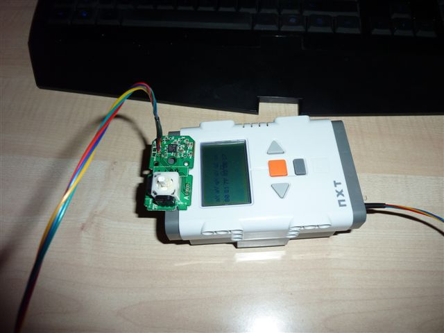

## Ingrédients

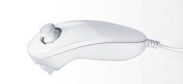

**–** 1 [Nunchuk de Wii](http://www.wiili.org/index.php/Wiimote/Extension_Controllers/Nunchuk) (dont le câble a été mâchouillé par le chat) trouvé sur Ebay déjà démonté par son propriétaire, et qui s’en débarrassait pour 3€, FdP compris ;  
**–** 1 [connecteur mâle NXT](http://www.mindsensors.com/index.php?module=pagemaster&PAGE_user_op=view_page&PAGE_id=67), du [câble RJ12](http://www.philohome.com/nxtcables/nxtcable.htm) et une [pince modifiée](http://www.philohome.com/crimp/crimp.htm), ou une extrémité d’un câble NXT coupé en deux (snif !) ;  
**–** 1 diode type 1N4148 (ou 1N4150) ;  
**–** 2 résistances 33k, 1/4W ;  
**–** 1 fer à souder, une pince coupante et du fil d’étain pour soudure électronique.

**Avertissement** Enfant, ne faites pas cette manipulation. Demandez à un adulte de vous aider. A tous, les auteurs ne sauraient être tenus responsables de blessure éventuelle et/ou de dommage provoqué par de mauvais branchements électriques.

## Mode opératoire

Ouvrir délicatement le nunchuk, puis sortir le noyau (aussi appelé PCB), réserver la coque.

[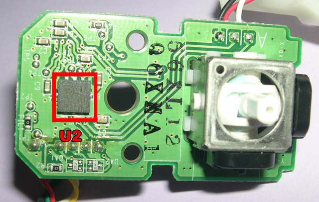](https://www.freelug.org/IMG/jpg/Nunchuck_top.jpg)

Dessouder les résistances sms R1 et R2, délicatement, avec une panne fine, en forçant légèrement sur le coté, une fois la deuxième soudure fondue.

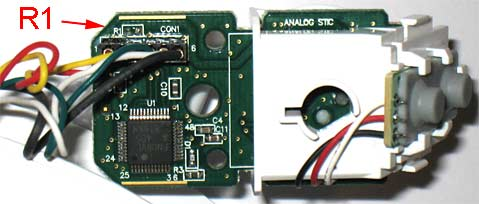

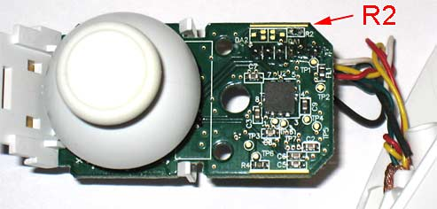

Si vous avez les ingrédients nécessaires pour faire un câble dédié (pour rappel : 1 connecteur mâle NXT, du câble RJ12 et une pince modifiée), alors dessoudez carrément le connecteur noir et réservez le câble blanc (avec le connecteur de la Wiimote).

[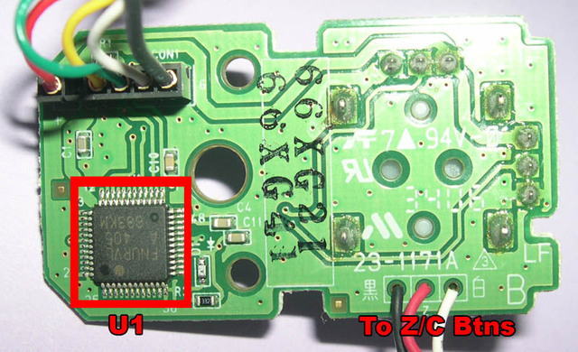](https://www.freelug.org/IMG/jpg/Nunchuck_btm.jpg)

Effectuez le montage des résistances de 33k et de la diode, puis soudez les brins du câble RJ12.

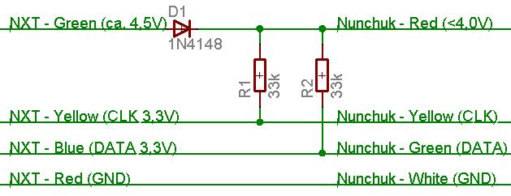

A l’autre extrémité, faites le sertissage du connecteur NXT, vérifiez visuellement le résultat (court circuits, plots de soudures, ordre et tenue des fils), puis vérifiez à l’ohmmètre.

|  |  |  |  |
| --- | --- | --- | --- |
| 1 | Blanc | AN1 | Entrée analogique, avec résistance de tirage |
| 2 | Noir | GND | Masse analogique |
| 3 | Rouge | GND | Masse numérique |
| 4 | Vert | Vcc /4.3V | Alimentation numérique |
| 5 | Jaune | DIGI0/CLK | Ligne Horloge I2C |
| 6 | Bleu | DIGI1/DATA | Ligne Données I2C |

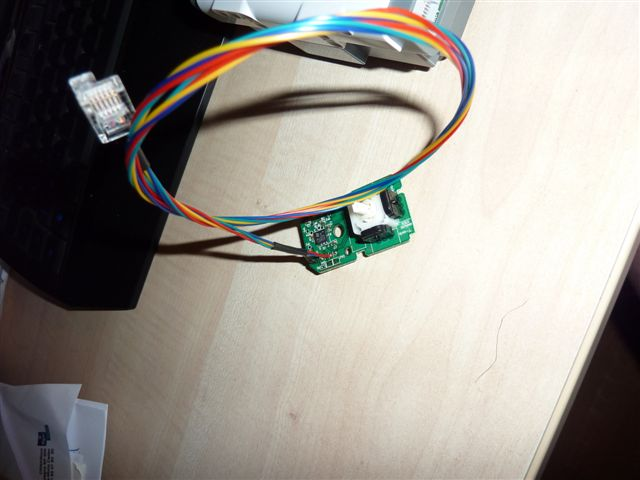

Sinon, coupez un long câble NXT en deux, coupez le câble du nunchuk avant le connecteur de la Wiimote, et connectez les deux câbles.

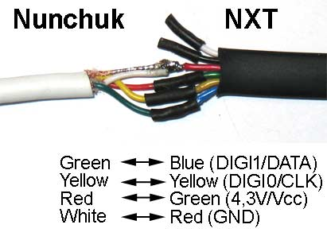

Faites le montage des résistances de 33k et de la diode, au niveau du connecteur noir, prés de la platine du nunchuk.

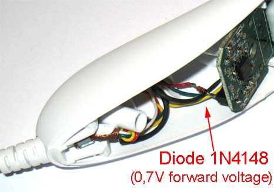

Vérifiez visuellement le résultat (court circuits, plots de soudures, ordre et tenue des fils), puis vérifiez à l’ohmmètre.

## Test

Un PC avec [Brixcc](http://bricxcc.sourceforge.net/), [NBC/NXC](http://bricxcc.sourceforge.net/nbc/), et un NXT avec le « [enhanced firmware by John Hansen](http://bricxcc.sourceforge.net/lms_arm_jch.zip) »

//Code pour la connexion via I2C, d'un Nunchuk pour nintendo Wii //Aucune espèce de garantie ou de copyright sur le code, faites //en ce que vous voulez. Contact: benparsy@yahoo.fr #include "NXCDefs.h" //Vous pouvez plugger le nunchuk sur l'un des 4 ports, en le //déclarant dans votre code (variable port\_Nunchuk). byte outbuf\[\]; //Buffer sub NunchukGetParamter(byte port\_Nunchuk) { byte CMDNunchukInit\[\] = {0xA4, 0x40, 0x00}; // @I2C 0xA4, registre 0x40 byte CMDNunchukWrite\[\] = {0xA4, 0x00}; byte CMDNunchukRead\[\] = {0xA4}; byte nbytes; //Initialisation de connexion I2C avec le Nunchuk SetSensorLowspeed(port\_Nunchuk); // données brutes, raz du capteur //Ecriture à @I2C 0xA4, Mot d'Initialisation, pas de résultat (0 byte) LowspeedWrite(port\_Nunchuk, 0, CMDNunchukInit); while(LowspeedStatus(port\_Nunchuk, nbytes)>0); //Ecriture à @I2C 0xA4, Mot d'Ecriture, pas de résultat (0 byte) LowspeedWrite(port\_Nunchuk, 0, CMDNunchukWrite); while(LowspeedStatus(port\_Nunchuk, nbytes)>0); //Ecriture à @I2C 0xA4, registre 0x00, attente de 6 bytes byte count = 6; LowspeedWrite(port, count, CMDNunchukRead); while(LowspeedStatus(port, nbytes)>0); //Lecture du registre, et reception dans le buffer if(nbytes == count){ LowspeedRead(port, count, outbuf) for(int i=0; i<count; i++ ){ outbuf\[i\]=(outbuf\[i\]^0x17) + 0x17; } } else { ArrayInit(outbuf,0,0); //erreur } } task main() { while (true) { NunchukGetParamter(IN\_1); if (ArrayLen(outbuf)==6) { string Nunchuk="aXaYgXgYgZCZ"; if ((outbuf\[5\]&0x01)!=0) {Nunchuk\[11\]=122;} //Show Z-Button if ((outbuf\[5\]&0x02)!=0) {Nunchuk\[10\]=99;} //Show C-Button ClearScreen(); for(int i=0; i<ArrayLen(outbuf); i++ ) { TextOut(15\*i, LCD\_LINE3, SubStr(Nunchuk, 2\*i, 2)); TextOut(15\*i, LCD\_LINE5, FormatNum("%02X", outbuf\[i\])); } CircleOut((outbuf\[0\]-0x1E)/2, (outbuf\[1\]-0x1E)/3, 3); //analog stick RectOut((outbuf\[2\]-0x46), (outbuf\[3\]-0x46)/2, 6, 6); //acceleration value } Wait(100); } }

Le code dessine un cercle contrôlé par le joystick analogique, et le carré est contrôlé par le capteur d’accélération [ST Microelectronics LIS3L02AL "3-axis accelerometer"](http://www.st.com/stonline/products/literature/ds/11668.pdf).

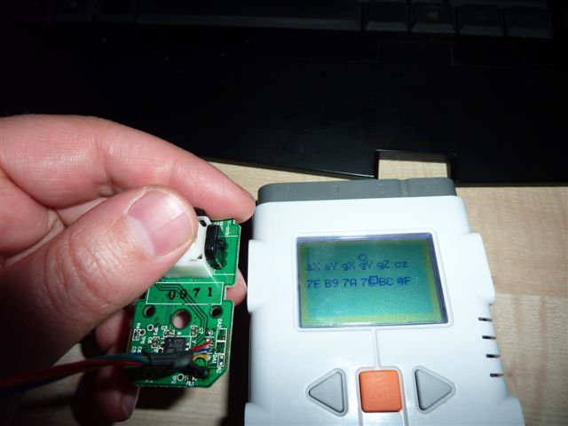

_Note du 23/12/2010_ - correction du code source donné en exemple, embrouille dans la procédure GetParameter sur la variable `count`, qui est égale à 6, et que j’ai voulu supprimer, mais pas entièrement, d’où une erreur de type "count non déclarée". Code mis à jour, et testé ! Ca fonctionne. Ouf. Merci philo ;-)
