Constatant que le grand carrousel 10196 est beaucoup trop grand à mon goût pour côtoyer les bâtiments modulaires, j’ai décidé de construire mon propre manège...

## Première étape : Identifier les principales difficultés et fixer les contraintes

**–** faire un manège rond  
**–** faire un manège pas trop haut  
**–** faire un manège pas trop lourd  
**–** faire un manège qui fonctionne  
**–** faire un manège qui rentre dans l’emplacement prévu : le manège doit être positionné sur un support de 4 briques de haut maximum pour le mécanisme

## Deuxième étape : modélisation

Comme j’en ai l’habitude maintenant, je commence la construction de mon manège dans LDD. Voici le prototype :

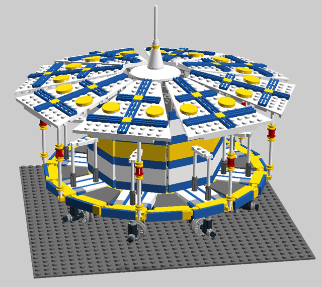

**modélisation dans LDD**

modélisation dans LDD

Les principales caractéristiques de ce manège :  
**–** utilisation des charnières plates pour l’aspect circulaire

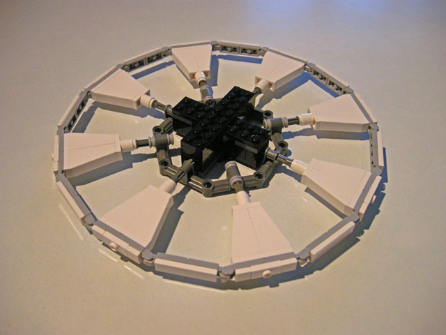

la base avec les charnières

**–** du snot sur la partie horizontale pour les briques Technic : le mécanisme de soulèvement des chevaux est situé sous le manège

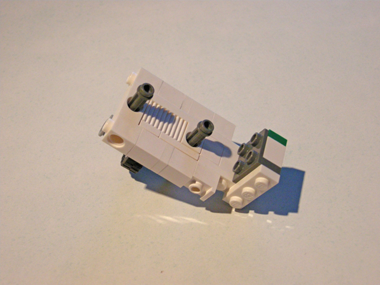

élément de la base en snot

**–** du snot sur la partie verticale : les plaques (à tenons et lisses) sont a priori plus légères qu’un tas de briques et ça permet de faire une décoration plus jolie, c’est un manège après tout !

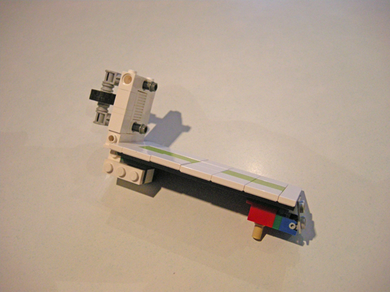

l’élément de base et le panneau vertical

**–** un peu de Technic au milieu pour tenir l’ensemble

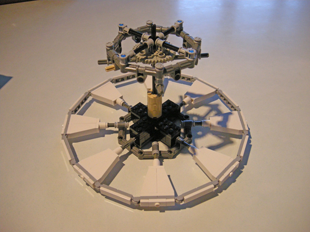

la partie centrale du manège

## Troisième étape : construction

Quelques modifications sont apportées sur la structure interne (par rapport au modèle informatique) et sur la toiture, pour cacher les interstices.

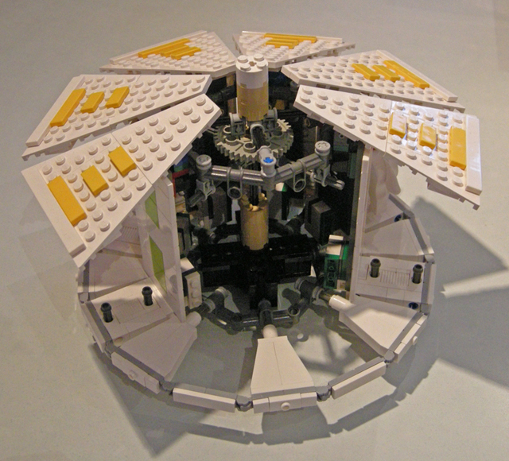

la construction progresse

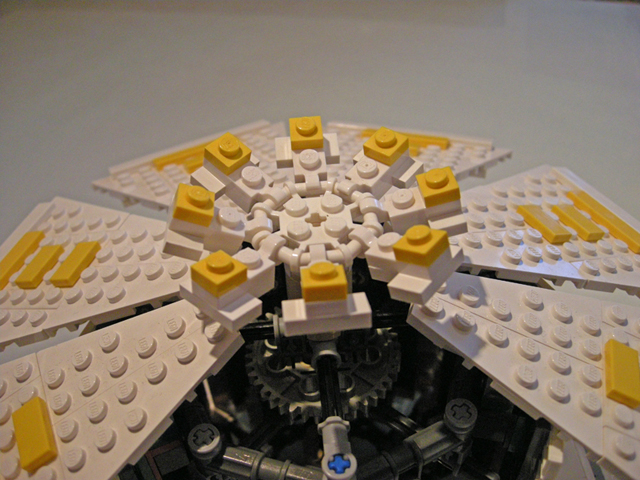

partie supérieure

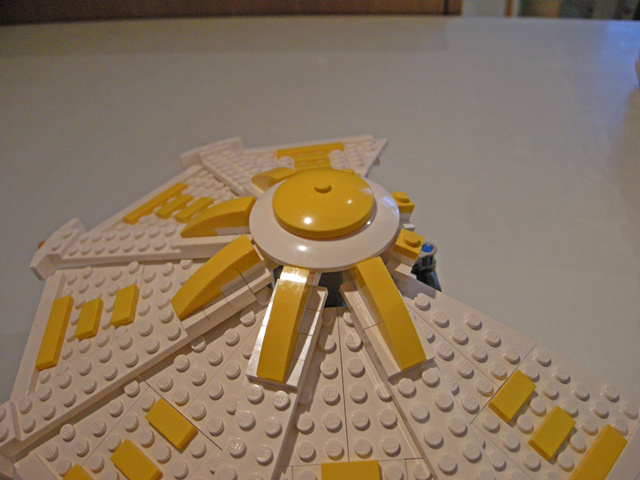

le chapeau et les arêtes

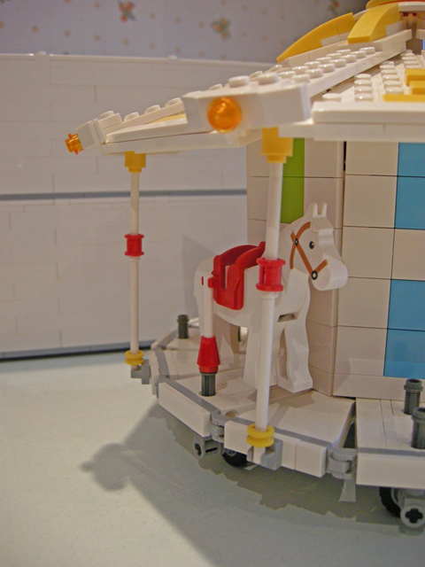

premier cheval installé et colonnes extérieures

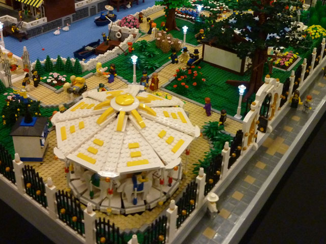

le manège dans le parc

## Quatrième étape

**Motorisation**

Le mouvement des chevaux est assuré par leur système d’attache visible sur les deuxième et troisième photos : les axes Technic avec tenon ([http://www.bricklink.com/catalogList.asp?catType=P&catID=134](http://www.bricklink.com/catalogList.asp?catType=P&catID=134)) sont reliés à un essieu et une roue qui roule sur le circuit suivant :

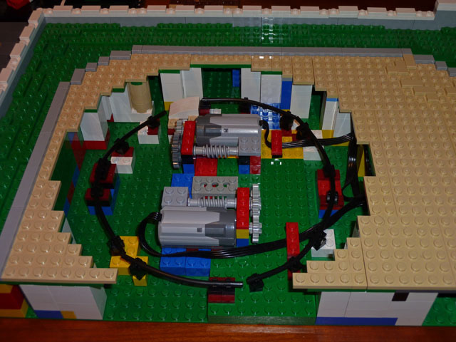

**guide**

guide pour le mouvement vertical des chevaux

Ce circuit, réalisé avec du tube rigide permet d’avoir sur un tour 2 montées et 2 descentes des chevaux.

La rotation de l’ensemble du manège est assurée par l’entraînement du bloc central (noir).

Et c’est là que ça coince :  
**–** Motorisation directe : je ne peux pas à cause de la trop faible profondeur du socle du manège  
**–** Motorisation indirecte 1 : un moteur PFS M entraîne un axe avec quelques engrenages à angle droit. Ca ne marche pas, il y a trop d’efforts sur l’axe, qui se vrille (j’arrête le moteur avant d’abîmer l’axe)  
**–** Motorisation indirecte 2 : deux moteurs PFS M en opposé de chaque côté du manège, avec axes et engrenages. c’est un peu mieux, mais pas assez  
**–** Motorisation indirecte 3 : deux moteurs PFS M placés sous le manège entraînent des vis sans fin, qui entraînent une même roue dentée. C’est le meilleur résultat obtenu, mais il y a encore trop d’efforts sur la roue dentée qui finit par se décaler de l’axe et génère soubresauts et à-coups sur le manège.

## Conclusion

Je suis parvenu à un résultat qui me satisfait sur l’esthétique du manège. Depuis sa construction, de nouvelles pièces/couleurs sont apparues (pentes arrondies dorées - Atlantis - et dôme doré - Prince of Persia) qui pourraient encore l’améliorer.

La partie mécanique, et bien, si vous voulez tenter de nouveaux montages, je suis intéressé !
