Généralement, lorsque l’on parle de train à grande vitesse, on oublie souvent la voie. En effet, la très grande vitesse en train n’est possible que sur une voie construite spécialement pour la grande vitesse. Un TGV d’aujourd’hui sur une voie classique, ne va pas beaucoup plus vite que les 200 Km/H du Capitol en 1967 entre entre Les Aubrais et Vierzon.

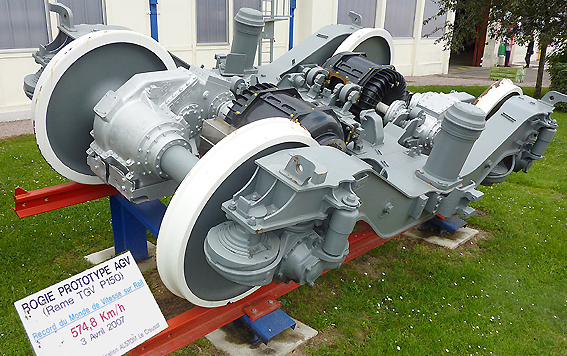

## Spécifications générales pour la LGV 2

Nous en étions donc restés à Saint Rambert qui a vu la deuxième (et finalement dernière) sortie de la LGV 1. En effet, les multiples runs des trains sur la LGV et les discussions lors de l’exposition de Saint Rambert, plus ensuite pas mal d’échanges de mails ont imposé une seule conclusion possible : une LGV V2 doit être faite pour Fana’briques 2010.

Les principaux points retenus pour cette LGV 2 sont :  
**–** faire des tronçons de voies un petit peu plus long ( 128 tenons au lieu de 96)  
**–** trouver un système de traverses plus "réaliste" vis à vis d’une LGV réelle  
**–** faire des courbes de grand rayon  
**–** faire des courbes avec clothoide en début et fin de courbe  
**–** faire des courbes avec un dévers important mais réaliste.

Enfin l’objectif est d’avoir une LGV 2 complète, c’est à dire :  
**–** 2 virages complets en LGV 2  
**–** un aller et un retour ( environ 2x30 mètres) en LGV 2

Ce qui fait donc environ 80 mètres de voie nouvelle à complètement construire.

## L’esthétique générale de la voie

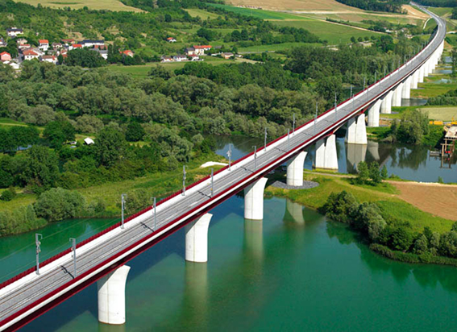

**Les rails**

Les rails utilisés ont un profil de type Vignole : rail en aluminium (pour des raisons de budget, mais existe aussi en laiton, inox ou maillechort) code 250

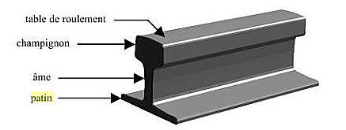

Vient ensuite le ballast et l’accroche du rails sur les traverses.

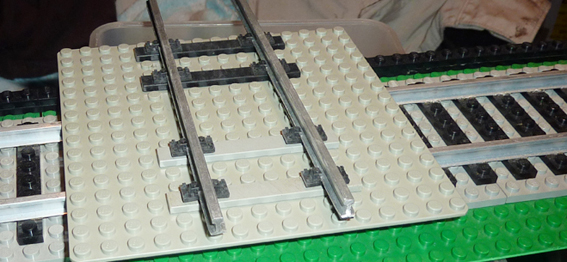

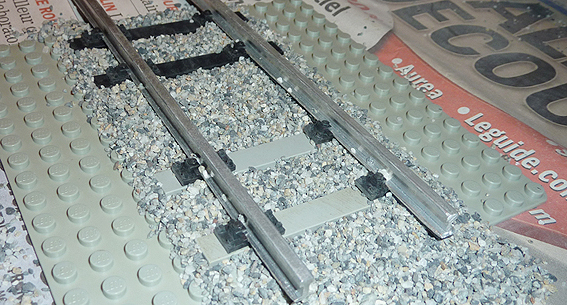

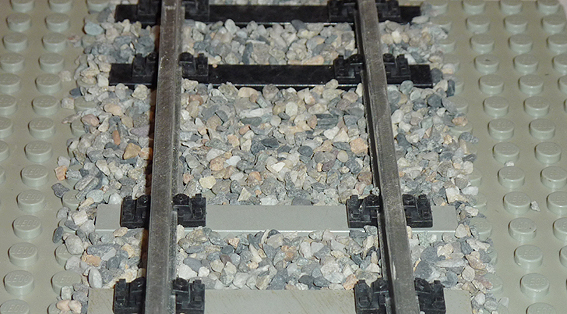

Après pas mal de recherches une solution plus réaliste et "full LEGO" sans les petits graviers est retenue en utilisant des semelles de rails qui seront implantées directement dans les plaques de ballast.  
Le ballast est constitué d’une base plate de 10 tenons de large sur laquelle est posée une plaque de 8 tenons de large :  
**–** les plaques de 8 tenons sont en Light bluish gray  
**–** les bases plates sont en light gray

La légère différence de couleur donne un effet de relief/ombre un peu plus réaliste.

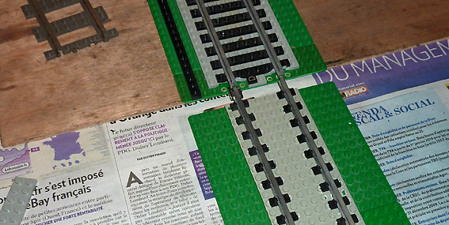

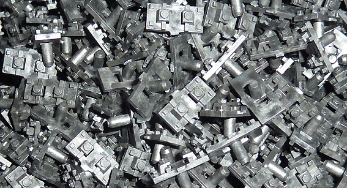

Ces semelles viennent de Suisse, mais pas de chances elles sont adaptées pour des rails ayant un patin de 4 mm alors que les rails que j’utilise ont un patin de 5 mm : il faudra donc enlever 5/10mm de chaque côté du patin pour pouvoir faire l’assemblage.

Le type d’éclisse va aussi changer. Le premier modèle de la LGV 1 est certes très solide mais pas pratique à monter et avec des vis CHC au standard américain. De plus ce modèle est plutôt voyant par sa taille et aussi par sa couleur (en laiton massif sur des rails en aluminium).

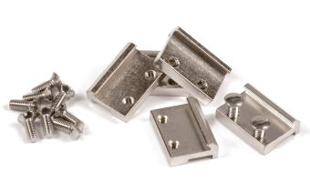

La nouvelle éclisse est plus simple, plus petite et plus rapide à monter avec un simple tournevis standard.  
Toutefois, pour prévenir une usure prématuré du patin du rail au point de fixation, j’ai ajouté une rondelle car l’aluminium est très malléable.

Ce qui, tous ces choix faits, donne la liste de courses suivante pour une LGV d’environ 80 mètres virages compris :  
**–** 160 mètres de rails aluminium code 250  
**–** 9000 semelles  
**–** 2000 plaque 4x8 light blue gray à usiner  
**–** 800 plaques 2x8 light blue gray à usiner  
**–** 80 mètres de base plate light gray largeur 10 tenons pour le socle du ballast  
**–** 160 éclisses

J’en profite pour remercier ici [l’Atelier Vaporiste](http://www.atelier-vaporiste.com/) qui a été d’une aide indispensable pour avoir réussi à me trouver les semelles et les éclisses que je voulais et qui au départ n’étaient pas dans le catalogue de son magasin.

## Les usinages

Au final il y a deux usinages à faire :  
**–** un sur les rails auxquels il faut enlever 5/10ème de mm de chaque côté du patin.  
**–** un sur les plaques (4x8 et 2x8) : enlever complètement un tenon sur deux dans la longueur ( les 2ème et 6ème dans la largeur) et enlever aussi environ la moitié des deux tenons adjacent dans la largeur. Ensuite pour terminer, il faut faire un perçage de diamètre 4,5 mm. Ces deux usinages vont permettre de monter la semelle qui donnera précisément l’écartement des rails.

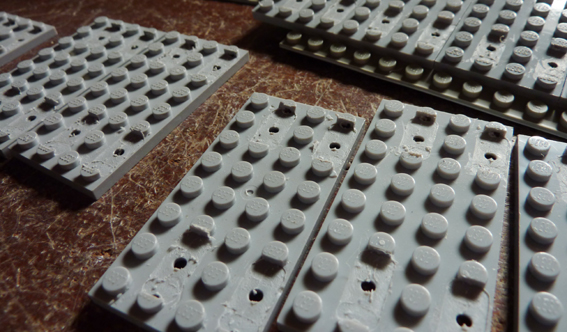

Outre plus de réalisme, l’utilisation de ce système permet un montage plus solide et plus précis des rails que le collage de la LGV 1 mais impose d’usiner de façon très précise les plaques de ballast.

Me voici donc parti pour usiner 160 mètres de rails avec mon centre d’usinage Dremel ;-) équipé d’une mini fraise. cela a pris quelques heures...

Mais pour les plaques, compte tenu de la précision nécessaire et du nombre de plaques à usiner, il a fallu trouver une solution un peu plus industrielle. Le recours providentiel à une unité opérationnelle de production de l’EN (elles sont rarissimes) a solutionné le problème en une grosse journée...

[Usine du ballast](http://youtu.be/yFxEeqUXGuE)

La cote de l’écartement des rails LEGO est plutôt large par rapport à l’écartement des roues des boggies. Cela est normal dans la logique du système LEGO qui a un rayon de courbure des voies très petit.  
A partir du moment où l’on augmente ce rayon de courbure pour la LGV V2, il va être possible de resserrer cet écartement des rails à 37,8mm au lieu de 38mm pour moins de flottement des boggies donc des trains ce qui doit améliorer le rendement du système donc en final la vitesse.

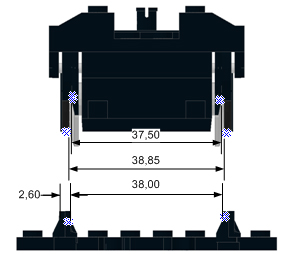

## Construction des courbes en dévers

Pour le rayon des courbes, une analyse de ce qu’il est généralement possible d’avoir comme place en exposition amène à se fixer 1,50 mètre de rayon ce qui permet de faire ½ tour sur 4 modules standards ( soit 12 plaques de 32x32).

Chaque attaque de courbe se fait avec une clothoide tout en passant d’un dévers de 0° à 13°.

Pour la définition géométrique exacte j’ai utilisé la NEM 113 du MOROP (Normes Européennes de modélisme) : « Raccordement des courbes » et en utilisant la méthode de construction par point sur un tracé à l’échelle 1.  
J’ai réalisé le tracé à échelle 1 en utilisant le logiciel Visio puis je l’ai imprimé à cette même échelle.

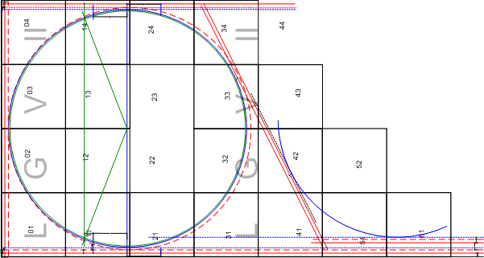

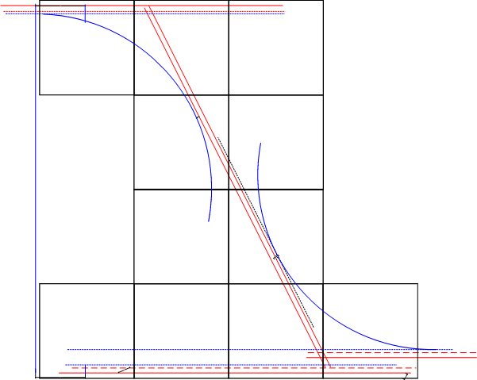

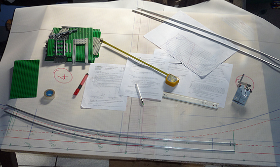

Pour le dévers, j’ai utilisé un jeux de cales progressif pour passer de 0° à 13°.

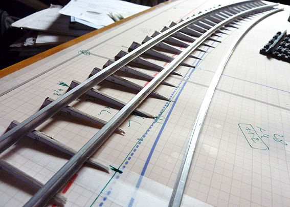

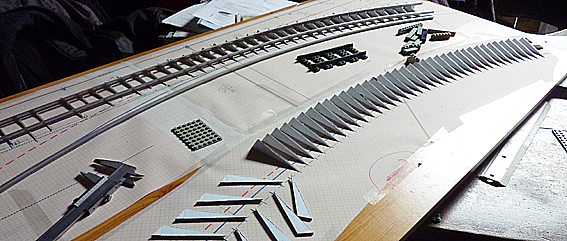

J’ai collé ces cales profilées sur le tracé à l’échelle 1 puis j’ai rempli avec du plâtre les intervalles pour faite le socle. Ce modèle de socle m’a ensuite permit de faire les moules ad hoc. Puis j’ai utilisé ces moules pour faire le socle des courbes. J’ai du faire 3 moules :  
**–** un moule R1500 à dévers constant à 13°,  
**–** un moule clothoide à droite à dévers progressif de 0° à 13°,  
**–** un moule clothoide à gauche à dévers progressif de 0° à 13°,

Les moules sont fait en deux couches :  
**–** une première couche fine d’environ 1cm en silicone,  
**–** une deuxième couche en plâtre armé de grillage  
L’ensemble donne un moule rigide.

Le socle des courbes est fait en fibre de verre bourrée de vieilles briques ou plates LEGO (noble fin s’il en est !).

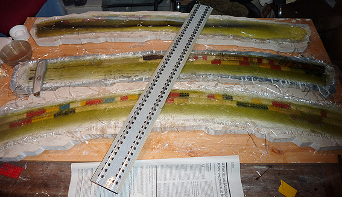

**3 moules en usages avec posé dessus la première section droite de la VGV V2.**

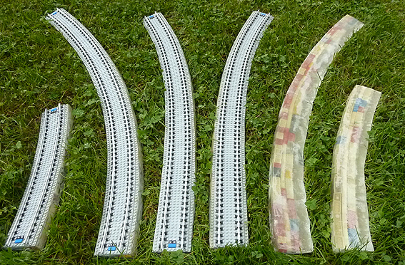

**Le choix d’un dévers à 13° est le résultat d’un compromis.**

Des tests statiques ont montré qu’un train LEGO standard devient instable et risque de basculer à l’intérieur de la courbe à partir d’environ 20°.

Donc pour privilégier une vitesse maximum dans la courbe il aurait été tentant de faire un dévers proche de cette limite.  
Mais cela donne un résultat visuellement assez irréaliste et trop éloigné de notre objectif d’un minimum de réalisme.

Sur une LGV réelle les dévers maximum arrivent à 6°.  
Le compromis est : (22+6)=26. 26/2=13° ce qui finalement se révélera quasi réaliste une fois monté en exposition.

[Article de DanSto - Trains et virages](/articles/trains-et-virages/)

## La construction

Cela étant fixé, il n’y a plus qu’à construire :  
**–** 60 mètres de ligne droite  
**–** environ 20 mètres de courbe

Pour la ligne droite, les plaques ballast utilisées pour monter les semelles de rails sont des 4X8 light bluish gray soit 960 plaques. Le choix des 4X8 ainsi que la couleur light bluish gray est lié à un arbitrage économique : c’était le meilleur rapport prix/surface par rapport au prix des pièces sur Bricklink.

Pour les courbes, les plaques ballast utilisés pour monter les semelles de rails sont des 2X8 soit environ 650 plaques pour un virage (il y en a deux : un à chaque bout donc plus de 1300 plaques à usiner...). L’usage des 2X8 est rendue obligatoire pour pouvoir s’inscrire correctement en courbe et en dévers progressif.

Les plaques ballast sont elles mêmes assemblées sur des bases plate (light gray) de 10 tenons de larges (soit l’équivalent de 40 plaques de 32x32 pour faire les 30 m de ligne droite et 26 plaques pour les deux virages ...)

Et aussi 6400 semelles de rail à monter.

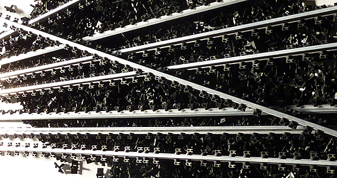

Pour les besoins de la cause (forcément noble comme toutes les causes...) tout est collé !.Oui, je sais, les puristes de salon vont hurler, mais je rappelle que notre objectif est d’avoir un système fiable pour des meeting en public afin d’assurer le spectacle. Donc pas d’états d’âmes : colle comme dans les parc Legoland.

Les semelles de rail sont collées sur les plates ballast avec de la colle pour plastique dur. Les plates ballast sont collées sur les base plates avec de la colle pour plastique rigide (Sader). Les bases plate dans les courbes sont collées sur le socle de courbe avec de la colle mastic, cela pour apporter une certaine souplesse.

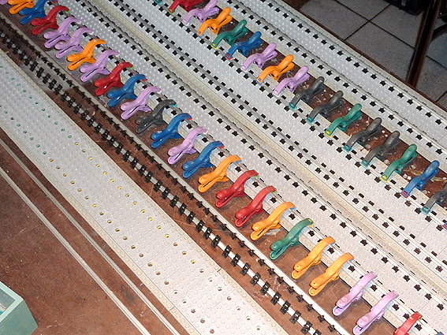

Une fine moquette noire est enfin collée sous chaque tronçon de voie afin de faire une finition impeccable et aussi d’avoir un usage polyvalent de cette LGV V2.

L’ensemble est complété par deux aiguillages afin de pouvoir se raccorder sur un circuit LEGO classique comme par exemple une LGL (Ligne grande longueur). Après un premier essais in situe de ces aiguillages, cela fonctionne, mais il ne faut pas passer top vite dessus car sinon les trains déraillent. Il faut que je songe à en faire une version II mieux adaptée à la grande vitesse.

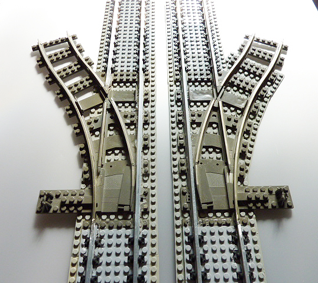

Après un beta montage chez moi, la première sortie de cette LGV V2 s’est faite à Fana’briques 2010 ; et c’est vrai que ces grandes courbes avec dévers sont un vrai plus pour le plaisir des yeux.

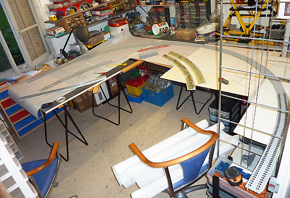

Ces courbes permettent une vitesse de passage beaucoup plus rapide pour les TGV mais les autres trains en profitent aussi car ils s’inscrivent dans ces courbes de façon beaucoup plus réaliste par rapport à leur échelle.

**Voir les vidéos :**  
**–** [Fana’briques 2010 - le Thalys](http://youtu.be/5DZnSroTRLA)  
**–** [Chatenois le Royal 2011 - le Thalys](http://youtu.be/641Q0nafjBU)  
**–** [Chatenois le Royal 2011 - Tain Octan](http://youtu.be/6LNnC0hf3Ts)

Voilà ; vous savez tout. Non, il n’y aura pas de LGV 3 car c’est vraiment un gros chantier !

Et pour la voir en vrai et totalement terminée : rendez-vous à Fana’briques 2012.
