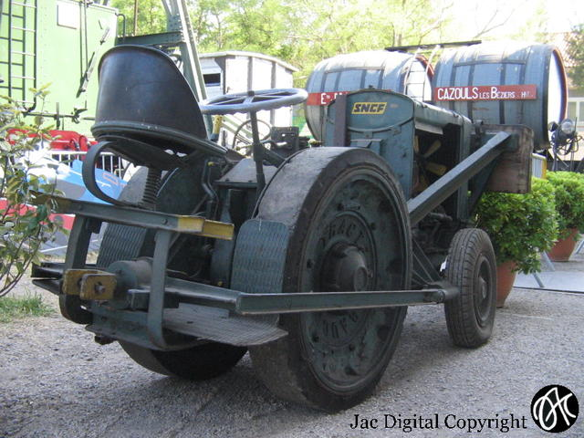
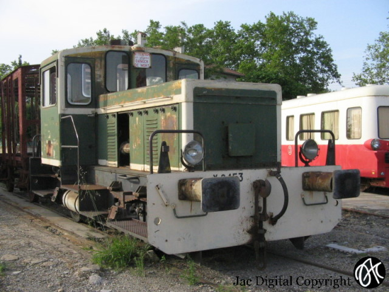

Tout d’abord, un locotracteur, qu’est-ce que c’est ? C’est une locomotive, de petite taille, qui sert à la manoeuvre des wagons sur les voies de garage d’une gare, d’un triage ou d’un embranchement privé. En général, sa vitesse ne dépasse pas 70 km/h. Cet engin est appelé "YOYO" car il ne fait souvent que des petits allers-retours dans les gares.

Il peut être de plusieurs types, c’est suivant le genre de matériel à tracter, mais c’est aussi en fonction des machines du parc. Certaines manoeuvres ont même été faites par des tracteurs !

**Tracteur de manoeuvres**

En général, les locotracteurs ont un aspect caractéristique, un capot, la cabine, et puis un autre capot, des fois plus petit, des fois identique. Il faut penser que, pour la manoeuvre des wagons, surtout en marchandises, le conducteur a besoin de visibilité, pour ne pas créer d’accident, en tamponnant des rames trop violemment. Il circule sur des voies déjà occupées. Alors qu’en ligne, elles sont libres. Pour des exemples, voir la [galerie de "Charlie"](http://photos.freelug.org/main.php/v/Charlie/Essai/yoyo/).

**Un petit "Yoyo".**

Pourtant certaines locomotives, en fin de vie, sont affectées à la manœuvre des trains. En prenant le cas des séries [BB900](http://fr.wikipedia.org/wiki/BB_900), elles ont remplacé les locomotives à vapeur pour le transfert des rames voyageurs dans les grandes gares.

Une locomotive en fin de vie, soit elle est vendue à un ferrailleur, c’est le cas des [CC 6500](http://www.cc6575.com/), et des [CC 72000](/articles/moc-cc-72000-pfs-ready/) il y a peu de temps, soit elles viennent prendre la place de locomotives encore plus vieilles. Car dans le temps, c’était pareil, il y avait des locomotives à vapeur conçues pour les grandes lignes, d’autres pour les manoeuvres.

Du coup, pour le concours que nous vous proposons pour cette Assemblée Générale 2010, vous avez d’énormes possibilités de construction. Il suffit de penser aux exemples que nous venons de vous énumérer. Tant que votre création aura suffisamment d’adhérence pour "travailler".

Cet article ne se veut pas référencer tous les locotracteurs existants, il y en a tellement. Mais pour donner une voie et des idées de construction, que se soit pour le concours, ou pour votre propre réseau. Et ainsi créer un compagnon au [locotracteur 7760](http://www.peeron.com/inv/sets/7760-1?showpic=2600) sorti en 1980 par LEGO. En anglais, vous trouverez des exemples également avec le mot "_[Shunter](http://www.docbrown.info/docspics/nymr/locoDiesels/Pa107796.jpg)_"

[Forum Locotracteurs](http://www.photos-de-trains.net/forums/viewforum.php?f=28), il y a plein d’idées à puiser là dedans !
