En guise d’avant-propos, laissez-moi vous affirmer que je n’étais pas fier le jour où j’ai trouvé sur Brickshelf cette technique pour la première fois ; étant un AFOL des plus modestes et disposant d’une collection de pièces relativement limitée dans son abondance, je n’aurais jamais cru possible avant de m’y essayer réellement, juste pour voir, de pouvoir aboutir à la construction d’un tel navire. A l’heure où je commence à écrire ce message, j’en ai déjà aligné deux, et le troisième sera bientôt prêt à être lancé.

Ceci pour vous dire que ce tutoriel est très simple, et qu’il ne vous fera employer que des pièces extrêmement courantes, des jumpers, des charnières, et des tiles. En somme, la seule chose qui limitera réellement la construction de votre navire, ce sera le nombre d’éléments de coques que vous possédez. Par conséquent, si vous avez déjà essayé de construire un bateau hors du commun pour vos pirates, je vous encourage vivement à suivre ce tutoriel pour avoir un résultat de toute beauté.

Pour commencer, voici une liste, mise à jour mais non-exhaustive, des pièces dont vous allez avoir schématiquement besoin :  
**–** 1 proue de style ancien  
**–** 1 poupe de style ancien  
**–** 5 sections de coque de style ancien  
**–** 30 2x4 briques old brown  
**–** 8 2x3 plaques old brown  
**–** 4 2x2 plaques old brown  
**–** 4 2x10 plaques old brown  
**–** 4 1x2 plaques old brown  
**–** 1 1x8 plaques old brown  
**–** 100 jumpers  
**–** 20 2x2 tiles noires  
**–** 4 1x8 tiles noires  
**–** 20 1x4 tiles noires  
**–** 20 1x2 tiles noires  
**–** 28 charnières, de style ancien.  
**–** Des barrettes, des tiles de 1x2 ainsi que des briques de 1x1, 2x1 et 3x1, de la couleur de votre choix (blancs, jaunes, rouges, marrons) pour faire les bandes de vos batteries.  
**–** Des plaques de couleur sable ou gris, pour faire les ponts.

Sans oublier, les éléments de mâture traditionnels ainsi que des colonnes noires à base carrée, et moult barrettes noires pour les vergues. Prévoyez également une bobine d’au moins 200m de corde en lin, et, le cas échéant, de la matière (papier, vieux t-shirt, drap en lin) pour vous tailler des voiles.

## Première étape : Préparation de la coque

Commençons, logiquement, par assembler les éléments de la coque, ce que je fais toujours avec des briques de 2x4.

[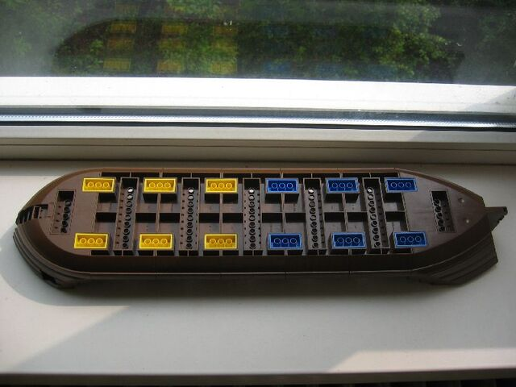](https://www.freelug.org/IMG/jpg/step-1-a.jpg)

Je rajoute toujours quelques plaques pour renforcer l’intérieur de la coque, mais on pourra quand même les enlever, plus tard.

[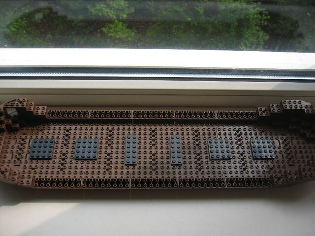](https://www.freelug.org/IMG/jpg/step-1-b.jpg)

Ensuite nous prenons les briques marron de 2x4 pour recouvrir la partie basse de la muraille, prenez soin de recouvrir à chaque fois le chevauchement entre les éléments de la coque.

[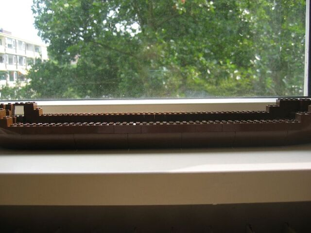](https://www.freelug.org/IMG/jpg/step-1-c.jpg)

Ensuite nous courbons la partie basse vers le haut, poupe et proue, de façon à ce que le chevauchement du noir sur le marron paraisse moins pixélisé.

[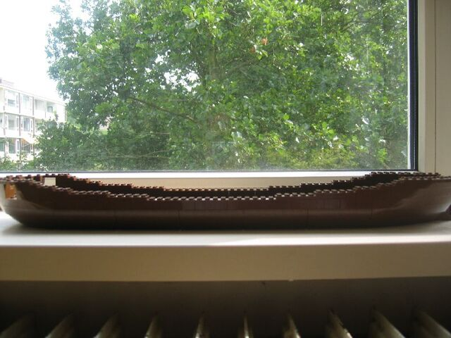](https://www.freelug.org/IMG/jpg/step-1-d.jpg)

Voici le détail du résultat sur la poupe.

[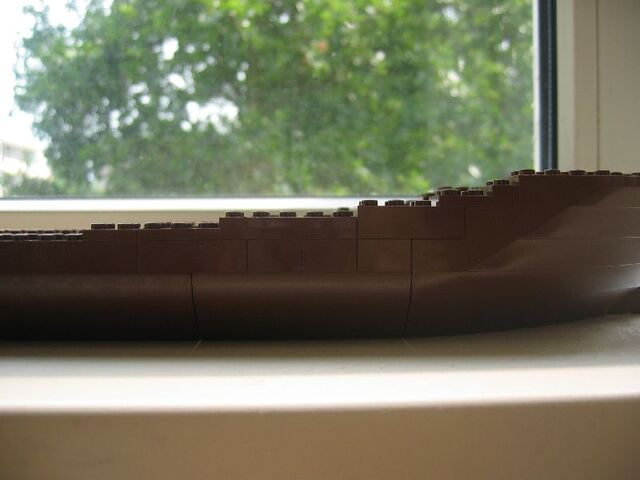](https://www.freelug.org/IMG/jpg/step-1-e.jpg)

## Seconde étape : Élargissement de la coque.

A présent, nous allons élargir la coque en nous servant de jumpers, de tiles, et de planchettes.

Tout d’abord, nous posons une couche de jumpers et de tiles alternés comme ci-dessous. Si vous n’avez pas assez de jumpers, vous pouvez toujours augmenter la proportion de tiles comme je l’ai fait ici.

[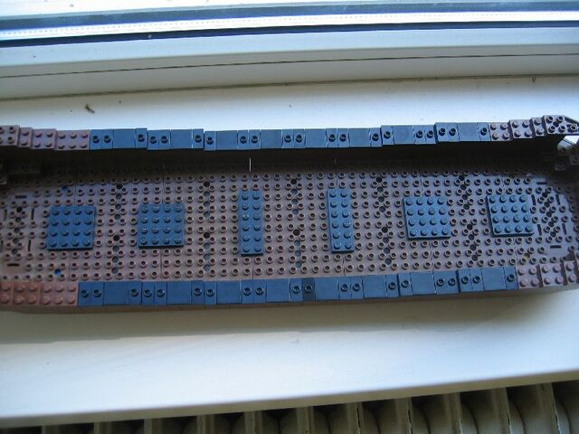](https://www.freelug.org/IMG/jpg/step2-a.jpg)

Ensuite nous posons les planchettes, avec un décalage d’un demi-tenon vers l’extérieur.

[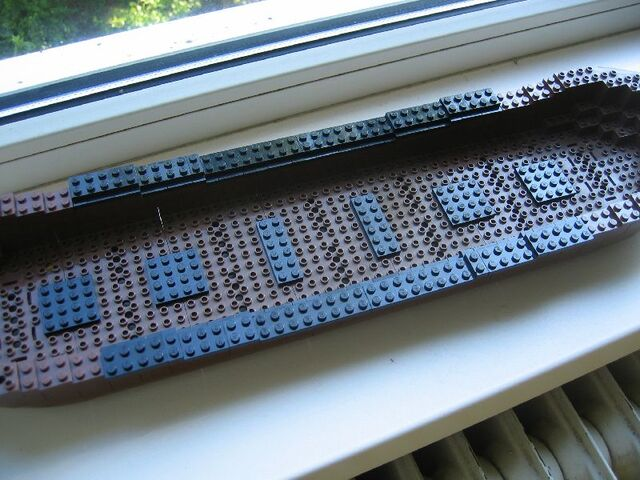](https://www.freelug.org/IMG/jpg/step2-b.jpg)

Puis, à nouveau, nous posons une couche de jumpers et de tiles, à l’exception des 5 premiers et derniers tenons, sur lesquels nous ne placerons que des tiles.

[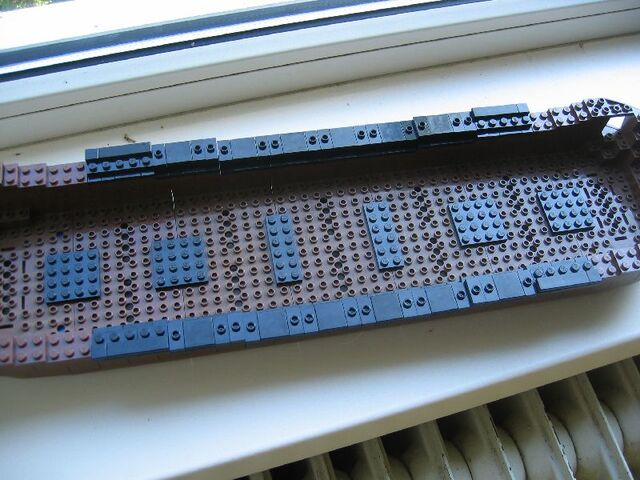](https://www.freelug.org/IMG/jpg/step2-c.jpg)

Enfin, nous posons encore une fois des planchettes décalées d’un demi-tenon vers l’extérieur, avec une bande de tiles vers l’extérieur elle aussi.

[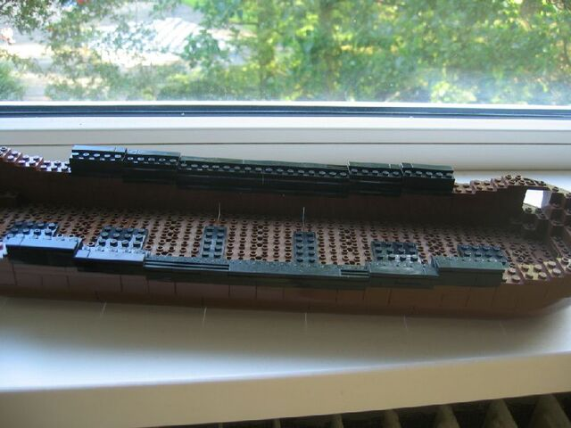](https://www.freelug.org/IMG/jpg/step2-d.jpg)

## Troisième étape : Pose des chevilles

Comme je viens de le dire, les 5 premiers et derniers tenons de la partie que nous avons faite plus large doit désormais être plus haute de trois planchettes, ou d’une brique.

Ensuite nous posons les chevilles de cette façon.

[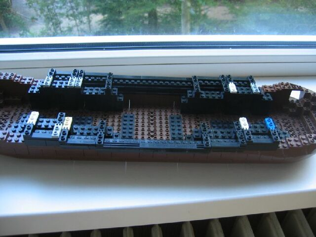](https://www.freelug.org/IMG/jpg/step3-a.jpg)

Comme vous pouvez le voir, elles reposent toutes exactement sur la bordure de tiles.

[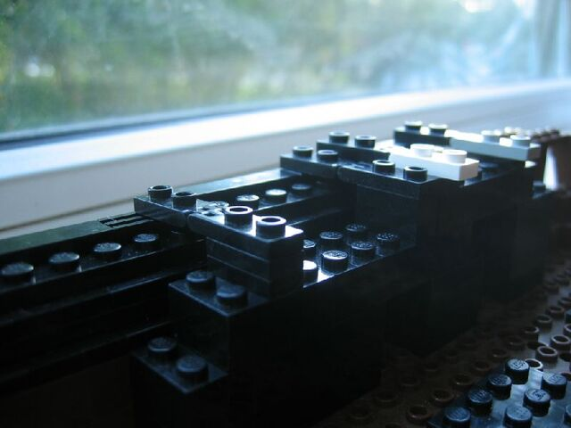](https://www.freelug.org/IMG/jpg/step3-b.jpg)

Sur les parties où le muret est plus large d’un demi-tenon, les charnières sont placées sur un jumper.  
Ce que vous voyez ci-dessus est le strict minimum de chevilles que vous pouvez employer, mais je préfère toujours en rajouter deux paires au milieu.

Ci-dessous, les chevilles sont au complet, et je me suis également permis de rajouter quelques longueurs de part et d’autre de la construction.

[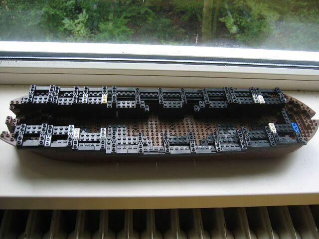](https://www.freelug.org/IMG/jpg/step3-c.jpg)

Voici à quoi ressemble désormais la proue, j’en parlerai plus en détail par la suite.

[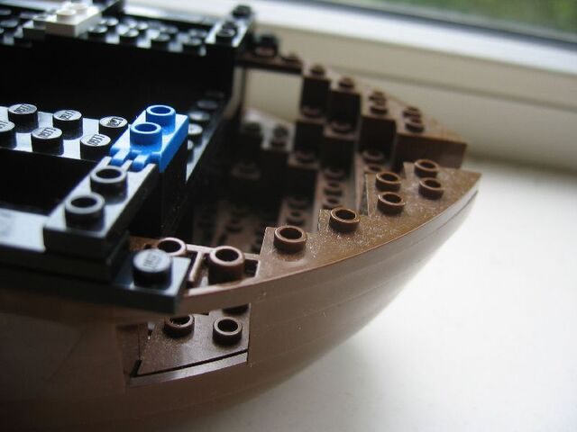](https://www.freelug.org/IMG/jpg/step3-d.jpg)

Je laisse toujours une ouverture de quatre tenons sur la poupe.

[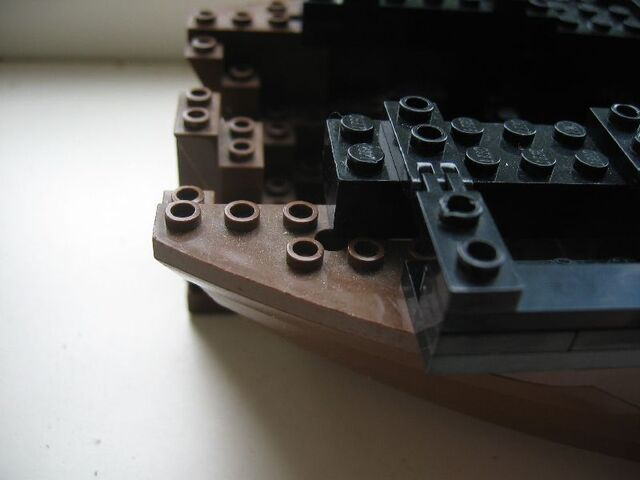](https://www.freelug.org/IMG/jpg/step3-e.jpg)

En vue d’oiseau, on peut déjà observer la courbure de la muraille, d’où l’intérêt d’utiliser des jumpers.  
_Nota : ne vous fiez pas trop au détail de la photographie, et veuillez surtout à laisser un espacement de quatre tenons entre chaque cheville._

[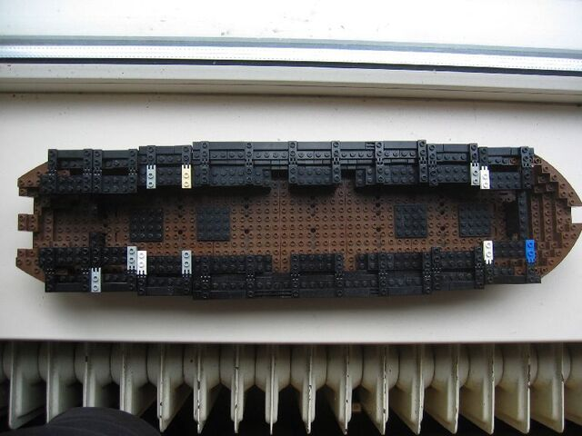](https://www.freelug.org/IMG/jpg/step3-f.jpg)

Et enfin un aperçu du côté, montrant la courbure horizontale.

[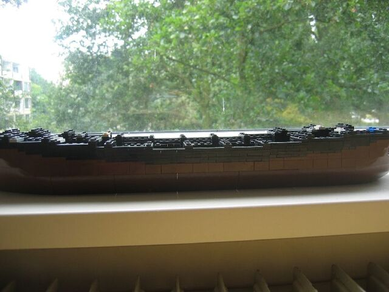](https://www.freelug.org/IMG/jpg/step3-g.jpg)

[La suite dans le prochain article](/articles/construisez-une-authentique-fregate-2-4/).
