**–** [Etapes 1 à 3](/articles/construisez-une-authentique-fregate-1-4/)  
**–** [Etapes 4 à 6](/articles/construisez-une-authentique-fregate-2-4/)  
**–** [Etapes 7 à 9](/articles/construisez-une-authentique-fregate-3-4/)

## Dernière étape : Mise en forme

Cela a mis du temps, mais la construction du navire touche à sa fin. Tous les cordages ont été posés, et il ne reste plus qu’à rajouter les voiles.

J’ai fait exprès de ne pas les mettre en place, de façon à ce que vous puissiez voir les derniers détails.

Tout d’abord une vue générale depuis tribord.

[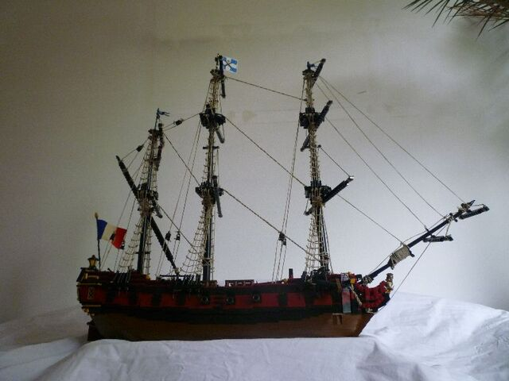](https://www.freelug.org/IMG/jpg/a-2.jpg)

De la poupe.

[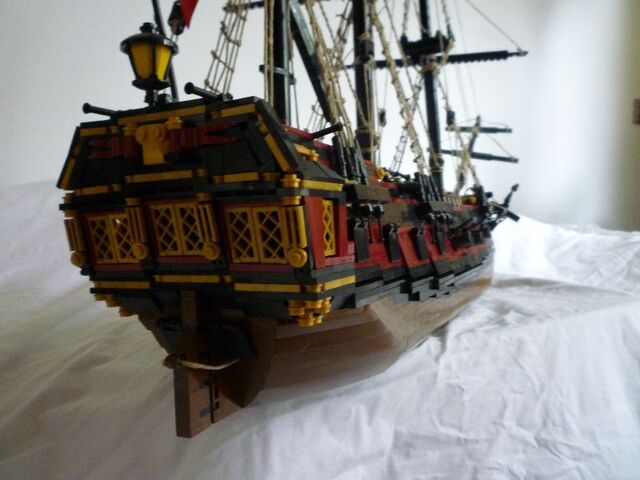](https://www.freelug.org/IMG/jpg/c.jpg)

De la proue. Notez l’ancre faite en briques.

[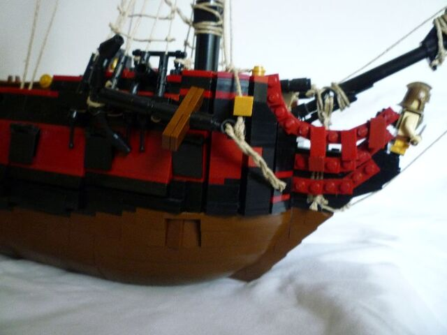](https://www.freelug.org/IMG/jpg/d.jpg)

La partie du premier pont qui est visible depuis la fosse.

[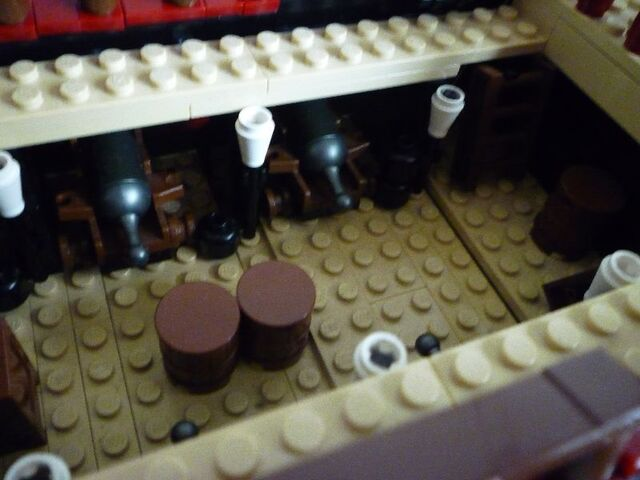](https://www.freelug.org/IMG/jpg/g-2.jpg)

Vue d’oiseau.

[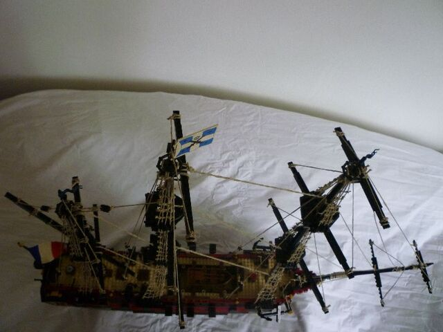](https://www.freelug.org/IMG/jpg/e.jpg)

Chaque hauban est constitué d’une seule corde qui sera nouée très fort sous la hune. Vous trouverez la démarche détaillée de la pose des cordages dans [cet article que nous devons également au Captain Blue-Hair](http://www.eurobricks.com/forum/index.php?showtopic=12757).

Et pour finir sur la traduction de cet article, quelques détails.

[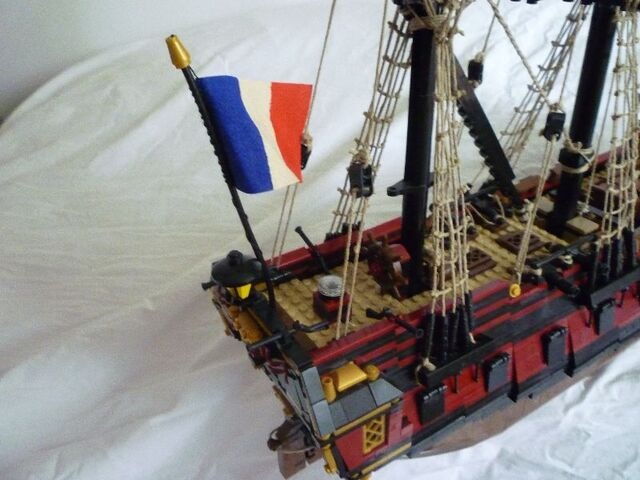](https://www.freelug.org/IMG/jpg/h-2.jpg)

[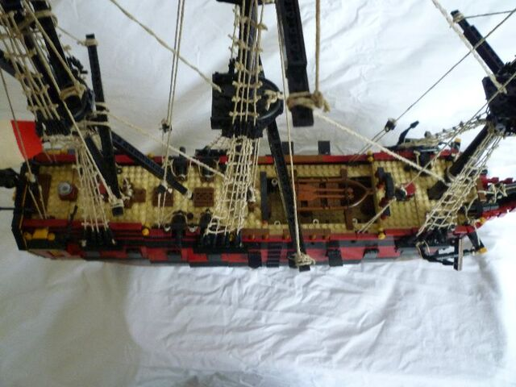](https://www.freelug.org/IMG/jpg/i.jpg)

[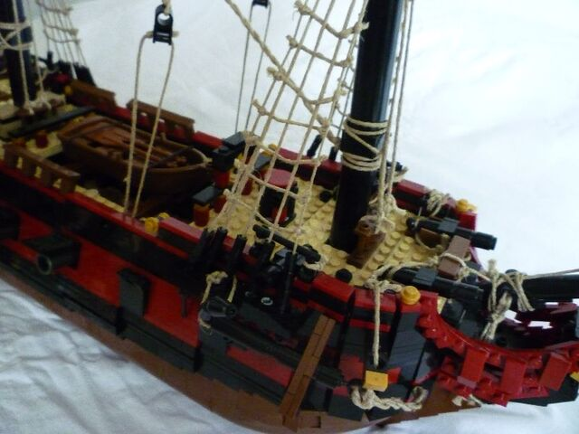](https://www.freelug.org/IMG/jpg/j-2.jpg)

[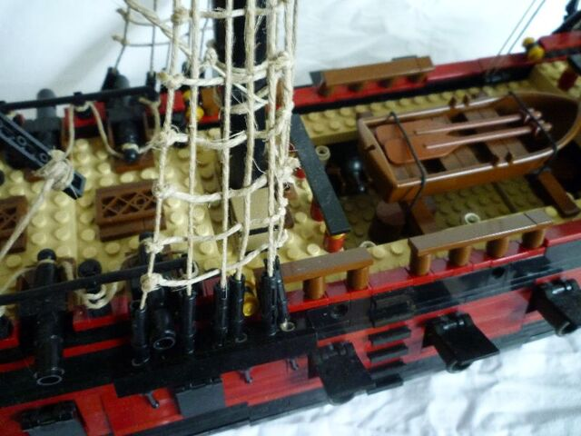](https://www.freelug.org/IMG/jpg/l.jpg)

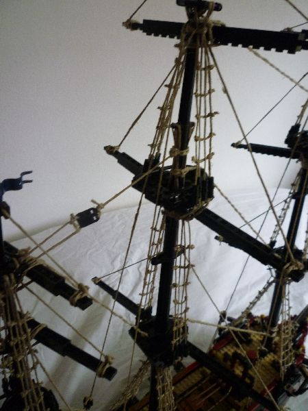

[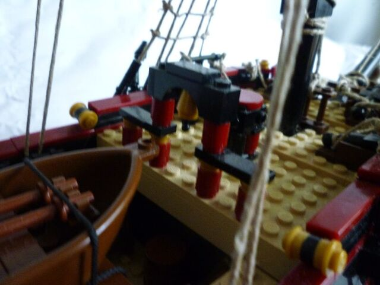](https://www.freelug.org/IMG/jpg/n.jpg)

Idées, textes, images et nomenclatures originales de Captain Blue Hair, avec tous mes remerciements.
