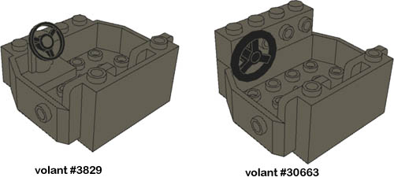
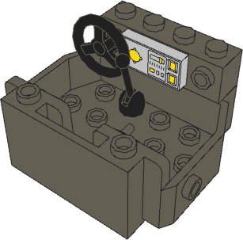
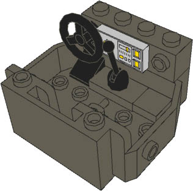
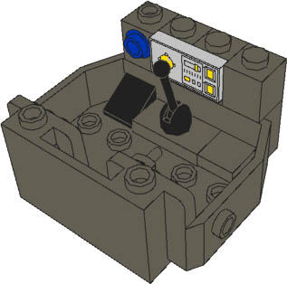
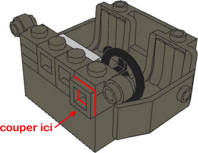
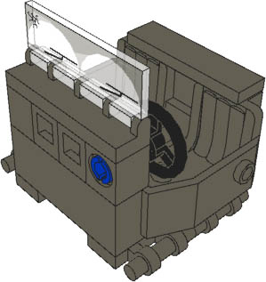
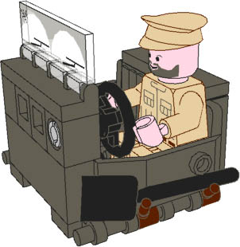

[La dernière fois](/articles/construisons-une-snotmobile-1-5/) on avait cherché les bonnes proportions à donner à notre jeep, nous allons maintenant nous attarder sur la partie la plus facile : l’habitacle.

Bon, vous allez me dire avec notre [SPUD #30149](http://www.peeron.com/inv/parts/30149) l’habitacle est quasi terminé, et à vrai dire vous n’avez pas tort. D’habitude dans les sets officiels, TLC rajoute un [volant #3829](http://www.peeron.com/inv/parts/3829) et le tour est joué.

Sauf que le volant de la Jeep Willys est particulièrement grand. D’autre part si on pouvait ajouter un tableau de bord, je ne dirais pas non. Le [volant #30663](http://www.peeron.com/inv/parts/30663) me faisait clairement de l’œil et finalement ne semblait pas si difficile à monter sur une brique [#30414 "1 x 4 with studs on side"](http://www.peeron.com/inv/parts/30414).

**Comparaison de volants**

L’avantage de la brique 1x4 avec des tenons sur les cotés, c’est qu’on peut aussi clipper une tile 1x2 décorée avec un tableau de bord quelconque. Je vous laisse choisir la décoration à votre goût, pour ma part j’ai choisi la référence [#3069bpx19](http://www.peeron.com/inv/parts/3069bpx19) (qui n’est pas celle sur l’image ci-dessous car cette décoration n’existe pas encore sous LDraw).

**Tableau de bord**

Au passage on ajoute le levier de vitesse qui prend naturellement sa place au milieu ou presque (si on souhaite vraiment le mettre au milieu, on peut ajouter un [jumper](http://www.brickwiki.org/index.php?title=Jumper_plate) en dessous). Avec l’ajout de ce jumper, m’est venue aussi l’idée d’ajouter les pédales avec une [slope 1x1 #50746](http://www.peeron.com/inv/parts/50746) de préférence noire. Bon... à vous de voir si on va trop loin dans les détails...

**Centrage du levier et ajout des pédales**

Bon en fait il y a moyen d’améliorer le tableau de bord. Tout d’abord il reste un tenon disgracieux à droite, et il va sans dire que notre jeep se doit d’être [studless](http://www.brickwiki.org/index.php?title=Studless) ! Quoi ? Je vous ne l’avais pas dit ? Mais pourquoi diable aurais-je appelé ce MOC une **Snotmobile** sinon !? L’obsession du studless nous poussera à mettre les tenons sens dessus-dessous à tel point qu’aucun tenon n’aura la tête en haut à part ceux du châssis (mais là c’est le [SPUD](http://www.brickwiki.org/index.php?title=POOP) qui m’a forcé la main, comme nous l’avons vu au premier chapitre :-))

Et puis le tableau de bord ressort un peu trop, l’emploi de [briques machine à laver](http://www.brickwiki.org/index.php?title=Washing_machine_brick) améliora le problème d’une demi-plate. Le volant se retrouve monté sur une brique technique 1x1 avec un [demi-pin #4274](http://www.peeron.com/inv/parts/4274), ce qui a un autre avantage, c’est que le volant peut maintenant tourner. Vous pouvez même monter le volant à droite si vous voulez faire une jeep anglaise...

**Tableau de bord amélioré**

Vous me croirez ou pas, mais lorsque j’ai commencé la conception de la Snotmobile, je n’ai pas été regarder le site de Nico qui avait lui aussi réalisé une [Jeep Willys](http://lego.nico.free.fr/lego-jeep.htm) il y a quelques temps. Bien sûr je l’avais visité à l’époque mais je n’ai pas voulu la revoir pour ne pas être trop influencé. J’y suis tout de même retourné une fois ma Snotmobile terminée, et là je me suis aperçu que j’avais oublié les rétros... Il faut dire aussi qu’ils n’étaient pas toujours présents sur les photos de références dont je me suis servi.

Donc si vous voulez une version avec rétroviseurs, et si comme Nico vous n’avez pas peur de couper vos briques, je vous propose ce montage avec une brique machine à laver posée à plat dont on coupe le pied :

**Charcutage façon Nico**

Mais bon, si vous êtes vraiment allergique au charcutage et tenez quand même à avoir des rétros, vous pouvez aussi utiliser le petit [volant #3829](http://www.peeron.com/inv/parts/3829) et faire le rétro de gauche comme celui de droite.

Pour finir on ajoute un pare-brise tout à fait standard (le pare-brise choisi par Nico fait tout aussi bien l’affaire, voire mieux, mais bien sûr cela dépend de la couleur de la jeep et de la disponibilité de cette pièce dans cette couleur).

**Ajout du pare-brise et des marchepieds**

Vous vous demanderez peut-être pourquoi avoir choisi la pièce [#2540 "plate 1x2 with handle"](http://www.peeron.com/inv/parts/2540) pour faire le marchepied. En effet on aurait pu aussi mettre une simple plate 2x4, mais les poignées nous permettent de clipper des mains de minifig et ainsi de "sangler" une pelle sur le flanc de la jeep, un petit détail qui ajoute à la jouabilité. Là encore, d’autres solutions pour ajouter la pelle sont sans doute envisageables (des solutions plus où moins volumineuses et plus ou moins solides selon vos goûts, comme de clipper une ["tile 1x1 with clip #2555"](http://www.peeron.com/inv/parts/2555) sur la poignée de la porte).

**L’habitacle une fois fini**

[La suite au prochain numéro !](/articles/construisons-une-snotmobile-3-5/)
