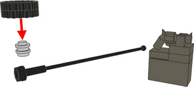
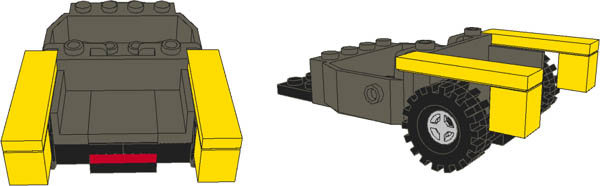
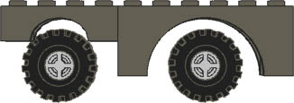
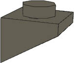
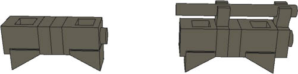
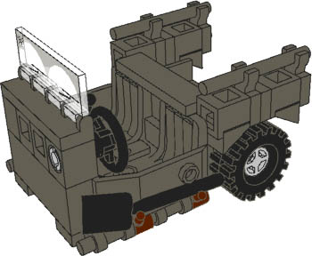
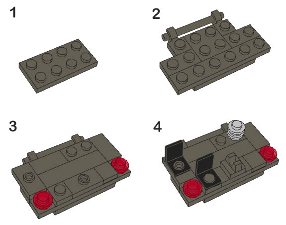
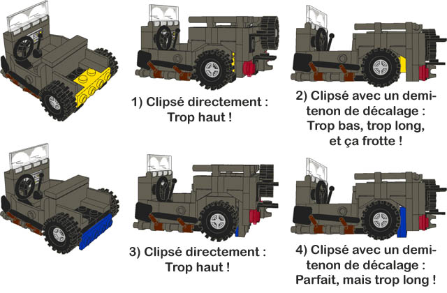
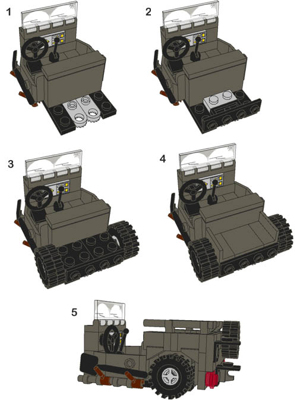
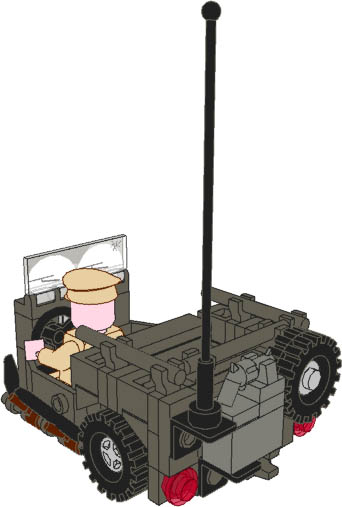

Dans [le précédent article](/articles/construisons-une-snotmobile-2-5/) on s’était attaché à décorer le [SPUD #30149](http://www.peeron.com/inv/parts/30149) qui nous sert de base pour l’habitacle de notre Snotmobile, rien de bien méchant. Aujourd’hui on va s’occuper de l’arrière du véhicule et on gardera le plus compliqué pour la fin.

L’arrière de la jeep Willys est intéressant car il possède une roue de secours ainsi qu’un bidon d’essence. J’aimerai aussi y ajouter une grande antenne de radio car souvent les jeeps utilisées pour des missions de reconnaissance avaient besoin de communiquer à grande distance.

Le choix des pièces est vite fait : bien sûr la même roue que celles montées sur la jeep, mais afin de faciliter la fixation, on remplace la jante par deux plate 1x1 rondes. Pour l’antenne je choisis bien sûr la longue et fine [antenne #2569](http://www.peeron.com/inv/parts/2569) en noir, et pour le bidon d’essence, je recopie carrément le bidon de chez TLC qu’on peut trouver dans les set Indiana Jones et que je trouve digne d’un MOCeur AFOL. En tout cas, je ne sais pas comment faire mieux...

**Accessoires à l’arrière**

L’arrière de la jeep Willys se compose d’un coffre à ciel ouvert et c’est à mon avis un détail important à reproduire. Vu la largeur des roues (un peu plus d’un tenon) et étant donnée la largeur du véhicule que l’on vise (6 tenons), il semble évident qu’il va falloir construire la carrosserie autour des roues arrières avec une largeur d’un tenon. Dans la photo suivante j’ai représenté la largeur de la carrosserie avec des briques jaunes.

**Gabarit arrière**

Si on se contente de la carrosserie symbolisée en jaune cela laisse les roues visibles de l’intérieur du coffre. C’est pour cette raison que j’ai rajouté des [Panel 1x2 #4865](http://www.peeron.com/inv/parts/4865) qui bouchent efficacement les trous tout en laissant une largeur de coffre de 4 tenons, ce qui est indispensable.

J’ai ensuite testé beaucoup de solutions pour la carrosserie, mais le principe des panels et de la largeur de 1 tenon autour des roues n’a pas changé.

Naïvement avec cette largeur d’un tenon, je pensais pouvoir utiliser une brique de type arche, mais d’une part les roues qu’on a choisies n’ont pas un diamètre qui s’accommode bien avec les arches, et d’autre part elles sont placées très près du [SPUD](http://www.brickwiki.org/index.php?title=POOP) pour des raisons que nous avons vu dans le premier article, ce qui ne laisse pas assez de place pour l’arche.

**Essais d’arches**

Je voulais tout de même essayer de reproduire une certaine forme d’arche autour des roues arrières, je suis donc parti sur un montage [SNOT](http://www.brickwiki.org/index.php?title=SNOT) en utilisant des [slopes 1x1 #50746](http://www.peeron.com/inv/parts/50746), cette pièce incroyable pour rajouter de petits détails à un MOC. Si cette pièce existait en version inversée ça nous aurait simplifié la vie, on aurait pu la clipper en dessous de la tile jaune qu’on peut voir sur l’image du gabarit.

**Une pièce qui n’existe pas encore : une slope 1x1 inversée**

Mais ce n’est pas encore le cas, donc on va devoir utiliser la slope 1x1 en SNOT 180° (c’est à dire tête en bas). On peut imaginer la clipper sur une plate 1x4 aussi tête en bas, mais ensuite il faut trouver un moyen d’attacher la plate 1x4 à l’arrière du véhicule. J’ai finalement opté pour un clipsage sur des briques machine à laver, car cela simplifiait l’accroche à l’arrière.

**Aile arrière avec des slopes 1x1 en SNOT 180° et des briques de machine à laver en SNOT 90°**

Inconvénient : cette brique laisse des trous sur le dessus. Si cela ne vous gêne pas plus que cela tant mieux, sinon on peut rajouter une barre pour masquer un peu les trous. La barre n’est pas présente sur toutes les versions de jeep Willys mais on peut la voir sur certaines versions. Voila ce que ça donnera une fois en place :

**Les ailes arrières une fois en place**

Bon avec ces ailes en SNOT, l’accrochage se fera par l’arrière et semble nous obliger à faire l’arrière également en SNOT 90°, tenons vers l’extérieur. En fait cela nous arrange car ça sera plus facile d’accrocher tous les accessoires (jerrycan, roue de secours, antenne, feux de signalisation) si tout l’arrière est fait d’une ou deux couches de plate. Je ne vais pas disserter des heures sur comment je suis arrivé au résultat final, je vous le livre tel quel. Mais en fait cette partie n’est pas très contraignante et d’autres alternatives sont sans doute possibles en fonction de comment vous voulez accrocher les accessoires, et de la présence ou non de tenons.

**Notice de montage pour l’arrière**

Maintenant il ne reste plus qu’à accrocher l’arrière au châssis, sans doute avec un [bracket 1x4 #2436](http://www.peeron.com/inv/parts/2436). Mais là c’est le drame... le Dieu des MOCeurs refuse de donner son petit coup de pouce pour que tout rentre parfaitement dans l’ordre.

En effet si on clipse la bracket au dessus des supports de roues l’accroche est trop haute (cas 1 sur l’illustration ci-dessous). On peut essayer de la redescendre d’un demi-tenon (cas 2) en ajoutant une rangée de jumpers (en jaune sur l’illustration), mais hélas c’est trop bas et les roues frottent. D’autre part ça rallonge l’arrière d’une plate ce qui donne l’impression que l’arrière est trop long.

Maintenant si on clipse la bracket juste en dessous des supports de roues, on doit modifier un peu l’arrière pour pouvoir le clipser un cran plus bas, mais c’est encore trop haut (cas 3), ou alors on ajoute aussi une rangée de jumpers (cas 4 en bleu) et là on trouve enfin la bonne hauteur, mais comme pour le cas 2 la jeep est maintenant trop longue... GRRRR.... OUINS.... qu’ai-je fait au Dieu des MOCeurs ?

**Différentes possibilités d’accroche de l’arrière**

Après des heures d’acharnement, c’est le moment de rajouter encore plus de SNOT. Franchement, ça ne peut pas être pire... Je vous propose donc de retourner la bracket 1x4 de 180°, c’est à dire de la monter à l’envers !! Tout bon MOCeur doit garder à l’esprit les différentes techniques pour faire du SNOT 180°, sinon on peut toujours se référer au [Brickwiki](http://www.brickwiki.org/index.php?title=SNOT_techniques#SNOT_180).  
On choisi rapidement la technique de la plate technique (comme illustré sur le Brickwiki) pour retourner la bracket et là miracle, tout rentre dans l’ordre.

**Notice de montage pour l’accrochage**

Et voilà le résultat final pour ce qui est de l’arrière, rendez-vous au prochain article pour l’avant.

**L’arrière de la Snotmobile une fois fini**

[La suite au prochain numéro !](/articles/construisons-une-snotmobile-4-5/)
