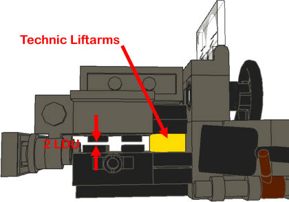
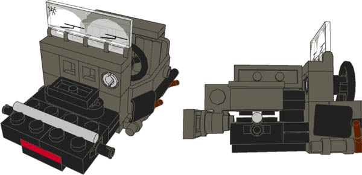
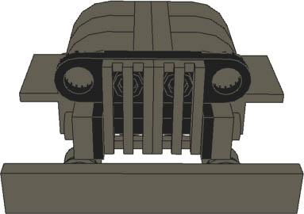
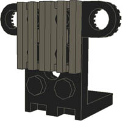
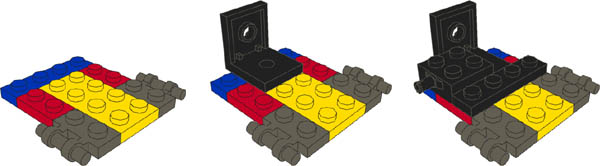
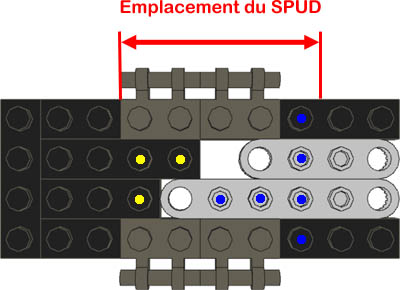
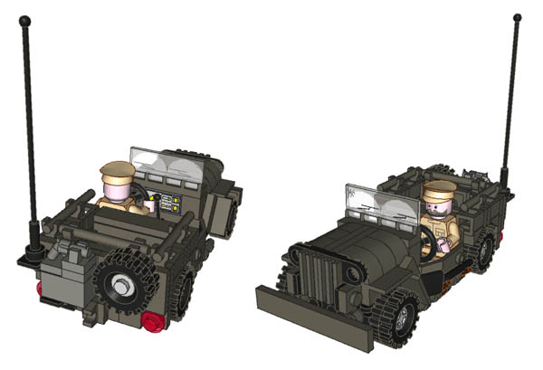
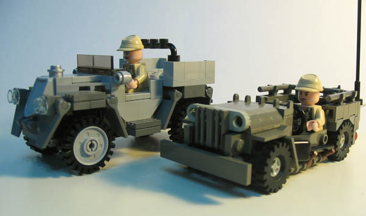

Et c’est déjà le dernier article de cette série, nous touchons au but. [La dernière fois](/articles/construisons-une-snotmobile-4-5/) je vous avais laissé avec deux questions en suspend que nous allons rapidement résoudre.

Je vais commencer par la deuxième, le bâillement du capot avant, car c’est la plus simple à expliquer bien que la solution que je vous propose soit un peu originale.

Un petit rappel du problème d’abord : on a utilisé un [Technic Liftarm 1x3 #6632](http://www.peeron.com/inv/parts/6632) afin de réaliser un SNOT 180° tenon contre tenon. Or cette pièce est légèrement plus épaisse qu’une plate, ce qui nous arrange dans un sens pour réaliser le SNOT, mais d’un autre coté, vu que l’accroche est faite sur l’arrière du capot, si on appuie sur l’avant, ça penche du fait de la sur-épaisseur.

Ma réponse à ce problème a été de chercher un moyen d’ajouter une pièce qui joue le rôle de "cale" et bouche l’espacement à l’avant du capot, de sorte que si on appuie dessus ça ne s’enfonce pas. Mais le problème est que la cale nécessaire doit être extrêmement fine, de l’ordre de 2 [LDU](http://www.brickwiki.org/index.php?title=LDU) (c’est à dire 0,8 mm soit moins d’un millimètre).

**Un petit jour à combler...**

Bon si vraiment on a besoin d’une cale de moins d’un millimètre d’épaisseur, pourquoi ne pas rajouter un petit bout de carton et le tour est joué ! Oui mais cette solution ne conviendra pas à un AFOL [puriste](http://www.brickwiki.org/index.php?title=Purist) qui n’utilise que des pièces LEGO, même si je lui propose de glisser des autocollants LEGO !! J’ai déjà titillé le lectorat dans l’article 2 en proposant de couper une pièce, je ne vais pas risquer de perdre ceux qui sont restés :-)

Donc voici la cale que je vous propose : un [sabre laser 1x4 #30374](http://www.peeron.com/inv/parts/30374) simplement posé entre les tenons. La couleur importe peu, je l’ai choisi noir pour plus de discrétion, mais sur les photos il est gris clair pour qu’il soit plus facilement visible.

**Une cale digne d’un Jedi !**

Bien sûr si vous avez une autre solution à ce problème, n’hésitez pas à nous en faire part en répondant à cet article. Voilà un problème réglé, voyons maintenant le dernier point à savoir l’accroche des phares et du radiateur. Je vous rappelle sa position :

**Le radiateur et les phares**

Je suppose que vous avez deviné que l’accroche allait se faire par le bas des tiles grille qu’il va falloir raccorder au châssis via une bracket quelconque. Pour une fois je laisse tomber les brackets modernes ayant une demi-plate d’épaisseur pour utiliser une vieille pièce (apparue en 1978 dans les set "classic space") : le [bracket 2x2 - 2x2 #3956](http://www.peeron.com/inv/parts/3956).

**C’est avec les vieilles brackets qu’on fait les meilleurs pans en long**

L’inconvénient de cette pièce (en tout cas pour ce MOC) est que le dessus horizontal est lisse (sans tenon) ce qui nous empêche de clipser les supports de roue ! Il va donc falloir revoir la base du châssis pour que tout tienne d’un seul tenon... heu _tenant_. L’idée de base est d’accrocher les supports de roues par les tenons les plus proches des roues ; pour cela j’utilise une plate 1x4 (en bleu) qui est clipsée à la bracket et cette dernière est accrochée au [SPUD](http://www.brickwiki.org/index.php?title=POOP) via la plate 2x4 jaune (les "plates 1x2 with handle" en gris foncé marquent la limite du SPUD).

**Agencement de plates pour faire tenir les supports de roues**

D’autre part les supports de roues sont aussi maintenus via les plates 1x2 rouges et la plate 1x4 noire transversale qui supportera la [Technic Liftarm 1x3 #6632](http://www.peeron.com/inv/parts/6632). Le tout est finalement assez solide. On y est presque, sauf qu’en fait dans l’article numéro 3 je ne vous avais pas précisé la longueur des Technic plates que j’avais utilisées pour faire un SNOT 180° de la bracket 1x4 servant à accrocher l’arrière de la jeep (si vous suivez, chapeau bas ! vous aurez le droit d’écrire mon prochain article à ma place :-)). C’est normal, j’avais réservé ce petit détail pour maintenant. En fait pour plus de solidité à l’arrière, j’utilise deux longueurs, une [Technic plate 1x4 #4263](http://www.peeron.com/inv/parts/4263) et une [Technic plate 1x6 #4262](http://www.peeron.com/inv/parts/4262). Voici le schéma final :

**Un châssis façon tetris**

Si on avait utilisé deux Technic plates 1x4, l’arrière de la Snotmobile n’aurait été accroché au SPUD que par une rangée de tenons transversaux ce qui aurait facilité son décrochage. Ici l’arrière est tenu par 6 tenons (marqués d’un point bleu) dont 3 dans l’axe (ceux de la Technic plate 1x6) et l’avant est tenu par 3 tenons (marqués d’un point jaune) dont 2 dans l’axe (ceux de la plate 1x4). Certes l’avant reste tout de même un peu fragile et comme souvent mes MOCs sont peu destinés aux [KFOL](http://www.brickwiki.org/index.php?title=KFOL), néanmoins la jeep est suffisamment solide pour pouvoir être manipulée par un AFOL curieux.

On peut enfin contempler le résultat final. Si vous avez monté la Snotmobile avec vos briques vous pouvez même la contempler en vrai. De toute façon vous retrouverez la notice de montage complète sous format LDraw à la fin de cet article.

**La Snotmobile enfin finie**

Et pour finir je n’ai pas pu résister à l’envie de faire une petite photo comparative avec la version officielle provenant du [set Indiana Jones #7622](http://peeron.com/inv/sets/7622-1).

**Comparaison avec la jeep du set Indiana Jones #7622**

A bientôt pour un nouveau MOC !

**Notice de montage de la Snotmobile**
