La première édition de la convention "Le Sanctuaire de la Culture Geek" a eu lieu le premier week-end de juin 2016, à Pierre-Bénite (69).

L’association **Star Leader**, organisatrice de cet événement et habituée de la convention de Cusset où **FreeLUG** sévit depuis des années, nous a invité à participer à la première édition d’une convention qui, vu les résultats, a un bel avenir devant elle. 6 freeluguiens ont répondu présents pour exposer leurs œuvres à Pierre-Bénite, tout près de Lyon, en ce premier week-end de juin 2016. Que des nouveaux : la **FreeLUG Next Generation**, en quelque sorte... ;-)

[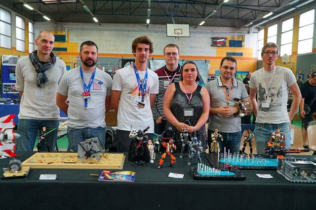](https://www.freelug.org/IMG/jpg/groupe-3.jpg)

Ne vous laissez pas impressionner par nos sourires de stars contrariées : c’est la présence de l’organisatrice (dame **Sénatrice Lilou d’Éloraïlys**) qui nous intimidait... ;-) Euh... Mais alors, c’est kiki l’intimide, elle ? :o)

Un grand gymnase et une salle polyvalente étaient dédiés à l’événement : l’un pour la partie exposition, l’autre comme réfectoire et salle de concert. Car oui, le dimanche après-midi, un fabuleux concert a été donné par l’harmonie **L’Abeille** ([http://harmonie-abeille.com/](http://harmonie-abeille.com/)) : des reprises de grands thèmes de films et séries télévisées, de SF principalement, avec la participation active des costumés !

[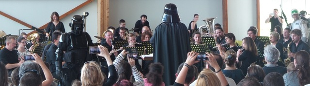](https://www.freelug.org/IMG/jpg/20160605_162350.jpg)

C’était vraiment chouette, avec des musiciens de qualité et c’est **Dark Vador** lui-même qui dirigea la formation pour le thème de fin (je vous laisse deviner lequel).

Alors une convention SF, c’est quoi ? Eh bien c’est un regroupement de passionnés qui viennent (en solo ou en association) montrer leur collections d’objets, leurs costumes, leurs constructions.

[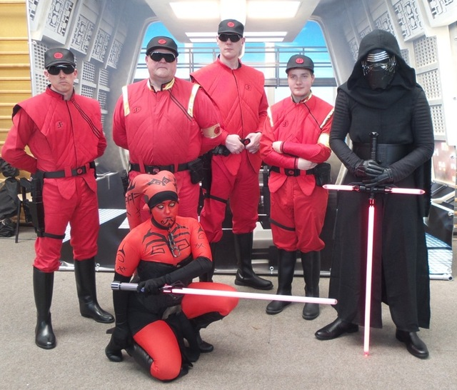](https://www.freelug.org/IMG/jpg/20160604_153110.jpg)

[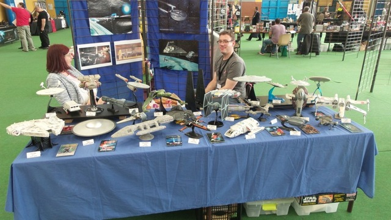](https://www.freelug.org/IMG/jpg/20160604_132623.jpg)

Ce sont aussi des vendeurs, des écrivains, des dessinateurs, des animateurs, des modélistes... Le tout dans une super ambiance d’amusement partagé (qui a dit "un tantinet régressif" ? Tsss....). De nombreux univers cinéma et télévision étaient là : Star Wars, bien sûr, mais aussi Star Trek, Docteur Who, Stargate, Ghostbusters, L’Âge de Crystal (non, non, il n’y a pas que moi qui connaît !), Le prisonnier, etc...

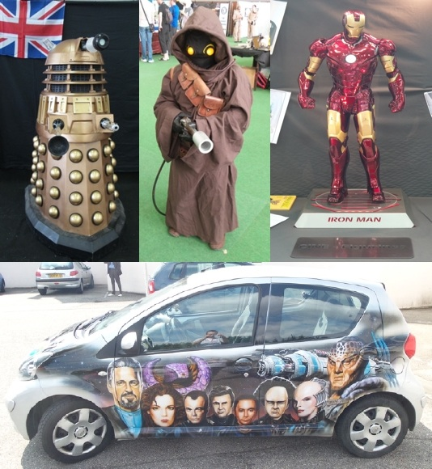

[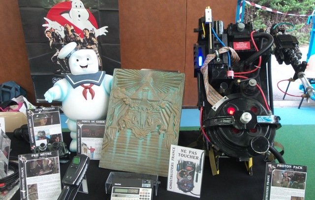](https://www.freelug.org/IMG/jpg/20160604_182855.jpg)

Ajouté à cela un repas du samedi soir très convivial où, malgré la fatigue naissante, on rigole bien : le geek est festif à Pierre-Bénite ! :-)

[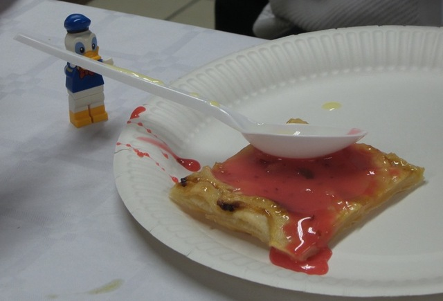](https://www.freelug.org/IMG/jpg/20160604_220732.jpg)

FreeLUG était donc présente, avec un joli stand peuplé de créations portant sur quelques thèmes bien connus.

[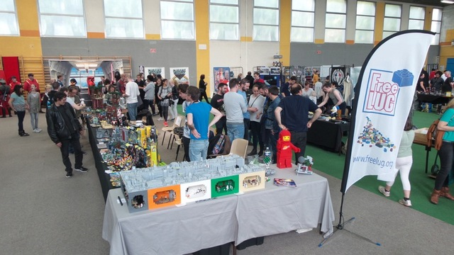](https://www.freelug.org/IMG/jpg/20160604_153719.jpg)

[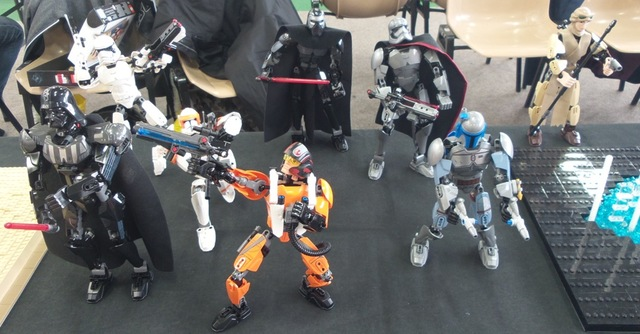](https://www.freelug.org/IMG/jpg/20160605_105047.jpg)

[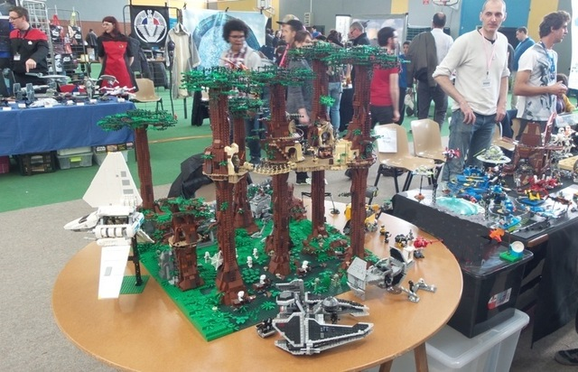](https://www.freelug.org/IMG/jpg/20160604_143918b.jpg)

[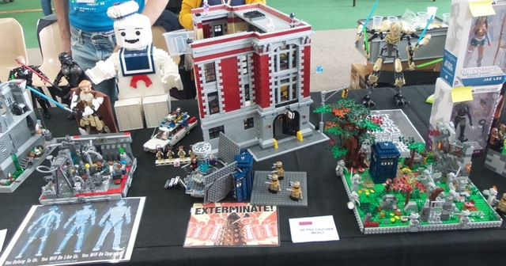](https://www.freelug.org/IMG/jpg/20160604_144035.jpg)

[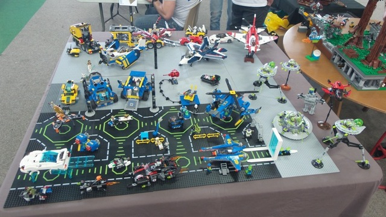](https://www.freelug.org/IMG/jpg/20160605_104952.jpg)

Un bon petit groupe d’exposants/copains et la visite des autres copains (dont quelques nouveaux ou futurs nouveaux), c’est l’assurance de passer un excellent week-end.

[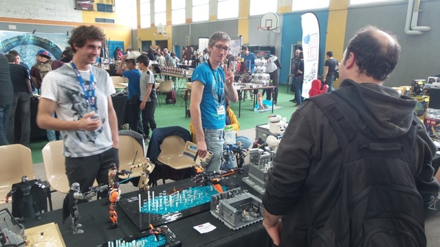](https://www.freelug.org/IMG/jpg/20160604_143946.jpg)

Cerise sur le gâteau déjà pourtant bien bon : une séance de massage Amma offert aux exposants par **Escale Sérénité** ! On y a presque tous goûté avec délice mais j’en connais un qui a eu du rab ! ;-)

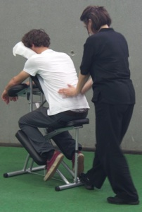

Un excellent week-end avec des LEGO dedans (mais pas que !) : bonne organisation, bonne ambiance, rencontres agréables, sans parler des divers gnons, coups de griffes et autres envolées de savate(s) qui font tout le sel de ces petites réunions entre amis ! ;-)

Personnellement ce sera avec grand bonheur que je remettrai ça l’année prochaine ! Enfin, hem ! Si on m’invite... ;-)

Jérôme (jivé69)

_\----------------------------------_

Que rajouter après cette visite virtuelle et l’emphase de notre prolixe leader. Oo

Excellent week-end. Je suis bien heureux de m’y être jeté quand l’ordre 66 fut donné.  
Enlist now qu’ils disaient. Je ressigne sur le champ l’année prochaine.

Première convention à Pierre Benite mais pour un capitaine solo et une sénatrice qui ont 20 ans de métier. Orga précise, efficace et pleine d’attentions et de surprises, tant pour le public que les exposants.  
Discuter avec des fêlés de SF (qui sont assez étranges dans leur domaine) nous rapproche car nous sommes dingos de nos briques à même mesure. La rencontre du 3ieme type fonctionne. Le public y trouve tout autant et plus son compte car c’est à lui que l’on compte l’histoire.  
Non, monsieur, ce ne sont pas les droids que vous recherchez.

Pas dit si les Ghostbusters ont sauvé toutes les personnes du public qui ont fini au garde manger de l’équipage de V.  
Par contre dalek a ventousé le wall-e rc lego :)

J’y retourne en delorean.

LEGO let’s go  
Thierry (lejigabou)

_\----------------------------------_

On a bien mangé, on a bien bu, on a rencontré des gens sympa, on s’est fait masser, on a écouter de la musique des années 80.

C’était bien marrant ! à refaire donc...

Matthieu

_\----------------------------------_

Après être revenu tout droit d’une autre Galaxie, je peux prendre du recul et faire un petit point sur cette Geek convention très sympa et très bien organisée (avec un coordinateur FreeLUG au top).

Personnellement j’ai beaucoup aimé le fait que ce soit éclectique au niveau des stands (vente, sculpture, geeks, Cosplay,etc...), un concert avec orchestre pour clôturer le week-end est une très bonne idée. Vador en chef d’orchestre que demander de mieux ^^

Le public -qu’il soit en Cosplay ou pas- ne s’attendait pas forcément à voir des geeks en train de présenter des LEGO mais comme toujours leurs yeux ont pétillé.

Pour une première édition, beaucoup de choses étaient parfaites. Je rempile pour 2017 sans aucun souci (une convention de plus dans le Rhône-Alpes mais dans un format différent).

Je veux remercier aussi certains FreeLUGiens d’être passé nous voir, merci à Bertrand, Julien, Antoine tout particulièrement.

Pierrick dit Rouk le Fifou
