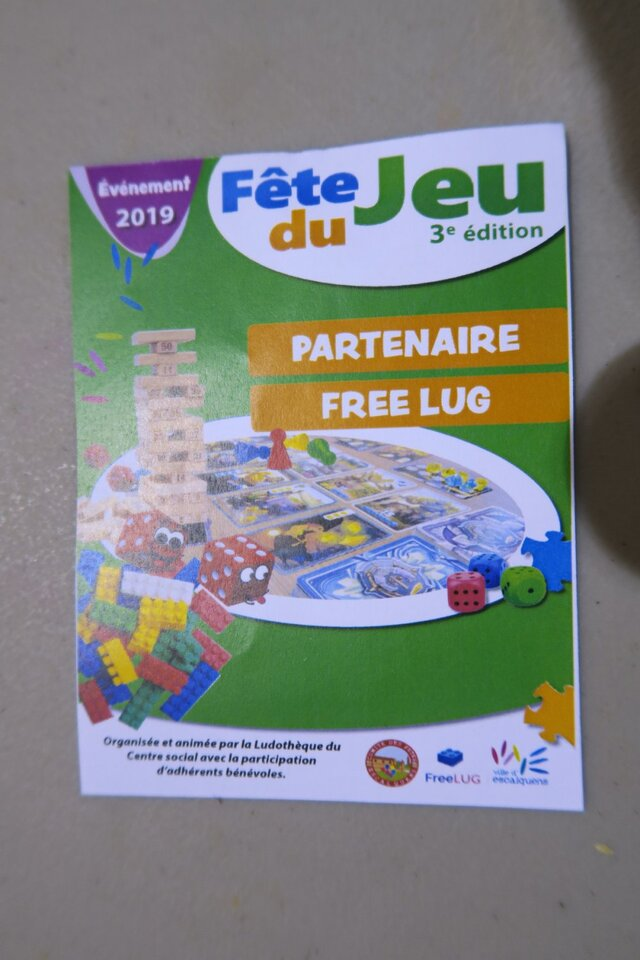
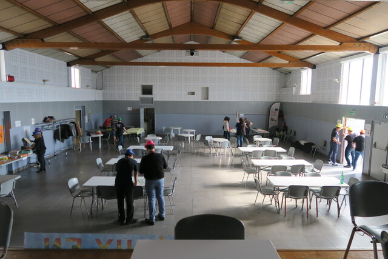
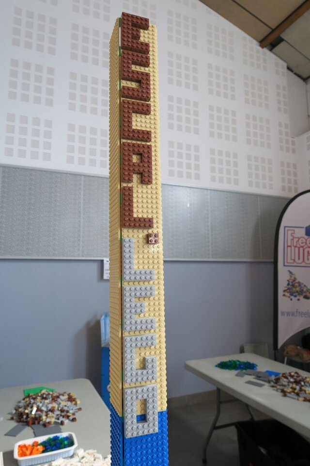
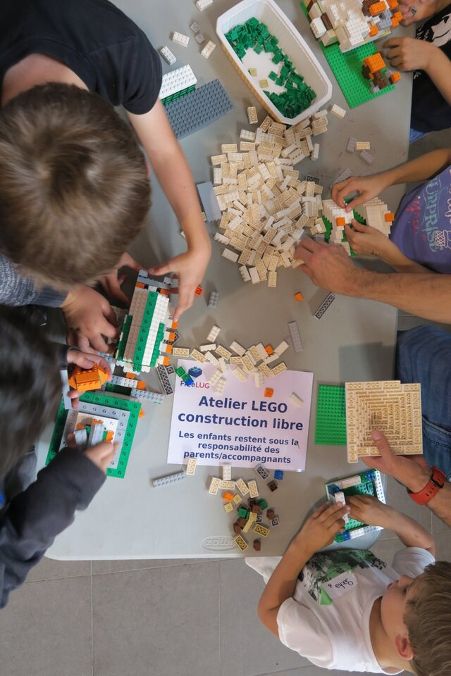
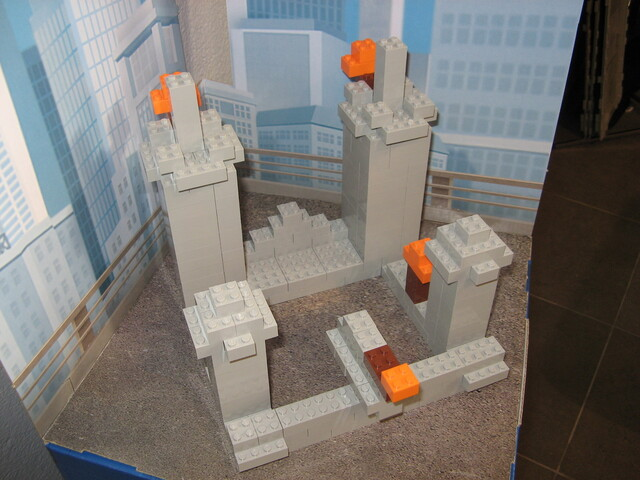
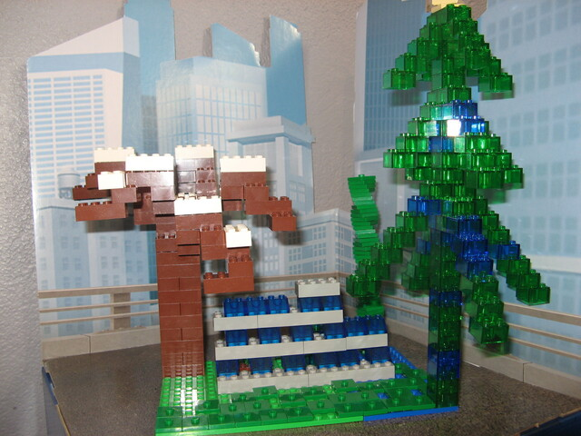
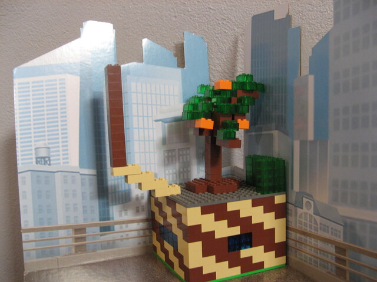
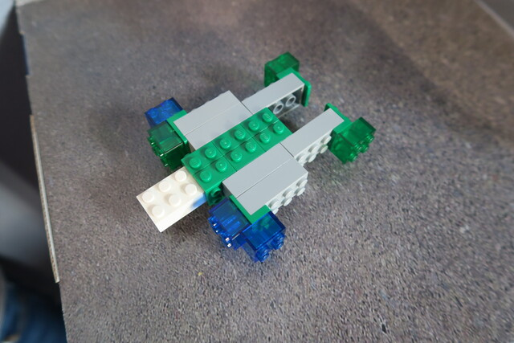

FreeLUG a participé à la Fête du Jeu d’Escalquens

Nous étions partenaire de cette 3ème édition.

Nous avons installé l’atelier de construction dans un coin "tranquille" de la salle, mais dès les premières briques sur les tables, des curieux se sont approchés.

Notre totem, une contraction d’"Escalquens" et de "Lego"

Comme d’habitude nous avons eu beaucoup de constructeurs.

Les réalisations sont toujours aussi variées.

Les briques briques transclear sont toujours autant appréciées.

Et les maisons, toujours aussi futuristes.

Et un jeune constructeur de 4 ans et demi (a t-il tenu à nous préciser) a conçu un très beau vaisseau spatial.

Les plus de 300 visiteurs et les organisateurs, ravis, espèrent nous revoir pour une 4ème édition.  
Nous avons également établi d’autres contacts et FreeLUG est invité à la Fête du Jeu de Ramonville le 2 février 2020.
