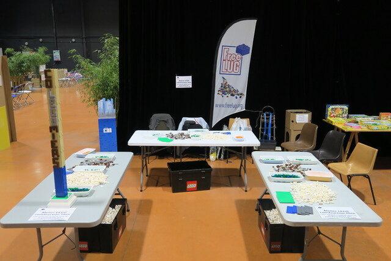
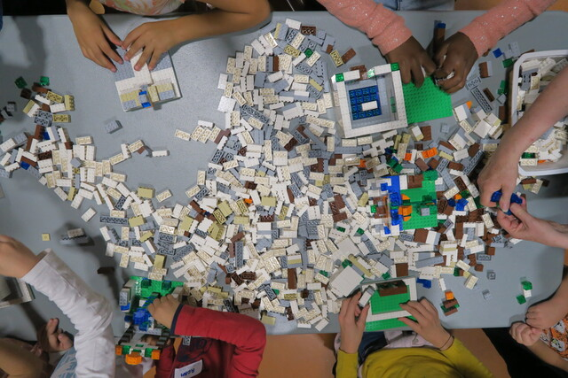
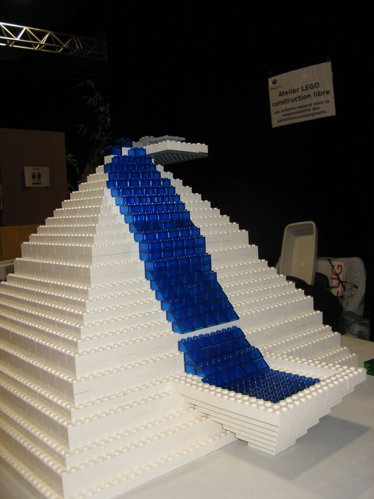
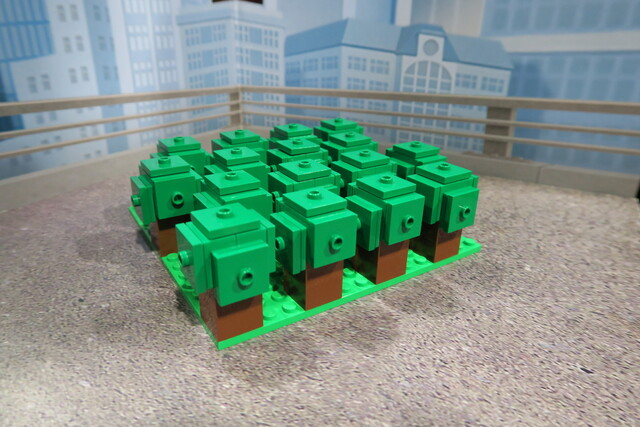
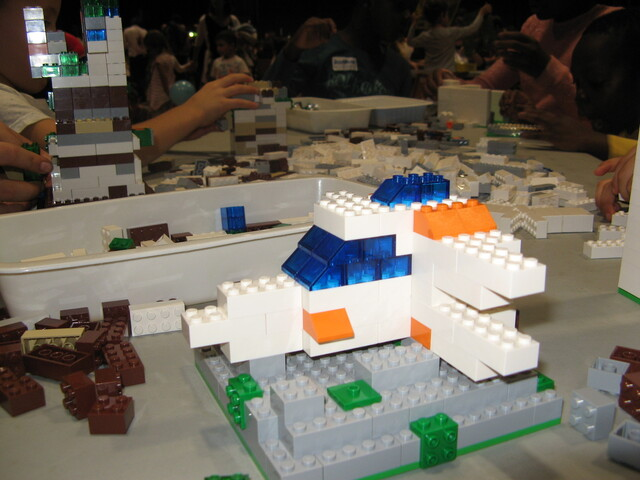
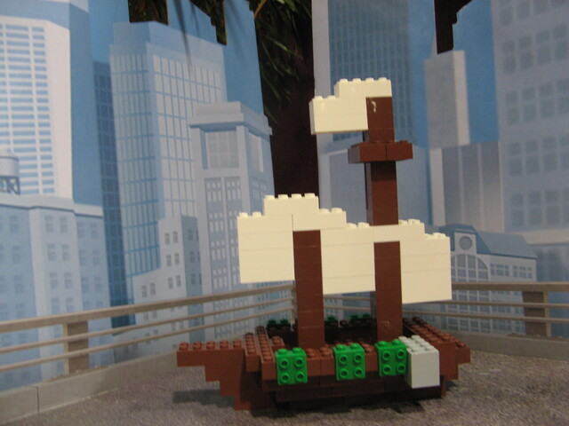
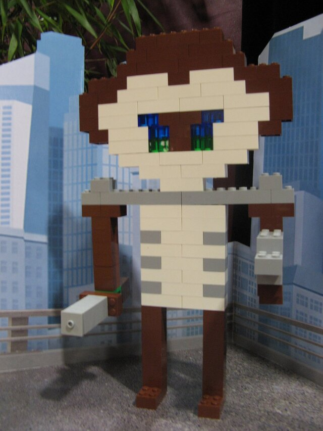
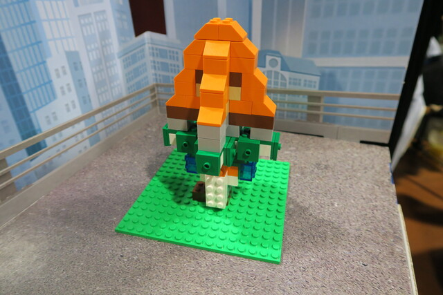

FreeLUG a animé un atelier de construction au Festival du Jeu de Colomiers (31) les 19 et 20 Octobre 2019.

Notre emplacement était spacieux, bien situé à coté des jeux de société pour les plus jeunes.

Plus de 5000 visiteurs, dont de nombreux ont "briqueté", donnant un panel de créations toutes plus différentes les unes que les autres.

De grandes réalisations avec toujours autant de briques transclear.

De petites réalisations comme cette foret miniature.

Des véhicules futuristes comme ce vaisseau spatial.

Et ce vaisseau à voiles.

Mais aussi d’étranges et sympathiques créatures.

Ainsi que d’amusantes maisons comme ce champignon à toit orange.

Rendez-vous a d’ores et déjà été pris pour l’édition 2020.
