Profitant de mon voyage au parc Legoland en Allemagne après Fana’briques, j’ai fait l’acquisition de la boîte 7628, l’avion que l’on peut apercevoir dans les dernières aventures du professeur Jones, Le Royaume du Crâne de Cristal.

## Descriptif de la boîte

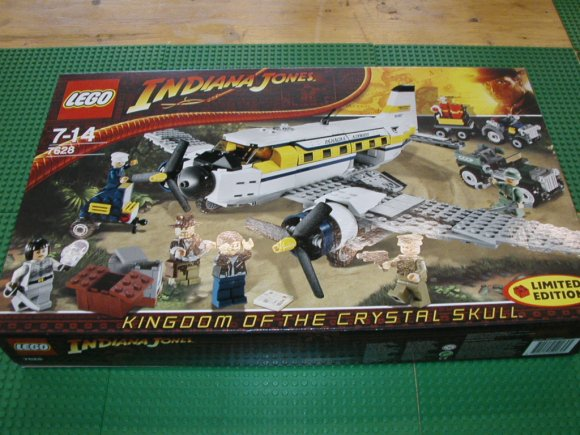

La boîte de taille correcte reprend le design de la gamme, avec la mention supplémentaire "Limited Edition" (édition limitée).  
**–** Nombre de pièces : 625  
**–** Année : 2008  
**–** Prix : environ 65 euros

L’emballage nous annonce également la composition en minifigs :  
**–** un pilote  
**–** le colonel Antonin Dovchenko  
**–** Indiana Jones  
**–** Mutt Williams  
**–** un garde russe  
**–** Irina Spalko  
**–** un crâne de cristal

Six minifigs dans la boîte, c’est agréable.

Je profite de l’exposition Kultiverse pour construire cette boîte, ça fera un bon complément à exposer sur notre table.

Le contenu de la boîte révèle six sachets, dont deux portant le numéro 3, une planche d’autocollants et deux livrets de montage.

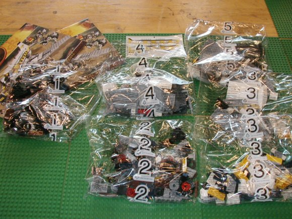

## Sachet 1 : les personnages et la jeep

Le premier sachet correspond traditionnellement aux minifigs, mais propose aussi le montage d’un véhicule tout terrain aux couleurs de la [CCCP](http://fr.wikipedia.org/wiki/Union_des_r%C3%A9publiques_socialistes_sovi%C3%A9tiques).

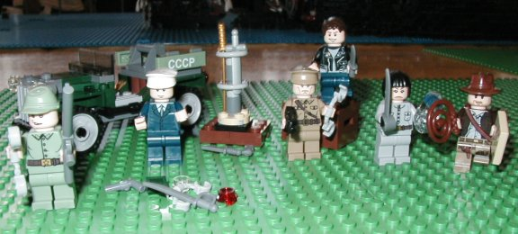

Comme certains des [personnages sont déjà connus, tout comme le râtelier d’armes](/articles/set-7624-duel-dans-la-jungle-jungle-duel/), je m’attarderais davantage sur le véhicule dont le montage est intéressant : passage de roue en SNOT, simulation des suspensions...

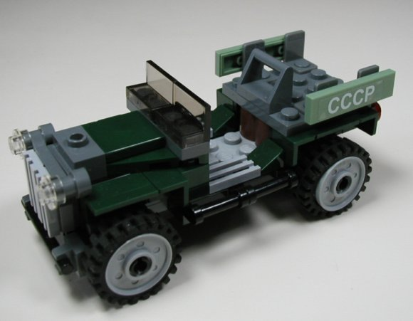

## Sachet 2

Le sachet 2 propose le montage du tracteur, d’une remorque et de l’escalier d’accès à l’avion. Le tracteur est très sympathique, le passage des roues arrières est peut être toutefois un peu large.

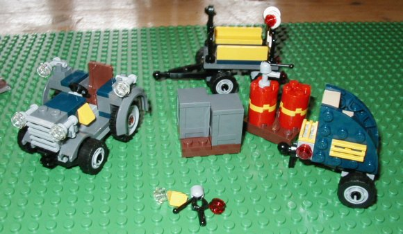

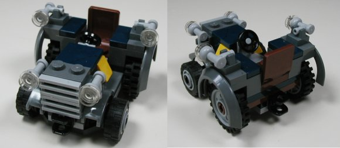

On regrettera toutefois l’impossibilité de fixer l’escalier à la remorque, mais le tracteur dispose de deux attelage, dont l’un frontal ce qui n’est pas forcément pratique pour manoeuvrer. N’ayant pas vu le film, je ne pourrais dire si c’est une retranscription fidèle.

Le montage est complété par une palette de caisses et une autre de fûts d’essence.

## Sachets 3

Les deux sachets 3 permettent l’assemblage de la carlingue de l’avion.

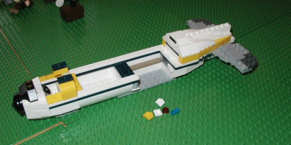

## Sachet 4

Le sachet 4 nous amène à construire la base des ailes ainsi que l’aile bâbord. Les moteurs dissimulent le mécanisme très simple mais efficace du train d’atterrissage.

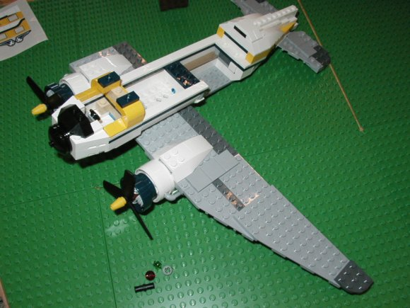

Ces parties mobiles apportent beaucoup au jeu.

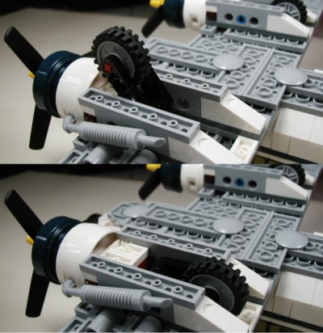

## Sachet 5

Enfin, nous terminons la deuxième aile et le dessus avec le dernier sachet. La plus grosse déception de ce set s’affiche lors de l’apposition des autocollants sur les verrières transparentes. Les coloris n’étant pas opaques, le résultat est décevant, d’autant plus que le reste de l’avion est parfait.

L’utilisation des nouvelles pièces arrondies offre un résultat très lisse et les proportions de l’avion sont agréables, l’association du jaune et du bleu foncé agrémentant le tout.

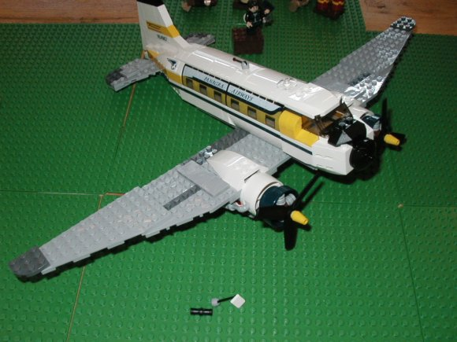

La photo ne rend pas très bien compte du défaut des autocollants, même si celui-ci a l’air d’être moins pertinent avec le temps.

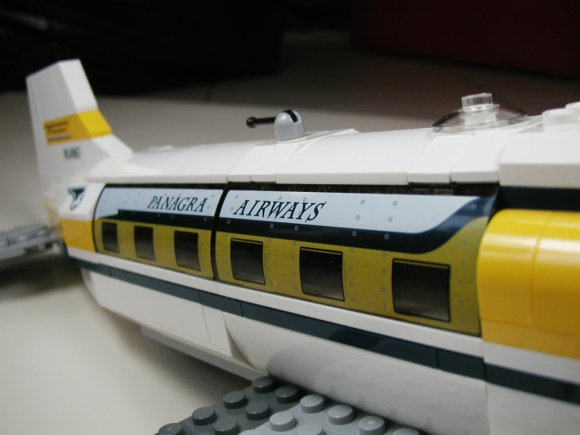

## Conclusion

Bien accompagné en minifigs, accessoires et véhicules, cet avion est quand même une belle construction. Ce problème d’autocollants gâche un peu le résultat, et surtout limite la possibilité de construire l’avion dans d’autres coloris.

Ceci dit, les inconditionnels des aventures d’Indy ou les amateurs d’avions y trouveront toutefois leur bonheur.

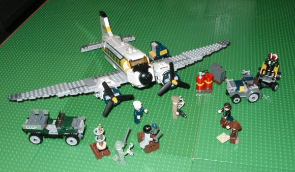
