Depuis sa naissance, le chemin de fer a toujours connu différents types d’écartements et ce pour des raisons diverses et variées. Au fur et à mesure du temps l’écartement de 1 435 mm s’est imposé comme la référence en Europe, voire aujourd’hui dans le monde. Il est encore utilisé de nos jours, notamment (à de rares exceptions près) par la SNCF. Mais au cours du temps d’autres écartements se sont imposés. On distingue ainsi les voies larges, dont l’écartement est supérieur à 1 435 mm, la voie métrique, dont l’écartement entre chaque rail est de 1m, ainsi que les voies étroites, qui vont nous intéresser aujourd’hui. Aujourd’hui l’écartement étroit (ou « narrow gauge » en anglais) est un terme qui regroupe l’ensemble des voies dont l’écartement est inférieur à 1m. En France, l’écartement le plus connu est "la voie de 60" cm qui a connu un véritable essor grâce à l’industriel Français Paul Decauville.

[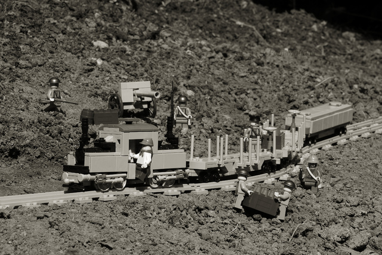](https://www.freelug.org/IMG/jpg/pechot_bourdon_de_1888-2.jpg)

_Mise en situation de ma locomotive Péchot Bourdon de 1888. Cette locomotive fut construite en grande partie dans les usines de l’industriel Decauville._

## Quel écartement choisir ?

Dans l’ensemble de cet article on se base sur "l’échelle minifigurine".

Pour éviter de se perdre parmi ces nombreux écartements, on va prendre la référence que l’on utilise tous aujourd’hui : la voie LEGO de 4 tenons de large est l’équivalent de la voie normale. Une fois mesuré, l’écartement entre 2 rails LEGO de 4 tenons de large est de 38 mm. Après une simple règle de 3, on obtient donc une échelle de 1/38 ème.

En gardant cette même échelle, pour obtenir un écartement de 1m réel, on obtient un écartement de 26 mm. Après plusieurs tests, cet écartement ramené est infaisable **simplement** en LEGO puisque un écartement de 3 tenons correspond à un écartement de 30 mm et une voie de 2 tenons, à un écartement de 22 mm.  
De la même manière pour une voie de 60 cm réel, on obtient un écartement LEGO de 16,2 mm, ce qui fait un tout petit peu plus d’un écartement de 1 tenon.

En résumé, pour réaliser les 3 écartements français les plus utilisés :

-   Pour la voie dite "normale" (écartement réel 1 435mm), on choisira les rails standard produit par LEGO.
-   Pour la voie de 1m (aussi appelée voie métrique), on pourra choisir entre un écartement de 2 tenons, de 3 tenons ou bien de 2 tenons et demi. Dans cet article, par soucis de simplicité de géométrie de la voie, on choisira l’écartement de 2 tenons.
-   Pour une voie étroite de 60 cm on choisira un écartement de 1 tenon. Néanmoins, il est important de prendre en compte que l’écartement de 1 tenon est très difficilement motorisable.

Dans cette partie on ne s’intéressera qu’à une voie de 2 tenons de large, car c’est la plus facile à "fabriquer" et la plus connue. La construction d’un circuit en 2 tenons de large fera l’objet d’un autre article.

## Entrons dans le vif du sujet

Sur voie étroite on peut tout reproduire voire imaginer, tant le matériel est diversifié. Jusqu’à présent je me suis intéressé à des écartements de voies étroites différents. Il s’agit d’une part de la voie de 60 cm, et d’autre part de la voie de 918 mm, que l’on retrouve en Irlande, ainsi que sur l’Ile de Man. Mais les inspirations peuvent être nombreuses ! En France, beaucoup de trains touristiques (qui sont souvent les restes de chemins de fer secondaires) sont à voie métrique et peuvent être une formidable source d’inspiration.

[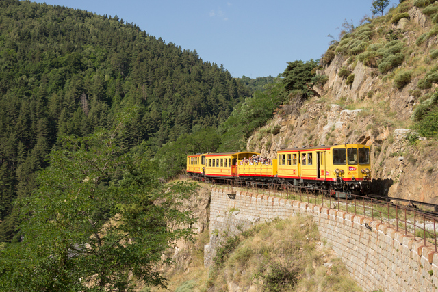](https://www.freelug.org/IMG/jpg/z_118_ter_23010_la_tour_de_carol_-_villefranche_gare_de_sauto_02.08.2019.jpg)

_Ici, une photo du "Train Jaune", près du village de Sauto. A écartement métrique, ce peut être une formidable source d’inspiration, tant par la beauté des paysages traversés que par l’ambiance dégagée_

Ce que je vais vous proposer ici, ce sont des solutions que j’ai utilisées pour la fabrication de mes trains. Vous pouvez vous en inspirer, mais surtout ne vous limitez pas, car il y a plein d’autres possibilités différentes pour résoudre un même problème.

## Un problème de bogie

La base d’un train c’est la roue. Et bien souvent, un wagon repose sur un minimum de 2 essieux (un essieu étant composé de 2 roues et d’un axe les fixant toutes les deux, en parallèle). Et avec l’augmentation du tonnage transporté par wagon, on a inventé le bogie. C’est un ensemble constitué de 2 essieux et relié à la structure du wagon par une liaison pivot.

Voici donc, de manière non exhaustive, quelques idées de bogies à voie étroite LEGO :

-   Pour faire un bogie simplement, le mieux c’est d’utiliser les mêmes pièces que celles proposées pour la fixation des roues sur une voiture. ([référence 4600 chez BrickLink](https://www.bricklink.com/v2/catalog/catalogitem.page?P=4600#T=S&O={{ '{%' }}22iconly%22:0}) ) On peut alors y fixer très simplement deux petites roues de train de manière à former un essieu ou un bogie.

[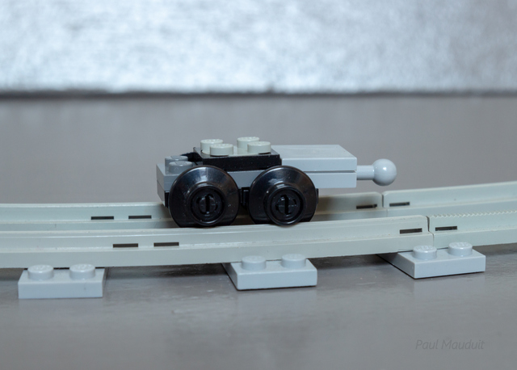](https://www.freelug.org/IMG/jpg/bogie_pechot_lego_narrow_gauge.jpg)

_Vue du bogie une fois monté_

[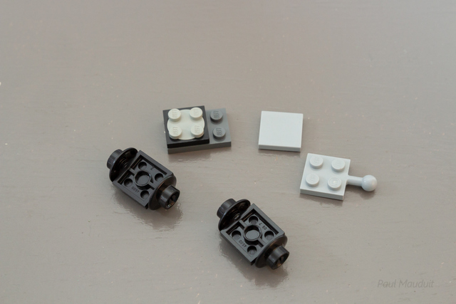](https://www.freelug.org/IMG/jpg/pieces_construction_bogie_pechot.jpg)

_Vue des pièces utilisées pour la fabrication du bogie_

-   On peut également imaginer des techniques plus complexes. Pour évoquer les bogies Pershing, j’ai du imaginer d’autres solutions. En voici une qui m’a donné satisfaction. Attention, il est bien important, lors du montage, de ne pas serrer les roues, qui auquel cas ne tourneront plus.

[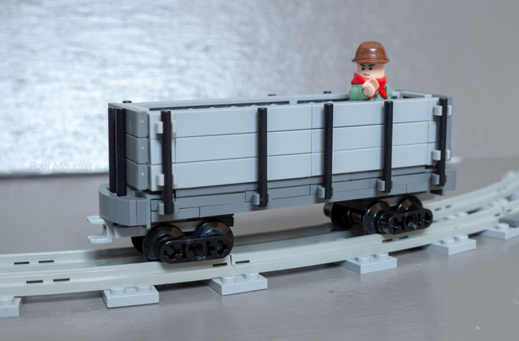](https://www.freelug.org/IMG/jpg/wagon_pershing_lego_narrow_gauge.jpg)

_Vue d’un wagon Pershing, doté de bogie du même nom. Ce type de wagon fut très employé pendant la guerre, et bien après notamment pour le transport de betteraves à sucre_

[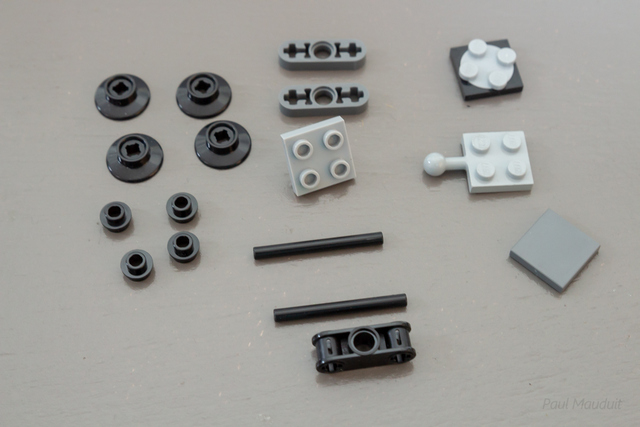](https://www.freelug.org/IMG/jpg/pieces_construction_bogie_pershing.jpg)

_Pièces nécessaires à la réalisation du bogie_

Voici les différentes étapes nécessaires à la réalisation du bogie

Étape 1

[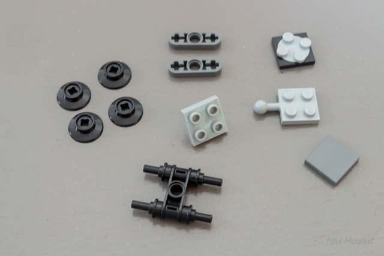](https://www.freelug.org/IMG/jpg/etape_1_bogie_pershing.jpg)

Étape 2

[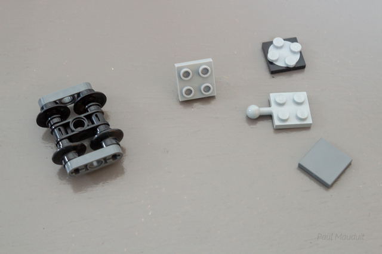](https://www.freelug.org/IMG/jpg/etape_2_bogie_pershing.jpg)

-   Pour concevoir la locomotive Péchot Bourdon de 1888, j’ai également dû réfléchir à un autre type de bogie. En effet, la locomotive possède un diamètre de roue intermédiaire entre les petites roues présentées ci-dessus et les roues de train standard. J’ai donc utilisé des jantes de voitures. Le modèle n’est plus fonctionnel, mais l’esthétique est préservé.

[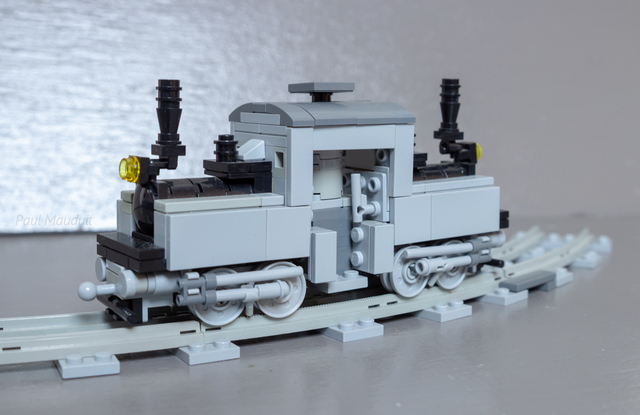](https://www.freelug.org/IMG/jpg/pechot_bourdon_de_1888_lego_narrow_gauge.jpg)

_Vue de la locomotive Péchot Bourdon de 1888. La locomotive est de type Fairlie et a donc nécessité la fabrication de 2 bogies similaires_

[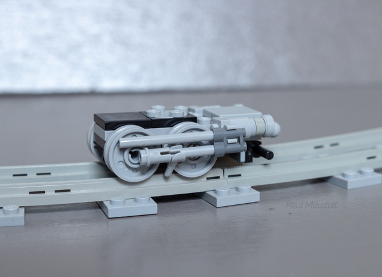](https://www.freelug.org/IMG/jpg/bogie_pechot_bourdon.jpg)

[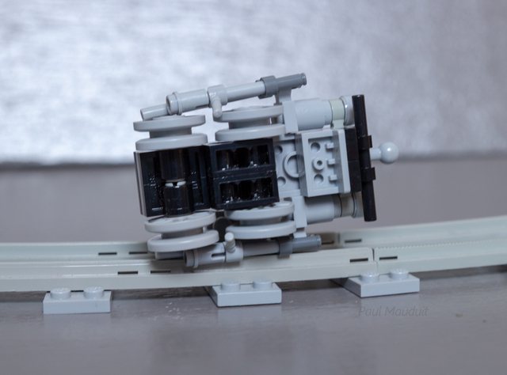](https://www.freelug.org/IMG/jpg/bogie_pechot_bourdon_2_.jpg)

_Deux vues du bogie en détail_

J’ai également réutilisé ces roues (mais cette fois-ci fixes avec le châssis) pour réaliser une Alco Cooke de 1917. Le système de fixation des roues est exactement le même.

[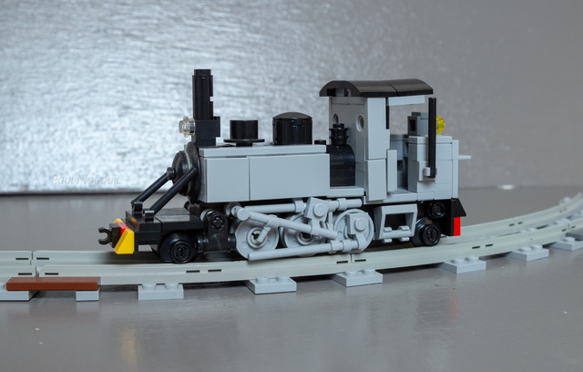](https://www.freelug.org/IMG/jpg/alco_cook_de_1917_lego_narrow_gauge.jpg)

-   Enfin, pour la réalisation d’un railcar Irlandais sur voie de 918 mm (donc aux dimensions plus onéreuses), j’ai utilisé des roues de trains standards.

[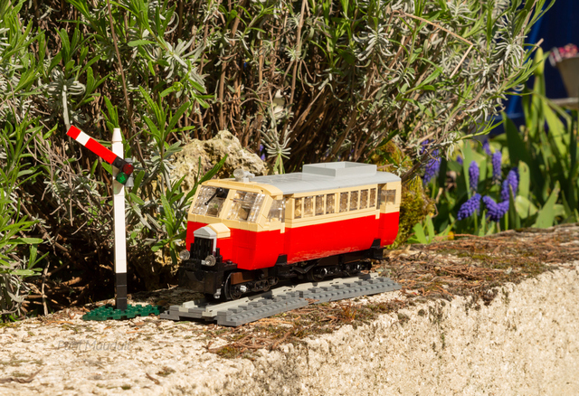](https://www.freelug.org/IMG/jpg/railcar_18_lego_narrow_gauge.jpg)

Ce railcar montre également que si l’écartement est réduit, les dimensions ne sont pas obligées de l’être. En effet, ce modèle est en 8 tenons de larges, soit autant, voire plus qu’un train Lego roulant sur une voie Lego standard. La aussi, il ne faut pas se restreindre.

## Des attelages en pagaille

Ok, nous avons fabriqué la base de notre train. Mais, bien qu’il existe des autorails, un train c’est par définition une suite d’éléments attelés entre eux. Étant donné la géométrie des attelages aimantés Lego, il va être difficile de les utiliser.  
Là aussi j’ai eu recours à plusieurs solutions :

-   La première reprend les attelages classiques de chez Lego. Ils sont petits et similaires à ceux utilisés en voie de 60 cm. Cependant ils sont parfois un peu durs à mettre et à défaire, ce qui peut faire perdre en jouabilité.

[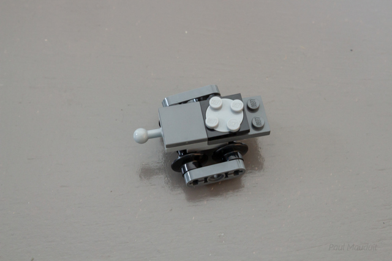](https://www.freelug.org/IMG/jpg/etape_3_bogie_pershing.jpg)

_Vue de la pièce utilisée pour les attelages (pièce mâle). Elle est ici installée sur le bogie Pershing_

-   Pour le railcar Irlandais, j’ai opté pour un autre type d’attelage avec une simple barre technique. Cependant je n’ai pas encore eu l’occasion de faire des tests dessus. Je le soumets à titre expérimental.

[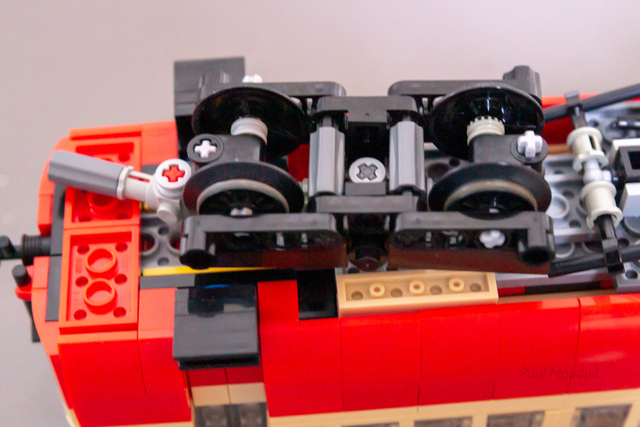](https://www.freelug.org/IMG/jpg/bogie_porteur_railcar.jpg)

_Vue du bogie porteur_

## Et la motorisation dans tout ça ?

En exposition, le diorama peut être magnifique, s’il ne bouge pas, il ne captera pas l’attention du public . Il faut donc du mouvement. Et pour ça quoi de mieux que de faire tourner des trains ? D’autant qu’un train qui roule procure toujours plus de satisfaction.

Malgré ça, par souci de complexité, j’ai renoncé à motoriser mes locomotives à vapeur (les jantes de voitures les empêchent de rouler correctement). Quant à mon locotracteur Baldwin 50HP, il n’y a tout simplement pas la place pour y loger un moteur.

[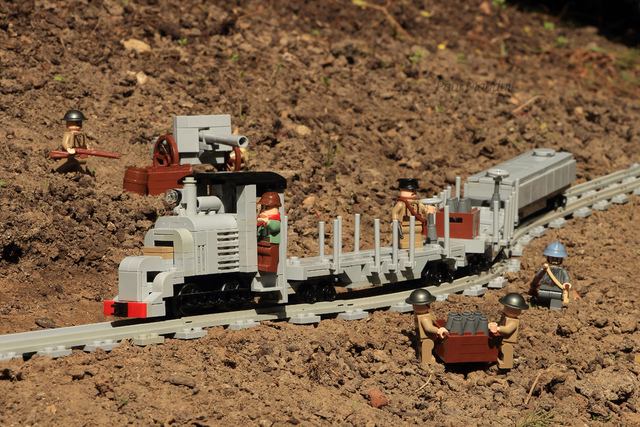](https://www.freelug.org/IMG/jpg/dechargement.jpg)

_Le Baldwin 50HP mis en scène_

J’ai donc remédié au problème en réalisant deux wagons couverts, le premier contenant le moteur, le second, le boitier à piles. Le système semble plutôt bien fonctionner, cependant, j’attends d’être en exposition et de l’avoir fait fonctionner pendant plusieurs heures d’affilées avant de le valider.

[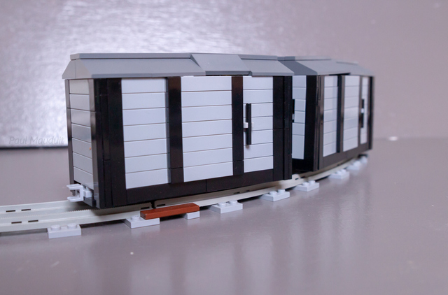](https://www.freelug.org/IMG/jpg/wagons_couverts_moteur_narrow_gauge.jpg)

[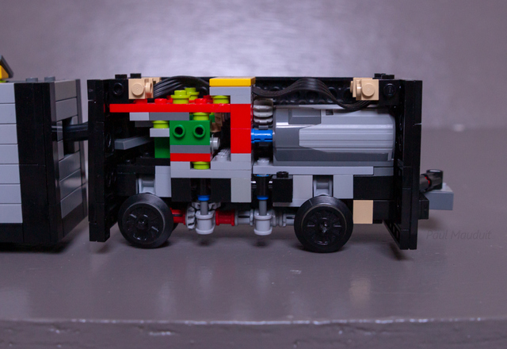](https://www.freelug.org/IMG/jpg/systeme_moteur_wagon_couvert.jpg)

[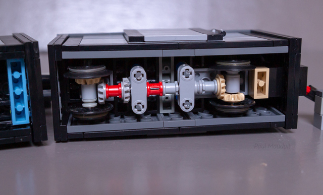](https://www.freelug.org/IMG/jpg/essieux_moteur_wagon_couvert.jpg)

_Trois vues différentes du wagon_

On peut également imaginer d’autres possibilités tel qu’ un ensemble de 2 wagons motorisés avec un cardan entre les 2 wagons pour transmettre le couple.

Pour le railcar Irlandais, l’opération fut beaucoup plus simple, car il y a de la place (ou tout du moins plus que dans un train de 4 tenons de larges). J’ai donc pu loger sans trop de soucis boitier à piles, récepteur et le moteur. Ce dernier est situé parallèle à la structure, au niveau de la cabine. Il entraine le bogie avant par l’intermédiaire de l’axe de rotation du bogie par rapport à la caisse. Le mouvement est ensuite distribué de la manière suivante, via l’engrenage central :

[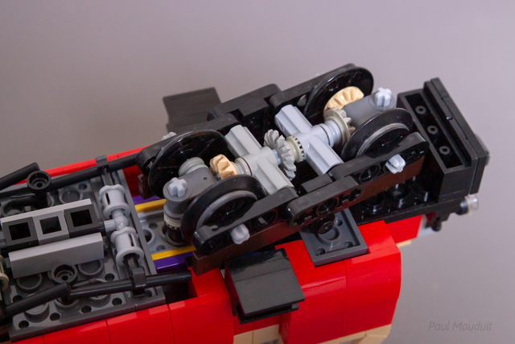](https://www.freelug.org/IMG/jpg/bogie_moteur_railcar_18.jpg)

_Vue du bogie moteur avant du railcar Irlandais_

La motorisation d’un matériel roulant en voie étroite demande toujours plus de travail qu’un train roulant sur un écartement de 4 tenons de large, car les bogies moteurs produits par Lego sont inutilisables. Cependant cela ne doit surtout pas nous arrêter, puisqu’il existe tout de même des solutions. Si vous avez peu manié de Lego technic, c’est le moment de vous lancer !

## **Pour conclure**

Voilà pour ce qui est du matériel roulant. Il y a évidement d’autres méthodes, d’autres possibilités. Si vous êtes en manque d’inspiration, je vous invite à aller voir sur internet. Il y a beaucoup de créations qui méritent le coup d’œil, toujours sur du matériel à voie étroite.

De manière générale le train à voie étroite en Lego c’est plus compliqué car plus petit. Ça demande de réfléchir encore plus à des techniques qualifiées de non conventionnelles par Lego, d’applications différentes pour chaque pièces... Mais c’est également là que s’exprime la créativité ! De plus, les dimensions moins onéreuses des trains vont permettre par la suite la création d’un diorama moins grand, aux rayons de courbures plus adaptée à l’échelle.

Enfin, il est possible de faire de la voie étroite sur la base écartement de 4 tenons, tout simplement en grossissant nos trains. Pour une voie de 60 cm, on arrive une échelle de 1/16 ème. C’est un choix à prendre.

Vous avez maintenant toutes les clés pour réaliser votre matériel roulant sur une voie étroite.

Bonne construction !

Paul Mauduit
