Les pièces LEGO ne sont pas destinées à créer des belles courbes lisses. Leur but originel est architectural : faire des murs, droits, et des maisons bien géométriques. De nouvelles pièces apparurent - arches et briques arrondies - mais toujours avec des choix limités : diamètres réduits, restrictions de couleurs, etc. Mais il existe des façons créatives d’utiliser les pièces LEGO pour faire des courbes.

## Introduction

C’est un exercice bien connu que de faire une sphère avec des briques de base. C’est un point de départ qui permet aux maîtres constructeurs de construire toute sorte de modèles LEGOLAND tels que des œufs de dinosaures, des globes terrestres ou des bustes de personnages célèbres. Cette technique n’implique pas de montage complexe comme le SNOT car les briques sont simplement empilées les unes sur les autres. Cette technique utilise une méthode permettant de mimer des modèles continus (courbes mathématiques, formes biologiques...) avec des pièces élémentaires carrés (pièces LEGO), de façon similaire à la création d’une mosaïque en trois dimensions. C’est cette méthode que nous allons étudier tout au long d’une série d’articles.

## Construire un dôme avec des briques

L’objet de ce premier article est de construire un dôme hémisphérique avec des briques. Certains constructeurs particulièrement doués peuvent réussir à construire de façon instinctive mais les autres ont besoin d’outils. L’idée la plus immédiate est d’utiliser un crayon et un papier (ou plutôt une imprimante) et de créer des grilles avec les dimensions classiques du LEGO : respectivement 8 et 9.6mm pour la largeur et la hauteur d’une brique, et 3.2mm pour la hauteur d’une plate. Ensuite, à l’aide d’un compas, vous superposez le tracé de plusieurs cercles de dimensions intermédiaires représentant des coupes à des hauteurs successives. On transforme ainsi un problème en trois dimensions en un problème en deux dimensions en découpant le modèle. Dans le cas qui nous intéresse ici, on découpe le dôme en une série de cercle suivant la hauteur. Le problème en 2D est bien connu, il s’agit simplement de mosaïques. Faire un modèle 3D consiste donc simplement dans ce cas à empiler des mosaïques.Cette méthode est peut être un peu archaïque, mais elle à fait ses preuves jusque dans les ateliers de la société LEGO.

Comme les pièces LEGO en formes de dômes hémisphériques les plus grandes ne dépasse pas le diamètre de 6 tenons, il est intéressant, pour commencer, de construire un dôme de taille supérieure. Nous prendrons ici l’exemple d’un dôme de diamètre de 8 tenons.

## Les grilles

La première grille est composée de carreaux de la taille d’une brique. Peu importe l’échelle tant que la proportion hauteur sur largeur (1,2) est respectée. Chacun des trois niveaux est découpé suivant un diamètre.

[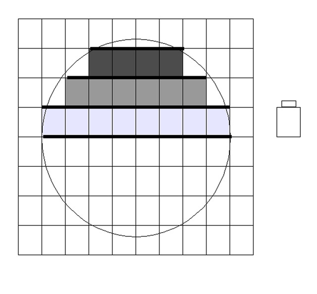](https://www.freelug.org/IMG/jpg/grid1.jpg)

Ces trois diamètres servent à tracer trois cercles sur la grille suivante, composée de carrés. Ces cercles permettent de déterminer quels carrés doivent ou non être noircis (ceux qui sont inclus à plus de la moitié dans le cercle). On obtient finalement les formes successives à reproduire avec des briques.

[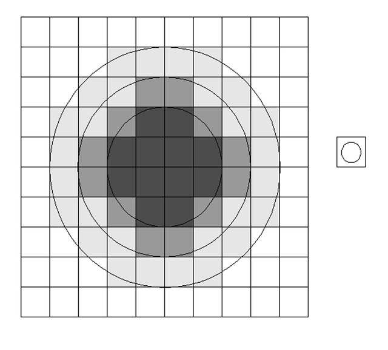](https://www.freelug.org/IMG/jpg/Grid2.jpg)

La dernière image illustre le résultat final. Bien sûr, cette méthode n’indique pas quelles tailles de briques utiliser pour reproduire les formes successives. Ce type de problème est difficile à programmer alors qu’un être humain le résout facilement. Le dôme, constitué uniquement de briques n’est pas joli. On va améliorer l’aspect en les combinant avec des plates.

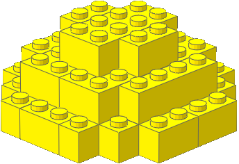

Pour utiliser des plates, on change simplement la première grille pour une grille plus fine, avec un rapport hauteur sur largeur de 0,4.

[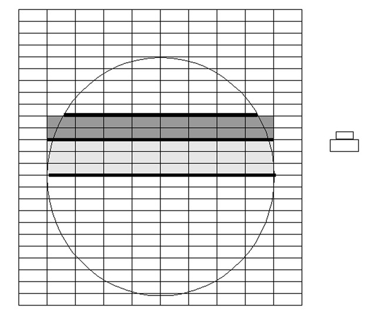](https://www.freelug.org/IMG/jpg/Grid3.jpg)

Il faut bien comprendre que rien n’oblige à utiliser des cercles dont la taille est un multiple de l’unité de base, et même un changement de diamètre minime peux avoir des conséquences sur la forme du cercle pixelisé. Les grilles montrent les tracés pour la première couche de briques et les deux couches de plates suivantes.

[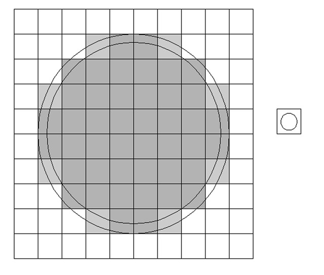](https://www.freelug.org/IMG/jpg/Grid4.jpg)

Le dôme final, utilisant des briques et des plates, apparaît bien plus lisse. Ce n’est pas encore parfait, mais c’est un dôme de petite taille pour cette technique et vous pouvez l’améliorer en utilisant des plates lisses ou des petites briques pentues comme la « cheese slope ».

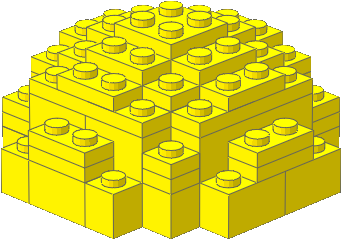

## Les programmes

La technique de la grille papier fonctionne mais elle reste approximative et longue. Un peu de mathématiques et de programmation permettent de s’affranchir de cette étape en l’automatisant. Il est bien compréhensible que cela ne soit en rien passionnant, en tout cas ce n’est pas le sujet de cette série d’article. Certains comme Arthur Gugick créent leur propre logiciel, je vous propose pour ma part de télécharger ci-après un fichier Excel ou OpenOfficeCalc (tableur).

Le programme permet de choisir la taille du dôme et donne pour chaque coordonnée la hauteur de la construction (en nombre de plates). Ici, le programme de Gugick pour un dôme de 32 tenons de diamètre.

[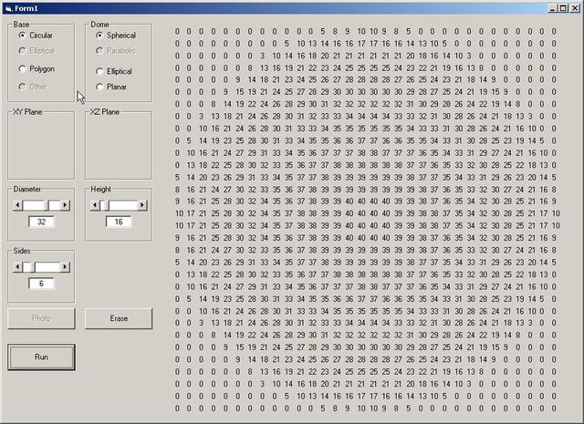](https://www.freelug.org/IMG/jpg/program01.jpg)

Même si le calcul est automatisé, pour ces modèles de grande taille il faut faire preuve d’organisation au moment de passer au montage. Une méthode consiste à monter d’abord une structure composée uniquement de briques, en partant de la périphérie qui constitue la base en repérant les chiffres supérieurs aux multiples de trois successifs.

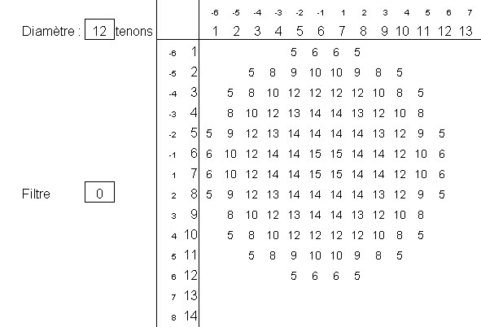

Un filtre permet de n’afficher que les couches supérieures dans le programme que je vous propose.

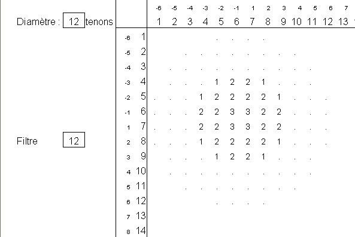

Dans une seconde phase, les manques sont complétés avec des plates, généralement de petites tailles (beaucoup de 1x1 et 1x2).

Comme vous pouvez le constater sur la photo ci-contre, le résultat est parfait pour ce dôme de grand diamètre, mais prenez bien en compte que ce type de construction nécessite une très grande quantité de pièces.

[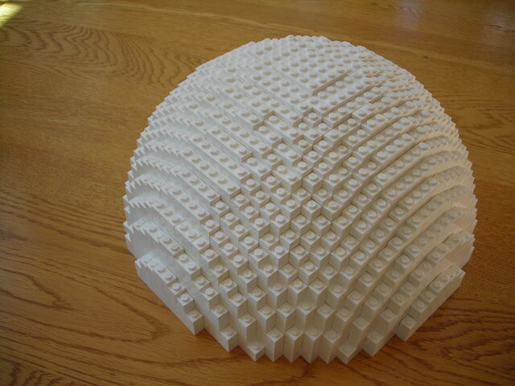](https://www.freelug.org/IMG/jpg/domecreator.jpg)

Pour finir, voici la notice de montage pour ce dôme hémisphérique de 8 tenons de diamètre.

## Notice d’un dôme de diamètre 8

[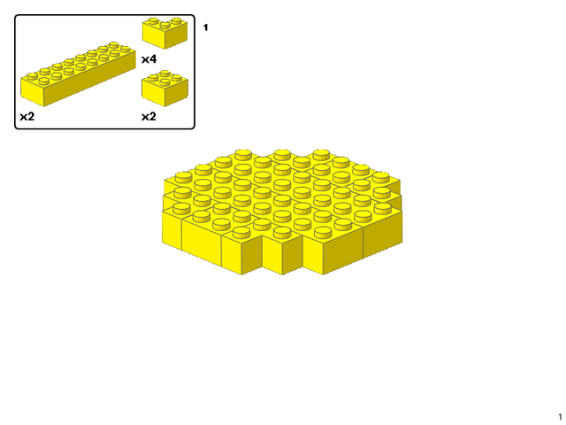](https://www.freelug.org/IMG/png/TennisBall_0_00_ci.png)

[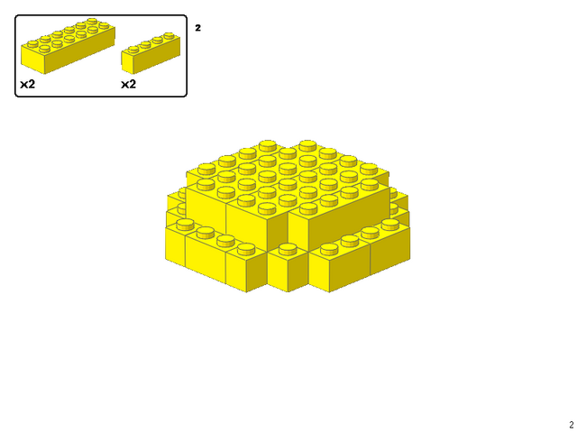](https://www.freelug.org/IMG/png/TennisBall_0_01_ci.png)

[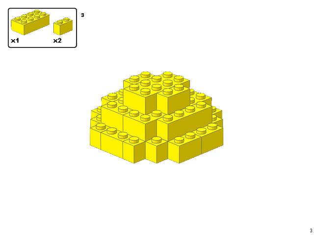](https://www.freelug.org/IMG/png/TennisBall_0_02_ci.png)

[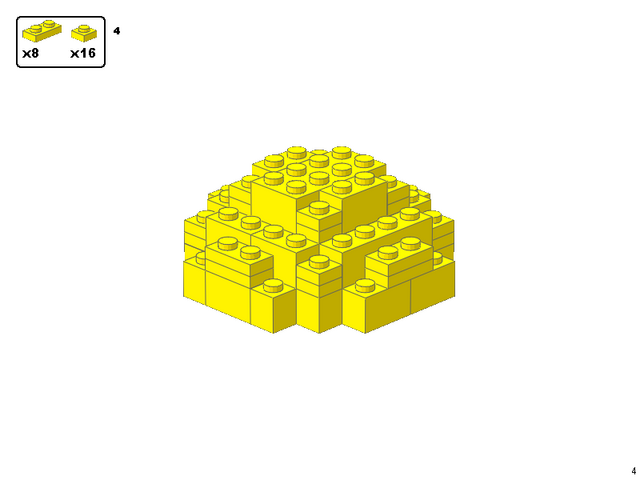](https://www.freelug.org/IMG/png/TennisBall_0_03_ci.png)

[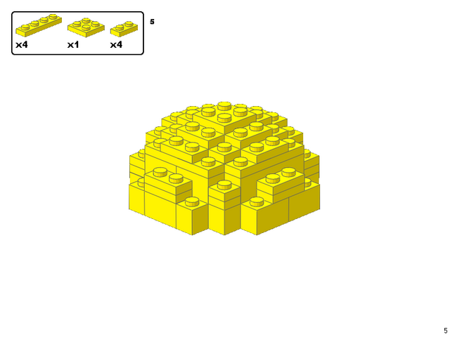](https://www.freelug.org/IMG/png/TennisBall_0_04_ci.png)

* * *

Téléchargez la feuille de calcul DomeCreator pour OpenOfficeCalc ou Excel

**DomeCreator (OpenDocument)**

**DomeCreator (Excel)**
