Jusqu’à présent, les formes que nous avons reproduites dans les premières parties sont globalement sphériques : dôme, balle, fruits. Mais notre technique de construction ne se limite pas aux sphères.

Il est tout à fait possible d’utiliser d’autres lignes génératrices pour générer des dômes, comme par exemple l’ellipse (ovale).

En utilisant cette nouvelle génératrice, nous allons pouvoir reproduire des objets comme un ballon de rugby ou un œuf.

Je vous propose donc de construire un œuf de 8 tenons de largeur et d’une dizaine de briques de long en combinant un dôme elliptique de base circulaire avec un dôme hémisphérique similaire à celui que nous avons construit dans la partie II. C’est un œuf de belle taille (6,4cm sur 10cm). Plus gros qu’un œuf de poule mais plus petit qu’un œuf d’autruche, il ressemble par sa taille à un œuf de... cygne.

[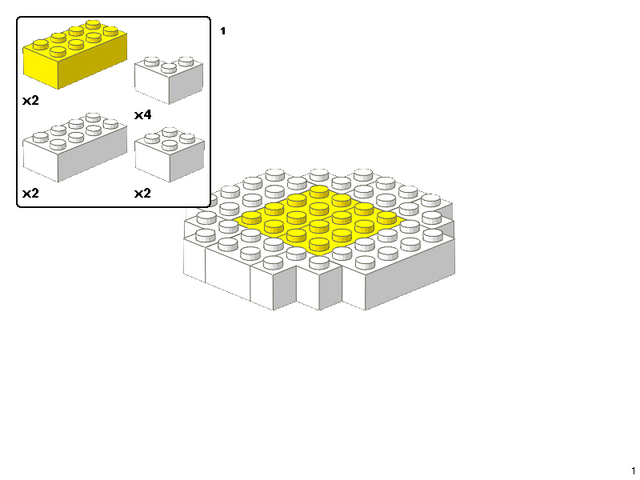](https://www.freelug.org/IMG/png/Oeuf2_0_00_ci.png)

[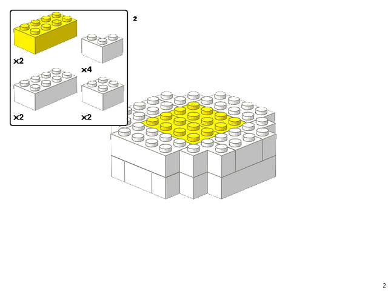](https://www.freelug.org/IMG/png/Oeuf2_0_01_ci.png)

[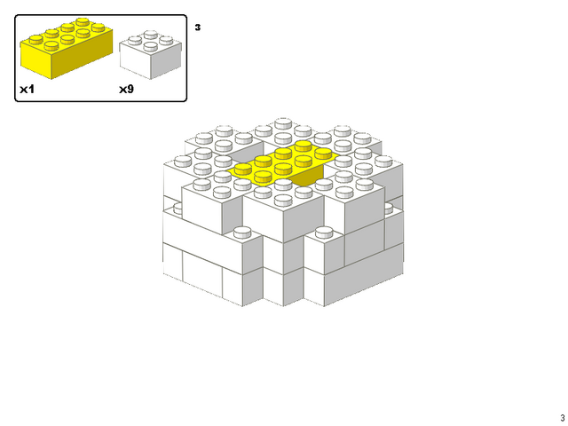](https://www.freelug.org/IMG/png/Oeuf2_0_02_ci.png)

[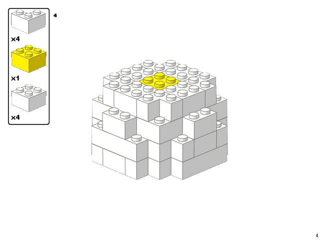](https://www.freelug.org/IMG/png/Oeuf2_0_03_ci.png)

[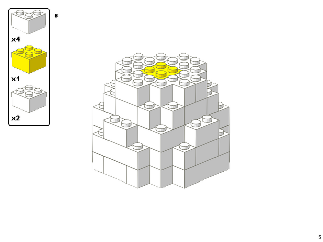](https://www.freelug.org/IMG/png/Oeuf2_0_04_ci.png)

[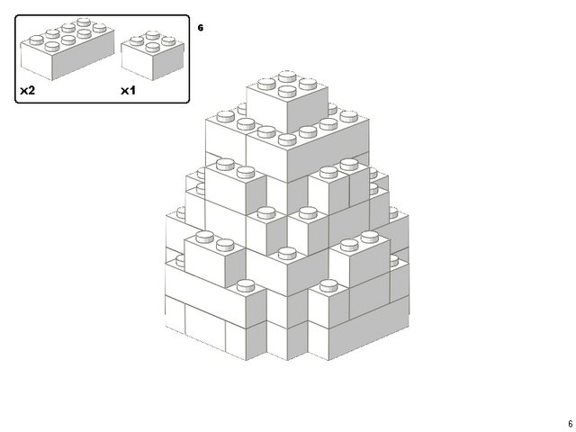](https://www.freelug.org/IMG/png/Oeuf2_0_05_ci.png)

[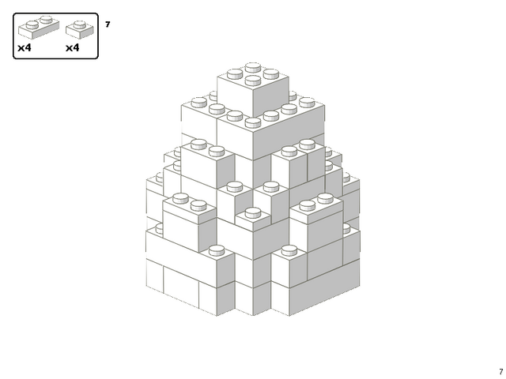](https://www.freelug.org/IMG/png/Oeuf2_0_06_ci.png)

[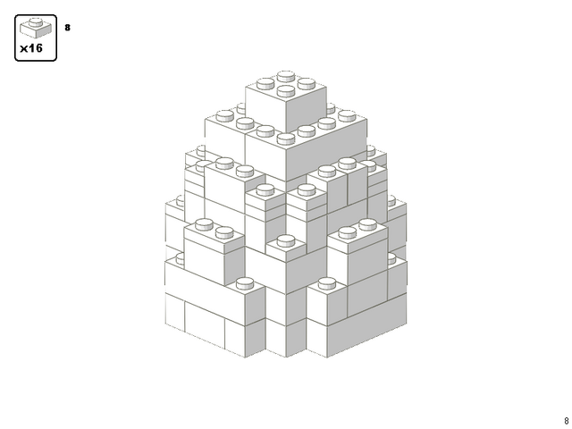](https://www.freelug.org/IMG/png/Oeuf2_0_07_ci.png)

[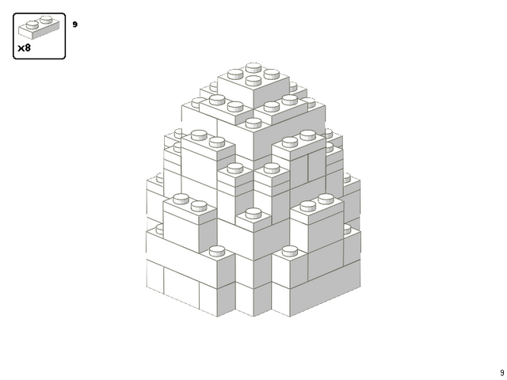](https://www.freelug.org/IMG/png/Oeuf2_0_08_ci.png)

[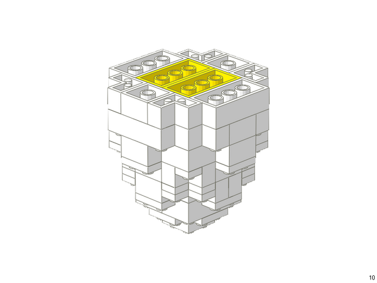](https://www.freelug.org/IMG/png/Oeuf2_0_09_ci.png)

[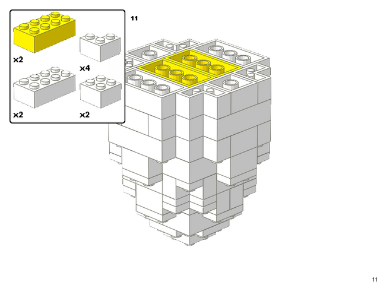](https://www.freelug.org/IMG/png/Oeuf2_0_10_ci.png)

[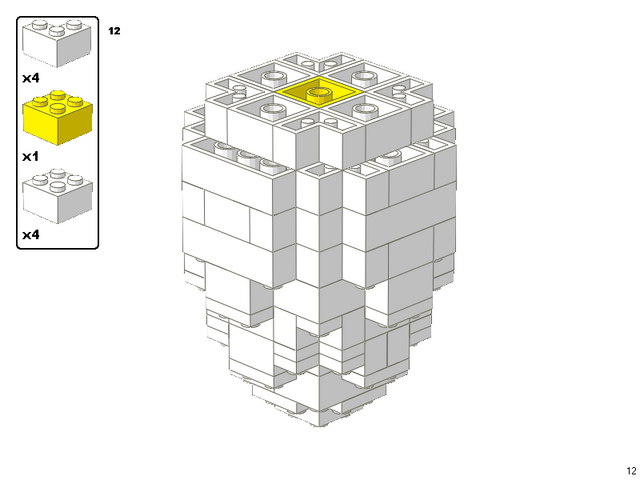](https://www.freelug.org/IMG/png/Oeuf2_0_11_ci.png)

[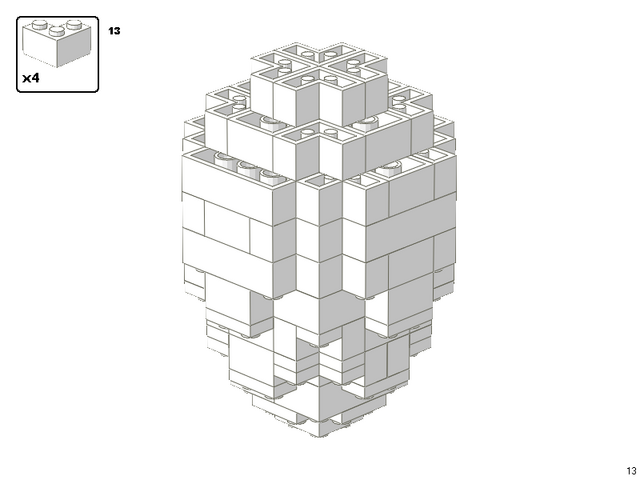](https://www.freelug.org/IMG/png/Oeuf2_0_12_ci.png)

[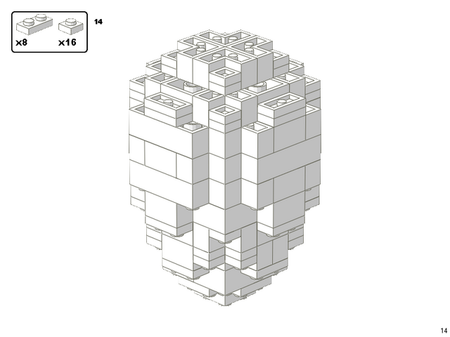](https://www.freelug.org/IMG/png/Oeuf2_0_13_ci.png)

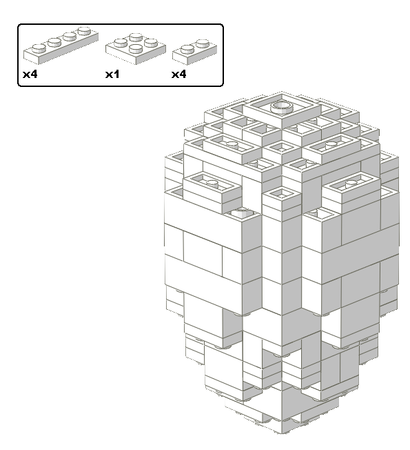

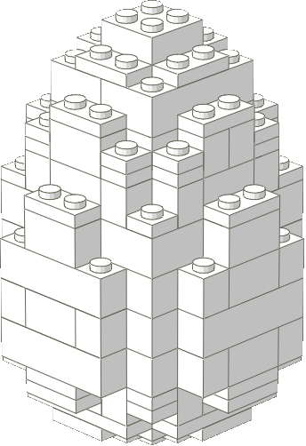

Le logiciel MLCAD permettant de créer les images de synthèses qui illustrent ici les notices de montage dispose aussi d’un générateur de volume en trois dimensions. Dans la barre de menu principal vous le trouverez dans Extras->Generators->Rotation Model... Il permet de tracer la génératrice suivant une grille dont vous choisissez la taille (brique, plate et dimension).

Toutefois il ne permet de générer que des volumes à base circulaire et les résultats sont généralement plutôt décevant comme vous pouvez le voir sur l’illustration ci-dessous qui simule un œuf de même taille que celui que nous venons de construire.

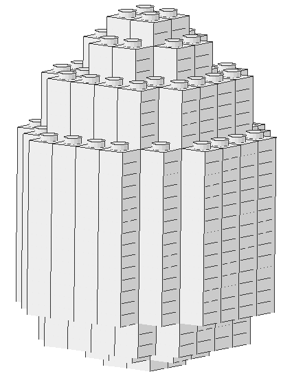

Les classeurs (OpenOffice et Excel) ci-après contiennent les feuilles de calcul pour des dômes à bases elliptiques et à génératrices droites ou elliptiques.

Notez bien que le cercle est un cas particulier d’ellipse pour lequel les deux axes ont la même dimension.

* * *

**–** [Des balles avec des briques. Partie I : les dômes](/articles/des-balles-avec-des-briques-partie-i-les-domes/)  
**–** [Des balles avec des briques. Partie II : la sphère](/articles/des-balles-avec-des-briques-partie-ii-la-sphere/)  
**–** [Des balles avec des briques. Partie III : les fruits.](/articles/des-balles-avec-des-briques-partie-iii-les-fruits/)
