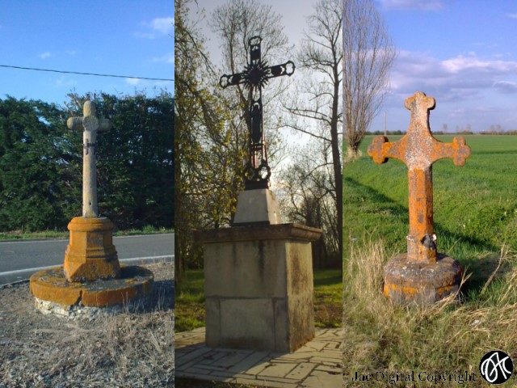
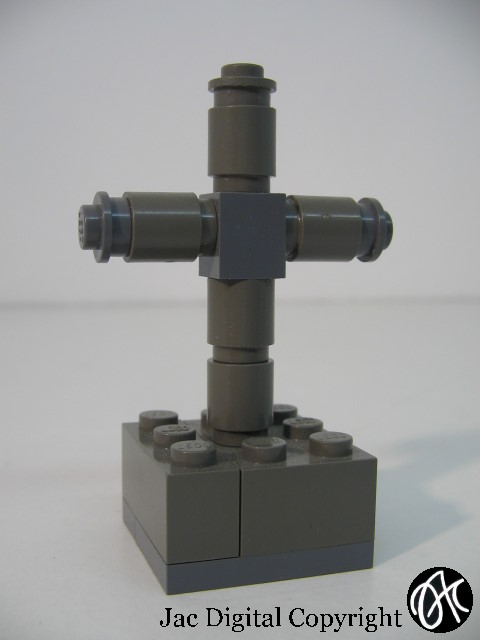
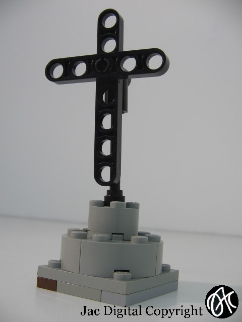

Pour ces quelques petits modèles, je me suis inspiré des constructions que je rencontre dans ma région. Les petites sculptures sont de deux types : en fer forgé, avec une base en pierre de taille, ou complètement en pierre.

J’ai reproduit les deux, pour varier, et je m’attarderais au passage, sur celles présentes sur les toits de nos églises. L’article n’est pas subjectif, il y a sûrement beaucoup d’autres exemples, comme les croix en bois qui sont plus rares ici...

Quelques exemples pris en photo aujourd’hui. Je les avais repérées, car elles sont situées sur le trajet quotidien de mon travail. Elles m’ont aussi inspiré les deux modèles que je vais vous présenter. Ils sont très simples à reproduire.

**Quelques exemples réels**

Elles sont situées en entrée de ville, aux croisements de routes ou d’anciens chemins, ou en cimes de montagnes...

Au salon du modélisme de Saint-Chély, j’ai entendu dire : "elle est chouette ta petite croix". Du coup, j’ai eu l’envie d’écrire un nouvel article.

## La petite croix en pierre

Construite sur une embase de petite hauteur, elle est entièrement en briques pleines. Elle est composée de 4 plates de hauteur. La brique 1x1 à 3 tenons permet de placer les 3 branches, deux horizontales puis la verticale. J’ai choisi le gris foncé, mais la construction est possible aussi en gris clair, et en "vieilli", avec libre choix de couleurs.

**La croix en pierres taillées**

## La croix en fer forgée

De construction plus travaillée, la croix en fer forgée est plus compliquée à assembler. Là encore, le choix des couleurs est assez libre. Celle de l’exemple réel est toute récente car restaurée après sa chute dûe aux tempêtes d’hiver. Mais pour mon modèle, j’ai tout de même vieilli l’embase.

**La croix en fer forgé**

**Notice "fer forgé"**

Sur les toits des églises, on peut retrouver le même type de croix, et s’inspirer de ces exemples. Elles sont aussi en pierres sculptées sur les anciennes de type romane, puis en fer forgées de plus en plus travaillées, jusqu’aux girouettes, qui feront peut-être l’objet d’un prochain article.

Pour les [exemples d’implantation, voir les photos des réseaux prises en exposition dans ma galerie](http://gallery.freelug.org/main.php/v/JAC/Exposition/).

Je ne suis ni croyant, ni pratiquant, donc ne voyez pas en ces quelques mots une quelconque incitation. Juste une manière de compléter harmonieusement un petit coin de réseau ou de Paradis !
