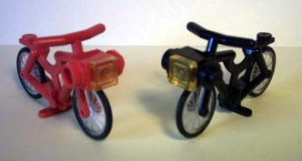
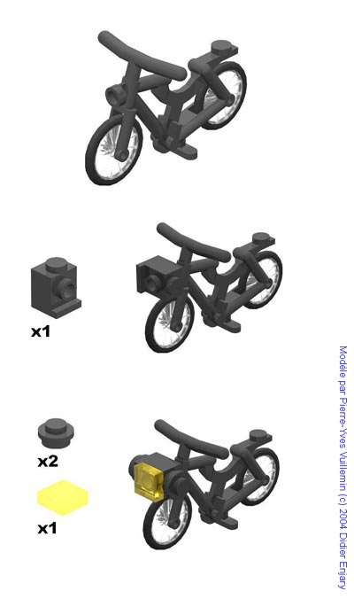
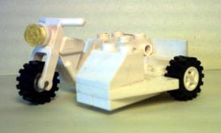
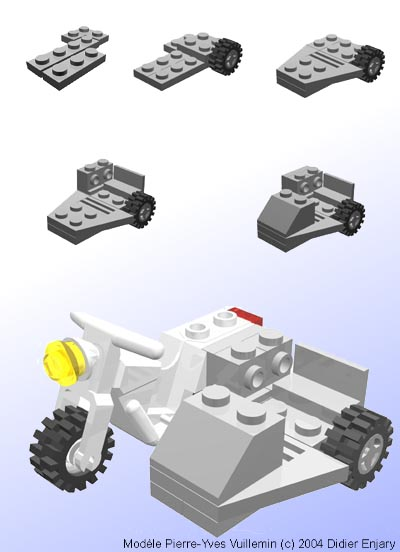
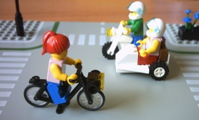

Pour étrenner cette rubrique des "Construction 5 min.", voici un Velo solex et un Side car que nous propose Obi.

Ces modèles simples à monter animeront agréablement vos scènes de ville :-)

Vous pouvez trouver d’autres modèles à construire en 5 minutes dans la revue de nos amis anglais ([acrobat reader indispensable](http://www.adobe.fr/products/acrobat/readstep2.html)) :  
[http://www.brickish.org/bi/](http://www.brickish.org/bi/)
