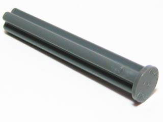

Régulièrement la société LEGO commercialise de nouveaux modèles. Ces sets sont bien souvent scrutés sous la forme de revues (reviews) que ce soit dans nos colonnes ou sur d’autres sites comme SeTechnic, BrickPirate (français), Eurobricks ou Brickset (anglais).

Mais jamais ou presque les nouvelles pièces ne suscitent autant d’intérêt, même si elles apparaissent nombreuses chaque année.

Pourquoi cette désaffection ? Car les fans adultes sont bien souvent plus intéressés à créer leurs propres modèles plutôt que de construire ceux du commerce. Les pièces novatrices devraient les intriguer plus que les modèles. D’autant plus qu’il y a souvent autant à dire.

Prenons pour exemple cette nouvelle pièce (2010) que Pierrick "PZ" a porté à notre attention : [l’axe de 4 avec arrêt (Axle 4 with stop)](http://www.bricklink.com/catalogItem.asp?P=87083).

Cette pièce apparaît dès la première année dans pas moins de 33 sets, et pas seulement des sets Technic. Elle semble donc présenter une très grande utilité, utilité purement technique toutefois, elle demeure cachée dans les montages et par conséquent n’apparaît qu’en gris foncé.

Elle remplace avantageusement les axes de tailles voisines (4,5) auxquels ils auraient fallu ajouter une pièce de blocage (Technic bush par exemple) pour avoir les mêmes fonctions.

Elle a une soeur aînée (2007) qui est aussi deux fois plus grande : [l’axe de 8 avec stop](http://www.bricklink.com/catalogItem.asp?P=x1739) (et elle aussi très employée, apparaissant dans plus de 70 sets entre 2007 et 2010).

Pour conclure, plutôt que de m’engager à vous faire de régulières présentations, je préfère encourager les membres, tous rédacteurs du site, à écrire eux aussi des revues de pièces récentes... [ou](/articles/etude-de-piece-2/) [pas](/articles/etude-de-piece-3/).
