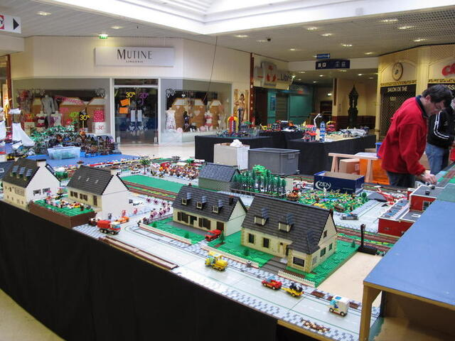
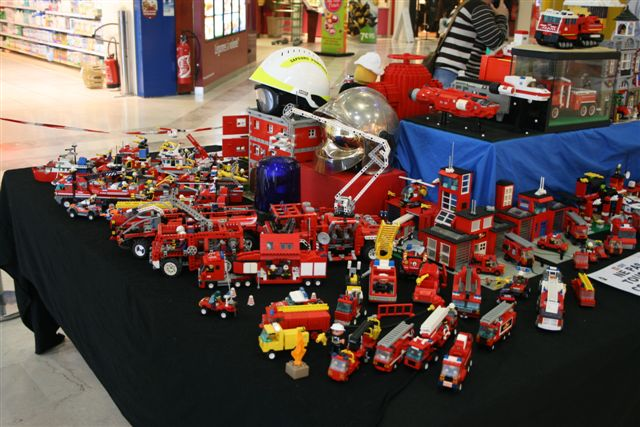
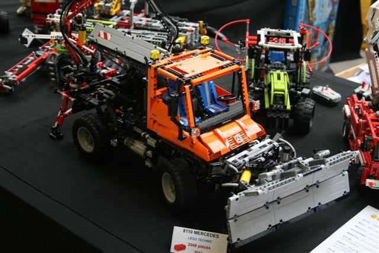
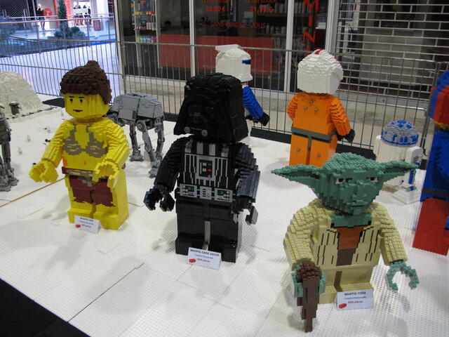
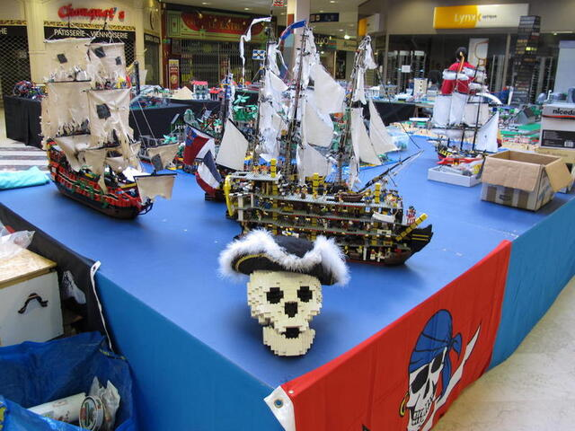
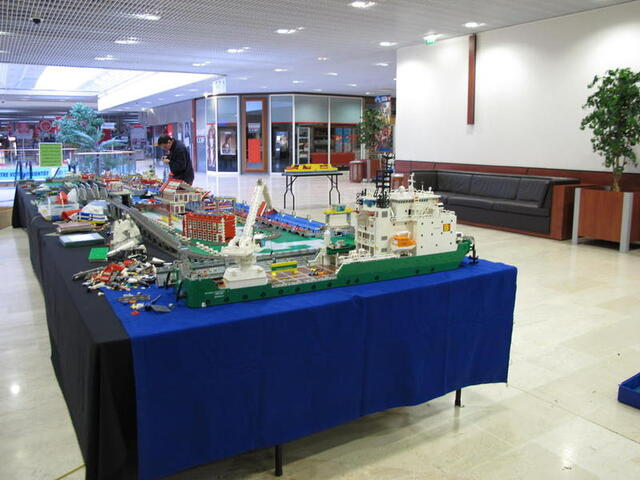
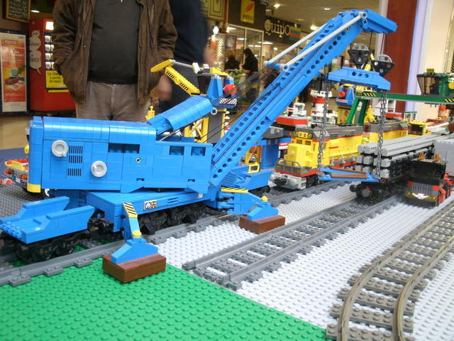
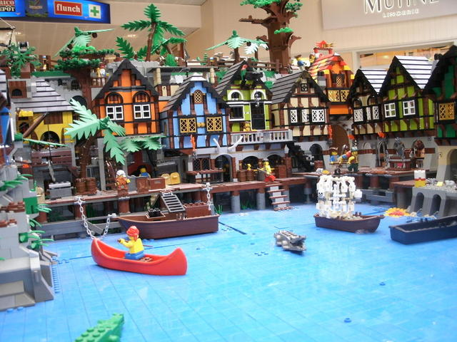
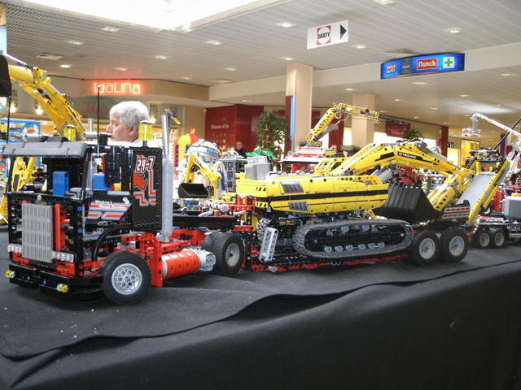
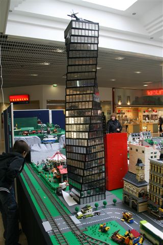

Pour ma première exposition en tant qu’organisateur, j’ai fait fort. Deux semaines dans une galerie commerçante avec un espace bien important.

Après acceptation du projet par l’association des commerçants, il a fallu trouver les personnes à exposer avec moi. Je profitais de ma présence à Cholet pour "engager" les derniers récalcitrants.

A l’arrivée pas moins de 5 zones la première semaine et 6 la seconde !  
**–** une zone portuaire avec JM, fidèle à lui même,  
**–** une zone Star Wars habillée par Dominick alias Ar Sparfel,  
**–** une zone CITY d’environ 40 m2,  
**–** une zone Technic avec GBB,  
**–** une zone asiatique avec la montagne de Gaëlle.

La seconde semaine, Bordolego aura son espace pompier dans l’entrée du magasin.

Le montage s’est déroulé sans encombres, bien qu’il nous ait fallu pas moins de 11 h à 10 le dimanche, et environ 4h le lundi matin pour peaufiner... Peaufiner étant un bien grand mot car j’en ai rajouté jusqu’à la fin...

Nous avions mis sur pied un concours pour faire gagner de nombreuses boîtes de LEGO ; la première semaine 5 lots Ninjago par jour + un lot CITY, la seconde semaine, 1 boite de DUPLO avec l’atelier de Brigitte par jour et du CITY tous le soirs... En point d’orgue les vendredis & samedis où nous faisions gagner des grosses boites.  
Ainsi le premier week-end, le commissariat et le dernier faucon millénium, le second, un train de marchandise 7939 et l’Unimog Technic.

Le dernier jour nous fîmes un jeu spécial pour gagner la gamme fusée, navette en découvrant le nombres de pièces de la deuch à Séb... pas moins de 500 participants pour 7 bonnes réponses. Un tirage et hop, partie avec une mère de famille présent au moment du tirage.  
Un de ses enfants fit le tirage surprise de cette fin d’exposition : quelques boîtes achetés de ci de là pour l’expo à faire gagner aux exposants. 15 billets dans une boites et GO !

1.  JF remporte le nouveau port city
2.  Dom remporte le nouvel hélicoptère de police city
3.  Alain repart avec la gare
4.  Bruno repart avec un portique vert du 7939
5.  Séb repart avec le cabriolet "Friends"
6.  Brigitte & Erik profiterons d’un set Dino,
7.  Vincent gagne 20 fleurs
8.  Pierre Charles gagne 20 arbres,
9.  Gaëlle gagne 20 barrières au choix

Perdu pour les autres, il faudra revenir !

L’exposition s’est passée sans réels problèmes - à part le vol du crâne - et le public, très nombreux a été ravi ! Les responsables du magasins nous ont largement félicités et nous offrent la possibilité de réitérer l’expo dès 2014 !

Donc je tiens à remercier mes exposants : JM, Dom, Ronan, Jac, Damien, Vincent, JF, Séb, Gaëlle, Brigitte, Alain, Christophe, Bruno, Cyril, Roger, et ceux qui m’ont prêté du matériel, Gilles pour les BURP, Pierre pour la tour, et FreeLUG en général pour le prêt de plaques & nappes... Merci au président aussi de s’être déplacé pour le montage !

_mickbatto_

* * *

Bonjour

Suite à l’invitation de Mickaël, j’ai amené, à sa demande, mon célébrissime diorama trains et ferries (bientôt 6 ans d’existence et pas démodé du tout).

Le montage (dimanche) s’est passé dans de bonnes conditions, je remercie Damien pour son aide précieuse.

Au passage, mon aide-assistant a pu observer les coulisses du diorama.

Le lendemain matin à 9h, le réseau était en route pour 12/13 h d’affilées par jour et ce, pendant 12 jours.

Comme toujours, j’ai invité au hasard des papas, des enfants à jouer avec moi, certains étaient vraiment surpris de mon initiative, le livre d’or ouvert pendant 12 jours était rempli de commentaires positifs (30 pages). J’ai eu des contacts de toutes sortes, reçu la visite de personnes travaillant chez Bourbon, des retraités qui ont même vu l’original du ferry blanc norvégien, comme le monde est petit !  
D’une façon générale, hormis les connecteurs cassés, le matériel LEGO 9V a bien marché.

Comme dans tout salon, il y a une fin, le diorama fut rangé en 3h30, après un coup de main pour déblayer la place sous l’œil d’un vigile de sécurité.

Quant au reste de l’exposition, j’ai vu et revu les différents dioramas sans oublier bien sûr les exposants.

En conclusion, merci à Mickaël pour son énorme travail sans équivalent en France (lieu public, durée, nourriture, hébergement).  
Merci à l’association des commerçants de la galerie marchande.  
Merci au public heureux de voir et de revoir les jeux LEGO, le soutien a été fort et apprécié, nous le reverrons dans les différents salons de la région où LEGO retrouvera sa vraie place.

_jean marc_

* * *

Partis de Saint Lô, Alain et moi sommes arrivés samedi 18 pour une semaine à Brest. Notre participation à l’espace enfants étant programmée du 20 au 25. Nous avons pu en arrivant voir la foule émerveillée autour des dioramas et constructions déjà exposés depuis une semaine. Aussitôt nos briques DUPLO, Toolo, etc. en sécurité et le tout nouvel espace enfant de la galerie découvert, nous avons participé à la surveillance des dioramas et avons répondu avec plaisir aux multiples questions des visiteurs curieux de voir des adultes s’amuser autant avec leurs briques.

Ces expositions assez loin de chez soi ont l’avantages de nous faire rencontrer aussi d’autres exposants, et Brest a été riche de belles rencontres. Rendez-vous a été pris pour août et plus.

Dès le lundi les enfants et les grands parents (vacances scolaires oblige) en majorité sont venus passer des heures à jouer. En soirée, vers 17h 18h, beaucoup plus de parents venaient avec les petits passer un moment et participer à la tombola très attractive. Une boite DUPLO tous les jours à gagner vers 17h30.

J’ai observé mon Alain, avec plaisirs, au milieu de l’espace central complètement embarqué sur la planète LEGO naviguant entre les boites à billets de tombolas, les trains et son coin cuisine pour nous préparer nos casse-croûtes copieux.

S’offrant aussi quelques moments de détente comme pilote de course dans la galerie.

Je remercie Damien pour son implication avec moi, auprès des enfants et des Toolo.

Après le dimanche de démontage, nous sommes rentrés certes fatigués. Mais la tête pleine de jolis souvenirs, dans la poche le petit cadeau qu’une petite fille accompagnée de sa maman tenait à m’apporter, tout spécialement.

Le cœur touché par un ou deux moments inoubliables. Mais là, chut c’est notre secret à Angelot, sa maman, son papa et moi ;)

Cette exposition est une belle expérience, certainement complexe à organiser.

Mickaël a relevé le défi et la réussite a été au rendez-vous.

_Brigitte et Alain les Normands_

* * *

## Galeries photos

**–** [Galerie de Jean-Marc](http://photos.freelug.org/main.php/v/barr__/expositions/2012/tonnerre/)  
**–** [Galerie de Sebastien](http://photos.freelug.org/main.php/v/sebhamon/2012/Brest+2012/)  
**–** [Galerie d’Erik - installation](http://photos.freelug.org/main.php/v/brickerik/expositions/2012/TonnerreBriques/)
