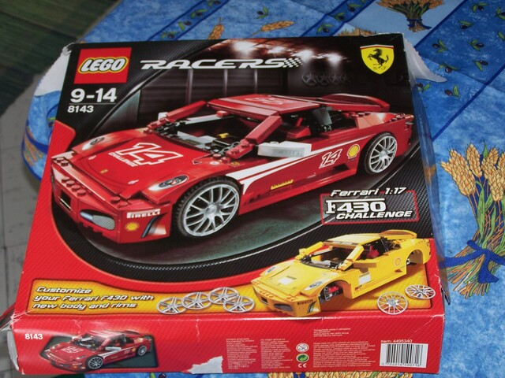
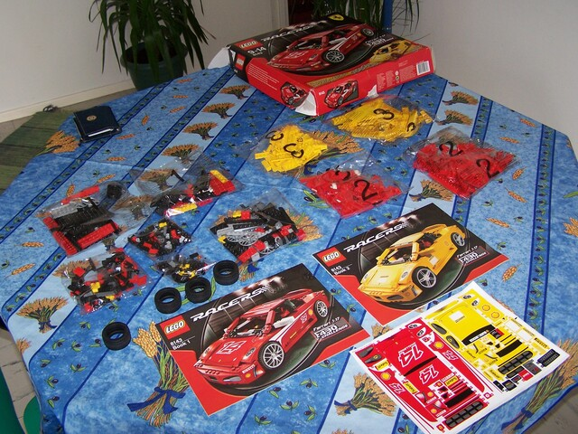
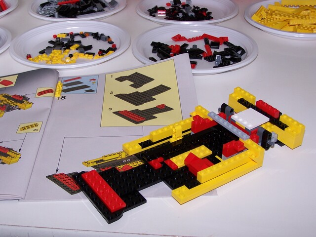
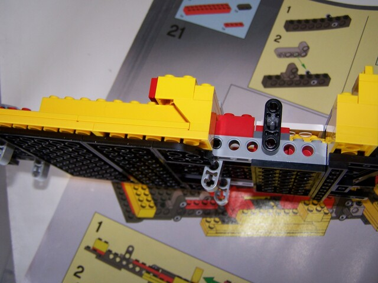
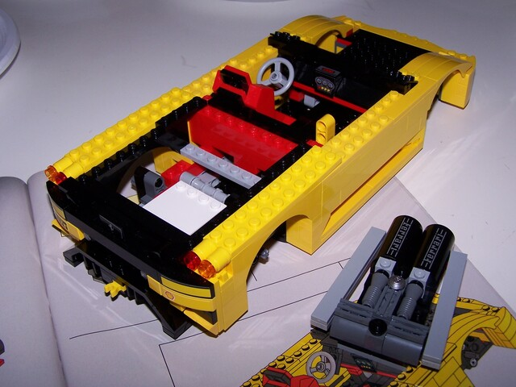
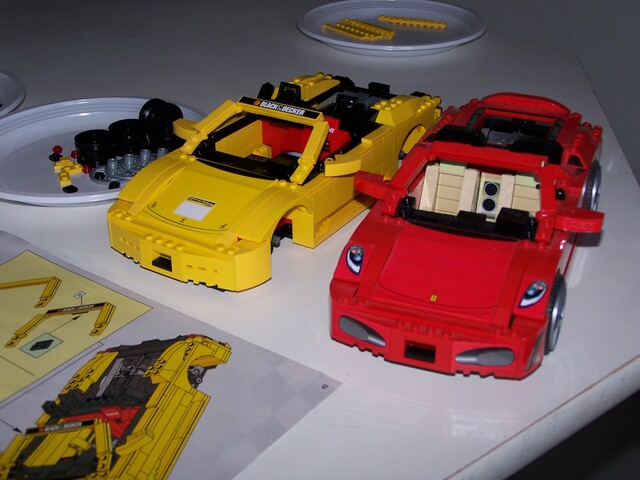
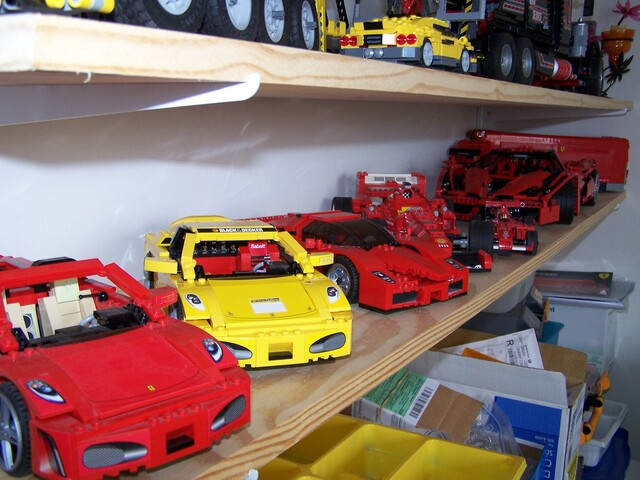

Amoureux des belles italiennes en général rouges avec un cheval cabré sur le capot et des LEGO, je suis un AFOL comblé car mes deux passions se retrouvent à travers la gamme "LEGO Racers Ferrari ".

Pour ce premier article, c’est le set 8143 que j’ai choisi de vous décrire car très sympa et original.

Il s’agit de la reproduction de la Ferrari F430 challenge. Ce set a une originalité, celle d’offrir le choix entre deux couleurs pour la carrosserie, rouge ou jaune.

La boite contient 10 sachets plus 2 enfermés dans des sachets constituant la carrosserie, une planche d’étiquettes et deux notices de montage, je m’attendais d’ailleurs à une seule notice pour le montage du modèle quelque soit le colori choisi, bonne intention de LEGO.

Je commence le montage, très vite on se rend compte qu’il faut choisir une des deux couleurs proposées, bien que Ferrari rime avec rouge, je choisis le jaune.

Le montage se fait sans souci les pièces se trouvent sans aucune difficulté car très bien reparties. Je m’attendais à un montage similaire au [set 8671](http://guide.lugnet.com/set/8671) mais celui-ci intègre un astucieux mécanisme composé d’éléments LEGO Technic reproduisant comme dans la réalité les vérins hydrauliques permettant le changement des quatre roues par les mécaniciens lors des courses

Le montage se fait sans grande difficulté, laissant apparaître la forme de la Ferrari F430. Je trouve la reproduction du moteur très réaliste (on aurai presque envie de le faire démarrer)

je me permets une comparaison avec le modèle 8671 pour constater que les designers LEGO ont gardé les mêmes proportions d’un modèle à l’autre.

Après un bon moment de plaisir à monter ce nouveau modèle comportant un grand nombre d’étiquettes à coller, je peux toutefois regretter la fixation assez simple du toit, ce set reste malgré tout très sympathique et ensuite pourquoi ne pas mélanger les deux couleurs pour faire un modèle original.

En attendant un futur démontage, cette Ferrari a rejoint mon petit parking privé dédié aux Racers Ferrari. C’est aussi pourquoi j’ai choisi le jaune parmi tant de  
rouge.

