La création d’un MOC, comme tout processus de création, peut parfois se révéler douloureuse si votre exigence envers vous-même est assez élevée et si les pièces ne veulent pas trouver leur place naturellement.

En fait on pourra être plus ou moins exigeant quant à la fidélité vis-à-vis du modèle original que l’on cherche à reproduire. Certains pensent que la brique LEGO étant un jouet, la fidélité de la reproduction ne devrait être que suggérée, tout en privilégiant la solidité du montage et la jouabilité. Si vous pouvez donner votre MOC à un enfant et qu’il peut jouer avec sans qu’il tombe en pièces alors le but est atteint pour ce genre de MOCeur.

D’autres MOCeurs (dont je fais sans doute partie, probablement parce que je n’ai pas eu ma période de vrai modéliste) cherchent plutôt à reproduire un maximum de détails, et cela parfois au détriment de la solidité.

D’autres vont encore plus loin en réalisant des montages qui ne s’emboîtent pas vraiment, mais qui tiennent juste en équilibre le temps de prendre la photo [^1]. Personnellement j’essaye de ne pas aller jusqu’à cet extrême, le système LEGO étant quand même un jeu de construction à la base, j’essaye que mes MOC se tiennent.

La décision de réaliser un modèle particulier peut venir de l’observation de la vie de tous les jours ou bien de la visualisation des réalisations des autres fans de LEGO ou bien encore de la vue d’une seule pièce LEGO qui nous semblerait idéale pour représenter tel ou tel élément d’un modèle.

Pour le canon dont je vais vous parler, c’est en voyant un canon sur Brickshelf que j’ai eu envie d’essayer de faire le mien. Je n’ai pas réussi à retrouver la galerie donc je ne peux pas créditer son auteur, mais voici sommairement à quoi il ressemblait :

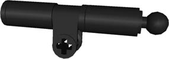

**Une idée de canon trouvée sur Brickshelf.**

D’autre part, les fans de pirates connaissent bien le canon tout fait proposé par TLC et qu’on trouve dans les boîtes pirates.

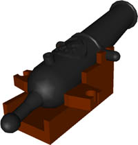

**Le canon officiel LEGO**

La réalisation d’un canon s’avérait donc un peu vaine dès le départ, mais j’ai quand même décidé de tenter ma chance, sans savoir que ce tout petit MOC allait me faire m’arracher les cheveux.

Lorsque je m’attaque à la réalisation d’un modèle, j’observe d’abord le modèle original (soit directement si j’ai la chance de l’avoir sous les yeux, soit _via_ des photos qu’on arrive toujours à trouver sur internet), et je décide quels seront les détails que je souhaite absolument reproduire (et qui sont généralement les éléments caractéristiques) et quels sont les détails que je laisserai tomber car trop petits ou trop biscornus.

Pour mon canon, voici la liste des critères que je me suis fixés :  
**–** 1) Une base à 4 roues, la base étant biseautée vers l’arrière.  
**–** 2) Le canon ne doit pas être trop haut, par exemple la bouche du canon ne devrait pas passer au-dessus de la tête d’une minifig  
**–** 3) Le canon doit avoir une boule à l’arrière avec si possible l’arrière arrondi (élément caractéristique des canons pirates). Il va sans dire qu’il doit être de section ronde et pas carrée.  
**–** 4) La bouche du canon doit être autant que possible ouverte et pas bouchée.  
**–** 5) Le canon lui-même est incliné vers l’arrière ; c’est un plus si l’inclinaison est variable, mais ce n’est pas obligatoire.

Voilà c’est à peu près tout, mais c’est déjà pas mal comme contraintes. Si vous voulez, vous pouvez arrêter la lecture de cet article ici et tenter de réaliser votre propre modèle avec ces contraintes :-) [^2]

Tout naturellement, j’ai commencé sur la base de l’idée trouvée sur Brickshelf avec notamment la pièce n°50

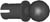

qui fait effectivement un joli cul de canon si vous me passez l’expression. Toutefois après différents essais il m’a semblé que le diamètre du canon était un peu petit pour le style de canon que je souhaitais réaliser. D’un diamètre de 1 tenon je suis donc passé au diamètre de 2 tenons. Heureusement il existe une pièce arrondi en 2 tenons de large que je pouvais utiliser pour l’arrière du canon, le "cylinder 2x2 with dome top" n°553 :

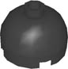

**Cylinder 2x2 with dome top n°553**

Pièce à laquelle j’ai ajouté tout naturellement une "technic ball joint" n°203 pour avoir l’arrière du canon comme je le souhaitais et ainsi respecter la contrainte 3.

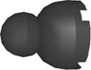

**L’arrière possible du canon**

Respecter la première contrainte n’est pas très difficile, c’est lorsqu’on doit les respecter toutes que cela devient difficile. Peut-être que ce cul de canon qui me plaît devra être complètement modifié pour satisfaire une autre contrainte et ainsi trouver un compromis sur l’allure général du modèle final ? Voyons la suite... Bon j’ai choisi un diamètre de 2 tenons, je dois maintenant fouiller dans mon stock et dans ma tête pour trouver une pièce ou un montage de pièces permettant de respecter la contrainte 4 (bouche ouverte). Le dessous d’une brique 2x2 ronde n’est pas franchement très ouvert, il y a un tube au milieu. Evidemment, on trouve plus facilement des briques 1x1 permettant de représenter des embouchures de canons. Bien sûr il y a le baril 2x2x2 n°2489, mais existe-t-il en noir ?

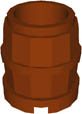

**Barrel 2x2x2 n°2489**

Une rapide vérification sur [Bricklink](http://www.bricklink.com/) me le confirme, par contre la pièce est assez rare donc plutôt chère. Apparemment si j’utilise cette pièce, il sera difficile de produire ces canons en masse pour, par exemple, armer un galion en entier ! Qu’importe pour l’instant, je ne suis pas un MOCeur du premier type qui privilégie la jouabilité :-)

J’ai donc maintenant l’arrière et l’avant de mon canon tout en satisfaisant les contraintes 3 et 4. Mais déjà se profile un problème à l’horizon : les deux morceaux ont les tenons dans le sens opposé. Il va donc falloir faire du [SNOT 180°](http://brickwiki.org/index.php?title=SNOT_techniques) ! Sans compter qu’il faudra trouver un moyen de fixation du canon au socle, et tout cela en très peu de place.

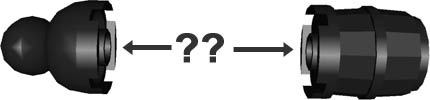

**Snot 180° !**

Pour la suite j’ai donc décidé de m’atteler au moyen de fixation, en essayant de trouver une solution satisfaisant la contrainte 5 (inclinaison vers l’arrière). Pour satisfaire cette contrainte, il faut de toute évidence un axe traversant le canon diamétralement. J’ai pensé au corps de R2D2 (n°30361), mais la base étant biseautée la jonction avec l’arrière du canon s’annonçait problématique. D’autre part le trou de l’axe étant relativement grand, la fixation promettait d’être trop volumineuse et donc inesthétique. Il y a aussi la poubelle qui possède des anses sur le coté, mais malheureusement pas orientées dans le bon sens. Finalement il y a peu de pièces rondes 2x2 permettant une fixation sur le coté. J’ai aussi cherché des solutions pour profiter du SNOT 180 que je m’étais imposé pour créer l’axe dont j’avais besoin, mais je n’ai rien trouvé de probant. Après m’être acharné à trouver une solution purement ronde, j’ai finalement consenti à regarder ce que les pièces carrées avaient à m’offrir. Le choix étant plus vaste, j’ai tâtonné encore pas mal de temps avant de m’arrêter sur le support de roues n°4600 qui a l’avantage d’offrir un axe de fixation tout petit et une section carrée finalement assez réduite.

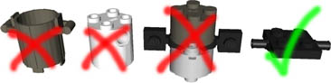

**Différentes pièces testées**

Bon j’ai choisi ma pièce, mais j’ai encore le choix de son orientation, sachant qu’elle ne m’aide pas pour le SNOT 180° qui reste à faire. Finalement j’ai choisi de l’orienter comme la bouche du canon car il y a plus de place à l’arrière pour faire le fameux demi-tour de tenons. Voici où j’en étais lorsque les ennuis ont commencé :

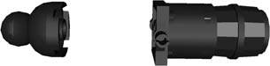

Normalement c’est assez simple de mettre tête-bêche deux briques 2x2 rondes : il suffit de glisser un axe technique en leur centre et c’est réglé. Seulement les briques 2x2 rondes sont découpées à leur base pour laisser la place aux tenons sur lesquels elles s’emboîtent. Lorsqu’on les met tête-bêche, cela crée un grand trou que je trouve peu esthétique. J’ai donc voulu trouver un moyen d’éviter ou de combler ce trou.

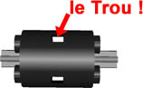

**Le trou disgracieux**

Au fil de mes réflexions, je me suis dit que ce trou pourrait alors figurer le trou que l’on trouve sur les vrais canons et qui sert à mettre la mèche. Je me suis donc rajouté une sixième contrainte :  
**–** 6) recréer si possible le détail de la mèche.

J’ai donc cherché autour de ce SNOT 180 forcé un moyen de rajouter une mèche et après de long tâtonnements, j’ai finalement trouvé une solution que je trouve très élégante à l’aide d’une main de minifig !

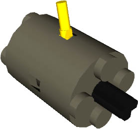

**Une main de minifig en guise de mèche.**

Mais le problème auquel je n’avais pas pensé est que si je veux que la mèche soit sur le dessus du canon alors je dois tourner l’arrière du canon de 45° par rapport à l’avant ! J’ai donc bien mon SNOT 180 en théorie, mais impossible de le connecter à la partie avant. Bref autant dire que mon SNOT 180 ne sert à rien et que tout est à refaire. C’est sur ce point précis que j’ai buté pendant plusieurs jours, y pensant dans mon lit pour m’endormir ou dans le métro pour passer le temps...

Généralement si j’ai besoin de faire une rotation d’un angle quelconque, j’essaie de le faire sur un tenon. J’ai donc pensé à des solutions où j’emboîtais une plate 1x1 ronde au centre de la brique 2x2 ronde, mais cela créait un trou encore plus moche que celui que j’avais essayé d’éliminer au départ. Dans ce cas le jeu n’en valait pas la chandelle, et je préférais laisser tomber ma mèche et avoir un canon qui ne ressemble pas à du gruyère.

J’ai finalement compris que mon problème venait des tenons de la brique 2x2 ronde qui dépassaient et que je devais supprimer. Il existe bien des tiles 2x2 rondes, mais ensuite impossible de connecter l’arrière à l’avant... Il a simplement fallu que je me pose la question suivante "existe-t-il une brique ronde 2x2 sans tenon sur le dessus ?" pour que la solution m’apparaisse finalement comme une évidence...

Bien sûr que cette pièce existe, il s’agit du baril que j’ai déjà utilisé pour la bouche du canon et qui a la délicate attention de posséder un trou d’axe en son fond. Et là j’ai connu ce sentiment de délivrance, lorsqu’un problème qui vous obsède trouve finalement sa solution. :-)  
Le reste n’est que de la mise au point de routine pour un MOCeur.

Un bon MOCeur sait qu’un trou d’axe peut aussi être traversé par une barre en friction (du diamètre de ce que peut tenir une main de minifig). Je remplace donc l’axe technique par une barre L4 n°30374 (lame de sabre laser) et j’y emboîte au bout une brique 1x1 ronde avec un tenon ouvert. Cela forme le tenon sur lequel je vais pouvoir faire pivoter l’arrière du canon de 45°.

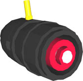

**La barre et la brique 1x1 ronde.**

Il suffit maintenant de connecter une plate 2x2 ronde sur le support de roue pour faire la jonction, mais ATTENTION ! il faut la nouvelle version de la plate 2x2 ronde. Tous les bons MOCeurs savent aussi que cette pièce existe sous deux formes, l’ancienne et la nouvelle, et les deux formes sont utiles selon l’utilisation que vous voulez en faire. L’ancienne pièce possède les rainures du trou d’axe sur toute la hauteur de la pièce alors que la nouvelle pièce ne possède ces rainures que sur la moitié supérieure et la moitié inférieure se comporte comme un tube normal.

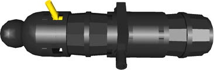

**Le canon dans sa version finale.**

Le canon proprement dit étant enfin terminé j’ai pu m’atteler à la réalisation du support. Heureusement le support m’a causé moins de soucis. J’ai d’abord cherché une solution en 3 tenons de large (2 tenons sous le canon et un demi-tenon de chaque coté) car j’avais peur que 4 tenons fasse trop large. J’envisageais notamment de faire tenir l’axe du canon sur des "plate 1x1 with clip vertical" n°4085. Mais les solutions auxquelles j’aboutissais n’étaient finalement pas beaucoup moins large que 4 tenons (principalement parce que j’avais besoin d’une plate supplémentaire pour tenir la "plate 1x1 with clip"). D’autre part le 3 tenons complexifiaient grandement la réalisation des roues.

Je suis donc redevenu raisonnable et je suis passé à 4 tenons. Une base à 4 tenons simplifie le montage, le seul point délicat reste les roues. Je voulais des roues pas trop grandes et si possible par trop épaisses et qui ne soient pas trop petites non plus. Je trouve que les jantes de roues classiques (sans les pneus donc) utilisées par certains MOC sur Brickshelf sont trop large par rapport à leur diamètre.

J’ai pensé utiliser un moment la pièce "Hose reel 2x4x2 Drum" n°4210 dont le diamètre et l’épaisseur me convenait à merveille. Il s’agit en fait d’un dérouleur de ficelle LEGO que je détourne ici en roue. Malheureusement le diamètre de l’axe n’étant pas standard, impossible de le clipser sur une pièce. J’ai donc pensé à un montage en 4 couches de plates, dont voici l’idée (remarquez que la base ici est en 3 de large) :

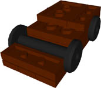

**Base avec enrouleur en guise de roue.**

Notez que le montage tenons vers le bas est obligatoire si on veut que les roues touchent le sol.

Mais finalement j’ai trouvé la base trop longue par rapport à sa largeur, et aussi l’empilement de 4 plates allait me faire rater la contrainte 2 (canon pas trop haut). J’ai donc opté pour une solution plus classique à l’aide des petites roues de train montées sur des supports de roue classique (même si cela ramène la largeur hors tout à 6 tenons). De plus, l’ajout d’une slope 1x3 de chaque coté me permet de respecter facilement la contrainte 1 (arrière biseauté).

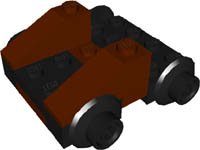

**Base avec petites roues de train.**

J’ai ensuite naturellement pensé à utiliser un "jumper" n°3794 et la "tile 1x1 with clip" n°2555 pour réaliser la fixation qui va recevoir l’axe du canon. Malheureusement le support de roue possède un petit butoir biseauté près de l’axe empêchant la roue en temps normal de venir frotter sur la plate. Ici ce petit butoir nous empêche de clipser correctement le support de roue sur "les tiles 1x1 with clip"...

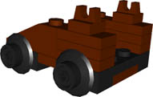

**Fixation à l’aide d’une tile 1x1 with clip**

Est-ce à dire à dire que nous devons revoir le montage de l’axe du canon (et revenir à la case départ ou presque) ? Fort heureusement non, car il existe un montage qui s’affranchit du problème du petit butoir et qui utilise une brique de Erling et une "plate 1x1 with clip horizontale" n°6019. D’autre part ce montage a l’avantage inattendu de rabaisser la hauteur du canon me permettant ainsi de respecter la contrainte 2 (canon pas trop haut). De plus la contrainte 5 (inclinaison vers l’arrière et inclinaison variable) est entièrement respectée !

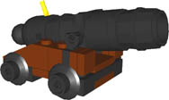

**Fixation à l’aide d’une plate 1x1 with clip horizontal**

J’ai finalement réussi à respecter les 6 contraintes que je m’étais fixées et je trouve l’allure générale du modèle plutôt plaisante. Ce sera donc le montage final de mon MOC. Mais vous pouvez constater que ce montage final utilise des "plates 1x1 with horizontal clip" et des tiles 1x1 en marron, pièces assez rares dans cette couleur, ce qui va encore augmenter le prix de ce MOC (à défaut, on peut aussi utiliser ces pièces en noir si on a du mal à les trouver en marron) !

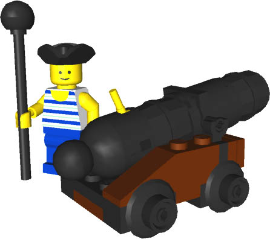

Je n’ai pas compté mes heures mais je pense que j’ai dû travailler environ une dizaine d’heures sur ce MOC. J’espère que vous aurez apprécié de partager avec moi mes peines et mes joies à la lecture de cet article !

Ci-dessous vous pouvez télécharger le fichier LDraw du modèle en cliquant sur l’icône.

**Fichier LDRAW du modèle.**

[^1]: Par exemple : utilisation d’[un levier pour représenter une pipe](http://www.brickshelf.com/cgi-bin/gallery.cgi?i=2138469) simplement posé en équilibre dans le creux d’une main de minifig.

[^2]: Voici quelques d’exemples de canons du même style sur Brickshelf : [1](http://www.brickshelf.com/cgi-bin/gallery.cgi?i=2162734) [2](http://www.brickshelf.com/cgi-bin/gallery.cgi?f=80773), [3](http://www.brickshelf.com/cgi-bin/gallery.cgi?f=199503)
