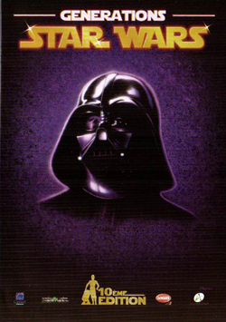
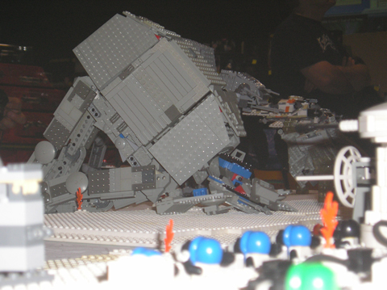
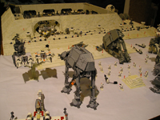
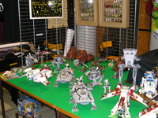
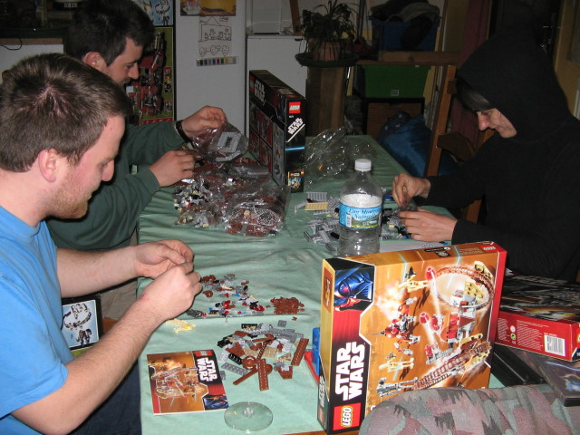
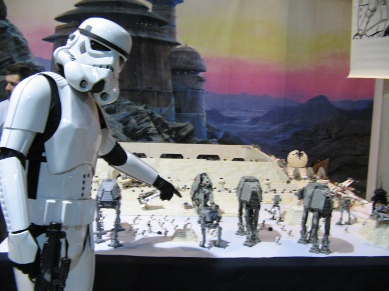

Il y a 5 ans, j’exposais pour la première fois à cette manifestation qui rassemble tous les passionnés des films Star Wars et Science-Fiction à Cusset, à côté de Vichy (03). Depuis, j’ai toujours suivi cette exposition chaque année avec une autre participation en tant qu’exposant il y a 3 ans. Pour fêter la dixième édition, j’ai proposé à quelques membres de l’association qui le souhaitaient, d’y participer.

C’était aussi l’occasion de demander à Phenix21000 (Fred) de participer à sa première exposition et de nous présenter sa base Hoth. Une construction que je suis depuis pratiquement ses débuts.

L’arrivée des membres participants pour l’association FreeLUG s’est faite le vendredi. Le rendez-vous était pris chez moi. J’ai transformé mon home en haut lieu de réceptions des Stars, pour l’occasion ! L’ambiance pendant toute la durée de l’exposition fut mémorable comme à l’accoutumée, et la fête agrandie par le dixième anniversaire. Mais, ce fut en plus une bonne ambiance dans les camps retranchés lors de la construction des derniers modèles le vendredi soir, et l’installation des dioramas, sur le stand de l’équipe FreeLUG le samedi matin. En tout, sur place, 5 x 3,50m de LEGO Science-Fiction. Pour cette première, à plusieurs nous avons fait fort : Fred, Pierre Charles, Cheub/Jérôme, Pierre Laurenge, JAC/Jérôme, et Gilles qui nous a rejoint avec son épouse le samedi après-midi. Il a d’ailleurs présenté une superbe mosaïque Star Wars que vous pourrez contempler sur sa galerie.

Vous trouverez donc en photo, la base de Hoth de Phenix21000 qui s’est aussi énormément concentré sur les détails intérieurs de la base ; mais aussi un diorama "battle Droïd", avec 3 MTT, dont deux montés simultanément ;-)) ; un "Millenium Falcon UCS modified", pour mieux coller aux scènes, entre autre le décollage de Hoth ; deux tableaux en relief avec une belle collection de personnage Star Wars ; et la mosaïque de Gilles. J’oublie peut-être des trucs, mais vous m’excuserez, il y en avait beaucoup, sans toutefois tout déballer...

L’impact de notre stand a été excellent auprès du public, mais aussi auprès des Héritiers de la Force. Et cela fait toujours plaisir à entendre. Et je suis près à recommencer l’année prochaine, enfin, mes briques non, mais moi oui !!!

JAC/Jérôme

* * *

## Encore une superbe exposition !

Du Star Wars de partout, de magnifiques costumes, beaucoup de monde, de la joie et de la bonne humeur durant tout le week-end. Pour ce qui est des LEGO, une magnifique base rebelle de Hoth, Fred a fait ici une magnifique présentation de ce que l’on peut faire avec quelques LEGO, un peu de temps, quelques idées... !

La présentation du Millenium revu et corrigé par JAC, une sympathique petite bataille de droïdes contre des clones et des Jedi, et les magnifiques cadres reprenant les principaux personnages de l’univers Star Wars de Cheub.

Le public fut émerveillé par cette présentation.

Il est vrai qu’il nous en restait autant dans des cartons sous les tables, mais faute de place ils sortiront lors d’une prochaine exposition...

Merci à JAC de nous avoir accueillis pour ce week-end.

Pierrolego/Pierre LAURENGE

* * *

## Bonjour de la bordure extérieure.

Repérée par une sonde espionne près de Cusset (coin pourtant paumé... :-) ), la base de Hoth fut attaquée deux jours durant ! Les yeux rivés sur cette base les visiteurs ont vu que la seule limite avec la brique LEGO c’est :  
**–** son imagination ;  
**–** son nombre de pièces.

Ma crainte durant ces deux jours fut la chaleur... et oui exposer une base de la planète de glace c’est risqué quand le soleil est de retour !

N’oublions pas la bataille droïdes/clones.... qui même sans préparation préalable fut effectuée avec un talent d’improvisation incroyable ! Voilà des padawans qui promettent (surtout que notre padawan pierreC utilise son pouvoir pour tout rafler aux tombolas !! :-) ).

En parlant de padawan j’en fus un durant cette exposition. Ma première... c’est vrai on prend très vite goût à ce genre de manifestation ! Suis-je tombé du côté obscur ? :-) ( vais-je devenir dark phenix21000 ? )

Merci tout d’abord à notre ami cheub qui en plus d’être un fan LEGO aussi (et oui un de plus débusqué, qui avec ses vitrines montre là comment un fan Star Wars peut être "contaminé" par la legomanie), nous a reçu et fait confiance pour cette exposition !

Bon pour l’année qui suit la barre a été mise haute... à nous de tenir conseil pour la suite et préparer quelque chose digne de leur convention ! (bon quand on voit ce qu’il y avait dans les cartons sous les tables il y a moyen... de faire de jolis dioramas !)

Merci à vous les amis pour ces jours et soirs de bonheur (voir de nuits... avec de "petites construction de dernière minute..." :-) ) autour de la brique !! et merci à notre hôte, le grand maître de l’ordre JAC !

Hoth est tombée en deux jours !!! amis je vous dis à l’année prochaine avec... euh... ben vous verrez car vous viendrez !! ;-)

Que la force soit avec vous !!

A+

Phenix21000/Fred

* * *

Bonjour

Nous sommes passés en touriste pour participer à cette manifestation. Ma femme pour Star Wars, moi pour les briques et Star Wars. Mais je n’ai pu m’empêcher d’amener quelques briques ;-).

Un superbe week-end où nous avons alterné le passé (visite de la région et de quelques châteaux) et le futur. En passant un vide grenier le dimanche matin...  
Superbe exposition, avec beaucoup de personnes costumées et pleins de briques.  
Et toujours un plaisir de discuter ;-)

Gmi\_gilles

* * *

Quelle belle aventure ce fut que cette exposition à Cusset ! On ne peut par contre pas dire que tout était gagné d’avance ! En effet le vendredi soir j’arrivais chez JAC avec encore 6 boîtes à monter ! 2 MTTs (7662), 2 AT-AP (7671) ainsi que 2 Half Fire Droïde (7670)...

Le plus dur dans ces montages fut les deux MTT : Fred et JAC ont eu la bonne idée de mélanger les deux sur la table pour jouer au concours de celui qui monte la boîte le plus vite !

**Y’a des briques......**

....Si on mélangeait tout ?

Finalement personne n’a gagné puisque sur le coup des 2h du matin je me résignais à les aider à finir et ainsi ruiner leur espoir de victoire l’un sur l’autre.

Heureusement toutes les boîtes furent montées à temps pour créer sur place un petit décor digne de la guerre des clones ! Mais ce décor improvisé n’était rien à coté de la sublimissime base Echo prise sous les feux croisées des rebelles et des stormtroopers présentée par Fred.

Heureusement que la flotte de X-wing et de Snowspeeders était là pour protéger les cadres de la rébellion !

**Pas si grande la base, pour les guerriers de l’Empire !!**

Bien sûr ces deux décors étaient agréablement complétés par l’UCS Millenium Falcon de JAC et de la jolie vitrine « minifigs Star-Wars » de Cheub/Jérome.

Tout ça pour vous dire que j’ai encore une fois pris un grand plaisir à exposer avec d’autres Freelugiens et que j’ai déjà hâte d’être à l’année prochaine pour ré-exposer à Cusset !!

PierreC

* * *

## Liens vers les photos

Galeries de photos :  
**–** [Phenix21000](http://www.brickshelf.com/cgi-bin/gallery.cgi?f=316506)  
**–** [Gilles Micheletti](http://gallery2.freelug.org/main.php/v/gmifr/CUSSET/)  
**–** [Pierre Laurenge](http://photos.freelug.org/main.php/v/pierrel/exposition/Cusset+avril+2008/)  
**–** [JAC](http://gallery.freelug.org/main.php/v/JAC/Exposition/SW-2008_001/)
