Traduction de l’entrevue avec Mark Stafford publiée sur [The Brothers Bricks](http://www.brothers-brick.com/) en trois parties ([partie 1](http://www.brothers-brick.com/2009/01/11/from-lego-fan-to-lego-set-designer-the-mark-stafford-interview-part-1/), [partie 2](http://www.brothers-brick.com/2009/01/11/working-as-a-lego-designer-the-mark-stafford-interview-part-2/) et [partie 3](http://www.brothers-brick.com/2009/01/11/lego-fan-vs-lego-designer-the-mark-stafford-interview-part-3/)) avec l’aimable accord d’Andrew Becraft de The Brothers Brick et de The LEGO Compagny.

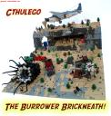

Que ce soit à l’image du gamin que nous étions il y a quelques années ou à celle de l’adulte fan que nous sommes aujourd’hui, je sais que nombre d’entre nous avons rêvé de travailler comme designer pour la société LEGO.

Lors de cette entrevue exclusive avec The Brothers Brick, Mark Stafford nous parle de son cheminement d’AFOL jusqu’au métier de designer chez LEGO.

**The Brothers Brick :** Tout d’abord, parle nous un peu de toi même.

**Mark Stafford :** Je m’appelle Mark John Stafford, j’ai 36 ans et je suis Britannique. Mon pseudo sur la plupart des sites de fans est [Nabii](http://www.brickshelf.com/cgi-bin/gallery.cgi?m=Nabii), qui trouve son origine dans le monde des jeux de rôles (il s’avère que cela signifie par ailleurs "prophète" en swahili, ce qui est sympa). Je vivais aux Pays-Bas où j’ai travaillé 5 ans comme inspecteur de cargos avant de devenir un designer LEGO à Billund au Danemark.

**TBB :** Depuis quand construis-tu ?

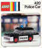

**Mark :** Depuis l’âge de 4 ans. Le premier set que j’ai eu dans mes souvenirs est [la voiture de police 420/611](http://www.brickset.com/detail.aspx?Set=420-1). J’avais l’habitude de tourner les deux briques marquées "police" pour la banaliser puis de les retourner dès qu’un crime était commis !

**TBB :** As-tu eu un dark-age, et si oui, quand ?

**Mark :** Oh oui. Un long dark-age. J’ai arrêté de construire à l’âge de 13 ans sous la pression de mon entourage, mes parents prétendant qu’il était temps pour moi de m’éloigner de mes jouets pour m’intéresser aux filles !

Je ne suis revenu aux LEGO qu’à l’âge de 26 ans. Deux de mes colocataires (l’un à Leicester, l’autre à Londres) sont devenus des collectionneurs avides et j’ai été pendant trois ans encerclé par les LEGO Pirate et Castle avant de tomber moi-même dans la lumière du monde LEGO des adultes.

**TBB :** Qu’est-ce qui t’y a ramené ?

**Mark :** Star-Wars. Le fait d’obtenir [le Snowspeeder LEGO](http://www.brickset.com/detail/?Set=7130-1) original et le [X-wing](http://www.brickset.com/detail/?Set=7140-1) le même jour a perverti mon pauvre petit cerveau d’adulte et dans l’année je récupérai dans le grenier de mes parents les LEGO de mon enfance et construisis de nouveau mes MOCs.

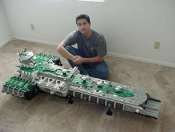

**TBB :** Quand as-tu découvert la communauté internet des fans adultes ?

**Mark :** Aux alentours de 1999, un ami m’a fait connaitre [Lugnet](http://www.lugnet.com/) et [Brickshelf](http://www.brickshelf.com/). Une des premières choses que j’ai vu alors était le [A-Wing Carrier de Dan Jassim](http://www.mocpages.com/moc.php/683)...

J’ai immédiatement ressenti le besoin d’avoir plus de LEGO !

**TBB :** Pourrais-tu nous dire quels sont tes constructeurs préférés et pourquoi tu les apprécies ?

**Mark :** J’en apprécie tellement que je ne peux pas vraiment répondre à cette question, j’en oublierai certains qui mériteraient d’être cités. De plus, certains des meilleurs constructeurs que je connais n’ont jamais posté la moindre chose sur le net. Pour 10 modèles construits par les designers chez LEGO, seulement un ou deux voient le jour, les fans pleureraient pour en voir quelques-uns être exhumés et recyclés du PMD [^1].

**TBB :** Quand as-tu commencé à travailler pour LEGO ? Comment as-tu été embauché ?

**Mark :** Ma compagne Megan Rothrock ([Megs](http://www.brickshelf.com/cgi-bin/gallery.cgi?m=Megs)) avait vu une annonce sur le site web, j’ai envoyé les photos de mes créations et j’ai été invité à un atelier de recrutement de deux jours avec 26 autres personnes au début de Septembre 2006 - huit d’entre nous se sont vu offrir une proposition d’emploi. J’ai commencé à travailler le 1er Octobre 2006.

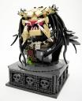

**TBB :** D’autres fans ont-ils été recrutés à la même occasion ?

**Mark :** oui. Adam Grabowski ([Mister Zumbi](http://www.brickshelf.com/cgi-bin/gallery.cgi?m=misterzumbi)). Il est à noter que deux autres fans "actifs" étaient présents lors de l’atelier mais n’ont pas été retenus à cette occasion. (Je dit "actifs" parce que de nombreux designers présents étaient fans quand ils étaient enfants et que leur "dark-ages" a pris fin à l’occasion de leur embauche.)

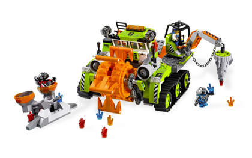

**TBB :** Quels sets as tu créé ?

**Mark :** J’ai travaillé sur les Exo-Force [Dark Panther (8115)](http://www.brickset.com/detail/?Set=8115-1), le [Hybrid Rescue Tank (8118)](http://www.brickset.com/detail/?Set=8118-1) et le numéro manquant 8116 (ce robot mecha a été écarté de la gamme très tard dans le processus [^2]).

Puis sur les [Agents](http://www.brickset.com/search/Default.aspx?year=2008&Theme=Agents), le 8632 Swamp Raid, le 8630 Gold Hunt, et le 8635 Mobile Command Centre. Sur un set Mars Mission : le [7648 MT201 Ultra Drill Walker](http://www.brickset.com/detail/?Set=7648-1). Sur les Power Miners : le [8957 Mine Mech](http://www.brickset.com/detail/?Set=8957-1) et le [8961 Crystal Sweeper](http://www.brickset.com/detail/?Set=8961-1). Plus tard en 2009 j’ai un autre modèle Power Miners et trois modèles dans la nouvelle gamme Espace \[!\], et je travaille déjà sur 4 sets pour la première moitié de 2010 !

**TBB :** Sur quels gamme as-tu travaillé ? Et sur laquelle aimerais-tu travailler ?

**Mark :** J’ai commencé chez LEGO avec une gamme qui n’a finalement jamais été développée, puis sur Mars Mission pendant quelques mois, où aucun de mes modèles ne fut retenu. Puis sur Exo-Force, Agents, Mars Mission, Power Miners, et le nouveau thème Espace, tout en contribuant à ébaucher des modèles sur Castle, Batman, City et en ce moment - je n’ai pas le droit d’en parler... mais c’est excitant !

J’aime travailler sur les thèmes de Science-Fiction et l’Espace est celui que je préfère, mais j’aime évoluer pour ne pas m’ennuyer et si quelque chose advient de neuf, je ferais tout pour y prendre part et me donner à fond pour parvenir à un bon résultat.

**TBB :** Est-ce dur de passer d’un hobby avec peu de limitations à un job avec de nombreuses restrictions sur tes constructions ? Ne trouves-tu pas cela frustrant ?

**Mark :** C’est un défi, sans aucun doute, le changement le plus notable étant celui du coût de revient des pièces.

Nous devons construire suivant un prix cible, et nous y arrivons en faisant attention au coût de revient de chacune des pièces, tout en sachant que ce coût, en interne, n’est pas toujours logique.

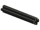

Par exemple (et je ne crois pas que cette information donnera un avantage à la concurrence) en interne, [un axe de 4](http://peeron.com/inv/parts/3705) coûte plus cher qu’un axe de 5 ou de 6 de long. Cela m’a intrigué pendant longtemps et j’ai finalement demandé à ce que l’on se renseigne à ce sujet.

Cela a mis longtemps avant que j’ai une réponse, il s’avère que le moule pour les axes de 4 est plus ancien, et il ne permet de produire que la moitié de ce que produisent les moules pour les axes de 5, 6 ou 8 à chaque cycle. La machine doit fonctionner plus longtemps, requiert plus de maintenance et au final les axes de 4 coûtent deux fois plus cher à fabriquer, d’où l’écart apparent du coût de revient en interne. Et chacune des pièces, elles sont plus de 6000, est sujette à ces considérations - alors atteindre le prix cible peut devenir parfois un exercice intéressant !

La période la plus frustrante a été les six premiers mois, j’ai alors accepté les raisons qui font que les modèles LEGO doivent être construits de la manière dont ils le sont, et non pas à la façon des fans. Je dois encore m’efforcer à me rappeler que si le modèle ne peux pas être construit d’après la notice par un enfant de 7 ans et qu’il se démonte complètement quand un de ses amis (qui ne l’a pas construit) joue avec, alors j’ai mal fait mon boulot !

**TBB :** Je me souviens que tu construisais souvent tes modèles personnels aussi bien en tant que jouets qu’en tant que modèles d’exposition (les Big Boys Toys me viennent immédiatement à l’esprit). Penses-tu que cela t’as permis de t’adapter ?

**Mark :** Tout à fait. J’avais commencé à adopter un style AFOL de construction intriquée de SNOT environ un an avant d’être embauché par LEGO, mon style restait encore très proche du style classique LEGO, tenon vers le haut, en ayant toujours à l’esprit de construire pour des enfants.

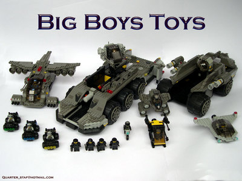

Mon évènement préféré est le LEGOWorld qui se déroule aux Pays-Bas, parce que tout les jours pendant 6 jours, il y a 10 000 visiteurs dont la moitié sont des enfants, et depuis la première année où j’ai participé je me suis toujours efforcé de construire des modèles qui émerveilleraient ces enfants, et essayé de faire des choses amusantes (comme les [Big Boys Toys](http://www.brickshelf.com/cgi-bin/gallery.cgi?f=170152)) pour susciter les applaudissements (au grand dam des fans à mes côtés).

Je voulais faire des modèles qui inspireraient et émerveilleraient les enfants, et aujourd’hui c’est mon job en tant que créateur de jouet !

**TBB :** Comment ton hobby affecte ton travail pour le meilleur ? et pour le pire ? Et vice-versa ?

**Mark :** Au départ cela m’a rendu la tâche extrêmement compliquée, je faisait du SNOT juste pour cacher les tenons.

[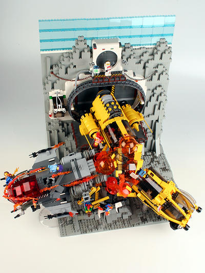](http://www.brickshelf.com/cgi-bin/gallery.cgi?f=358182)

Maintenant, je ne fais cela au boulot uniquement quand cela me permet d’obtenir la forme dont j’ai besoin. La société LEGO est fière de ses tenons, d’ailleurs un modèle sans aucun tenon serait rejeté.

Bien sûr, plus vous pratiquez une technique, plus vous devenez doué dans celle-ci, et je pense que maintenant mes créations en tant que fan utilisent moins d’éléments, sont plus propres et plus stables.

En plus, si je trouve une combinaison intéressante de pièces au travail mais qui ne peux pas être clairement transcrite dans la notice de montage, ou qui est un montage "interdit", ou qui est juste insuffisamment stable pour jouer avec, il se peut qu’elle finisse dans une de mes créations de fan.

**TBB :** Il y a-t-il quoi que ce soit dont tu penses que les fans devraient être au courant à propos des différences qui existent entre tes styles de construction au travail et pour le jeu ?

**Mark :** Seulement que le style de la société LEGO est dicté par le public cible : nous créons des sets pour les enfants et ils sont différents sur la tolérance à la frustration, le temps qu’ils mettent à trouver les pièces dans le tas, et ont une dextérité manuelle et une force dans les doigts bien plus réduites que celles des adultes. Ils apprécient aussi bien plus les fonctionnalités de tirs !

A la maison je peux faire tout ce que je veux. Une grande partie de mes créations peut ne reposer que sur une ou deux connexions, des modèles entiers peuvent être construits sur une seule et unique couleur, des sections construites à l’équerre ou placées de façon inextricable, sans parler de ce que je peux faire aux mini-figurines !

**TBB :** Combien de personnes prennent part au processus complet de conception d’un set depuis le brainstorming initial jusqu’à la production finale ?

**Mark :** Wouah, quelle question ! Premièrement, il y a l’idée pour le thème qui peut être proposée en interne (PMD), dans les locaux où travaillent les designers ou bien elle peut provenir de nos laboratoires de concept du Japon, d’Amérique, d’Allemagne, d’Espagne et du Royaume-Uni avant d’être adaptée à Billund. Ceci nous permet d’avoir un univers autant que possible attractif pour notre public cible (normalement les garçons de 6 à 12 ans). Le thème est alors attribué à un groupe qui va récupérer des idées déjà éprouvées et des modèles (souvent collés ensemble et mettant en avant des éléments trouvés ou créés) et nous commençons à construire des modèles. Parfois, l’essence d’une idée d’une section peut se transformer en un énorme projet ailleurs.

Une fois que le thème a reçu une approbation, les modèles sont triés dans les catégories de prix imposées. Un modèle est attentivement considéré, et ses fonctions de base et sa qualité examinées, et si c’est nécessaire, est réduit ou agrandi en taille afin d’optimiser son potentiel. Les re-conceptions et les variantes de construction à cette étape sont une part importante du processus.

Parfois, les prototypes sont de vous, parfois d’autres personnes. Nous avons des réunions hebdomadaires où toute l’équipe se retrouve pour discuter de ce qui va ou ne va pas sur les modèles de chacun, et c’est sans mentionner les conseils constants que nous partageons chaque jour.

Ensuite, nous avons le retour sur la constructibilité pour le public cible de nos experts en notices de montage, sur la régularité des constructions de nos laboratoires en design, et sur la consistance globale entre chaque modèle d’un projet.

Ensuite, il y a les designers graphiques qui travaillent sur les mini-figurines, les briques sérigraphiées et les autocollants, les designers de pièces qui créent de nouveaux éléments et enfin les designers d’emballages qui travaillent dès le début à rendre aussi cool que possible nos modèles photographiés. Au-dessus de tout cela, il y a les directeurs de design qui essayent de maintenir une balance entre tous les thèmes "jeu" et encore au-dessus les directeurs qui s’assurent de la cohérence entre tous les modèles LEGO produits pour le semestre.

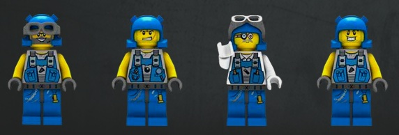

Et ce n’est que pour le design. Il y a aussi la production, l’emballage et la logistique et parfois, la considération de ces aspects peut affecter le processus de design.

En fait, c’est très égocentrique de prétendre qu’un modèle est le sien étant donné l’équipe qui se trouve derrière chaque set, mais je fais ainsi donc j’en déduis que je dois avoir la grosse tête !

**TBB :** Est-ce que cela te donne la liberté d’ajouter ton propre style personnel ?

**Mark :** Mes anciens conférenciers à l’université ont essayé de nous dire que les designers n’ont pas le luxe d’avoir une style personnel. Si vous voulez un style personnel, devenez un artiste !

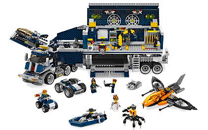

Mais ce n’est pas la réponse. Je pense que mon style et mes goûts personnels se retrouvent à l’intérieur de mes modèles et en fait il y a énormément de possibilité pour créer des sets à mon goût. Et quand je ne suis pas bon sur une idée de modèle, je peux au moins essayé d’y mettre plein de pièces sympathiques !

**Mark :** A propos du choix des couleurs, est-ce collaboratif ou cela vient-il d’en haut ?

Mark : Cela dépend. Si il doit y avoir une palette de couleurs globale, comme pour les Power Miners, alors nous prenons la décision dans le groupe du projet. Pour les Power Miners (je sais que ce choix est assez controversé chez les AFOLs), nous avons testé une trentaine de variantes de couleur pour un modèle dans Photoshop et avons réalisé un petit test consommateur pour voir quelle combinaison avait le meilleur impact vis-à-vis de l’arrière plan foncé que nous avions en tête pour les boîtes.

Nous sommes allés dans un musée sur les mines en Allemagne et avons vus que la majorité des machines étaient jaunes ou blanches avec des outils de découpe en rouge ou orange, et quelques-unes étaient vert clair ou bleu clair (les équipements de forage doivent être clairs parce que le sous-sol est très sombre !) et nous avons alors regardé les gammes LEGO existantes : Mars Mission est surtout blanche, la partie Construction de la gamme City jaune, les garde-côtes oranges et un thème sous-terrain dans des couleurs foncées n’aurait pas été visible sur un fond foncé. C’est pourquoi nous avons décidé que le vert serait très probablement la couleur principale et que la plupart des palettes de couleurs devraient tourner autour du vert. Au final, les couleurs retenues furent le vert clair et l’orange, et je suis d’accord que cela donne le meilleur impact et attire le regard dans les linéaires des magasins.

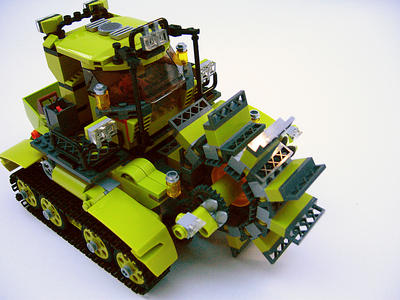

Cette version préliminaire du Crystal Harvester affiche beaucoup moins d’orange mais vous pouvez voir que l’outil (la grosse roue sur le devant) semble disparaitre dans le reste du véhicule.

Toutefois, dans la gamme Exo-Force, chaque set pouvait être d’une couleur différente et nous avons pu expérimenter différents choses. Mon 8115 Dark Panther a en fait été conçu en noir et rouge puis j’ai fait une version en turquoise, orange puis une autre en mauve, et nous avons choisi mauve.

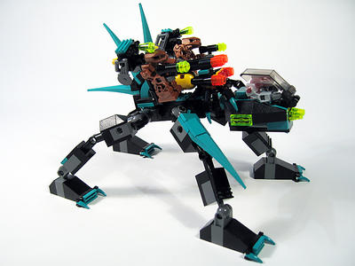

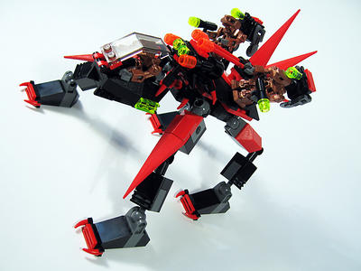

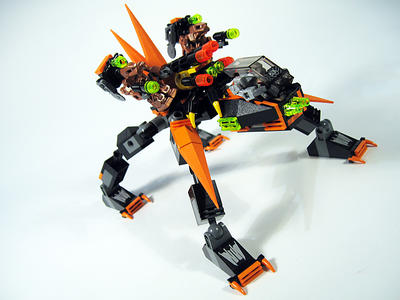

**TBB :** Regardez-vous, toi ou les autres designers, le travail des AFOLs quand vous concevez un modèle ?

**Mark :** Pas vraiment. Certains d’entre nous suivent les sites des AFOLs. Nous aimons regarder les MOCs sympathiques et voyons souvent des pièces utilisées d’une façon à laquelle nous n’avions pas pensé, mais nous ne cherchons jamais des idées pour des produits spécifiques. Nous sommes plus enclins à regarder des sites de concept art, des photographies ou des livres pour trouver des formes ou des constructions intéressantes et alors nous les imaginons en briques LEGO.

Et d’ailleurs, où serait le plaisir de copier l’idée de quelqu’un d’autre ? Tout l’objectif des briques LEGO est de réaliser ses propres créations !

**TBB :** Y-a-t-il quelque chose que tu souhaiterais ajouter à propose de ton travail ?

**Mark :** C’est vraiment un travail super, comme quand vous l’imaginez quand vous êtes enfant !

Bien qu’après avoir construit toute la journée, comme beaucoup de fans le suspectent, il y a moins d’envie de construire sur son temps libre et beaucoup de designers ne veulent pas du tout le faire.

J’aimerais également faire taire une fausse idée : nous n’avons pas de briques LEGO gratuites, et pour les constructions à la maison, nous achetons des sets comme n’importe qui. La boutique réservée aux employés offre une remise de 50%, mais pour le prix danois, cela revient au prix américain, ce qui fait que nous n’avons pas spécialement plus de pièces que les autres fans.

**TBB :** Pour conclure, lequel de tes MOCs aimerais-tu le plus voir en set officiel ?

**Mark :** Le [Big Boys Toys](http://www.brickshelf.com/cgi-bin/gallery.cgi?f=170152) est le seul de mes MOCs dont je pense qu’il pourrait être repris pour faire un set bien que l’aspect militaire aurait besoin d’être retiré, et que plusieurs éléments ne sont plus disponibles ce qui impliquerait un certain travail de re-création.

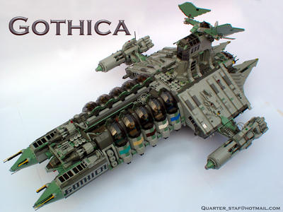

Ce serait chouette de faire un nouveau vaisseau spatial énorme (de la taille du [Gothica](http://www.brickshelf.com/cgi-bin/gallery.cgi?f=149927) ou encore plus grand) mais vous les fans adultes ennuyant que vous êtes ne cessez de demander du StarWars, des Café Corners, des Volkswagen Beetles et des Tours Eiffel !

_Un grand merci à Mark, son chef Matt Ashton, et Steve Witt pour avoir travaillé avec nous sur cette entrevue._

[^1]: Nom du service du Design chez LEGO

[^2]: NdT : des photos de ce mecha sont disponibles dans le BrickJournal Issue 4 Volume 2
