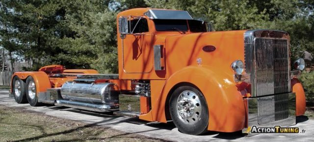
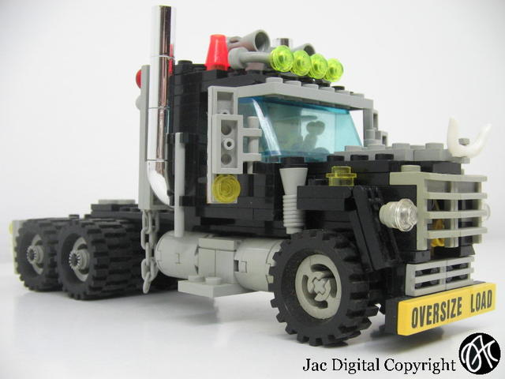
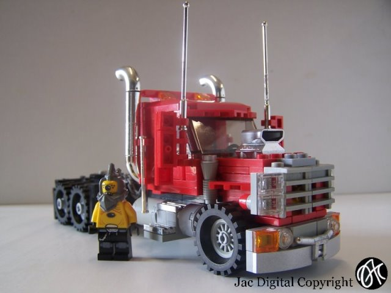
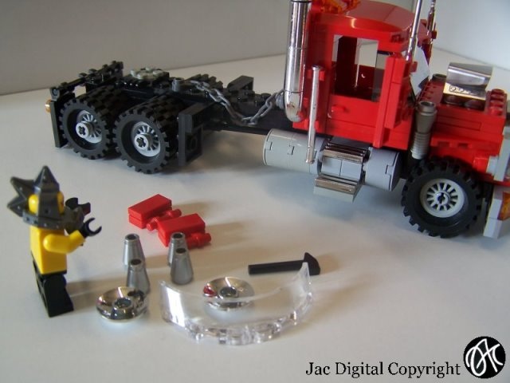
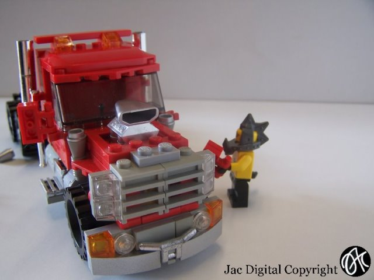
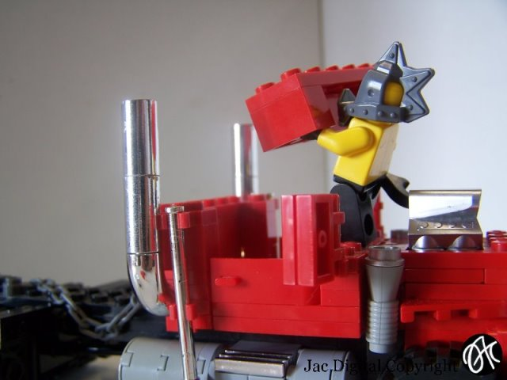
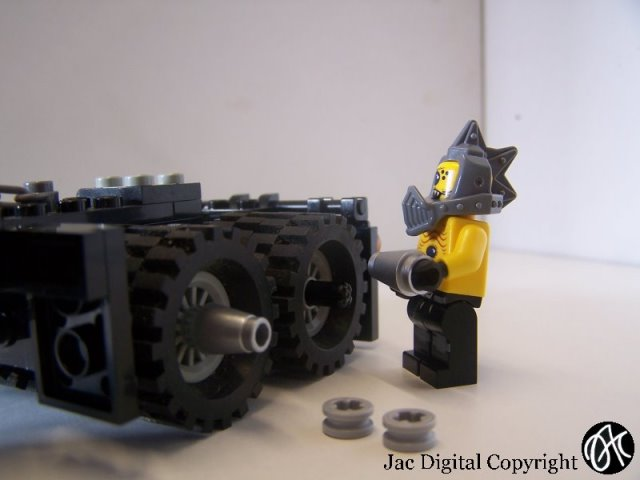
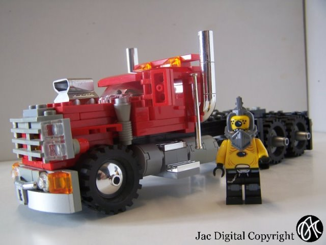
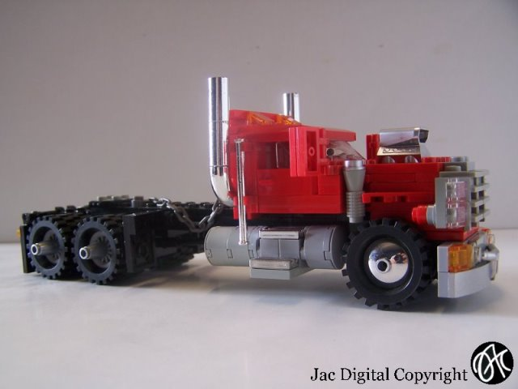

Grâce au L13 de Brickpirate, je me suis décidé à remettre mon camion américain en forme.

Les [concours](http://www.brickpirate.net/forum/phpBB3/viewtopic.php?f=50&t=7261) sur le forum de Brickpirate sont très diversifiés. Il y a beaucoup d’idées différentes et j’y participe lorsque je suis suffisamment inspiré.

Là, pour le [L13 numéro 16](http://www.brickpirate.net/forum/phpBB3/viewtopic.php?f=50&t=11013), il fallait faire du tuning sur ce qu’on voulait, du moment que ça roule ! Etant passionné de camions et sachant que ça existe avec des choses aussi folles que pour les voitures, je me suis lancé dans l’aventure. Le concours donnait vraiment beaucoup de liberté à la création.

Le tuning a pris un peu la suite du custom. Ce dernier datant des années 80, consistait à transformer sa voiture pour la rendre unique. Les lois en France interdisent de toucher aux moteurs, c’est donc sur la carrosserie que le gros du travail était fait. Cela pouvait être très beau ou très laid, suivant l’extravagance des passionnés. Aux Etats-Unis, par contre, on pouvait aussi voir des moteurs préparés. Aujourd’hui, le tuning consiste plus à placer des pièces toutes faites sur nos voitures, mais le but est le même, les rendre uniques. Bon je ne cherche pas non plus à faire une vraie description, mais c’est pour situer le sujet.

Mon camion américain qui sert au transport exceptionnel commence à vieillir vraiment. Cela se voit par les pièces utilisées, les techniques de montages, le conducteur et aussi la poussière. C’est donc sur celui là que j’allais travailler. Il est dit qu’il faut faire une photo avec les deux modèles. C’est cool je ne vais pas être obligé de démonter le noir.

Pour commencer, j’ai donc changé la couleur et rajouté quelques pièces chromées. Le rouge ça fait quand même un peu plus "fun" pour du tuning, mais bon, c’est une question de goût. Puis, j’ai voulu aussi booster un peu le moteur. En LEGO tout est permis, il n’y a aucun contrôle du service des mines... J’ai changé le capot, changé les jantes d’origine pour des rayons et fait sortir le compresseur du moteur. J’ai quand même voulu conserver la calandre d’origine. Pour finir, j’ai rehaussé la cabine d’un petit aileron.

Mais ce n’était pas assez à mon sens. Puis, Maunokle est venu et il m’a dit que le camion comme ça ne lui convenait pas du tout. Donc comme on était d’accord, je lui ai demandé de m’aider à en faire un peu plus... On a sorti les outils et aussi les pièces qui permettraient de modifier encore plus le "look".

C’est parti pour la transformation...

Il est prévu de réduire la hauteur de cabine, donc, on va diminuer aussi celle des rétroviseurs.

Grâce à de nouvelles pièces qui permettent de faire des pare-brises très fins et en arrondis, j’ai pu rabaisser le toit de la cabine. On appelle ça "top choppé". Cela se fait très bien aussi, on le voit d’ailleurs sur le camion réel qui sert d’exemple.

Ensuite, on a placé des enjoliveurs sur toutes les roues. Des bien chromés pour l’avant et des pointes à l’arrière, pour garder la vision sur les jantes à rayons. Le châssis à aussi été légèrement rallongé.

Et voilà le résultat...

Maintenant, mon camion a un look qui me plait. Cela brille, on se voit dedans...

Ce qui est marrant, c’est que le camion qui m’a servi de modèle pour le premier, en noir est déjà du tuning.

**Liens pour les galeries photos**

[Le camion d’origine.](http://photos.freelug.org/main.php/v/JAC/MOC/vehicules/Camion2Route/Oversizeload/)

[Le "truck tuning".](http://photos.freelug.org/main.php/v/JAC/MOC/vehicules/Camion2Route/OversizeCustom/)
