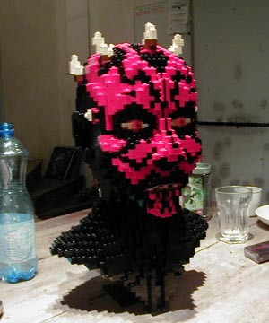
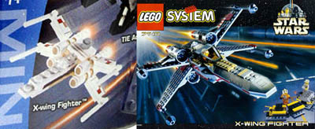
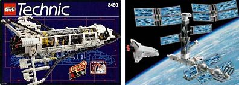
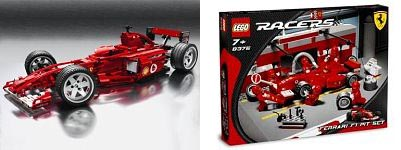

Les briques de construction LEGO® sont, pour les fans adultes, un outil de modélisme.

Qui dit modélisme, dit choix d’une échelle pour la reproduction des modèles. Une certaine confusion peut régner que nous allons tenter de dissiper.

Avant tout, et en simplifiant, soulignons que du fait de la nature des pièces LEGO® il est impossible de tomber dans des dimensions très faibles (la plus petite unité restant le tenon qui mesure 8 mm). Il est par ailleurs très difficile d’obtenir un hyper réalisme et l’échelle est donc rarement respectée à 100% (trains plus courts, échelle des détails supérieure à celle de la structure générale de la maquette).

**Quels rapports d’échelles ?**

Tous les rapports d’échelles sont possibles dans l’absolu. Trois échelles retiennent toutefois les suffrages :

**–** L’échelle minifig

Les minifigs sont ces petits personnages si populaires. Vous pouvez trouver toutes la collection sur [Minimundo](http://www.minimundo.de/inhalt/englisch/minifigFrameset.htm). Elles mesurent approximativement 4 cm de hauteur. Ceci nous donne une échelle de 1/40 à 1/45.  
Cette échelle, comme les minifigs, est très populaire.

**–** L’échelle microfig (ou nanofig)

regroupe en fait l’ensemble des échelles nettement inférieures à celles de l’échelle minifig. (inférieur à 1/50)

L’échelle nanofig est intéressante car c’est un challenge de faire ressemblant avec peu de pièces. Mais c’est une échelle appréciée aussi pour les [bâtiments](http://www.brickshelf.com/cgi-bin/gallery.cgi?f=74081) et les autres modèles de grandes tailles (vaisseaux spatiaux).

**–** L’échelle Technique

Elle correspond plus à la gamme Technic® ainsi qu’aux personnages de cette gamme de 9 cm. L’échelle représente alors 1/10 à 1/20. Voir par exemple les maquettes de [Dennis Bosman](http://home.planet.nl/~bosm0959/legotrucks/english.html)

Les échelles plus importantes (échelle 1 par exemple) ne sont pas notablement utilisées. On peut toutefois citer certaines sculptures comme le Darth Maul :

**Exemples**

Certains modèles ont des maquettes en plusieurs échelles :

**–** Le X-wing en échelle microfig et minifig

**–** La navette spatiale minifig (même si c’est du Technic®) et microfig

**–** La formule 1 Ferrari en échelle Technique et en échelle Minifig

**Pour choisir**

Il est bien évident que plus l’échelle est importante, plus le réalisme peut être poussé... mais plus la place nécessaire s’accroit ainsi que le nombre de pièces nécessaires.

Ainsi, comparons la taille (longueur) et le nombre de pièces d’un même modèle (le X-wing) dans trois échelles différentes :

| Modèle | Longueur en tenon | Progression | Nombre de pièces | Progression |
| --- | --- | --- | --- | --- |
| [4484](http://www.fbtb.net/sets/index.asp?page=set&set=4484) | 9 |  | 41 |  |
| [7140](http://www.fbtb.net/sets/index.asp?page=set&set=7140) | 33 | \*3 | 263 | \*7 |
| [7191](http://www.fbtb.net/sets/index.asp?page=set&set=7191) | 61 | \*2 | 1300 | \*5 |

C’est pourquoi l’échelle minifig, qui représente un très bon compromis, est plébiscitée.

De plus certains éléments (rails de trains) contraignent à faire ce choix... (pourtant on trouve des modèles ferroviaires en échelle minifig et en échelle [Technic](http://www.brickshelf.com/cgi-bin/gallery.cgi?f=80079)).

Remerciements :

Merci à Jef pour ses idées d’articles et à Frogleap qui à toujours un petit mot d’encouragement.
