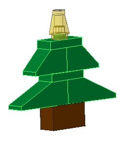
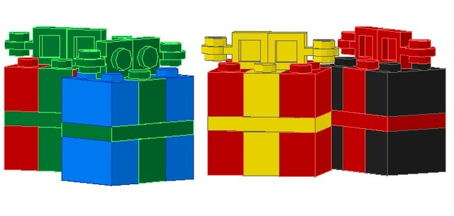

Voici quelques petites créations qui pourront occuper vos enfants pendant les fêtes.

En flanant sur le net, on peut trouver par ci par la quelques petites instructions de montages simples que pourront, avec un peu d’imagination, réaliser vos bambins à l’aide de leurs propres briques.

Le classique du genre en cette saison est le père noël. J’en ai trouvé trois pour vous sur BrickShelf :

**–** [Père noël 1](http://library.brickshelf.com/cgi-bin/gallery.cgi?f=501)  
**–** [Père noël 2](http://library.brickshelf.com/cgi-bin/gallery.cgi?f=482)  
**–** [Père noël 3](http://library.brickshelf.com/cgi-bin/gallery.cgi?f=452)

mais c’est encore mieux si le père noël est accompagné de son rêne :

**–** [Père noël avec rêne 1](http://library.brickshelf.com/cgi-bin/gallery.cgi?f=454)  
**–** [Père noël avec rêne 2](http://library.brickshelf.com/cgi-bin/gallery.cgi?f=502)

le bonhomme de neige

**–** [bonhomme de neige 1](http://library.brickshelf.com/cgi-bin/gallery.cgi?i=4641)  
**–** [bonhomme de neige 2](http://library.brickshelf.com/cgi-bin/gallery.cgi?f=580)  
**–** [bonhomme de neige 3](http://library.brickshelf.com/cgi-bin/gallery.cgi?f=499)

est un grand classique ainsi que

[l’ange](http://library.brickshelf.com/cgi-bin/gallery.cgi?f=500) ou les [lutins](http://library.brickshelf.com/scans/1000/1980/)

enfin avec un brin d’imagination vous pouvez créer de jolis petits paquets cadeaux colorés :

