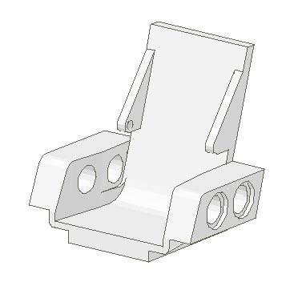
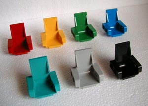
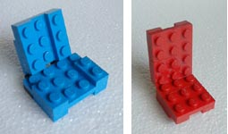
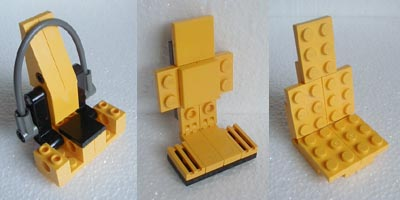
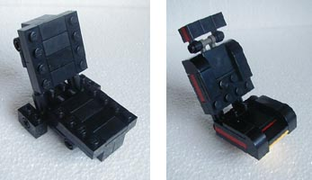
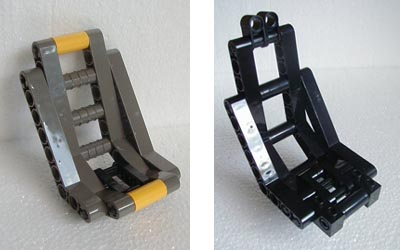
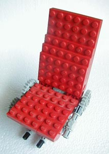

Nous allons tenter d’étudier au fil des jours quelques pièces LEGO®

Pour cette première étude, nous allons nous intéresser au siège Technic.

Elle porte le numéro 2717. Son nom (anglais complet) est "Technic Seat 2x3 Base"

Cette pièce est apparue en 1986 (Source : [Peeron](http://www.peeron.com/)) dans la gamme des sets Technic ["Arctic Action"](http://www.peeron.com/inv/theme/LEGO_TECHNIC/Arctic_Action).

Elle est toujours d’actualité. On la retrouve dans ce set de 2003 : [Rescue truck 8454](http://www.peeron.com/inv/sets/8454-1)

Elle a été produite depuis en 8 couleurs : Les très classiques noir, bleu , gris, rouge, jaune. Cette pièce n’est disponible en vert que dans le "Spy runner" ([8213](http://guide.lugnet.com/set/8213)) et en blanc uniquement dans le "Barcode multi-set" ([8479](http://guide.lugnet.com/set/8479)). On retrouve aussi la couleur turquoise dans deux sets.

Ce qui fait de cette pièce une pièce Technic® est la présence des trous latéraux (dans les accoudoirs) qui permettent un [montage](http://library.brickshelf.com/cgi-bin/gallery.cgi?i=15473) avec les différentes chevilles Technic®. Un [montage](http://library.brickshelf.com/cgi-bin/gallery.cgi?i=11824) plus classique par la base 2x3 est aussi possible et même plus souvent utilisé.

Cette pièce est une [métapièce](http://www.freelug.org/article.php3?id_article=271) : on peut utiliser des montages de plusieurs pièces pour modéliser les sièges. Voici des exemples

que vous trouverez dans ces sets : [8857](http://library.brickshelf.com/scans/8000/8857-1993/8857-26.html) et [8844](http://library.brickshelf.com/scans/8000/8844/8844-07.html)

sont des modèles de sièges un peu plus grands : [8445 (modèle secondaire)](http://guide.lugnet.com/set/8445) et [8428](http://guide.lugnet.com/set/8428)

sont nettement plus imposants mais pourront vous être utiles : [8859](http://library.brickshelf.com/scans/8000/8859/8859-08.html) et [4404](http://guide.lugnet.com/set/4404)

sont dans la catégories encore au dessus pour ceux qui voient grand : [8466](http://guide.lugnet.com/set/8466) et [8448](http://guide.lugnet.com/set/8448)

est sans doute le plus complet des sièges Technic&reg (réglage avant/arrière et inclinaison du dossier : [8860](http://library.brickshelf.com/scans/8000/8860/8860-01.html)

PS : On note que la couleur turquoise est appelé "Teal" par Peeron mais que Bricklink note une turquoise claire et une turquoise foncée. Je n’ai pas été en mesure de déterminer la correspondance entre ces dénominations et dans quels sets apparaissent ces nuances de turquoise.

Ndr :

Vous êtes membre de FreeLUG et vous souhaitez faire un article de présentation d’une (ou plusieurs) pièce particulière ? Contactez-moi !

Vous n’êtes pas membres de Freelug ? Adhérez, c’est simple :-)
