Il existe plus de 250 plaques de base différentes sans même prendre en compte les variations de couleur. Il faut dire que ce type de pièce existe maintenant depuis plus de 35 ans. Laissons nous guider dans un tour d’horizon de ces pièces un peu vite oubliées.

**Définition :**

Les plaques de bases sont des pièces de grandes tailles (au moins 16 tenons de large, quelques rares exceptions sont en 8) et dont l’épaisseur est moitié de celle des plaques. [^1]

Les plaques de base sont souples, conséquence de leur faible épaisseur. Elles semblent gauffrées.

Les plaques de base ne peuvent s’emboîter avec d’autres éléments que sur le dessus car, faute d’épaisseur, les tubes sous la plaque ne sont que très partiellement formés. Elles sont généralement plates, quelques unes sont en relief, comme embouties.

Leurs dimensions, normalisées à 8,16, 32 ou 48 tenons, permettent de combiner ensemble ces plaques de bases pour créer de grandes surfaces sans laisser de vides.

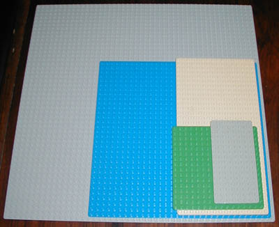

Certaines plaques de bases ont des dimensions non standard (10, 14, 20, 25, 40, 50) mais elles sont anciennes (avant 1978) et leur durée de commercialisation a généralement été courte.

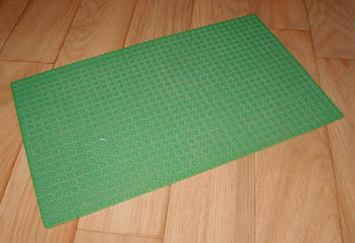

Plaque de base 24x40

|  |
| --- |
| Le saviez vous ? |
| "Plaques de base" se dit "Byggepladen" en danois, et c’est d’ailleurs le nom qu’on choisit les fans danois pour leur [site web](http://www.byggepladen.dk/) |

**Court retour dans le passé**

En remontant dans le temps, on découvre les "ancêtres" de nos plaques de base "modernes" :

**–** [912](http://www.peeron.com/inv/parts/912) : 1968  
**–** [811](http://www.peeron.com/inv/parts/811) : 1968

Elles ont la particularité de ne pas être entièrement recouverte de tenons. Seules des zones prédéterminées pour servir de base au montage du modèle en sont pourvues. Le placement des briques en est facilité.

D’autres sont entièrement couvertes mais le positionement est là encore facilité par un marquage en blanc, ce sont les "[dots pattern](http://www.peeron.com/cgi-bin/invcgis/psearch?query=baseplate+dots+pattern&limit=none&anyword=0)" - schéma de points - qui sont la règle au début des années 70 (1969-1976). Elles sont pour la grande majorité vertes.

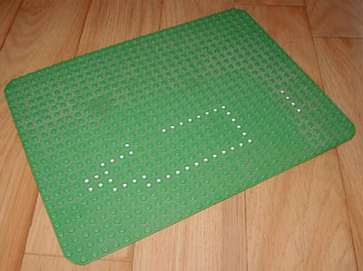

Parmi elles certaines ont des [coins arrondis](http://www.peeron.com/cgi-bin/invcgis/psearch?query=baseplate+rounded+corners&limit=none&anyword=0), notamment au tout début des années 1970.

Notons le retour d’une de ces plaques, la [367](http://www.peeron.com/inv/parts/367) dans un set assez récent, le [Technic Control Center (8094)](http://guide.lugnet.com/set/8094), pour servir de support à la table traçante. On remarquera qu’il s’agit sans doute du seul modèle où une plaque de base est montée en SNOT 180.

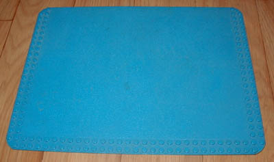

**Variation actuelle sur le thème**

Plus proche de nous, il existe une grande variété de plaques de base, chacune avec leur particularité :

**–** [les routes](http://www.peeron.com/cgi-bin/invcgis/psearch?query=baseplate+road+&limit=parts&anyword=0) sont un standard qui évolue régulièrement mais toujours dans l’idée de représenter les rues d’une villes ou les pistes d’atterissages.

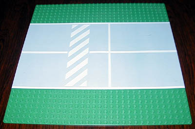

On retrouve régulièrement des routes droites, des carrefours ou intersections, et des courbes.

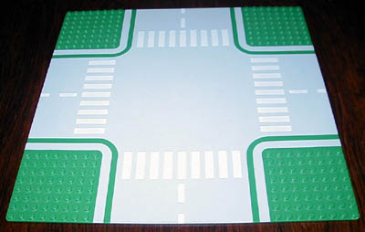

Mis à part [cette ancienne plaque originale](http://www.peeron.com/inv/parts/x1460px1) (1970) ce sont toujours des plaques de base 32x32.

**–** [les patterned](http://www.peeron.com/inv/parts/30225px3) - décorées - sont simplement des plaques de bases imprimées tout comme le sont certaines briques. Les impressions peuvent être des plus simples aux plus colorées.

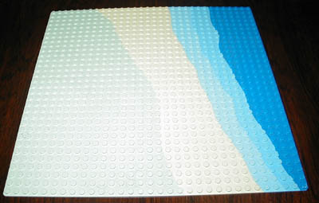

**–** La plaque de base [déchirée](http://www.peeron.com/inv/parts/30606px1) est une nouveauté de ce siècle (depuis 2000) et permet par exemple de simuler les effets d’un tremblement de terre.

**–** Les "raised" - en relief - présentent des élévations. Elles ont pour avantage de permettre de créer des montages donnant une impression de volume avec peu de pièces. Les raised sont souvent décorées, et font partie des plus grandes plaques de base (32x32 et 32x48).

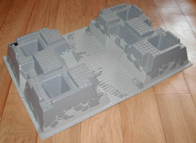

[1](http://www.peeron.com/inv/parts/6024px1) et [2](http://www.peeron.com/inv/parts/6024px4) sont strictement identique à la décoration près, tout comme celles-ci :

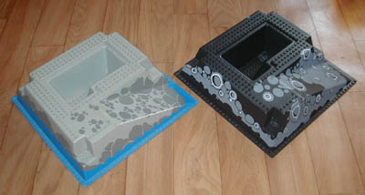

**Les plaques de base...de base**

Ce sont les plaques les plus simples, ont pourrait dire "normalisées", aux bords non arrondis, uniformes sans un dessin, entièrement recouvertes de tenons, sans élévations.

-   La 8x16 ([3865](http://www.peeron.com/inv/parts/3865))apparait régulièrement depuis 1978, surtout en vert et en gris.
-   La 16x16 ([3867](http://www.peeron.com/inv/parts/3867)) et 16x32 ([3857](http://www.peeron.com/inv/parts/3857)) apparaissent depuis 1977, nombreuses couleurs mais généralement vertes.

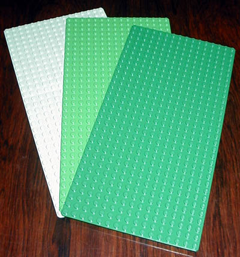

-   La 32x32 ([3811](http://www.peeron.com/inv/parts/3811)), depuis 1978, est principalement verte, grise ou bleue.

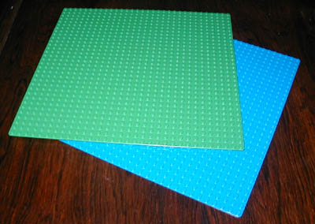

**–** La 48x48 ([4186](http://www.peeron.com/inv/parts/4186)), uniquement grise est courante car elle est disponible en tant qu’accessoire (elle est aussi incluse dans les sets "mosaïque").

On regrettait depuis 2000 l’absence de la couleur bleue de ces plaques de bases, dans le but de représenter les plans d’eau. La 32x32 est réapparue dans [un set Spiderman](http://guide.lugnet.com/set/4856) en 2004 et elle est depuis 2005 en vente en tant qu’accessoire.

**–** La 24x24 ([x1193](http://www.peeron.com/inv/parts/x1193)) , grise, datant de 1992, n’est pas considéré comme standard à cause de sa rareté.  
**–** La 50x50 ([782](http://www.peeron.com/inv/parts/782)), n’est apparue qu’une fois en 1965 (grise).

**Les plaques de bases populaires**

Outre les plaques normalisées qui sont populaires du fait de la standardisation de leurs dimensions, grâce à leur versatilité, les AFOLs apprécient aussi :

-   La plaque de base 32x32 avec cratères ([3947](http://www.peeron.com/inv/parts/3947)), plaque mythique de la série "Classic Space"

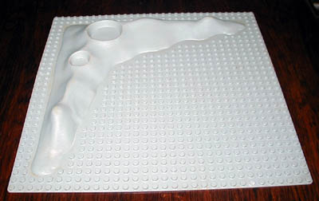

-   Les plaques de routes en général puisqu’elles permettent de constituer les rues des villes.

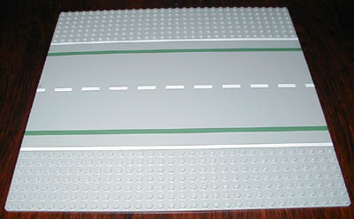

**Scala et Duplo**

Il existe des plaques de base pour les gammes Scala et Duplo. Je vous laisse les découvrir.

[Scala](http://www.peeron.com/cgi-bin/invcgis/psearch?query=baseplate+scala&limit=parts&anyword=0)

[Duplo](http://www.peeron.com/cgi-bin/invcgis/psearch?query=baseplate+duplo&limit=parts&anyword=0)

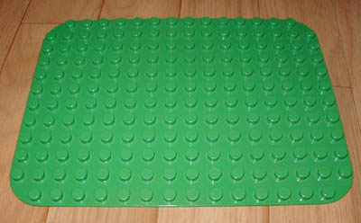

[^1]: On parle aussi parfois de plaques de base à propos des briques de grandes dimensions, telles que la [8x16](http://www.peeron.com/inv/parts/4204).
