Pour cette seconde étude nous allons quitter le Technic® pour le System®

Interessons nous à cette pièce :

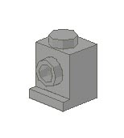

[4070](http://www.peeron.com/inv/parts/4070)

C’est la "Brick 1x1 with headlight" (Brique 1x1 avec feu).  
Cette brique porte aussi le nom de ["Brique de Erling"](http://news.lugnet.com/build/schleim/?n=3) du nom de son inventeur ; "brique machine à laver" en référence à son apparence ou encore "Brique 1x1 avec tenon en retrait sur le côté"

Elle est apparue en 1979 ou elle sert de support à des plaques 1x1 transparentes jaunes qui font office de feux avants sur un véhicule (c’est peut être l’origine du nom de cette pièce).

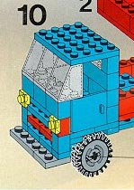

Depuis 1980 elle existe en rouge, jaune, bleu, gris, noir et blanc. Depuis 1998 elle apparait en gris foncé puis depuis 1999 en "tan" (beige).

D’autres [couleurs](http://www.peeron.com/inv/colortable/4070?ip=0) apparaissent épisodiquement et de manière plus anecdotique, par ordre d’importance : vert, orange transparent, brun, etc.

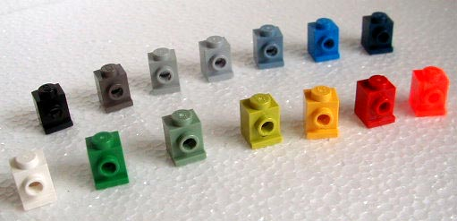

Cette pièce présente des particularités :

**–** Le tenon latéral est creux ce qui permet d’y insérer des barres.

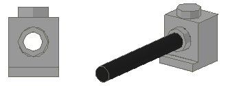

  
**–** Elle présente deux orientations perpendiculaires qui permettent de développer ce que les anglophones nomment le montage SNOT (montage dans lesquels les tenons sont orientés ailleurs que vers le haut).

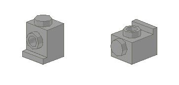

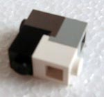

  
**–** Le placement du tenon latéral en retrait est calculé : la brique est épaisse comme 4/5 d’une brique classique ce qui correspond parfaitement à la hauteur de 2 plaques.

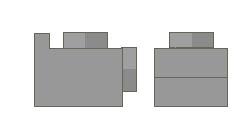

Vous pourrez créer avec cette pièce :

**–** Des calandres de véhicules

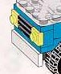

  
**–** Des parois à claire-voie

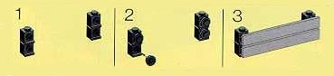

  
**–** Des supports pour les accessoires minifigs

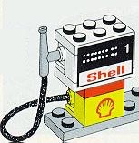

  
**–** et bien d’autres choses

Cette pièce peut éventuellement être remplacées par celles-ci :

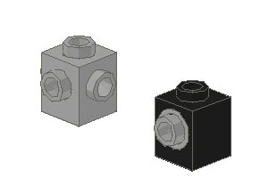
