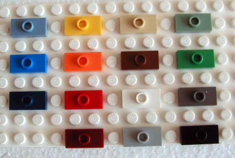
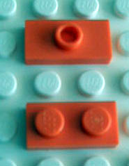
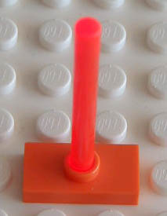
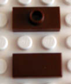

Pour cette étude encore une pièce curieuse. Nous allons nous attarder sur la "jumper plate" [3794](http://www.peeron.com/inv/parts/3794) (plaque de décalage).

Elle est apparue la première fois en 1977 en jaune et en blanc dans le set [588](http://library.brickshelf.com/cgi-bin/gallery.cgi?f=290). Elles sont produites depuis 1978 dans de [nombreuses autres couleurs](http://www.peeron.com/inv/colortable/3794?ip=0&header=1)

Contrairement à une plaque 1x2 classique, elle ne présente qu’un seul tenon sur le dessus, tenon placé au centre : il y a un décalage d’un 1/2 tenon.

Le décalage sert dans les sculptures comme le [darth maul](http://guide.lugnet.com/set/?q=10018_1&v=z) à avoir plus de douceur dans les courbes (deux écarts de 1/2 tenon au lieu d’un écart d’un tenon). Cette possibilité a été mis a profit dans la technic [SNIR, mur non aligné](http://www.brickshelf.com/gallery/Ben/train-town/House-at-the-coast/80_snir.gif)

Ce décalage d’un demi tenon permet aussi de faire des maquettes avec des dimensions impaires en gardant un centrage sur des structures paires (beaucoup de pièces LEGO® ont une dimension paire).

De plus le tenon de la jumper plate est évidé au centre. Cela permet d’y insérer des pièces verticalement comme les barres :

Enfin on peut voir la jumper plate comme une plaque lisse de 1x2 avec un tenon au centre. On s’en sert alors en combinaison avec des plaques lisses pour faire des liens faibles permettant, par exemple, de faire des toits de batiments qui se démontent facilement.

