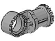
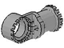
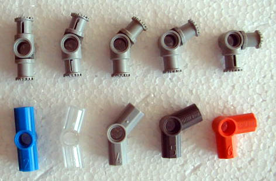

Nous allons nous intéresser au Technic Connector Toggle Joint Toothed ([4273](http://www.peeron.com/inv/parts/4273)).

En français on pourrait parler de connecteur genouillère à dents. Elle existe en fait dans deux versions légèrement différentes :

Cette pièce est apparue depuis sa première version en 1981, dans environ 80 sets. Uniquement grise, elle permet de raccorder deux axes Technic® suivant des angles prédéfinit de 90 ; 112,5 ; 135 ; 167,5 et 180 degré d’angle.

Par exemple dans le [8844](http://guide.lugnet.com/set/8844) elle permet de faire la structure complexe mais fragile du cockpit d’un hélicoptère.

Depuis 1997 cette pièce a été remplacée par la série des connecteurs d’angles, qui chacun remplace deux connecteurs à genouillère mais dont l’angle de raccordement est fixe.

Le connecteur à genouillère est fragile (les petites dents se cassent facilement) et les structures créés avec sont fragiles. C’est pourquoi les connecteurs d’angles qui le remplacent sont fort appréciés.

Toutefois, ce sont des pièces moins versatiles : il en faut 5 différentes pour couvrir les mêmes applications.  
De plus, les connecteurs d’angles existent dans une très grande variété de couleurs, inconvénient majeur dès lors que l’on souhaite construire des structures importantes en conservant une homogénéité de coloris.
