Vous connaissez tous le tenon qui orne les briques et qui vous permet de les emboiter. Mais d’autres éléments permettent de relier les pièces entre elles.

**Le tenon**

Revenons d’abord sur le tenon. C’est cette partie cylindrique et aplatie située sur le dessus des pièces LEGO® et qui souvent est ornée du nom de la marque.

Pour qu’ils puissent créer un emboîtement ils ont besoin d’une partie femelle. C’est pourquoi le dessous des pièces est évidé (plaques et briques 1x1). Sur les pièces plus grandes, pour une meilleure tenue de l’emboitement, des cylindres intercalaires de différentes tailles ont été rajoutés :

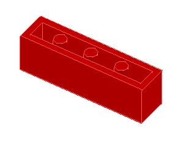

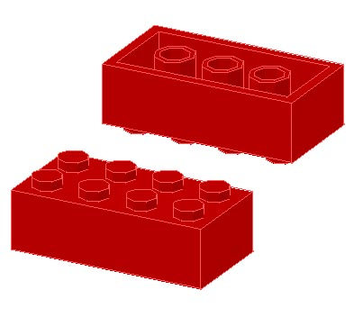

On trouve parfois un tenon de manière surprenante sur certaine pièce comme l’axe avec un tenon à une extrémité.

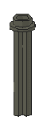

**Les liaisons System®**

_Clips et barres_

Une des pièces emblématique du système LEGO® est la minifigure (minifig). Les mains des minifigs sont de la taille d’un tenon mais elle présente un vide d’une taille inférieure. La liaison prévu pour s’y adapter est une "barre".

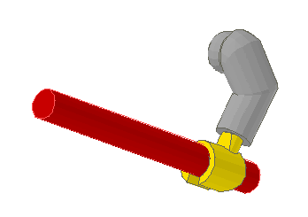

D’autre pièces similaire à la main des minifigs existent, ce sont les "clips".

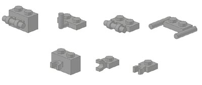

Les liaisons ainsi créés permettent un mouvement de rotation.

On remarquera que ces barres sont de la même taille que les cylindres intercalaires présents sous les briques 1xn.

_Les rotules_

Les barres et clips donnent un degré de liberté : c’est parfois insuffisant. Par exemple on peut souhaiter avoir un mouvement suivant deux axes de rotations pour une liaison entre un véhicule et une remorque, ou pour simuler une articulation (poignet). La société LEGO® à produit des pièces permettant une telle liaison :

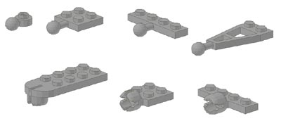

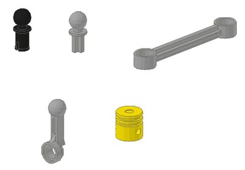

_les charnières_

Les charnières se présentent sous la forme de languettes qui s’interpénètrent. Les anciennes sont lisses et permettent une rotation selon des angles variés.

Note : De manière un peu inattendu, le levier constitue une charnière compatible avec les autres.

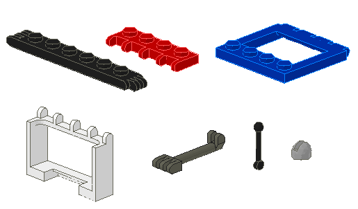

Les nouvelles ont des crans qui contraignent l’emploi de certaines valeurs d’angles prédéfinis. En contrepartie la position est plus stable. Ces nouvelles charnières sont aussi adaptées sur des briques et par uniquement sur des plaques.

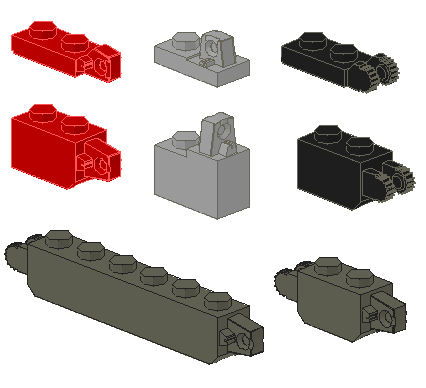

**Les liaisons Technic®**

Les pièces Technic® sont à l’origine d’autres emboitements.

_Le tenon_

Le tenon Technic® est légèrement différent. Comme le tenon System® il est de forme cylindrique et aplatie mais il présente un vide en son centre. Ce vide est d’un diamètre compatible avec les "barres" System®

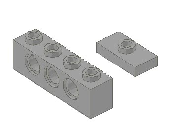

_Les chevilles_

Les pièces Technic® sont percées de trous perpendiculaires (briques et plaques) en décalage avec les tenons.

Ces trous servent principalement au passage des axes Technic® et des chevilles :

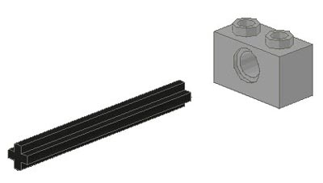

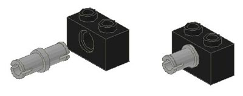

L’intérêt principal est de pouvoir faire des constructions plus complexes grâce à la diversification des possibilités de connexions, perpendiculairement à l’axe vertical (celui des tenons)

_Les axes_

Les axes peuvent se placer dans les trous Technic® et tourner librement. Mais l’on peut souhaiter avoir une liaison fixe en rotation. C’est le cas par exemple de la plupart des roues dentées mais aussi de la plupart des connecteurs qui présente un orifice en forme de croix.

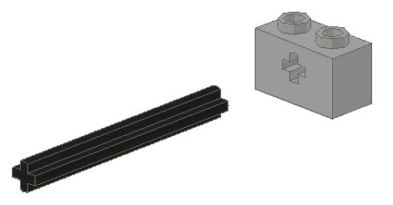

_Les rotules_

Tout comme avec le System® , la gamme Technic® dispose de rotule mais de taille supérieure. Elles ont de nombreuses caractéristiques communes. Les fans de Bionicle apprécie particulièrement ces pièces pour la construction de personnage.

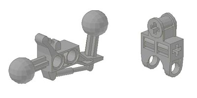

_Le Flex System_

Cet ensemble de pièces permet de transmettre un mouvement à distance à l’aide d’un "cable" enfermé dans une "gaine" (comme les cables de frein sur les deux roues). L’avantage principale est la [souplesse géométrique du système](http://library.brickshelf.com/scans/8000/8412/8412-09.html). Il n’a pas rencontré toutefois un grand succès car les dimensions standards disponibles sont peu nombreuses.

_Les petites dents inusitées_

Comme nous l’avons vu dans [Etude de pièce #4](http://www.freelug.org/article.php3?id_article=301) , ces pièces sont aujour’hui en grande partie disparue à cause de leur fragilité.

**Autres**

_Les aimants_

Ils sont principalement utilisés pour créer des liaisons temporaires entre wagons ferroviaires...mais on peut les utiliser pour maintenir joints des modules de superstructure comme l’[Imperial Star Destroyer](http://guide.lugnet.com/set/10030).

**Les liaisons dangereuses ;**

_l’AZMEP_

Comme nous l’avons vu les pièces sont pourvues en sous-face de cylindres intercalaires pour permettre un emboitement ferme des tenons entre ceux ci.  
Cependant dans certaines conditions il est possible d’imbriquer les tenons directemennt dans ces cylindres : les deux pièces ainsi imbriquées sont alors décalés. On parle alors d’un montage AZMEP (acronyme allemand signifiant "Aus Zwei Mach Eins Plättchen")

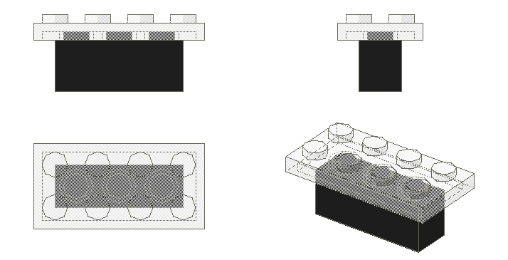

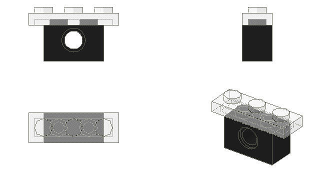

Le SNOT

Le trou Technic® à une forme et une taille compatible avec les tenon. On peut alors faire des montage curieux ou les tenons ne sont plus dirigés systématiquement vers le haut :

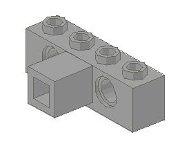

On appelle ce type de montage des montage SNOT (de l’anglais Studs Not On the Top - Les tenons pas sur le dessus).

Il existe une très grande variété de montage SNOT.

[Le TopLess](http://www.iltco.org/library/docs/TOPLESS_BM2004.pdf)

Le Topless consiste à imbriquer une plaque perpendiculairement à une autre en l’emboitant entre les tenons. Cette liaison, faible, est apprécié pour des éléments décoratifs, de préférences non structuraux. C’est une technique SNOT parmi d’autres.
