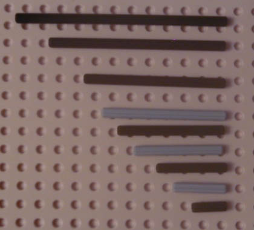
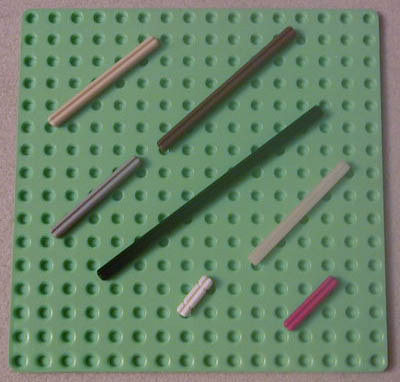

Pour cette étude, nous nous intéressons aux axes Technic™.

**Les axes Technic™**

Il existe une grande variété d’axes Technic™. Ce sont des pièces longilignes dont la section est une croix.

Leur taille se mesure en tenons (0.8mm). Il existe toutes les tailles d’axes de 2 à 8, ainsi que des axes de taille 10 et 12.

Il existe aussi, c’est beaucoup moins connu, des axes de taille supérieure (16 et 32) qui sont apparus en 2004.

La principale fonction des axes est de transmettre un mouvement de rotation (usage purement ’mécanique’ : essieu, réducteur, train d’engrenage...) mais ils peuvent avoir d’autres usages : éléments de structure, supports de connecteurs, éléments de liaisons fixes...etc)

Les axes étaient blancs translucides jusqu’à 1976-77 puis noirs depuis cette date. Afin de faciliter leur repérage, et ce depuis 2000, les axes de taille impair sont gris.

La plupart des tailles existent depuis la fin des années 1970 sauf l’axe de 5 (depuis 1998) et l’axe de 7 (depuis 2003)

Certains axes, employés dans certains sets comme décorations plus qu’en tant qu’éléments techniques, sont apparus depuis en d’autres couleurs :

**–** blanc en 1996 ([Space Shuttle](http://guide.lugnet.com/set/8480))  
**–** vert en 1997 ([Barcode multi-set](http://guide.lugnet.com/set/8479))  
**–** rouge en 1999 ([Super Street Sensation](http://guide.lugnet.com/set/8448))  
**–** brun en 2001 ([Sopwith Camel](http://guide.lugnet.com/set/3451))  
**–** tan en 2003 ([Saturn V Moon Mission](http://guide.lugnet.com/set/7468))

Après près de 20 ans sans changements, la société LEGO® nous a offert 6 nouvelles couleurs (avec le gris) en l’espace de 7 ans. Toutefois notre enthousiasme doit être modéré à la fois par le faible éventail de tailles proposées dans ces couleurs aujourd’hui :

**–** le tan en 6 uniquement  
**–** le brun en 4 et 8  
**–** le vert en 4,10 et 12

et par le très faible nombre de sets qui contiennent ces couleurs et donc au final la très faible disponibilité de ces pièces :

**–** le tan :

-   4 axes dans le [Saturn V Moon Mission](http://guide.lugnet.com/set/7468)

**–** le brun :

-   10 axes de 4 ([Sopwith Camel](http://guide.lugnet.com/set/3451))
-   5 axes de 8 ([Sopwith Camel](http://guide.lugnet.com/set/3451) et [Scary Laboratory](http://www.peeron.com/inv/sets/1382-1))

**–** le vert :

-   9 axes de 4 ([Barcode multi-set](http://guide.lugnet.com/set/8479) et [Republic Gunship](http://www.peeron.com/inv/sets/7163-1))
-   7 axes de 10 ([Barcode multi-set](http://guide.lugnet.com/set/8479))
-   1 axe de 12 ([Barcode multi-set](http://guide.lugnet.com/set/8479))

En guise de conclusion, rappelez vous aussi des nombreuses variantes :

**–** [axes avec tenon](http://www.peeron.com/inv/parts/6587)  
**–** [axes avec arrêt](http://www.peeron.com/inv/parts/32209)  
**–** [axes flexibles](http://www.peeron.com/inv/parts/32199)

que nous oublions trop souvent alors qu’ils peuvent remplacer avantageusement les axes classiques dans certaines applications.
